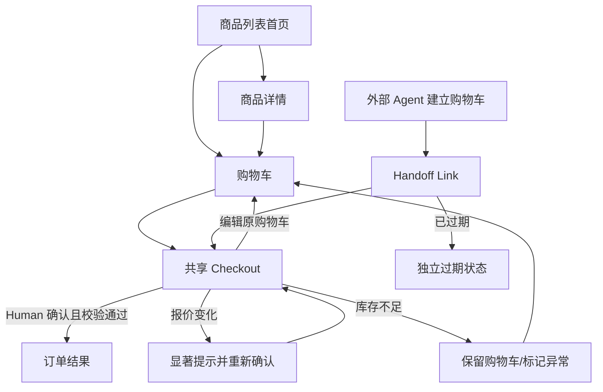

# Agent-Ready Store · UI/UX 设计决策记录

> Status: **Accepted decisions, pending repository persistence**  
> Source: 本次 Human + ChatGPT 多轮 UI/UX 讨论。此文件为讨论结论整理，不声称已写入 Codex 仓库、进行用户研究或实现测试。  
> 重要：业务语义以仓库中最新 `REQUIREMENTS.md` 与已批准的产品 `DECISIONS.md` 为准；若产生冲突，须报告而不是自行覆盖。

## 决策边界

本文保存已确认的 UI/UX 方向、备选与理由。具体字体、数值化 Design Tokens、响应式断点、每种组件尺寸、图片策略及最终页面文案仍属于下一阶段 Design Draft；除非另有明确确认，不应标记为已批准。

## 总体页面和路径

**页面职责**：列表负责发现；详情负责理解商品和评论；Cart 负责编辑；Checkout 负责核对并确认；订单结果负责反馈。Human 与 Agent 共用 Checkout，不做 Agent 专属结账流程。

## UX-01 · 首页信息架构

- **Status**：Accepted（对话中由 Human 确认）
- **最终选择**：C · Catalog-first 首页
- **讨论过的方向**：品牌营销型首页 / 纯商品列表 / 轻量品牌区＋商品目录
- **有效设计要求**：首页保留克制的品牌介绍，搜索、筛选、排序与商品网格为主体。无需独立营销 Landing Page。
- **主要取舍**：兼顾商品发现效率与视觉完成度，避免大幅增加营销内容制作成本。

## UX-02 · 商品详情

- **Status**：Accepted（对话中由 Human 确认）
- **最终选择**：A · 独立详情页
- **讨论过的方向**：独立详情页 / 快速预览弹窗 / 侧边详情面板
- **有效设计要求**：独立页面展示商品身份、价格、规格、库存或可购买状态、评论概览与评论分页。首页可保留轻量快捷加购。
- **主要取舍**：避免在有限空间中承载复杂规格和分页评论，页面职责更清楚。

## UX-03 · 购物车形态

- **Status**：Accepted（对话中由 Human 确认）
- **最终选择**：B · 独立 Cart Page
- **讨论过的方向**：购物车 Drawer / 独立页面＋轻反馈 / Drawer＋独立页面
- **有效设计要求**：加入购物车后使用轻量反馈，不强制跳转；通过顶部入口打开独立购物车，处理数量、移除和异常状态。
- **主要取舍**：减少多处购物车编辑 UI 的重复与同步负担。

## UX-04 · Agent Handoff 入口

- **Status**：Accepted（对话中由 Human 确认）
- **最终选择**：B · 直达共享 Checkout
- **讨论过的方向**：先到购物车 / 直达共享 Checkout / Agent 独立交接页
- **有效设计要求**：Agent 生成的 Handoff Link 直接进入普通购物共享的 Checkout，展示完整订单摘要和编辑入口；最终由 Human 明确确认。
- **主要取舍**：减少不必要跳转，保持同一套结账行为和授权边界。

## UX-05 · Checkout 编辑

- **Status**：Accepted（对话中由 Human 确认）
- **最终选择**：B · 返回原 Cart 编辑
- **讨论过的方向**：Checkout 内联编辑 / 原 Cart 编辑后返回 / Checkout 仅改数量
- **有效设计要求**：Checkout 的订单摘要原则上只读；编辑入口打开当前对应购物车，编辑完成回到 Checkout 并重新报价。Agent 来源与购物车身份必须保留。
- **主要取舍**：复用购物车管理能力，避免 Checkout 承载完整购物车编辑职责。

## UX-06 · 导航与响应式

- **Status**：Accepted（对话中由 Human 确认）
- **最终选择**：A · 顶部导航＋响应式
- **讨论过的方向**：统一顶部导航 / 移动端底部 Tab / 侧边导航＋移动菜单
- **有效设计要求**：桌面与移动端共用信息架构；顶部保留品牌、搜索、购物车入口。桌面商品网格和 Checkout 可更宽，移动端按空间重排，Checkout 优先单栏。
- **主要取舍**：简化导航，突出当前只有少量一级功能的购物闭环。

## EX-01 · 报价变化

- **Status**：Accepted（对话中由 Human 确认）
- **最终选择**：Checkout Inline Alert＋再次确认
- **讨论过的方向**：页内提示 / 模态弹窗
- **有效设计要求**：Checkout 页面内显著展示报价或关键购买内容的变化，更新明细，要求 Human 再次确认；不得按新结果静默成单。
- **主要取舍**：避免不必要弹窗，同时保留可见的报价上下文。

## EX-02 · 库存不足

- **Status**：Accepted（对话中由 Human 确认）
- **最终选择**：保留购物车、标记问题商品
- **讨论过的方向**：保留并提示 / 直接跳转购物车
- **有效设计要求**：保留现有 Cart，定位并标注缺货或不可购买商品，提供编辑入口；不删除商品、不自动部分下单。
- **主要取舍**：符合整笔购买成功或失败的业务决策，便于用户恢复。

## EX-03 · Handoff 过期

- **Status**：Accepted（对话中由 Human 确认）
- **最终选择**：独立过期状态
- **讨论过的方向**：独立状态 / 回首页 Toast
- **有效设计要求**：旧链接不可继续 Checkout；单独说明过期，并提供返回商城或重新发起 Agent 购物的指引。
- **主要取舍**：清晰揭示访问失效，避免误导用户继续购买。

## WF-01 · 原型覆盖

- **Status**：Accepted（对话中由 Human 确认）
- **最终选择**：A · 5 个 Wireframe＋3 个视觉稿
- **讨论过的方向**：5+3 / 全部桌面移动双线框 / 仅三个关键线框
- **有效设计要求**：五个核心页面：列表首页、详情、购物车、Checkout、订单结果；三张代表性视觉稿：列表首页、详情、Checkout；异常状态用局部状态稿。
- **主要取舍**：覆盖关键业务链路，控制重复制作成本。

## V-01 · 视觉语言

- **Status**：Accepted（对话中由 Human 确认）
- **最终选择**：黑白极简 Monochrome Minimal Commerce
- **讨论过的方向**：Editorial Minimal / Modern Commerce / AI Futuristic；最终调整为黑白极简
- **有效设计要求**：以白、黑、灰、排版、留白和细边框为主，突出商品与价格，高对比强调主要操作；必要语义色仅用于状态表达，不单靠颜色区分。
- **主要取舍**：符合偏好的清爽对话式视觉语言，避免 AI 风格装饰干扰购物。

## V-02 · 设计稿形式

- **Status**：Accepted（对话中由 Human 确认）
- **最终选择**：HTML + CSS
- **讨论过的方向**：静态图片 / 设计工具 / HTML-CSS
- **有效设计要求**：用可渲染的 HTML/CSS 提供线框和代表性视觉稿，可做必要状态切换及响应式预览；不连接真实业务服务，不成为第二套商城。
- **主要取舍**：直观可看，利于评审和复用视觉规范，避免把原型变成重复开发。

## UI-01 · 界面语言

- **Status**：Accepted（对话中由 Human 确认）
- **最终选择**：仅繁体中文 zh-TW
- **讨论过的方向**：繁体＋英文切换（曾提出并确认）→ 仅繁体（最新修订）
- **有效设计要求**：商城系统 UI 文案使用繁体中文，保留商品 Mock 原始字段内容；不做语言切换、翻译服务或国际化资源管理。
- **主要取舍**：跟随本次题目与 Mock 数据语言，降低超出作业必要范围的实现成本。

## QA-01 · 验收策略

- **Status**：Accepted（对话中由 Human 确认）
- **最终选择**：人工 Design Review＋关键自动检查
- **讨论过的方向**：仅人工 / 人工＋关键自动化 / 全面视觉回归
- **有效设计要求**：人工审阅布局、视觉层级、状态与交互；关键用户流与基本响应式做自动化检查；不强制建设大型视觉回归矩阵。
- **主要取舍**：兼顾可信交付与时间约束。

## DS-01 · 设计入口

- **Status**：Accepted（对话中由 Human 确认）
- **最终选择**：单一 HTML Design Preview
- **讨论过的方向**：分散预览 / 单一入口
- **有效设计要求**：一个可直接打开的设计展示 HTML，含 5 个线框、3 个视觉稿、异常状态、Tokens 与导航。与最终 Project Showcase 分开。
- **主要取舍**：便于 Human Review 和后续 Codex 理解，避免散落的设计资产。

## 设计资产交付约定

- `PRODUCT_DESIGN.md`：信息架构、用户流程、交互、状态、视觉规范、响应式及设计验收的结果型文档。
- **Design Preview**：独立可查看的 HTML/CSS 入口，含五个 Wireframes、三个 Visual Mockups、三个已确认关键异常状态和简洁 Tokens。
- **Project Showcase**：最终交付 Presentation 中心，另行生成；链接真实产品、真实 Agent Demo、过程设计与测试证据，不与 Design Preview 混同。
- 原型不是商城实现；不得用演示状态代替真实业务状态，不得声称测试已完成。

## 仍待细化（不视为已批准设计）

- 具体字体、颜色值、间距、圆角、容器宽度与图标资产。
- 断点、商品网格列数、细节动效与组件实现。
- 示例图片来源与缺失时的占位策略。
- 各种异常页面的最终文案和无障碍细节。
- 单个页面的具体 HTML/CSS、状态预览与最终视觉稿。

## 下一步（尚未执行）

由 Human Review 本记录；再交给 Codex 对照仓库最新版 Requirements 检查冲突并持久化。之后生成 Product Design Draft 与设计预览，再经 Human Review 批准。此文档生成行为不构成仓库已更新或设计稿已批准。
