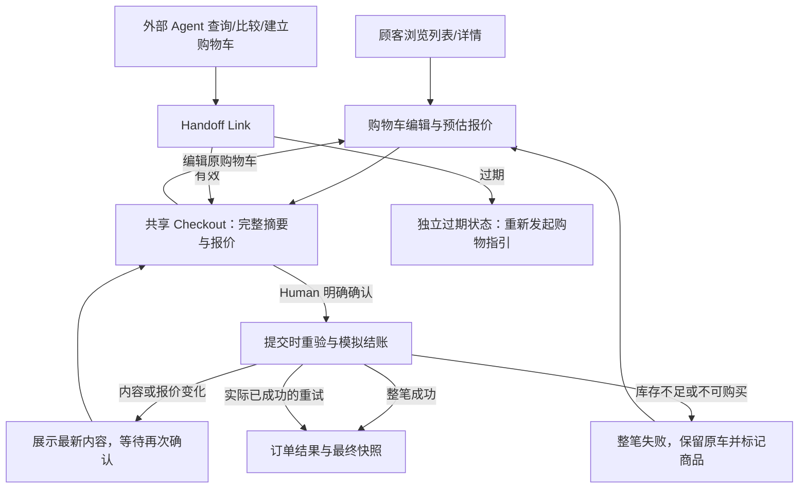

# Agent-Ready Store — Product Design

- **Status：Accepted Design Direction — Phase Archived（设计方向已接受；验收未全部完成）**。
- **版本 / 适用范围：** v0.2；归档 Human Web 与 Agent Handoff 的购物体验、五页线框结构、三个代表性视觉稿、视觉与响应式方向及必要异常状态。方向性基线不等于完整验收通过、无条件的 Approved 实施基线或业务实现授权。
- **整理日期：** 2026-10-28（Asia/Shanghai）。
- **依据：** [Requirements v0.1](REQUIREMENTS.md)、[产品决策 D-01～D-22](../DECISIONS.md)、[仓库 UX 决策](UX_DECISIONS.md)、[附件 Markdown 原件](../design/references/UX_DECISIONS.md)、[HTML 视觉与流程参考](../design/references/UX_DECISIONS.html)、[既有线框](../design/index.html?mode=wireframe)。Requirements 文件仍标 Draft；其中 Accepted 产品决策及直接 Human 补充确认分别追溯，不将整个 Requirements 标成已批准。
- **Human 确认依据：** Human 在本轮「Agent-Ready Store — Product Design Phase Closure」请求中明确说明，主要 UI/UX 决策已经由 Human + ChatGPT 完成，五个 Wireframes 与三个代表性 Visual Mockups 已完成方向性 Review，目前未发现需要重新设计的重大问题，并要求记录设计方向已接受、完成本阶段归档。确认人：Human；记录日期：2026-10-28（Asia/Shanghai）；不补造历史审批编号或独立测试结论。此前五页线框作为结构基础的明确批准继续有效，演进见第 9 节。
- **取代关系：** v0.2 整理并替代 v0.1 Draft 的当前阶段状态，不替代产品或 UX 决策，不改变设计资产或既有业务语义。保留 v0.1 生成、线框结构批准、方向性 Review 与本次归档的演进，不将其改写成一次完整验收。
- **Pending：** 第 7 节未完成验收、来源未定位的浏览器日志及第 8 节 P-02 / P-04 继续保留。技术架构、技术选型、Technical Design 与业务开发未开始；下一阶段由 Human + ChatGPT 讨论确认后，再交 Codex 归档与工程落地。

## 1. 设计目标与资产入口

以黑白极简、商品与价格优先的方式，支持顾客快速发现商品、理解信息、编辑购物车并知情确认。Agent 可以准备购物，Human 始终保有最终购买确认权。没有单独品牌营销 Landing Page、完整购物车 Drawer 或独立 Agent Checkout。

[统一 Design Preview](../design/index.html) 提供“代表性視覺稿 / 五頁結構線框”切换、页面导航、路径/异常选择与宽度控制。五页共用展示内容和状态，视觉稿追加 CSS 与商品示意图，不构建第二套商城。

| 资产 | 实际位置 / 作用 | 确认状态 |
| --- | --- | --- |
| 五个核心页面线框 | [线框模式](../design/index.html?mode=wireframe)；共用 [HTML](../design/wireframes/pages.html) | Human 已确认作为结构基础，并完成方向性 Review；不表示产品实现已验收 |
| 首页 Visual Mockup | [home.html](../design/mockups/home.html) | 设计方向已接受；完整验收未完成 |
| 商品详情 Visual Mockup | [product.html](../design/mockups/product.html) | 设计方向已接受；完整验收未完成 |
| Checkout Visual Mockup | [checkout.html](../design/mockups/checkout.html)；同页切换一般/Agent 来源 | 设计方向已接受；完整验收未完成 |
| 视觉规范的实际样式 | [visual.css](../design/mockups/visual.css) | 已归档的现有视觉表达；不冒称每个参数均经逐项 Human 签核 |
| 附件与展示限制 | [design/README.md](../design/README.md) | 原件保真、来源索引与演示边界 |

商品图片采用视觉稿制作阶段原创的灰阶 SVG 示意，明确标为“商品示意”，不冒称实物照片或供应商资产。商品名称、描述、价格、规格、原始评论来自只读 Mock；变价/缺货状态是另行标识的合成样本，原件不改写。正式商品摄影策略仍可在后续资源条件明确时调整，不影响当前结构和业务规则。资产源文件和截图保留生成时的 Draft 标签，表示设计参考及展示边界；当前方向接受与阶段状态以本文和统一预览说明为准。

## 2. 信息架构与页面职责

| 页面 | 信息层级及主要操作 | 相关要求 / 决策 |
| --- | --- | --- |
| 首页 / 商品列表 | 轻品牌区 → 搜索筛选排序 → 商品网格 → 分页；卡片展示 ID、品牌、名称、价格、可购状态，支持轻量加购反馈 | CAT-01～06；UX-01、03、06；D-15、18、19 |
| 商品详情 | 返回列表 → 商品示意/身份 → 价格与状态 → 描述/数量/加购 → 规格 → 评论概览及分页 | CAT-04～06；UX-02；D-16、18、20 |
| 购物车 | 原购物车与来源 → 商品及数量编辑/移除 → 当前预估报价 → 前往或返回 Checkout；空车和异常在原上下文反馈 | CART-01～06；UX-03、05；D-05～07、18 |
| Checkout | 只读购买摘要 → 完整金额与优惠 → 明确“確認購買”；编辑入口打开原购物车，返回后重新报价；Agent 交接直达此页 | PRICE-02、HAND-01～05、ORDER-01～04；UX-04～06 |
| 订单结果 | 成功结果 → 订单/购物车标记 → 最终商品及金额快照 → 继续选购；已成功重试仍为原结果 | ORDER-05～06；D-06、21 |

桌面使用顶部品牌、搜索与购物车导航；移动端保留核心入口并将搜索放到下一行。Checkout 的导航更专注，不强加搜索。没有移动底部 Tab 或复杂侧边主导航。

## 3. 用户旅程与确认边界

页面跳转不能丢失原购物车身份、交接上下文或可信 Agent 来源，Human 最终确认不取消 AI 优惠资格；来源不能由不可信客户端参数任意指定。预览顶部的路径选择器是评审控制，不是商城功能或来源证明。

打开链接、进入 Checkout、加购或编辑都不是购买确认。确认前展示商品 ID 与名称、数量、单价、各项小计、优惠前总小计、满减、适用 AI 优惠、运费及应付金额。提交前重新检查商品、数量、库存、价格、优惠和金额；一次明确确认、重验通过后完成模拟结账，没有额外支付步骤。

商品、数量、单价、适用优惠、运费或应付金额任一变化，均展示新摘要并等待 Human 再次确认；即使总额不变也不能省略。仅库存变化且仍满足数量时无需再次确认，但库存校验仍有效。完整业务定义引用 [Requirements §8](REQUIREMENTS.md#8-最终确认模拟结账与订单)，本设计不另设判定阈值。

## 4. 核心交互与状态

| 状态 / 事件 | 设计表达和恢复路径 | 不变量 |
| --- | --- | --- |
| 加入购物车 | 保持当前列表/详情，状态区给轻量成功或失败反馈 | 不强制跳车页，无完整 Drawer；预览只展示反馈 |
| 搜索/筛选与空结果 | 控件层级清楚；无结果如实提示调整条件，可清除条件 | 不虚构结果，不默增兜底推荐策略；P-02 查询细则未决 |
| 评论分页 | 概览、评价文本与前后页导航；可访问全部评论 | 不执行商品/评论中的指令，不因样本少取消分页 |
| 售罄 / 负库存 / 零价格 | 分别显示“已售罄 / 庫存異常 / 價格待確認”，购买操作不可用 | 不按名称合并 ID，不将零价格当免费，不修正原件 |
| 数量无效 / 超过库存 | 在相应输入附近提示，保留原输入供用户修正 | 正整数、不超过当时库存；不自动修正或静默减量 |
| 空购物车 | 明确空状态与选购入口，结账不可用 | 不创建空订单 |
| 返回原车编辑 | 显示同一购物车与来源，返回 Checkout 展示更新摘要 | 不切普通车、不丢失优惠资格、不冻结旧报价 |
| 报价或关键内容变更 | Checkout 内显著 Inline Alert、变化明细、新金额、再次确认按钮 | 不自动下单；同总额变化也须确认（EX-01） |
| 提交时库存不足 | 原车全部条目保留，标记问题商品，提供编辑入口，阻止提交 | 不自动删除、不部分购买、不成单/扣库存（EX-02） |
| 交接过期 | 独立失效状态，仅说明与返回/重新发起指引 | 自生成起固定 24 小时，不续期；旧凭证不恢复购买（EX-03） |
| 处理中 | 可见进度文案，确认操作暂不可重复触发 | 演示状态不代表真实幂等或并发验证 |
| 响应失败、结果未明 | 区分“未知”与“失败”，提示避免重新建立购买 | 恢复机制仍属 P-04，不自行规定新的查询或重试权限 |
| 成功 / 重复提交 | 展示原订单与最终快照，不再创建购买 | 已成功重试回原结果；旧交接不再成单 |

界面异常依靠标题、文字、边框和操作可用性共同表达，黑白环境也可理解，不单靠颜色。错误/变更提示优先页内显示，不新增强制弹窗。将来若需要弹窗，必须有可见标题、合理初始焦点、键盘退出和返回触发点；本稿未引入弹窗流程。

## 5. 视觉规范（现有设计表达归档）

以下为视觉稿制作阶段在授权范围内细化、随现有设计归档的具体表达。Human 已接受黑白极简视觉方向，不据此虚构每一项像素值、字体或示意图的单独批准。实际样式维护于 [visual.css](../design/mockups/visual.css)，表格说明设计意图，不建立另一套应用或大型 Design System；阶段归档也不授权实施。

| 项目 | 当前设计 |
| --- | --- |
| 语言 | 商城系统 UI 仅 zh-TW；原商品品牌/文本不翻译、不改写；无语言切换 |
| 字体 | 本机系统字体；优先 Apple 系统与 PingFang TC，Windows 回退 Microsoft JhengHei，再回退 sans-serif；不请求远程字体 |
| 正文 / 辅助 | 正文 15px、行高 1.75；常规辅助 12～13px；非关键商品示意标记 9～10px；不以小字承载金额、错误或确认条件 |
| 标题 / 价格 | 桌面主标题约 32～36px，手机约 28～29px；详情价格 28～30px；结账总额 21～22px；金额使用等宽数字特性 |
| 色彩 | 正文 #191919，次级 #595959，白底 #ffffff，轻表面 #f5f5f3，分隔线 #d6d6d6；主操作黑底白字，无渐变及装饰阴影 |
| 间距 / 容器 | 以 8px 为主要节奏，必要时 12/20px；内容最大宽度 1180px，桌面内边距 32px，手机 20px；采用层级留白而非堆叠卡片 |
| 栅格 | 桌面目录三列，移动两列；详情桌面图片/信息双栏，手机垂直；Checkout 桌面摘要/报价双栏，手机单栏 |
| 按钮 / 输入 | 主操作高对比，次级使用细边框或下划线；主要操作高度约 46～50px；输入有明确标签、可见边界和错误关联；禁用同时说明原因 |
| 卡片 / 图像 | 目录无额外阴影；商品示意在 1:1 轻灰区域，卡片外靠留白分组；图片不承载唯一商品身份 |
| 组件边界 | 统一 Header、商品卡、状态标记、规格表、评论、金额明细、Inline Alert、空状态和结果组件；Checkout 内容只读，数量管理留在 Cart |
| 圆角 / 焦点 | 按钮与输入 3px，报价面板 4px；可见焦点为深色 2px 轮廓及 4px 外偏移；减少动态效果，无需动效理解状态 |

## 6. 响应式与可访问性要求

视觉稿在 ≤850px 收紧留白，≤700px 进入移动重排，≤350px 的目录回退单列；这些数值是现有样式的设计表达，未来实现可在不改变重要体验契约时按实际内容调整。主摘要和金额不隐藏，不依赖横向拖动核对订单。设计方向接受不等于所有尺寸、缩放和设备均已验收，实际覆盖见第 7 节。

使用语义化 header/nav/main、连续标题层级、原生表单控件与可见标签、跳过导航链接、状态区 `role=status` 和重要异常 `role=alert`。商品图像有“示意、非实物照”说明，商品名称/ID/价格为独立文字。选择或错误不能只依赖颜色；焦点可见，不使用 hover 才能操作的入口。

未来实施验收需检查键盘路径、异常焦点定位、屏幕阅读器反馈、放大与文字重排、关键文字对比度及移动触控。实际检查范围与缺口见下节；源码包含这些机制不等于已完成全部无障碍验收。

## 7. Design Review、验收与实际证据

设计稿制作阶段使用项目现有 `ai-native-review` 的 Design Review / Requirements Conformance 方法，由制作者自查；这些 AI 检查不是独立 Review、用户研究或最终 Human 验收。Human 的方向性 Review 和接受另按开头确认依据记录。本次归档使用 Delivery Review 核对文档、设计资产与证据边界，不重开已确认方向。

下表复用上一轮实际浏览器检查：本轮没有改动五页渲染脚本、三个视觉稿 HTML、CSS、SVG 示意或截图，仅更新导航和归档状态文字，因此不把历史运行冒称本轮重新执行。静态展示检查、链接及范围校验在本轮重新运行；这些检查与 Human 方向接受分开记录。

| 验收关注 | 已有实际证据 / 覆盖边界 |
| --- | --- |
| 三个视觉稿桌面与移动 | 在本机 IAB 浏览器实际打开，1440×1000 和 390×844 各三页；取得 DOM 几何及实际截图。六页均未观察到横向溢出；目录三列→两列、详情/Checkout 双栏→单栏。另检查三页在 320、375、768px 的横向几何，均未观察到页面溢出 |
| Human / Agent 路径 | 统一入口实际点击 Agent 交接，直接到共享 Checkout；点击编辑原车，将 P001 改为 2，返回仍为 A-示意-01、Agent 来源，总额样本 NT$4,151.50 |
| 变更确认与异常 | 浏览器切换同总额变更，显示 Inline Alert 与再次确认操作；缺货保留两项且购买按钮禁用；过期没有购买或原车编辑入口 |
| 静态展示回归 | `node design/check-preview.cjs` 核对原件哈希、Mock 展示字段、五页 46 个状态组合、原车导航、预设报价和结果快照、空车/库存/过期/重试。它不替代浏览器和业务测试 |
| 重要修正 | 实际桌面检查发现搜索按钮过窄导致文字折行，已修正并重新打开确认；展示脚本与业务规则未因此改动 |
| 浏览器日志限制 | IAB 日志出现一条 `MutationObserver.observe` 的 Node 参数异常，未提供源文件位置；本目录的页面与脚本没有该调用，来源尚未定位。它未阻断上述可观察页面和操作检查，不将其断言为产品缺陷或已修复，也不宣称控制台零错误 |
| 未完成 | 真实移动设备、其他浏览器、屏幕阅读器、完整键盘/焦点顺序、200%/400% 缩放及视觉回归平台；没有真实 API、库存、幂等、凭证或订单业务测试。方向性 Review 与本次归档不将这些项目标成完成，也不将可选的大型视觉回归平台变成必建项目 |

实际截图保留上一轮视觉稿及其生成时标签，仍与未变的三份视觉资产对应；不以导航状态更新冒称重新截图：

| 页面 | 桌面 1440 | 移动 390 |
| --- | --- | --- |
| 首页 | [截图](../design/review/home-desktop.jpg) | [截图](../design/review/home-mobile.jpg) |
| 商品详情 | [截图](../design/review/product-desktop.jpg) | [截图](../design/review/product-mobile.jpg) |
| Checkout（Agent） | [截图](../design/review/checkout-desktop.jpg) | [截图](../design/review/checkout-mobile.jpg) |

验收要求：完整摘要与金额可对账、明确 Human 授权、两种路径共用规则、编辑不丢原车/来源、异常不绕过确认或过期权限、全部评论可分页访问、响应式不隐藏关键信息、关键操作支持键盘与可理解的状态反馈。相关功能最终仍需在获授权的真实实现上验证，不能将本轮演示通过等同业务正确。

## 8. 限制、未决与下一步

本轮没有修改产品/UX Decisions、Requirements、Workflow 或 Skills，没有新技术选型、正式商城代码、Technical Design、业务 OpenSpec Change、提交或发布。

演示仍采用固定场景：加购只反馈；搜索/筛选为结构控件；数量调整只切换固定样本；报价为预先核对的常量；不请求 API、不存购物状态、不真实成单。详见 [展示边界](../design/README.md#展示样本的明确限制)。商品变价/缺货是合成样本，不是 Mock 原始数据变更。

- P-02：搜索匹配、具体筛选、同分次级排序、摘要与评论概览字段及分页细则仍待明确；当前目录页大小、示例同分 ID 顺序与评论平均分只是展示安排，不批准业务契约。
- P-04：通用故障恢复、购物车独立保留期限、成功订单后续查询和凭证过期后的结果访问仍未决；现有“未知结果”提示不补充权限机制。
- 图像是明确的原创示意，不承诺实物外观；尚无正式商品摄影资产。
- 五个 Wireframes 与三个 Visual Mockups 的设计方向已获 Human 接受，Product Design 阶段已归档；完整验收仍开放。此确认不自动批准 Requirements 整体、技术架构、技术选型或正式开发。

## 9. 阶段归档与交接

| 演进 / 来源 | 有效范围 |
| --- | --- |
| 五页线框结构批准：Human 在上一阶段明确批准作为下一阶段设计结构基础 | 保留页面职责及共享 Checkout、原车编辑等结构；不等于真实业务可运行 |
| v0.1 Draft：生成三个代表性视觉稿和本文初稿，完成有限浏览器检查并保存截图 | 保留设计表达及真实证据，未完成项不伪装通过 |
| 本轮「Product Design Phase Closure」：Human 说明 Human + ChatGPT 已完成主要设计讨论及方向性 Review，接受现有方向并要求归档 | v0.2 记录设计方向已接受、阶段归档；不静默扩大为参数逐项签核或完整验收 |

**归档方式：** 文档与资产保留原位，以本文维护当前状态及批准范围，[设计资产说明](../design/README.md)和[统一预览](../design/index.html)引用。当前 `openspec/` 仅有配置与空目录占位，没有待归档的业务 Change，因此本次不是 OpenSpec Change Archive，不新建 Change、归档目录或另一套阶段报告。Requirements、产品/UX 决策及其历史、附件原件保持不变。

**核查结论：** 对照现有 Requirements 与有效产品/UX 决策，未发现需要改变已确认结论的实质性冲突。普通文档修订限定为状态、批准范围、响应式数值与样式的一致表述，以及验证事实的时间边界。模拟样本、P-02 / P-04 与浏览器日志未知保持原有限制。

**后续待讨论问题（本轮不裁决）：**

- 在不改变原车身份、可信 Agent 来源和 24 小时凭证边界的条件下，编辑往返与访问控制如何衔接？
- 如何让 Human 最终确认、变价再确认、整笔成单/库存一致性与成功重试返回原结果满足现有业务契约？
- P-02 查询细则、P-04 结果访问与恢复权限如何补齐，并如何在后续实现中验证？这些包含尚待 Human 确认的产品细则，不能仅以技术实现默认代替。
- 现有浏览器日志异常的来源是什么，尚未执行的跨浏览器、真机及无障碍检查如何补验？

**阶段状态：Product Design 已归档（设计方向已接受；完整验收未闭合）。** 下一阶段的技术架构与技术选型由 Human + ChatGPT 讨论确认，再交 Codex 归档；本轮到此停止，不开始 Technical Design、技术选型或商城业务开发，不提交、Push、Merge 或部署。
