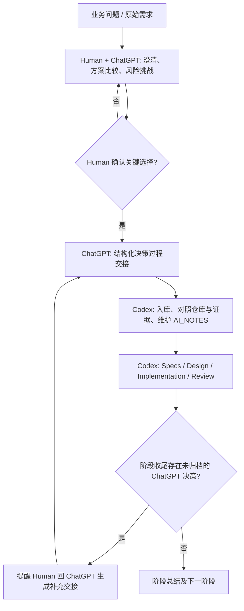

# Agent-Ready Store — AI 协作过程交接记录

> **状态**：Human + ChatGPT 讨论回顾草案，待 Codex 入库及证据核对  
> **日期**：2026-10-28  
> **用途**：补全 `AI_NOTES.md` 的上游协作证据，不替代 `DECISIONS.md`、`UX_DECISIONS.md` 或工程测试报告。  
> **证据原则**：以下记录依据 Human 与 ChatGPT 在本项目中的对话过程以及已交换的设计文档、Wireframe 文件整理；未附原始完整对话导出。凡未能从仓库验证的执行、测试、Git、Skill 迭代均不得写成已完成事实。

## 1. 协作边界与阶段流

本项目采用 **Human 决策负责 / ChatGPT 讨论与挑战 / Codex 归档、工程验证及实现** 的协作模式。

**权威来源分工**：`DECISIONS.md` 记录产品业务决定，`UX_DECISIONS.md` 记录 UI/UX 选择，后续 `TECH_DECISIONS.md` 记录技术选择；Requirements/Product Design/Technical Design 记录批准后的结果；`AI_NOTES.md` 记录协作过程中 AI 的贡献、Human 纠偏、验证和证据链。任何阶段性 AI Notes 均不能覆盖正式决策。

## 2. 关键时刻（候选案例）

以下四个案例均来自已发生的交流，可作为最终 `AI_NOTES.md` 中 **3–5 个关键时刻** 的候选材料。Codex 应与仓库现有 AI Notes 去重，并在补充下游工程案例时控制最终数量。每个案例的「证据」分为已经交接的材料和仍需查证的材料。

### Case 01 — 对 Agent 自动下单需求说“不”

**Context**：初始 PM 需求希望 Agent 创建购物车后直接下单；Handoff 永久有效，建车即保留 24 小时库存，并允许不公开的高毛利推荐分数加权。这些要求与消费者知情确认、可用库存及排序透明性形成冲突。

**AI contribution（ChatGPT）**：在需求分析对话中协助拆解业务目标与风险，比较自动化转化率、投诉风险、可审计性与权限边界；将产品需求转换成可明确批准的备选决策。

**Human intervention**：坚持 Human 最终明确确认；Handoff 链接仅在创建后固定 24 小时内有效；创建购物车不锁库存；推荐排序不使用隐蔽高毛利乘数。通过决策而不是直接复刻 PM 初稿来确定产品边界。

**Outcome**：确立 Agent 可准备购物车、Human 才能完成订单的路径，以及链接有效期、库存和排序透明度的约束。

**Evidence / traceability**：`references/home-quiz.md`（原始 PM 初稿）；`DECISIONS.md` 中 D-01～D-06、D-14～D-15；具体内容和当前编号须以现有仓库为准。

**Lesson**：AI 的价值不只是执行模糊需求；关键是提出冲突、暴露取舍，并让 Human 对业务风险承担决策责任。

### Case 02 — 将优惠规则和结账一致性从文字变为可检验约束

**Context**：全站满减、免运、Agent 折扣需要明确叠加顺序与舍入；提交瞬间还可能发生库存或价格变化、请求重复和成功响应丢失。

**AI contribution（ChatGPT）**：帮助分解计价顺序、确认时机、库存边界和幂等场景；将「重新报价」与「重新确认」拆成具体可验证的业务行为，并讨论订单是否允许部分成功。

**Human intervention**：确认商品满 NT$1,000 减 NT$100、免运以优惠前小计 NT$990 为门槛；Agent 5% 折扣应用于满减后的商品金额；订单级两位小数 HALF_UP 舍入；关键购买内容变化必须重新确认；整笔创建与库存扣减同步成败，已成交重试返回原结果。

**Outcome**：形成 Web 与 Agent 共用一套价格实现所需的产品语义，明确最终 Human 确认和重试行为。

**Evidence / traceability**：`DECISIONS.md` 中 D-06、D-09～D-13、D-21；后续实现与测试证据仍需 Codex 对照仓库补充。**本记录不宣称上述规则已经实现或自动测试通过。**

**Lesson**：对金钱、库存、授权的需求讨论，应交付可检验的边界和不变量，而非只留下高层描述。

### Case 03 — ChatGPT 设计决策到 Codex 可执行原型的跨工具交接

**Context**：UI/UX 曾通过多轮 ChatGPT 讨论，包含方案 A/B/C、流程图、结构示意和响应式取舍；Codex 无法天然获取完整对话与示意。

**AI contribution（ChatGPT）**：协助收敛 UX-01～UX-06、EX-01～EX-03、WF-01、V-01/V-02、UI-01、QA-01、DS-01；将文本决策与可视化参考整理成 `UX_DECISIONS.md` 和 `UX_DECISIONS.html` 两种交接材料。

**Human intervention**：选择 Catalog-first 首页、独立商品详情与购物车、共享 Checkout 与编辑原购物车、顶部响应式导航；坚持黑白极简及 HTML/CSS 原型；**撤回曾确认的繁中/英文切换方案，最终仅保留繁体中文**；不要求逐个微调线框细节，以重大偏差为 Review 重点。

**Codex handoff / observed artifact**：在交接后提供了五页 Wireframe 的设计预览相关文件，包括 `index.html`、`preview.js`、`preview.css`、`wireframes/pages.html`、`pages.js`、`styles.css`、`fixtures.js` 与检查脚本等文件供 ChatGPT 审阅；设计稿保留只读展示样本，不伪装真实结账。原仓库的具体目录、Commit 和测试结果应由 Codex 验证。

**Outcome**：建立「结构化 Markdown 供机器消费 + HTML 供人审查 + Codex 生成可渲染 Draft + Human 方向性 Review」的闭环。Human 表示五份 Wireframes 和三份代表性视觉稿未见明显重大问题，允许收敛设计；**这不等于所有浏览器/响应式/可访问性检查均已通过**。

**Evidence / traceability**：`docs/UX_DECISIONS.md`、可能存在的 `design/references/UX_DECISIONS.*`、`design/README.md`、`design/index.html` 与 `design/wireframes/*`（路径按仓库核验）；后续 `PRODUCT_DESIGN.md`。原始 UI/UX 交接 HTML/Markdown 的保存状态与版本需核查。

**Lesson**：跨工具协作不能只转交最终一句结论，图示与过程要结构化落地；也不能把静态检查冒充浏览器视觉验收。

### Case 04 — Human 纠偏 AI 的职责越界与 Review 成本

**Context**：设计阶段结束时，ChatGPT 曾建议让 Codex 直接提出技术方案并推进 Technical Design；另在 Wireframe Review 中曾倾向于逐页检查大量细节。

**AI contribution（ChatGPT）**：最初提出自动推进和细项审查建议，随后根据 Human 反馈重新整理协作职责及阶段门禁，形成更合适的归档/决策/验证节奏。

**Human intervention**：明确重申「关键技术决策必须先在 ChatGPT 讨论并由 Human 确认，Codex 再归档、验证与落地」；并表示不需要对所有 Wireframe 状态逐项手动检查，而应重点拦截真正影响购买安全、金额、Agent 权限或关键流程的问题。

**Outcome**：形成两项实践原则：**决策权不能因 AI 工具能力而下放**；**Review 应按风险分级，避免高成本的无差别细项审批**。

**Evidence / traceability**：本次 ChatGPT 交流总结；之后是否写入 `AGENTS.md` 或 Workflow 文档，由 Codex 检查，不得臆造已有 Git 证据。

**Lesson**：值得记录的 AI 协作案例包括错误建议被 Human 纠正，以及因此形成的流程约束。

## 3. 不应混淆的证据与状态

- ChatGPT 曾提出、被 Human 否决或撤回的方案，不应被记为 Approved。特别是 **UI-01 最终仅繁体中文**。
- Codex 的 README 中可能记录静态场景检查，但若无法复现真实浏览器渲染，不能写成完成了视觉或响应式验收。
- 目前这些 Case 是上游「讨论与决策」证据；**不冒充**已经完成的 Skill 迭代、CI、真实 Agent 购物 Demo、业务实现或 Git Commit。
- 当前 ChatGPT 讨论可能无法提供评审者可访问的原始消息链接；标记为「Human + ChatGPT 过程摘要」，以仓库文件、Git、测试输出作为可核验证据。

## 4. 后续迭代与补充建议

- 产品与 UX 阶段：本文件可作为首次上游 AI 协作记录交给 Codex，核对并合入 `AI_NOTES.md`。
- 技术决策阶段：每当 Human + ChatGPT 完成一批架构决策，补充「问题 / 方案 / 反例 / Human 选择 / Codex 验证」记录。
- 开发阶段：从实际 Codex Coding/Review 记录中优先挑选一次真实失败与纠正、一次 Skill/context 改进、一次真实测试或 Agent Demo 的关键时刻（如确实发生），替换掉重复或较弱的案例，使最终 `AI_NOTES.md` 保持 3–5 个高质量案例。
- 所有新增案例需标明发生阶段、提供者、可核验产物、尚未验证的事实和下一步动作。

## 5. 交接验收

Codex 入库时应：保留本文件原意；找到并核查上述证据；将少量有代表性的内容合并到现有 `AI_NOTES.md`，保留原有真实工程案例；分别标明 ChatGPT 与 Codex 的贡献；指出缺失的可验证证据。不得将本文件整篇机械复制成最终 3–5 个案例，也不得将「阶段总结」误标为「业务决策批准」。
