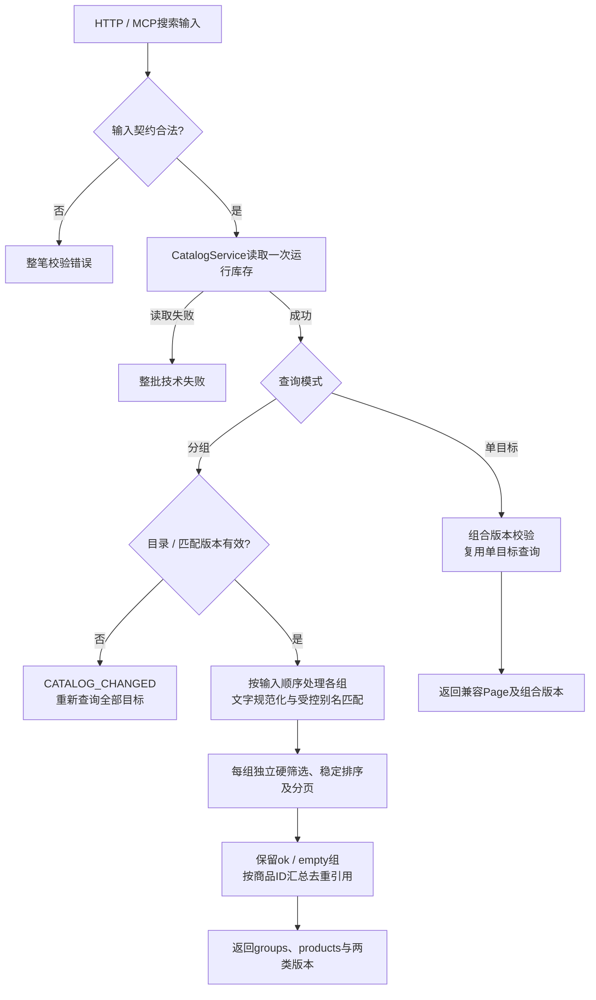
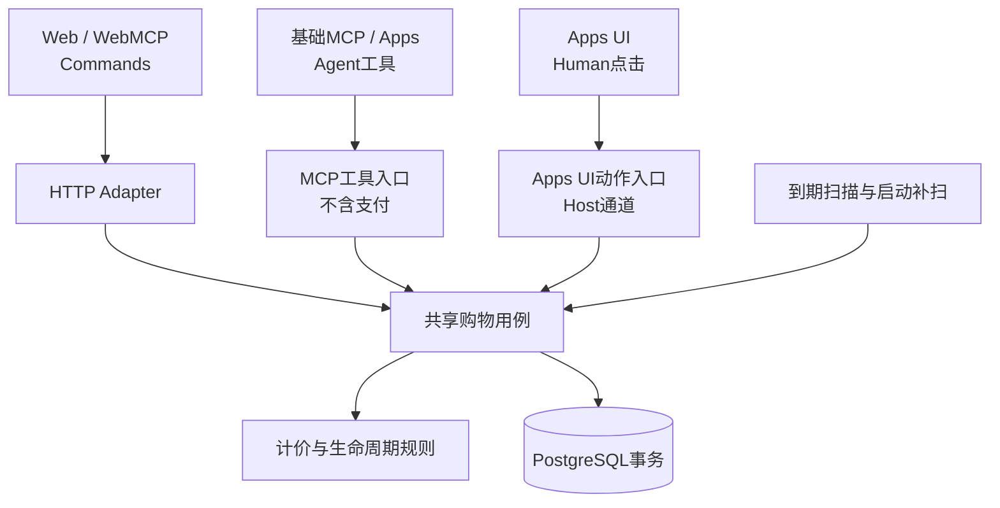

# 后端与运行详细设计

**范围与状态：** 2026-10-31 从原 Technical Design 按职责迁移；沿用[总体设计的状态、依据与批准范围](TECHNICAL_DESIGN.md)，不因拆分新增业务批准或声称全局基线整体 Approved。当前行为以正式 Spec 为准，变更理由见工程决策；本文维护当前设计，不维护实施任务或逐轮验证记录。

## 商品发现与运行数据

商品ID是唯一身份，同名商品仍分别展示和购买。列表提供必要摘要，详情提供基本信息、规格和评论概览，评论通过独立分页读完；描述和评论都只作为不可信文本。公开DTO排除毛利、推荐原始分数等内部字段，不直接传递原始目录对象。

Catalog在API生命周期内读取只读目录并建立进程内索引与revision，不新增Product/Review数据库表。原始stock仅用于初始化或异常溯源；运行库存始终来自Inventory，缺行时不可购买，不能回退原始stock。零库存、负库存、零价格等样本保真并解释原因，不静默修正为可售商品。预留启用后公开库存使用quantity减reservedQuantity，与订单自身的有效预留区分。

查询先执行确定性文本匹配及必要筛选，再按既定推荐分数降序、同分稳定ID顺序排列；不引入毛利加权、语义搜索或搜索服务。商品与评论均有界分页，非法参数明确拒绝。固定目录、库存和条件时结果稳定；翻页间可售量变化不承诺跨页快照，目录revision改变则重新开始，不拼接旧版本。参数和限值由[商品发现Spec](../../openspec/specs/product-discovery/spec.md)及contracts维护。

### 分组搜索与文字匹配

行为依据为[商品发现 Spec](../../openspec/specs/product-discovery/spec.md#requirement-多目标独立有界查询)；输入/输出定义唯一维护于[contracts](../../packages/contracts/src/index.ts)的 discoveryInput、groupedSearchInput 与 groupedSearchOutput。以下说明实现分工，不复制字段字典。

| 环节 | 当前实现与约束 |
| --- | --- |
| 入口与库存读取 | [CatalogService.discover](../../apps/api/src/catalog/catalog.service.ts)校验单目标/多目标互斥输入，一次读取运行库存后分派；HTTP和MCP复用服务，不创建搜索会话，不写车/订单 |
| 文字匹配 | [search-matching.ts](../../apps/api/src/catalog/search-matching.ts)对查询与字段采用NFKC、小写及OpenCC简繁归一；登记短语优先匹配，拉丁词检查边界，同义词组内任一匹配、查询词组间全部满足。未知词保留字面条件，不自动翻译或放宽预算/品牌/类别 |
| 独立目标与去重 | [Catalog.searchGrouped](../../apps/api/src/catalog/catalog.ts)逐组复用单目标筛选/排序，保留输入顺序和独立预算、分页；groups引用按商品ID去重的products，同名不同ID不合并。边界为1～5组、每组默认4项/最多10项，非法请求整笔拒绝 |
| 版本与续页 | 分组结果分别携带catalogRevision和searchRevision；后者由匹配规则版本、转换器与别名配置计算。续页携带两者，变化拒绝拼接并要求整组重新查询；旧单目标Page使用组合版本继续兼容。版本不固定运行库存，跨页可售变化仍可能移动页边界 |
| 失败语义 | 无匹配保留empty组；共享库存读取失败使整批失败，不伪造零库存。当前同步Catalog生成ok/empty；契约及UI还承接可独立识别的组error，不能据此宣称服务端已有逐组容错调度 |

图中“各组处理”复用同一单目标匹配实现，并非并行任务或新服务；单目标版本不匹配同样拒绝。共享库存故障在分组处理前终止，不把失败分组隐藏为empty。UI的组级重试见前端设计。

搜索结果的UI隔离与续页恢复由[前端分组搜索设计](FRONTEND_DESIGN.md#分组搜索的状态与交互)维护。规范化、别名边界、预算、版本、去重与一次库存读取见[grouped-search测试](../../apps/api/test/catalog/grouped-search.test.ts)；真实库存与零交易写入见[grouped-db测试](../../apps/api/test/catalog/grouped-db.test.ts)，跨HTTP/MCP一致性见[grouped-http测试](../../apps/api/test/catalog/grouped-http.test.ts)。执行证据统一见[质量验收链路](TECHNICAL_DESIGN.md#质量目标与验收链路)，测试文件存在不等于已执行。

## 后端、共享契约与运行保障

`apps/api`按Catalog、Cart、Order/库存生命周期与Pricing职责组织，复用同库事务；具体文件拆分服从现有消费者，不为每个职责建立服务或通用Repository。HTTP Controller与MCP Adapter处理协议输入、输出和错误映射，用例维护业务规则，Prisma承担持久化。

这里的“调度”有两层：Agent/UI按意图串联用例；服务端到期任务批量执行关闭用例。两者都不成为独立流程引擎，也不持有跨用户思考时间的数据库锁。

Apps UI动作与Agent工具是不同调用角色，即使复用Host传输，也不能把UI支付开放成Agent工具。图中的Adapter是逻辑入口，不表示新增进程、公共框架或强制包拆分。具体Host通道由入口适配器封装，不改变用例接口。

[完整交互链路](FRONTEND_DESIGN.md#56-关键交互如何贯穿各层)说明UI/Agent如何发起和恢复操作；本节只定义其依赖的用例、一致性和运行边界。前端的加载、选择和导航不进入数据库状态，服务端终态也不由页面请求顺序决定。

用例与一致性保障见[交易核心](CHECKOUT_CORE.md#61-用例与一致性边界)，原锁顺序与并发设计依据见[归档设计 §6](../../openspec/changes/archive/2026-10-31-checkout-lifecycle-redesign/design.md)，避免在每个入口复制。无Redis、队列或浏览器独占计时器；数据库是唯一交易事实来源。

持久化沿用[领域模型](CHECKOUT_CORE.md#2-领域与数据模型)实体，另保留必要的车操作幂等记录。交易不变量由[交易核心](CHECKOUT_CORE.md)维护；物理字段、完整锁序和验证反例的设计依据见[归档设计 §3、§5～6、§12](../../openspec/changes/archive/2026-10-31-checkout-lifecycle-redesign/design.md)。

### 实际模块与源码映射

Catalog、Cart、Order、Inventory、Pricing是逻辑职责；当前并无独立OrderModule、Inventory服务或McpModule。真实组装见[AppModule](../../apps/api/src/app.module.ts)及[main.ts](../../apps/api/src/main.ts)，不从领域名称推定部署或目录拆分。

| 实际入口 | 职责与依赖边界 |
| --- | --- |
| [CatalogModule](../../apps/api/src/catalog/catalog.module.ts) / [CatalogService](../../apps/api/src/catalog/catalog.service.ts) | 初始化目录及数据库连接，向Controller和CartModule提供CatalogService；Catalog承担只读投影/匹配，运行库存从数据库读取 |
| [CartModule](../../apps/api/src/cart/cart.module.ts) / [CartService](../../apps/api/src/cart/cart.service.ts) | 注入同一Catalog及数据库实例，集中承担车操作、报价、订单与库存生命周期；不拆出另一套订单事实 |
| [CatalogController](../../apps/api/src/catalog/catalog.controller.ts) / [CartController](../../apps/api/src/cart/cart.controller.ts) | HTTP输入、来源校验、通道派生与结果映射；业务规则调用服务，不在Controller重复计价或事务 |
| [attachMcp](../../apps/api/src/mcp/mcp.adapter.ts) | main从Nest取得CatalogService/CartService后挂载MCP；工具与Apps资源复用现有服务，接入参数见[MCP_CONNECT](MCP_CONNECT.md) |
| [pricing.ts](../../apps/api/src/cart/pricing.ts) | 唯一计价实现，被交易用例消费；精度与锁价约束见[交易核心](CHECKOUT_CORE.md#62-库存期限与计价事实) |
| [OrderExpiryWorker](../../apps/api/src/cart/order-expiry.worker.ts) | 生命周期定时调用CartService.expireOrders；业务裁决仍在服务事务内，不由worker自行释放库存 |
| [database.ts](../../apps/api/src/infrastructure/database/database.ts) / [contracts](../../packages/contracts/src/index.ts) | 前者提供持久化连接，后者提供共享校验与DTO；协议层返回公开投影，不能返回Prisma实体或把数据库连接带入前端 |

日志可定位到期扫描失败及失败orderId；库存积压、预留账实差异的只读检查入口见[交易核心运行段](CHECKOUT_CORE.md#数据库运行与隔离验证)。监控告警、备份恢复与生产SLA目前未形成交付保证，未来如纳入范围须明确目标与验证，不从已有日志推定具备完整运维能力。

### 运行拓扑与数据边界

| 运行环境 | 连接与职责 |
| --- | --- |
| 浏览器 | Web/WebMCP通过相对路径调用Next同源API转发；不直连数据库 |
| Next服务端 | RSC读取公开API，透明转发交易请求；API_INTERNAL_URL仅在服务端使用，不复制Nest用例 |
| NestJS | 同进程HTTP Controllers、Streamable HTTP MCP适配及Apps资源；调用Catalog/Cart/Order/库存与唯一计价用例，经Prisma访问PostgreSQL |
| Agent Host / Apps | 基础MCP直连API的`/mcp`；Apps经Host Bridge调用适配入口，不依赖网站Cookie或Next运行时 |
| 本机开发 | Web/API在本机Node运行，Docker只提供独立开发PostgreSQL；保留HMR与监听构建 |
| Compose交付 | Web/API使用生产构建，PostgreSQL不公开容器端口；目录只读挂载，数据库持久卷与开发环境分离 |

环境地址及启动命令见[运行入口](../../README.md)、[交付Compose](../../compose.yaml)和[开发Compose](../../compose.local.yaml)。初始化、迁移、seed与启动分离，重启不覆盖库存。数据库连接及服务端秘密不进入浏览器；本次订单重构不新增部署服务或公网发布要求。

### 共享契约与失败语义

[packages/contracts](../../packages/contracts/src/index.ts)是共享schema、DTO和错误定义的代码入口，OpenSpec是正式行为来源。新订单契约与保留的旧流程定义需区分使用，旧类型的存在不表示旧入口仍受支持；行为以适用正式Spec为准。HTTP envelope、MCP structuredContent与Bridge消息包装可不同，业务含义必须一致；不返回Prisma实体或原始JSON。

| 契约族 | 对消费者的承诺 |
| --- | --- |
| Product / ReviewPage | 公开字段白名单、可购买原因、目录版本与独立分页 |
| CartView | 服务端车ID、条目、版本与问题；存在问题行不阻止其他合法选择生单 |
| 选中Quote | 指定选择集合的无占用预估，与当前请求关联；金额与库存均不构成承诺 |
| OrderView / OrderLine | 同一原单的固定摘要、金额、状态、截止、可用动作及入口；终态与到期投影分开 |
| 操作结果 | 明确目标、请求恢复所需信息与权威快照；生单同时返回原订单和剩余车 |

金额以精确十进制计算，对外以十进制字符串表达。商品折后金额在订单级舍入，AI优惠展示额从已舍入金额反算以便对账；不逐件提前舍入、不用浮点显示值回写服务端。UI及工具展示同一完整金额明细。存储字段与请求载荷详述留Change，不维护第二份DTO草案。

| 结果类型 | UI与Agent应如何恢复 |
| --- | --- |
| 输入/商品/数量无效 | 指出具体问题，修正目标后才发新操作，不默默截断或少买 |
| 版本/选择冲突 | 读取最新车、保护并核对输入；不能自动换版本重放 |
| 配额或库存不足 | 保留原车与已存在订单，展示原因；不换车绕过、不部分占库 |
| 已支付/已关闭 | 返回原单事实，不再支付/释放，不把重复调用变成另一结果 |
| 依赖或事务失败 | 返回明确技术失败，遵守原子回滚边界；不能伪装为空数据或幂等成功 |
| 网络结果未知 | 客户端未知而非业务终态；保存原键/ID后查询或显式重试原请求 |

状态读取无写入副作用，不重新批准、计价、占库或续期。普通查询和渲染不会隐式生单；客户端错误展示不替代服务端状态。

### 运行、数据初始化与安全边界

Next以Node Server运行而非静态导出；生产构建不依赖运行中的API/数据库，目录读取发生在请求期。同源`/api/v1`转发不承接计价或事务，MCP直连Nest的`/mcp`。环境变量区分浏览器可见配置和server-only配置；开发与交付数据库/卷分离，业务库与测试库更须隔离。

正常启动不自动seed、重置库存或删除交易数据；首次初始化与迁移使用显式命令。目录异常样本保留，Inventory缺失不猜测补量。重设计的旧数据一次性切换有单独授权与目标环境核对，详见Change迁移章节，不能将切换清理复用为日常取消/到期处理。

链接使用配置的Web来源构造，不信任任意Host头；错误与日志不泄漏秘密或原件。目录公开投影与不可信文本边界见[目录与数据边界](BACKEND_DESIGN.md#21-商品发现与运行数据)。

HTTP与MCP继续校验适用的输入、网络来源和服务接入边界；Demo省略车/订单身份凭证、签名和Review，不允许客户端覆盖价格、绕过状态校验或让Agent代点支付。原商品查询的服务身份/Host约束继续适用，不把MCP服务身份解释为顾客身份。后续若开放公网、真实支付或多用户隐私，须先重新设计访问控制，而非宣称现有按ID演示已满足。

## HTTP 适配与隔离验证

新接口统一使用 `/api/v1/shopping`，复用 `{ok,data|error,requestId}` envelope，成功与错误响应均 `Cache-Control: no-store`。成功包含同键恢复均返回200；已知业务错误保留400/404/409等状态，依赖失败返回503且不泄露内部异常。不签发或读取车Cookie、Review、旧Token；旧 `/api/v1/carts`、handoff、购买及order-link路径保持410，不能作为新接口别名。

| HTTP（相对新前缀） | 输入 / 用例 |
| --- | --- |
| `POST /carts` | getOrCreate输入；新建或按cartId恢复 |
| `GET /carts/:cartId` | get；不会隐式创建 |
| `POST /carts/:cartId/operations` | operate输入，必须携原operationRequestId |
| `POST /carts/:cartId/quote` | quoteSelection输入，无预留 |
| `POST /carts/:cartId/orders` | createOrder输入，返回原单和剩余车 |
| `GET /carts/:cartId/orders` | 可选查询offset、limit、pendingOnly=true/false；严格解析、拒绝重复/未知参数，默认/上界见共享用例 |
| `GET /orders/:orderId` | 可选查询cartId；携带时校验关联 |
| `POST /orders/:orderId/pay` | UI专用模拟支付；JSON `{}` 或 `{cartId}` |
| `POST /orders/:orderId/cancel` | 关闭原单；JSON `{}` 或 `{cartId}` |

本组创建、报价与生单固定由适配器派生 `WEB`，不从body/车来源推导AI资格。所有POST要求JSON且Origin等于配置的WEB_ORIGIN；未知字段、旧x-cart-token和非预期查询参数拒绝。UI专用仅为产品交互边界，不证明自然人身份，不新增Agent支付工具。

Next继续复用既有 `/api/v1/:path*` rewrite到服务端API_INTERNAL_URL，保留请求方法、JSON及Origin，无需新增代理业务代码。隔离验证Next端口3004 → API端口3003 → store_test；两端测试写请求的Origin均为API配置的 `http://localhost:3004`。`lifecycle-http.test.ts` 需要TEST_DATABASE_URL仅指向store_test、CHECKOUT_CORE_API_URL为本机3003或3004，且该API确实连接store_test。套件会重置测试库交易与库存，必须与其他破坏性DB套件串行运行；实际业务库不得作为代理目标。
