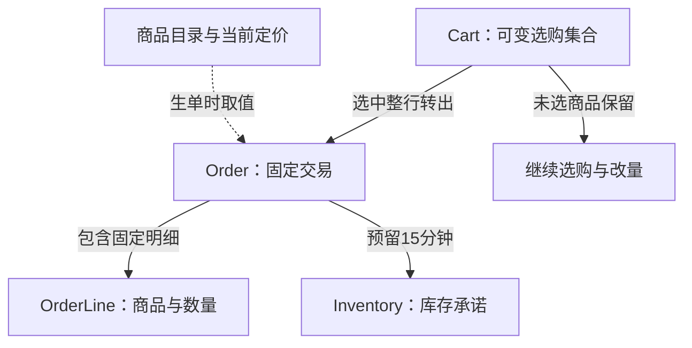
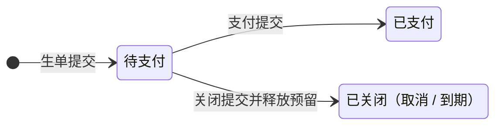
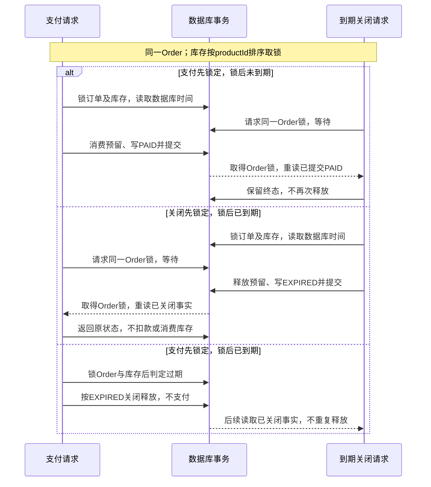

# 交易核心详细设计

**范围与状态：** 2026-10-31 从原 Technical Design 按职责迁移；沿用[总体设计的状态、依据与批准范围](TECHNICAL_DESIGN.md)，不因拆分新增业务批准或声称全局基线整体 Approved。当前行为以正式 Spec 为准，变更理由见工程决策；本文维护当前设计，不维护实施任务或逐轮验证记录。

## 领域与数据模型

图表达业务关系，不表示数据库表/外键：商品目录在生单时提供当前价格与摘要，随后固定到Order/OrderLine；目录引用不要求Product落关系表；Cart条目继续使用现有JSON，Order与OrderLine承载固定快照。一辆Cart可产生多笔独立Order；库存是跨订单共享资源，继续购物不会改变旧订单。

| 模型 | 负责的事实 | 不负责的事实 |
| --- | --- | --- |
| Cart | 持久购物上下文、可编辑商品与数量、version、来源归因；一车多单 | 用户身份、结算锁、订单付款状态；不另建Session |
| Order | 全局唯一ID、来源cartId、固定金额和优惠资格、支付/关闭事实、预留截止、创建幂等 | 继续跟随购物车或目录价格变化 |
| OrderLine | 生单时完整数量、商品摘要、单价和行金额的唯一权威 | 从当前商品目录重建历史交易内容 |
| Inventory | 实际未售量quantity、预留量reservedQuantity；可售量为二者之差 | 客户端倒计时、页面是否仍打开 |
| Product/定价规则 | 生单前的商品事实与当前计价依据 | 覆盖已生成订单快照 |

Order.cartId是必填、非唯一的来源关联；OrderLine按orderId与productId唯一，保存从车转入的完整数量。OrderLine加订单支付/关闭事实构成最小预留归属账本，不另建Checkout或独立预留生命周期。

Order与OrderLine共同组成不可变交易快照，不另存重复商品JSON或purchaseHash。Cart的JSON条目仍复用现有结构，首版不为减少偶发版本冲突新增逐行修订体系。读模型CartView/OrderView是权威数据投影，不是新的领域实体。

必须保持：选择整行且数量一致；生单、移出车行与预留全有或全无；同键不重复生单；有效待支付默认每车最多10笔；同一预留只能消费或释放一次。这些约束如何通过数据库保证，见[用例与一致性边界](#61-用例与一致性边界)；本节只定义业务边界。

车和订单长期落库，ID用于demo接续，无业务TTL；库存预留才有固定15分钟期限。Demo不设计身份、凭证或服务端访问隔离，分享仅约束页面展示，不把这一简化描述成生产级授权方案。

### 标识、版本、请求与来源

| 材料 | 唯一职责 | 不代表什么 |
| --- | --- | --- |
| productId | 区分商品，包括同名商品 | 不携带价格或库存承诺 |
| cartId / currentCartId | 来源车关联 / 当前入口的购物指针 | 不证明身份，不因订单状态自动换车 |
| Cart.version | 服务端车快照版本，保护JSON条目写入 | 不是订单支付版本，客户端不可自增后重放 |
| orderId | 从创建到支付/关闭持续定位同一订单 | 订单存在不等于已支付 |
| 创建/车操作请求键及载荷校验 | 原意图重试去重、拒绝同键异内容 | 不证明用户授权，不允许续期或复活 |
| createdByChannel / aiEligible | 固定本单生单通道与AI优惠资格 | 不从车来源继承，不因读单或支付者变化而升级 |
| Cart创建归因 | 按车记录最初有效创建事实 | Agent接手或生单不补算一次建车 |

数据库保存业务事实和必要幂等记录；查询投影与页面草稿不另建实体。Cart没有“存在订单即完成”的标志，Order没有支付后换号的第二生命周期。商品管理、账户、物流、真实金流和退款不属于当前模型。

## 状态与异常体验

图表达已提交业务事实的转移，不是数据库枚举；待支付节点包含“已到截止但关闭尚未提交”的中间观察窗口，此时不可新发起支付。请求“提交中/结果未知”也不是新的订单状态。

| 业务事实 | 存储映射 | 页面动作 |
| --- | --- | --- |
| 待支付且未到期 | status=CHECKOUT，closedAt为空 | 支付、取消、继续购物 |
| 已支付 | status=PAID，paidAt有值 | 显示结果，可继续购物 |
| 已提交关闭 | status=CHECKOUT，closedAt有值，closeReason记录原因 | 显示原因，返回选购 |
| 截止已到但关闭尚未提交 | status=CHECKOUT，closedAt为空，服务端判定到期 | 禁用新支付、查询结果；不能覆盖已在途支付的成功结果 |

数据库主状态只有CHECKOUT、PAID。服务端统一派生effectiveStatus、canPay/allowedActions，UI不各自实现状态机。本轮关闭原因限定为CANCELLED、EXPIRED；PAID必须有paidAt且无closedAt，已提交关闭不可复活。Human于2026-10-31明确本轮不新增停售/禁售功能；SALE_BLOCKED仅为未来条件性规则，不增加状态或更新入口。

| 维度 | 状态来源 | 处理原则 |
| --- | --- | --- |
| 订单业务状态 | 数据库支付/关闭事实 | 已提交终态不可逆，支付后不是新建第二个订单 |
| 期限有效性 | 服务器当前时间与reservationExpiresAt | 截止后拒绝新支付；读取与重试不续期 |
| 页面请求状态 | 当前目标的提交中、成功、失败、结果未知 | 不写回订单业务状态；未知不等于失败，不锁全局购物 |
| 当前导航 | currentCartId、当前orderId、普通/分享视图 | 查看订单不隐式切车，分享不更改currentCartId |

本地倒计时到点只能禁用新的支付并查询事实，不能认定关闭事务已完成。截止前已完成服务端准入的支付允许短事务提交；迟到的PAID结果不能被本地“超时”覆盖。取消与后台到期先保留既有终态，再按取锁后数据库时间裁决关闭原因，详见[归档设计 §5～6](../../openspec/changes/archive/2026-10-31-checkout-lifecycle-redesign/design.md)。

订单创建后商品/数量固定；改量须取消后重新选购。取消或到期释放整单预留，但不自动回车、不修改后来加购的行或兄弟订单。关闭页面、结束Agent对话、Abort网络请求都不代表取消；已支付单不能取消或退款。此前普通停售/禁止销售设想保留为未来条件性设计；当前只有可购买原因，不能将售罄、零价或缺库存推定为禁售。

异常按目标恢复：创建失败不移行、不占库；支付事务回滚保留此前已创建的订单、快照及原预留，仍受原截止约束。网络未知不能当成失败或已释放库存。创建未知按原车与创建请求键恢复，支付/取消未知按原orderId查事实，重试不换键、不续期。到期后原单只可查看；用户明确重新购买才重新选购、使用新请求键和当前价格创建新单，不复制旧锁价。

## 用例与一致性边界

| 用例 | 同一短事务内的保障 | 恢复边界 |
| --- | --- | --- |
| 加购、改量、删除 | add累加或新增，set对已有行绝对设量；两者校验目标可购买性和正整数可售量。remove可删除问题行；set/remove不存在行报错、0不当删除。车变更、version递增与操作幂等记录一起提交 | 原键同载荷返回原结果；同键异载荷拒绝；去重先于旧版本校验 |
| 创建订单 | 恢复原请求后，对新请求校验来源车版本、完整选中集合、预算/规格、配额及可售量；固定金额、写Order/OrderLine、增加reserved、删除选中车行和递增version一起提交 | 原键恢复同orderId及当前状态，即使车行已移出、价格已变、原单已关闭；不同键竞争同车旧版本不能都成功 |
| 支付 | 锁原Order及其库存，校验未关闭、锁后数据库截止、有效预留和原快照；quantity与reserved同时减本单数量，更新同单为PAID | 不重算价格、不插入第二笔订单、不比较当前车版本；重复支付返回原事实 |
| 取消/到期 | 锁订单及库存，释放reserved并写关闭事实 | 已支付/已关闭先返回已有事实；未关闭单锁后达到截止则记EXPIRED，未到期才按请求原因关闭；不重复释放、不改写原因 |

创建协调来源车与所选库存；支付/关闭只协调目标订单与库存，不锁来源车。库存按统一商品顺序取锁，关闭与支付共享协调边界；未来如引入可信禁止销售事实，须另行规划其更新与支付的协调。没有覆盖15分钟审阅期的数据库锁。具体锁序、参数和并发反例见[归档设计](../../openspec/changes/archive/2026-10-31-checkout-lifecycle-redesign/design.md)；当前行为仍以[正式 Spec](../../openspec/specs/)为准。

单车配额只计CHECKOUT、未关闭且未到期的订单，env默认10笔。新单在Cart短事务内完成计数与准入，避免并发超额；同键恢复先于配额检查。下调配置不取消已有单，只暂停新增；满额显示已有订单入口，不能自动换车绕过。该额度不提供自然人级防囤占。

## 库存、期限与计价事实

正常库存保持`0 <= reservedQuantity <= quantity`，reserved对应尚未消费或物化释放的订单预留。预留增加reserved、不减少quantity；支付同时减少二者；关闭只减少reserved。例如实际10件，预留3件和2件后可售5件；第一单支付后实际7、预留2、可售仍5；第二单取消后可售7。持有有效预留的订单不因公开可售为0而被拒付。异常库存不得新增预留。

创建在完成锁等待和校验后记录服务端创建时刻，截止固定为其后15分钟；锁后数据库时间达到截止即拒绝新支付。后台释放尚未提交时，占用仍计入reserved，可能短暂少卖但不能超卖；公开查询不能自行扣除超时占用形成另一口径。到期单不占待支付笔数配额，与库存实际释放是两回事。默认每秒扫描、正常负载5秒内释放是待验证目标；故障后补扫，不能承诺故障期间时延。

计价仅使用本单所选商品，未选商品不贡献优惠门槛。沿用[D-09～D-13金额规则](../../DECISIONS.md#统一价格计算语义d-09d-13)：优惠前商品小计满NT$1,000减100一次；再对有AI资格的商品金额打95折，精确十进制计算并在订单级HALF_UP至两位；运费按优惠前小计满NT$990免运，否则100，最后加到商品应付金额。车报价是无占用预估，生单固定单价、优惠、运费、币种、总额与计价规则版本；支付不按后续涨跌价或活动调整重算，客户端不能覆盖金额。

AI资格由服务端生单入口确定，不接受客户端自报资格，也不从Cart来源继承；这不证明具体用户身份或严格防伪AI来源。Cart创建归因仍单独保留。指标区分建车、订单创建、未支付、关闭与PAID，只有PAID计购买成功或收入；读单和人工支付不会改写生单来源。

## 交易约束与实现索引

本节连接当前不变量与实现，不新增交易规则。模型与关系唯一维护于[Prisma Schema](../../apps/api/prisma/schema.prisma)；数据库CHECK、外键及索引须同时核对[生命周期迁移](../../apps/api/prisma/migrations/202610310001_checkout_lifecycle/migration.sql)，不能只读Schema便推定SQL约束齐全。现行流程见[CartService](../../apps/api/src/cart/cart.service.ts)，历史推导留归档。

| 操作/约束 | 当前事务、锁序及数据库保障 | 验证入口 |
| --- | --- | --- |
| 初始化车 | 初始化请求键事务级advisory lock → 同键指纹恢复/校验 → 写Cart；createRequestId全局唯一，初始条目及归因同事务保存 | [生命周期DB测试](../../apps/api/test/cart/lifecycle-db.test.ts)的跨实例初始化与恢复 |
| 修改车 | 车操作键advisory lock → Cart行锁 → 查原操作指纹 → 校验版本/目标 → 写车与CartOperation；复合主键(cartId,requestId)去重，不预留库存 | 同文件的旧版本竞争、请求冲突及操作/幂等记录回滚 |
| 创建订单 | 生单键advisory lock → Cart行锁 → 同键恢复 → 配额/版本检查 → 按productId排序的Inventory行锁 → 校验并写新Order/OrderLine、增加reserved、移出车行；新单尚不可被其他事务访问，无需先锁新Order | 同文件的同车竞争、末件库存、配额并发、创建回滚；Order的(cartId,createRequestId)唯一约束 |
| 支付/取消/到期 | 原Order行锁 → 已提交终态直接返回 → 排序Inventory行锁 → 锁后数据库clock_timestamp裁决 → 同事务更新库存与原单；不锁来源Cart。支付过期时不付款，按EXPIRED关闭释放 | 同文件的支付/关闭竞争、取锁跨截止、终态及回滚场景 |
| 预留与状态一致 | Inventory_reservation_check约束非负预留及正常库存上界，历史负库存只允许零预留；Order_lifecycle_check约束支付时间与关闭字段一致。预留归属总量仍依赖事务与账实核对，不由单行CHECK独立保证 | [库存测试](../../apps/api/test/inventory/inventory.test.ts)、生命周期DB测试与运行段只读metrics |
| 金额、来源与明细 | Order_amount_check校验金额汇总，Order_channel_check约束优惠资格与通道；OrderLine复合主键、正数量/单价及行小计CHECK，外键RESTRICT。固定快照由用例维护，不能把这些CHECK描述成禁止任意SQL修改快照 | [计价测试](../../apps/api/test/cart/pricing.test.ts)、生命周期DB测试的固定快照/约束反例 |

CartService使用短交互事务，当前代码设置10秒事务timeout；这属于实现配置，不是请求延迟或吞吐承诺。取锁后读取数据库时刻，不能以客户端倒计时、事务起始时间或测试成功推定截止竞争正确。实际执行与尚待量化目标统一见[质量验收链路](TECHNICAL_DESIGN.md#质量目标与验收链路)。

### 支付与到期关闭竞争

图描述成功提交时的三种互斥结果；已取得Order锁仍须等待库存锁，不能在等待前判定支付准入。截止前完成锁后准入的支付可在截止后提交；事务失败则回滚更新，后续请求按重新取得锁后的事实裁决，不把“发出支付”当成已支付。相同协调路径也用于取消，具体裁决和验证入口见上表。

## 用例输入映射

`CartService` 是共享交易边界，输入均拒绝未知字段。通道是适配器参数 `WEB | MCP | WEBMCP | APPS`，不得从 JSON body 的 origin/aiEligible/price 派生。普通网页生单使用 WEB；MCP 服务工具使用 MCP；WebMCP 专用同源路径使用 WEBMCP；Apps Bridge/工具专用路径使用 APPS。这个通道约定不是自然人或 AI 身份证明。只有 WEB 不享本单 AI 折扣，车的 agentCreated 不参与优惠。

| 用例 | 输入及结果 |
| --- | --- |
| getOrCreate | `{cartId}` 只接续；或 `{requestId, initialItems:[{productId,quantity}]}` 原子初始化。Agent 通道不接受空条目；普通 Web 允许空车。浏览咨询不得调用创建分支 |
| get | cartId → 车 ID、版本、行、问题、有效待支付订单；没有业务 TTL、单个完成订单字段或自动建车 |
| operate | cartId + `{operationRequestId, expectedCartVersion, operation}`。operation 为 add_item / set_quantity（正数量）或 remove_item（无 quantity） |
| quoteSelection | cartId + `{selectedItems, constraints}` + 可信通道；只计算本次选中集合，不占库 |
| createOrder | cartId + `{requestId, expectedCartVersion, selectedItems, constraints}` + 可信通道 → `{order,cart}`；每个 selectedItems 元素为 `{productId,expectedQuantity}`，只断言整行数量，不拆分 |
| getOrder | orderId，可选 cartId；同时传入时必须关联同一车 |
| listOrders | cartId + `{offset?,limit?,pendingOnly?}`；默认20，最多100，稳定 createdAt/id 倒序，nextOffset 表示后页 |
| payOrder / cancelOrder | orderId，可选 cartId；返回原单当前事实。支付只给 UI，不注册为模型工具；调用失败恢复原单 |

`constraints` 必须含 `currency:'TWD'`，可含十进制两位金额 `maxTotal`；`items` 可逐项约束 `{productId,maxUnitPrice?,specs?}`，规格使用目录键和精确值。约束 ID 必须属于选中集合，重复/缺失/数量不符/预算或规格不符整笔拒绝。金额上限和规格不由最终支付兜底。

## 数据库运行与隔离验证

新迁移仅能在旧 Cart/Order/PurchaseReview 均为空时应用，否则明确中止；不会自动清空旧交易或重置库存。原切换的授权与执行证据见[归档 Tasks 8](../../openspec/changes/archive/2026-10-31-checkout-lifecycle-redesign/tasks.md)；该记录不授予再次清理权限。新数据产生后不可再次清理或回退到旧写服务。迁移保留 P008 负库存原值：负库存必须零预留，不可用于新订单。

`MAX_PENDING_ORDERS_PER_CART=10` 必须为正安全整数；下调不取消旧单，同键恢复不受额度限制。到期不占笔数配额，但尚未物化释放仍占库存。API 启动即补扫，每次扫描结束一秒后再扫，单批最多100笔，每单独立短事务；多实例按数据库行锁协调。单笔失败会记录日志并在后续扫描轮转后重试；非持久游标避免异常订单饿死后续批次，重启从头补扫，故障期间无5秒保证。

只读运维入口：`pnpm --filter @store/api metrics:checkout`。在同一只读可重复读事务中返回 Agent 建车、创建订单、有效待支付、物化关闭、PAID/收入、过期未关闭积压和最老超时，以及预留账实差异；不自动修复。`metrics:agent-carts` 保留独立创建事实口径，后续删空或普通车 AI 生单不修改归因。

隔离验证仅用 `TEST_DATABASE_URL` 指向 `/store_test`，串行运行 `pnpm test apps/api/test/cart/lifecycle-db.test.ts apps/api/test/inventory/inventory.test.ts --no-file-parallelism`。测试会删除该库交易和库存，禁止指向业务库。HTTP 退役验证另需指向测试库的 API，`CHECKOUT_CORE_API_URL=http://127.0.0.1:3003`，与该 API 匹配的 WEB_ORIGIN/MCP_SERVICE_TOKEN。跳过环境依赖测试不算通过。
