# 前端与交互详细设计

**范围与状态：** 2026-10-31 从原 Technical Design 按职责迁移；沿用[总体设计的状态、依据与批准范围](TECHNICAL_DESIGN.md)，不因拆分新增业务批准或声称全局基线整体 Approved。当前行为以正式 Spec 为准，变更理由见工程决策；本文维护当前设计，不维护实施任务或逐轮验证记录。

## 完整用户流程与各端差异

普通Web主线从列表开始：URL恢复搜索/筛选/页码 → 详情查看规格与评论 → 明确数量并加购 → 车页保存改量、勾选和核对预估 → 创建订单 → 审阅原单并支付/取消 → 查看结果或继续购物。空结果、加载失败、不可售、空车和订单关闭都有独立反馈，不将失败伪装成没有数据。

Agent辅助主线是“咨询/选购 → 明确目标 → 生单 → 展示固定订单 → Human支付或关闭”，各端只改变交互载体。下图聚焦Agent辅助路径，省略协议与数据库细节；普通Web由Human直接发起生单。

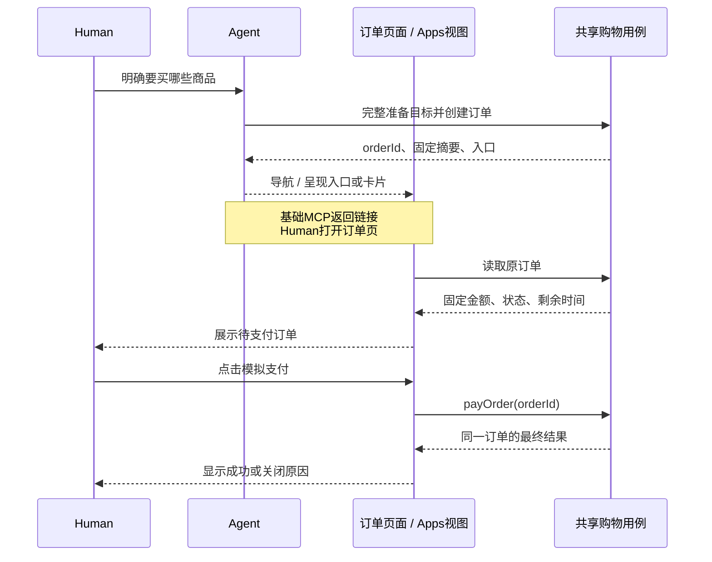

| 入口 | 正常路径 | 恢复/限制 |
| --- | --- | --- |
| 普通Web | 搜索→加购→车内改量/勾选→生单→同订单页模拟支付 | 首次全不选，提供全选；页面内保留有效选择，新商品不自动勾选 |
| WebMCP | Agent按意图搜索/加购/选行→生单→直接导航订单页→Human支付 | 复用Web Commands；仅启用工具不跳页，晚到结果不抢用户导航 |
| 基础MCP | Agent完成准备与生单→返回可打开的订单入口→Human网页支付 | 不能宣称Host已自动打开页面；页面打开失败仍保留同orderId，不重生单 |
| MCP Apps | Agent或专用UI生单→内嵌订单摘要→Human点击模拟支付 | 实例绑定orderId；重挂载先读原单，使用Host适配器而非Next Router |
| 分享 | 单订单分享视图→有效待支付可模拟支付→展示结果 | 不显示来源车、兄弟订单或取消，不修改当前车指针；非权限隔离 |

AI优惠在创建订单时按入口固定：MCP/WebMCP/Apps专用入口生单享资格，普通Web不享；仅咨询/加购不触发，人工支付不取消已固定资格。各端展示统一金额，UI不独立计算折扣。

### 选择、接续与多单导航

车页首次全不选，提供全选；页面内保留仍有效的显式选择，新加商品不自动勾选，离页不承诺保留。数量先保存再生单；外部改量或版本变化后展示最新车并重新核对。Agent直接购买只选本次意图涉及的整行，不受页面默认选择影响，也不顺带购买旧车其他行。明确“将A改为1件并购买”可连续执行；数量意图有歧义才澄清。显式预算、币种与规格必须在生单时校验；任何选中行失败都整笔拒绝，未选问题行不阻止合法选择。

Cart就是持久购物上下文：浏览器保存currentCartId，Host携带cartId；有ID先恢复，目标不存在明确反馈而不自动新建；无ID且首次明确写意图才用初始化键及initialItems幂等初始化，纯浏览/咨询/空车页读取不持久建车。Agent初始条目非空且全部可购买，与车和创建归因同事务保存；普通Web API可空建但页面不自动空建。同键恢复原车当前内容，不重放初始条目。关闭窗口、缓存TTL、本地ID丢失均不删除服务端数据，保存的车链接仍可恢复。不提供主动新建/切车，也不因付款、满额或失败自动换车。

本人跨端携带cartId和orderId；没有当前车或已是同车时接续原车。已有A车而打开B车订单，先只展示B订单；点击“继续这次购物”才确认是否切换到B，既不合并也不删除A。分享入口始终只展示单订单，不改变当前车。车操作显式定位cartId，订单操作显式定位orderId，不能根据页面位置猜测写入目标。

购物入口提供车与独立订单列表导航，待支付及历史订单在`/orders?cartId=…`分页读取；空车也能发现原订单和继续加购。创建订单、打开页面和支付成功分别报告：导航失败可重开原orderId，不能重生单。WebMCP明确加购后一次展示车，明确购买则直接进入订单；仅启用工具不导航。Apps每个实例恢复自己的订单，旧卡片不能覆盖另一订单。

### 从选中报价到订单审阅

普通Web的车页展示所选行及其金额汇总：勾选变化或数量保存后，以最新车版本和选择集合向共享计价用例取得无占库预估。没有选择时不生单；未保存的数量不是报价或创建依据。预估只计算选中商品的门槛和运费，不把整车报价当作本单金额。前端只格式化服务端结果，不自行算优惠，也不拼接不同响应的明细。

生单在短事务中按当时条件重新校验并固定金额，返回订单与剩余车快照；Human随后审阅该订单的完整商品、数量、单价、优惠、运费、应付及截止，点击模拟支付。若预估与生单间价格变化，展示实际订单快照供Human决定支付或取消，不能继续显示旧预估。Agent明确购买可以直接生单，不把一次预估调用设成强制中间步骤。

**Order本身就是固定审阅对象。** 新流程移除PurchaseReview、Cart.checkoutEpoch及确认签名，不在订单前后增加Review、批准签发或重复准备步骤。重新打开只读取原orderId，既不重新确认一份报价记录，也不延长预留。Human点击后由Web或Apps UI直接调用支付用例并显示结果，不等待Agent继续回复；Agent可选购、生单、查单和取消未支付单，但没有模拟支付工具。取消或状态查询有多个候选订单时先明确目标。

订单创建和读取结果直接带普通入口与分享入口，不要求另调取链接工具。明确加购通常展示车，但用户要求留在当前页时遵循；内部加购后直接生单的购买请求不插入车页导航。商品、评论或模型自述不能替代用户意图。

## 前端架构与Agent接入

前端以`packages/commerce-ui`中的同一购物应用实现Web与Apps的流程、交互和视觉。商品列表/详情/评论、购物车、订单列表/详情、导航外壳、控件、样式、商品示意资源、Hooks和Commands均只有一份；两端不各写一套购物页面或状态机。WebMCP调用Web实例中的同一Commands和协调层。

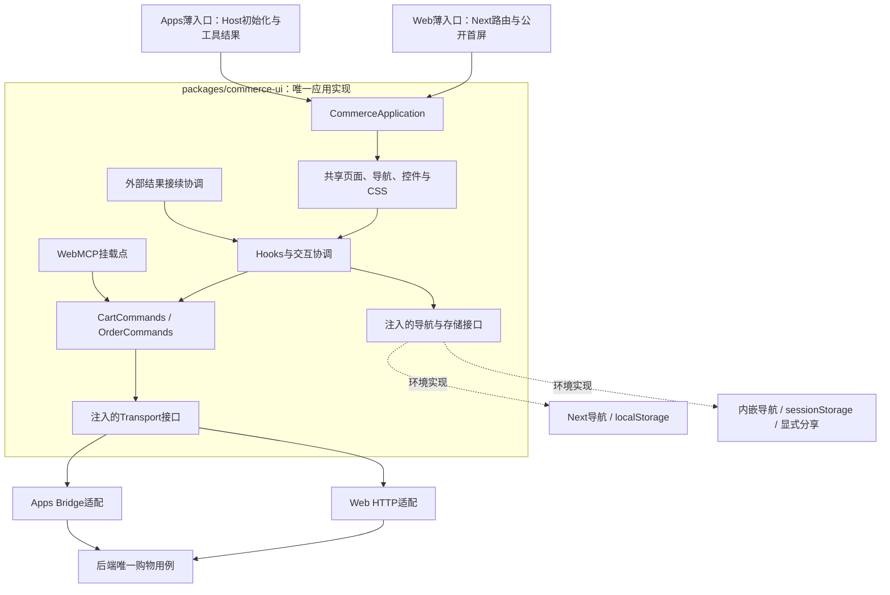

图表达代码职责与注入关系；实际每个Web或Apps实例有自己的Provider、查询副本、草稿、未决请求与导航位置。适配器不实现商品、选购、订单恢复或支付状态机，也不重新定义控件、页面布局和视觉；后端仍唯一裁决金额、库存与订单终态。目录独立与构建独立不构成重复实现界面的理由。

### 页面协作、路由与上下文

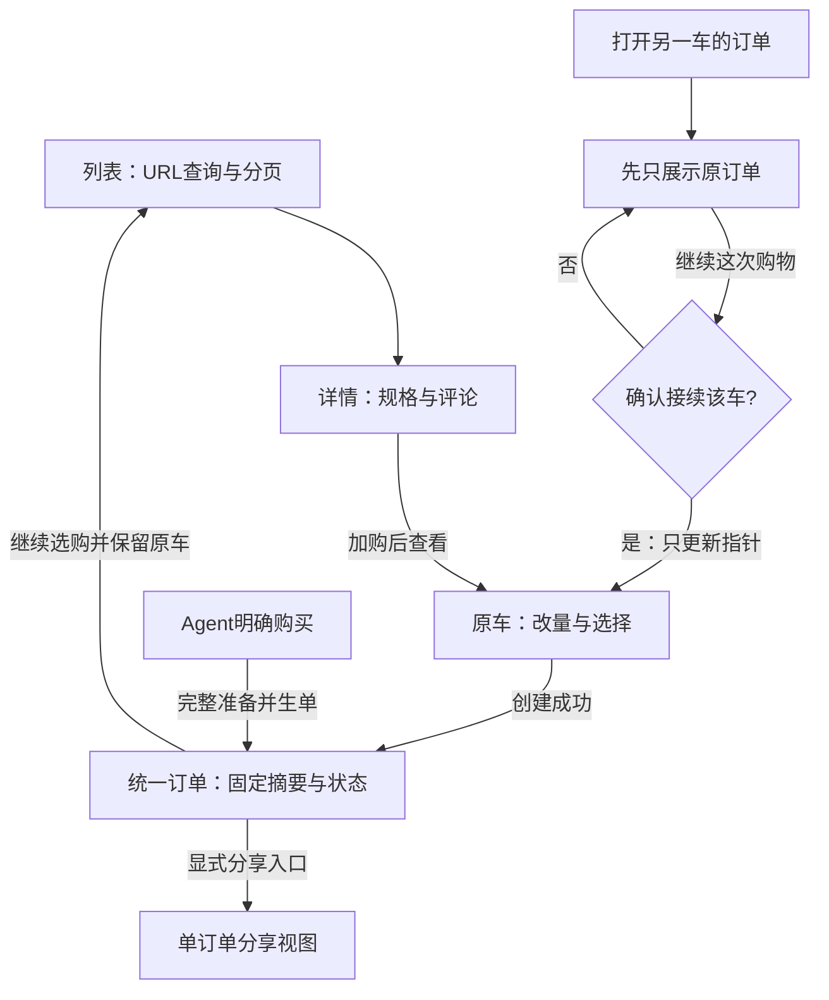

箭头表示用户流程，不表示所有入口都会自动导航；基础MCP须由Human打开网页，Apps在卡片内呈现。分享视图不提供返回来源车的入口。

| 页面 | 读取与交互 | 离开、返回及接续 |
| --- | --- | --- |
| 商品列表 `/` | URL查询驱动列表；搜索草稿、筛选、分页与商品卡 | 提交查询后导航，筛选变化重置偏移；返回按URL恢复，不用另一套全局搜索Store |
| 详情 `/products/{productId}` | 商品与规格首屏，评论独立分页，局部数量输入与加购 | 切商品隔离旧评论和请求；加购更新原车上下文，不把详情输入当车内已保存数量 |
| 购物车 `/cart`、`/cart/{cartId}` | 读取目标车，逐行改量/删除、选择与预估，链接到独立订单列表 | 返回读取最新车；选择仅在页面内保留有效部分，不承诺离页持久化；有草稿先保护并核对 |
| 订单列表 `/orders?cartId=…` | 按车分页查询待支付及历史订单 | 不改变当前车指针；返回页面后校准，空车保留入口 |
| 订单 `/orders/{orderId}` | 原单固定摘要、截止、状态、支付/取消/继续购物 | 直达或刷新先查原单，不生单、不准备Review；「繼續購物」返回商品列表并保留原购物上下文 |
| 单订单分享视图 | 相同订单摘要，有效待支付可模拟支付 | 不显示来源车、兄弟订单或取消；不更改currentCartId；展示限制不是权限隔离 |

当前车指针由入口上下文管理，页面只持自己的productId/orderId及查询位置。查看B车订单不会隐式把A车切成B；“继续这次购物”才按[选择与接续](FRONTEND_DESIGN.md#31-选择接续与多单导航)确认接续。订单路由中的ID只解释为orderId，不能复用旧`/orders/{cartId}`语义。旧Checkout及旧只读凭证入口的退场由Change切换约束处理，不保留两套购买页面状态。

导航与业务成功分开：生单成功但导航失败时显示原订单入口；用户已主动离页时，迟到结果仍归原目标，不能强制跳回订单。仅打开WebMCP不导航；明确加购通常展示车，明确购买在内部准备后直达订单，不插入车页中转。用户要求停留当前页时遵循该意图。

### 完整共享应用、组件与环境接口

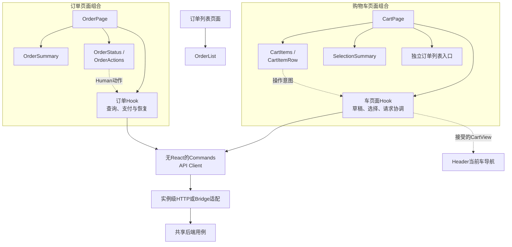

实线表示组件组合或调用，虚线表示意图回调/快照投影。组件通过props消费状态，页面协调层统一接受结果，不建立两份车版本或订单事实。

| 层 / 代表职责 | 输入、输出与协作 | 维护边界 |
| --- | --- | --- |
| Web / Apps薄入口 | Web解析Next路由并读取公开首屏；Apps验证Host工具结果并定位共享路由 | 两端挂载同一CommerceApplication，不导入Prisma/计价，不在渲染、工具结果接续或预取时写购物事实 |
| CartPage及页面Hook | 消费CartView、选择、草稿和请求状态；协调保存、报价、生单和返回导航 | 统一处理结果，子组件不各自维护另一份车版本 |
| CartItems / CartItemRow | 展示已保存数量，编辑局部草稿；回调绝对设量、移除、勾选意图 | 草稿与已保存值可区分，失效行有原因，不把未提交输入显示成已写入 |
| SelectionSummary / OrderList | 展示服务端选中预估、选择问题和原车关联订单入口 | 不按整车金额推导所选金额，不把待支付列表当独立业务事实库 |
| OrderPage及页面Hook | 读取原orderId；协调查询、支付、取消与未知恢复 | 普通/分享模式在外层决定动作区域；不重新创建订单或Review |
| OrderSummary / OrderStatus / OrderActions | 固定快照、状态标签、倒计时、明确动作回调 | 不自行决定支付可用性、重算金额或调用Host |
| ProductCard / ReviewList / MoneyBreakdown | 公开商品、独立评论页、服务端金额明细及展示模式 | 通过props和回调复用；不泄漏内部字段，不把评论指令当操作 |
| Commands / API Client | 明确目标、请求键、版本与载荷；返回结构化成功或失败 | 普通TypeScript函数，不依赖React、DOM、Router或QueryClient |
| CommerceRuntime / 环境适配 | 请求、当前位置、导航、存储、显式分享、页面工具挂载和外部结果投递 | 只翻译运行环境能力；结果交共享协调层接受，不复制购物交互或跨Host共享React上下文 |

Header根据当前车指针构建导航，车行数量来自被接受的CartView，不把草稿当已保存值；订单各组件读取同一份OrderView，支付结果由外层一次接受后共同呈现。

完整共享范围包含页面组合与状态协调，不能以共用商品卡、金额组件或部分CSS代替。具体源码职责如下：

| 代码位置 | 当前职责 |
| --- | --- |
| `packages/commerce-ui/src/application.tsx` | 组合共享Provider、导航、页面与外部结果接续；Apps内嵌路由选择同一页面 |
| `packages/commerce-ui/src/features/` | 商品/评论、车与订单页面、Hooks、Commands、反馈和恢复逻辑；Web原feature路径只保留薄导出 |
| `packages/commerce-ui/src/components/ui/` | 唯一的Button、Checkbox、Input与Label实现 |
| `packages/commerce-ui/src/application.css`、`style.css`、`artwork.ts` | 唯一的基础/响应式样式、商城组件规则及本地商品示意；两端使用同一完整CSS入口 |
| `packages/commerce-ui/src/runtime.tsx`、`transport.ts` | 实例级环境接口与HTTP实现；共享业务组件不导入Next或Host SDK |
| `apps/web/src/commerce-runtime.tsx`、App Router薄页面 | 注入Next导航、HTTP、localStorage和WebMCP，公开商品首屏从服务端传入共享页面 |
| `apps/mcp-app/src/main.tsx`、`bridge-adapter.ts` | Host连接/工具结果、Bridge协议映射、内嵌导航、sessionStorage和可信分享；无独立购物Controller/View/CSS |

请求适配使用`Transport(path, body?) → Promise<Response>`，由共享Commands统一验证响应、目标ID并协调原请求恢复；Bridge只把请求映射到所属Server工具和标准结果。`CommerceRuntime`提供位置/导航、存储、分享、WebMCP挂载及外部结果订阅，不持有另一套购物事实。Web使用Next导航与HTTP，Apps使用内嵌位置和Bridge；同一路由重试可触发新读取，不因位置字符串未变而失效。

两端沿用同一视觉、文案、草稿保护、冲突显式刷新、未知恢复和订单终态规则。Host窄视口由同一响应式CSS处理，不能另写简化版控件或摘要布局。前端实例和持久存储仍隔离，复用源码不表示共享会话、身份或React状态。

### 状态归属与保存范围

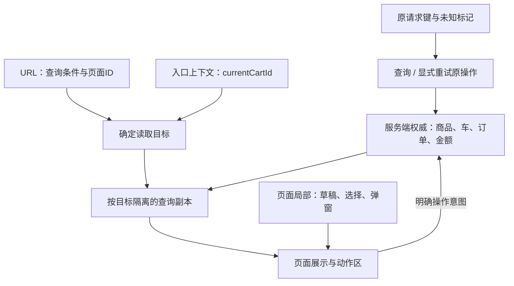

图中没有“草稿直接写入查询副本”或“倒计时写入订单终态”的路径。请求键在发出写操作前保存；持久ID只用于定位，不构成身份。

| 状态 | 权威 / 前端归属 | 保存及更新规则 |
| --- | --- | --- |
| 商品、可售量、CartView、OrderView | API/数据库；页面或feature的查询副本 | 只安装目标匹配的服务端结果；缓存不是库存或成交承诺 |
| 查询条件、页码、productId/orderId | URL / 页面入口 | URL承载可恢复的位置；搜索框草稿尚未提交时只在局部 |
| currentCartId、原订单入口 | 浏览器/Host入口上下文 | ID可持久保存用于接续，不证明身份，不因支付或空车自动清空 |
| 请求键、未知标记 | 操作协调层及必要持久客户端存储 | 发写请求前保存，未知时保留；不能靠完整本地对象重建交易事实 |
| 数量输入、勾选、弹窗、焦点 | 页面/feature局部状态 | 输入不是已保存数量；外部变化需核对；新商品不自动勾选 |
| 选中Quote | API计价；本页请求副本 | 关联车版本与选择集合；变化后旧结果不得作为当前预估 |
| effectiveStatus / allowedActions | 服务端投影 | UI消费业务动作条件，再叠加本目标的提交中/未知等交互限制 |
| 倒计时、格式化文字 | 展示层 | 到点只禁用新支付并查事实，不写闭单终态、不改金额 |

Web和Apps都沿用同一React state/ref/context与请求函数，不因使用“查询副本”或“查询键”引入TanStack Query。当前车Provider只承接跨页面确需共享的指针、车结果与操作协调，不吸收全部订单、搜索、表单或支付状态。每个订单有自己的请求状态，不能以一个全局busy阻塞继续购物。

Web的localStorage与Apps的sessionStorage由运行环境注入同一存储接口。Apps以稳定工具调用ID保存卡片路由，并把旧卡片实体映射和未知原请求迁入共享恢复材料；缺少存储/关联信息时明确提示，不静默换键、另建车或支付。共享外部结果协调层在有草稿或在途动作时保留当前页面，待用户处理后显式查看新结果。同版本重读不使草稿失效，确有版本变化或结果未知时仍要求核对。

### 交互状态与可继续的动作

本表是客户端呈现和操作协调，不是新增订单状态机。业务终态和期限由[交易状态与恢复](CHECKOUT_CORE.md#4-状态与异常体验)决定，表单校验、请求状态与导航可以独立变化。

| 场景 | 用户看到什么 | 动作与恢复 |
| --- | --- | --- |
| 首次读取 | 明确加载状态，无伪造金额或空订单 | 取得事实后展示；失败提供读取重试，不把失败当空数据 |
| 数量有未保存修改 | 输入草稿与保存反馈 | 先保存改量，再核对选择/报价后生单；不拿草稿数量直接下单 |
| 勾选变化或报价加载 | 选中集合与“预估更新中” | 旧预估不冒充当前金额；新生单仍须明确目标与服务端校验，报价不是授权或锁价 |
| 保存中 | 原目标的处理中状态 | 防止同车冲突写入，不排队自动重放；无关订单可继续操作 |
| 外部变更 / 版本冲突 | 最新事实需核对，草稿有丢弃提示 | 显式重载并重新选择；不自动合并、换版本重放或静默覆盖输入 |
| 创建中 | 明确正在创建待支付订单 | 原请求保留；不重复新建，成功才展示订单入口与剩余车 |
| 创建结果未知 | 尚不确定是否生单，提供查询/原请求重试 | 按cartId及原创建键恢复，不换键、不把一次未查到当确定失败 |
| 支付/取消中 | 原订单动作处理中，固定摘要仍可读 | 防止该单重复或冲突操作；其他订单及选购不受长期锁定 |
| 支付/取消结果未知 | 状态待确认，不宣称失败或库存已释放 | 查询原orderId，显式重试遵循原操作；不另建单或自动支付 |
| 截止已到 | 禁止新支付、查询服务器结果 | 不用本地超时覆盖截止前准入后提交的PAID |
| 已支付 / 已关闭 | 服务端结果或关闭原因 | 隐藏支付/取消，按视图提供继续购物或返回选购；不自动回车 |

输入错误允许原页修正；库存或额度拒绝要给出具体原因和可访问的原订单入口。用户可关闭页面，但关闭页面/Abort只结束当前观察，不等于撤销服务器事务。

### 查询标识、刷新与结果安装

下列是逻辑查询标识，用于隔离结果；不要求新建缓存库、持久查询表或统一框架。查询副本可沿现有feature state/ref维护。

| 查询 | 标识所需信息 | 更新/失效条件 |
| --- | --- | --- |
| 商品列表 | 规范化查询、筛选、排序、页偏移；返回目录revision | URL改变发新读取，旧条件结果不得覆盖；目录变化重启分页 |
| 详情 / 评论 | productId；评论还含页位置及目录revision | 切商品不拼接旧评论；加载失败不当评论为空 |
| 当前车 | cartId，结果携带version | 首次进入、返回、干净页聚焦、车写成功后校准 |
| 选中预估 | cartId、服务端车版本、选中商品与完整数量、请求代次 | 改量/选择/车版本变化后重取；旧选择响应不能更新当前金额 |
| 原车订单列表 | cartId及分页范围 | 生单、支付、取消或返回页面后重新校准；不依赖车是否为空 |
| 原订单 | orderId及本页读取代次 | 进入、返回、操作后、未知恢复或截止提示后读原单；不重建 |

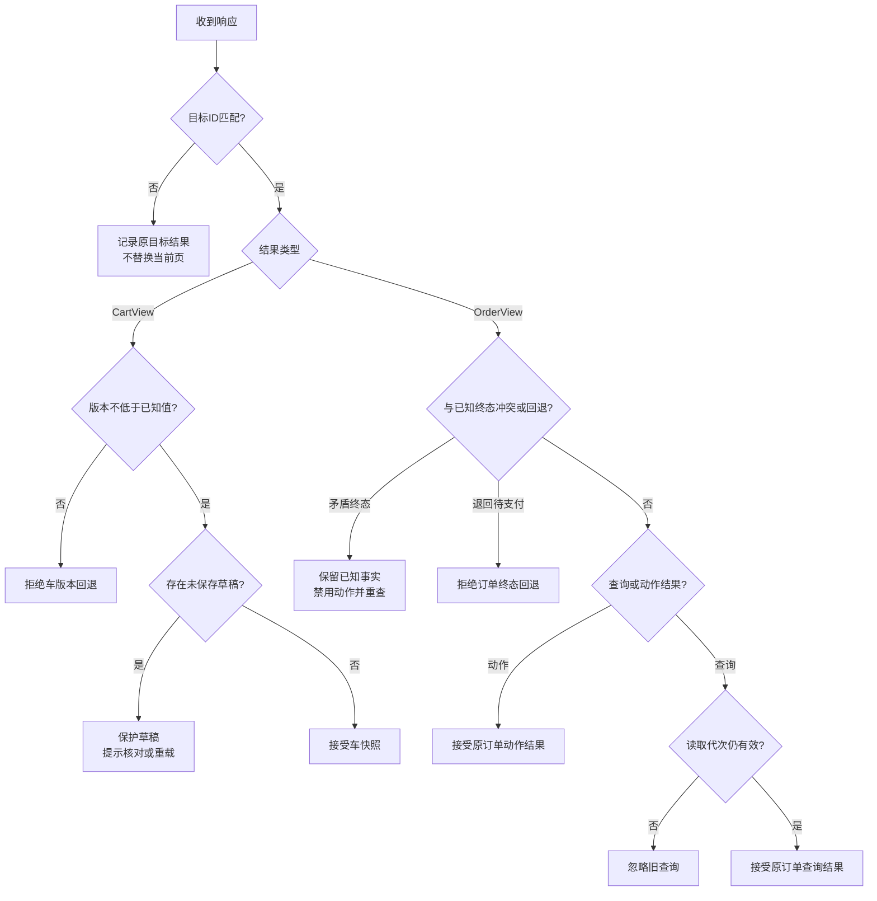

图表达结果接受规则，不是新的业务状态机。晚到的支付/取消动作结果仍须纳入原订单恢复，不能仅凭读取代次丢弃；本地截止或closedAt为空的超时投影不是已提交终态。

无脏输入时可接受最新车；存在草稿时提示核对，不静默覆盖。页面已离开时结果仍保留原请求/订单恢复事实，但不劫持导航或焦点。API写结果与后续重读分别携带目标，不依据“现在在哪一页”猜测应更新哪辆车。

动态库存、车、Quote与Order不进入跨上下文共享缓存，动态接口保持no-store。操作成功优先消费服务端已返回的权威结果，必要时补读受影响的关联视图，而非机械全站刷新。首版无WebSocket、跨Tab事件总线或跨Host实时推送；其他入口在返回/聚焦/显式读取时校准，提交仍由服务端验证。

### 分组搜索的状态与交互

后端匹配、限值和版本语义见[搜索设计](BACKEND_DESIGN.md#分组搜索与文字匹配)；页面只呈现与恢复同一契约，不复制筛选算法。[GroupedCatalogPage](../../packages/commerce-ui/src/grouped-catalog-page.tsx)承接独立搜索集合，复用ProductCard、Runtime和Transport；普通单目标目录仍沿用原URL/RSC入口。

| 状态/事件 | 归属、呈现与恢复 |
| --- | --- |
| 搜索集合 | collection标识原始目标集合，scope隔离交付实例；storage以scope和collection保存目标、页位置及两类版本。恢复时核对除offset外的原目标约束，不允许存储内容替换预算或筛选 |
| 分组展示 | 保持组顺序与标签，显示各自条件、总数、空组/错误；产品按ID解析，跨组可引用同商品。Apps在同一卡片内显示完整集合，不把一组结果当另一组的替代 |
| 独立翻页 | 按目标ID维护busy、错误和请求序号；只请求目标组，使用[mergeSearchGroup](../../packages/commerce-ui/src/grouped-search-state.ts)替换该组并裁剪无引用商品，保留其他组。集合epoch与组序号共同拒绝迟到响应 |
| 错误与重试 | 单组翻页失败保留原页，记录失败offset，重试同一页；CATALOG_CHANGED阻止旧集合继续拼接，显式重新查询全部目标从首页开始并清理旧组错误 |
| 返回与重挂载 | 保存查询材料而非可信库存快照，重新读取后安装结果；存储不可用明确提示页码无法保存。详情返回及同卡恢复不得写车、占库或生单 |
| Apps呈现边界 | 搜索结果不带搜索表单，主要区块上下排列，商品卡随可用宽度并排；仍复用共享组件/CSS。search_products产生搜索展示，query_products用于无UI准备；最终订单及支付状态留在原结算卡片 |

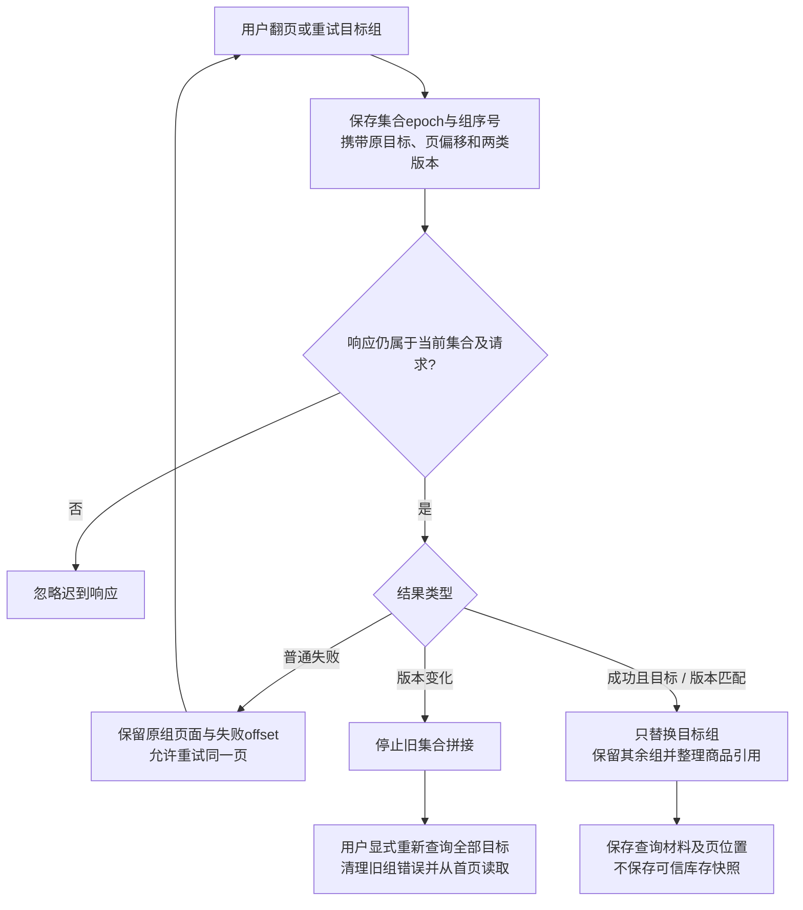

本图只说明分组读取结果的安装，不改变购物事实；整体刷新会使旧请求失效，不能把旧组结果重新装入新集合。

局部合并/版本拒绝见[分组状态测试](../../packages/commerce-ui/test/grouped-search.test.ts)；同卡双目标、独立翻页、详情返回、失败页重试与紧凑布局见[Apps浏览器测试](../../e2e/mcp-app.spec.ts)。购物车/订单的局部验证与真实Host证据入口见[总体质量链路](TECHNICAL_DESIGN.md#质量目标与验收链路)，浏览器Host替身不等于真实Host验收。

### 关键交互如何贯穿各层

#### 改量 → 权威车快照 → 选中预估

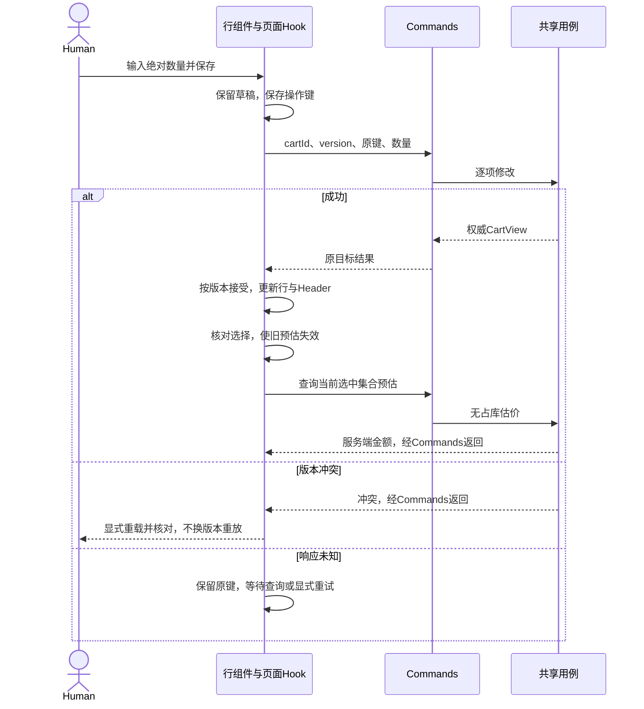

#### 选中生单 → 分别更新车与订单 → 条件导航

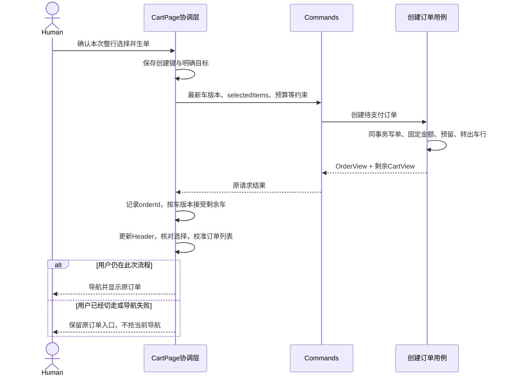

上图展开创建成功后的结果安装；创建失败整笔回滚，不先猜减车行。创建未知按原cartId和请求键恢复，不能换键重建。已转出行不再保留选择，金额切换为Order固定快照。

#### 原单支付 → 查询事实 → 恢复同单

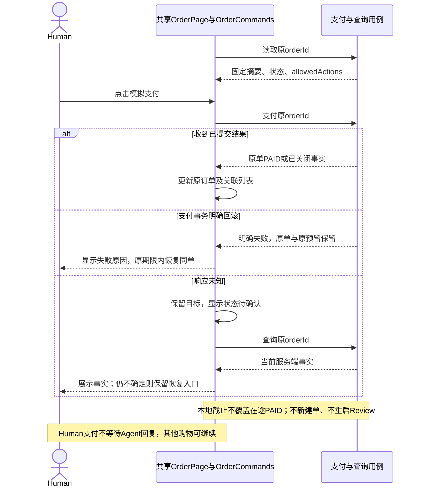

支付事务回滚保留原单与原预留，仍受原截止约束；查询未见PAID不能证明在途提交失败。明确重试仍针对原订单，来源车内容不因支付变化。

| 跨端接续 | 结果处理 | 呈现与恢复 |
| --- | --- | --- |
| WebMCP | 调相同Command，按车/订单目标接受结果 | 未切走才导航；仅启用工具不跳页 |
| Apps | 同一共享页面/Commands经Bridge适配，实例隔离 | 内嵌导航；重挂载读取原orderId，不另写协调流程 |
| 基础MCP | 返回固定摘要与原订单入口 | Human打开网页，不声称Host已自动打开 |
| 当前车与订单来源不同 | 先只展示原订单 | 继续购物才确认切换指针，不合并两车 |

以上路径共享[后端边界](BACKEND_DESIGN.md#6-后端共享契约与运行保障)的用例和事务，但多次准备操作不是一个数据库大事务。A准备成功、B失败时A可留车，界面如实报告，不能自行缩成只买A。

### 各端复用与协议适配

| 能力 / 交互形态 | Web | WebMCP页面工具 | MCP：无Apps兼容模式 | MCP：Apps UI增强模式 |
| --- | --- | --- | --- | --- |
| 商品/详情/评论 | 共享页面，经HTTP读取 | 按页面注册查询工具 | 查询工具返回公开数据 | 同一共享页面，经Bridge读取 |
| 恢复车/逐项编辑 | 共享Provider、Hook与Commands | 调用Web实例同一协调层 | MCP调用共享Cart用例 | 同一Provider、Hook与Commands，独立实例及存储 |
| 选中预估/创建订单 | 同一选行、生单与恢复流程 | 明确购买后调用并导航 | 生单后返回摘要和网页入口 | 同一流程，经APPS专用入口生单并内嵌导航 |
| 支付 | 共享OrderPage内Human点击 | 网页Human点击，工具无支付 | Human打开网页完成 | 同一OrderPage内Human点击，经UI专用Bridge支付 |
| 查单/取消 | 共享订单列表/详情及动作 | 工具读取/取消指定原单 | 工具读取/取消指定原单 | 同一页面、动作和终态协调；分享视图同样无取消 |
| 结果恢复 | 同一原请求键/原单恢复规则 | 不抢新导航、不换键 | 不假定Host已打开页面 | 同一规则，加Host工具结果验证与卡片位置接续 |

| 层 | 唯一共享实现 | 环境边界 |
| --- | --- | --- |
| contracts | DTO、运行时schema、错误语义 | 不依赖React、Prisma、Router或Host SDK |
| Nest用例 | 计价、库存、生命周期、幂等 | 不管理前端指针、焦点或页面导航 |
| commerce-ui完整应用 | 页面、控件、样式/资源、Hooks/Commands、草稿/未知/终态及外部结果协调 | 每个实例独立状态，不导入Next/Host SDK，不跨Host共享会话 |
| Web适配 | 消费完整共享应用；WebMCP复用同一实例 | Next路由/公开首屏、同源HTTP、localStorage及页面工具生命周期 |
| Apps适配 | 消费完整共享应用；不保留独立购物Controller | Bridge协议、Host工具结果/稳定调用ID、内嵌导航、sessionStorage及可信分享 |

Server MCP通过Streamable HTTP调用共享用例，返回结构化公开数据及可读摘要，不在服务内部绕回HTTP。WebMCP按当前页面注册/清理工具，不复制Server工具全集；旧页面回调不能更新新页。Apps只将search_products与create_order关联UI资源；购买准备使用同搜索契约的query_products及其他无UI数据工具，支付/状态恢复在原订单卡片内完成。Apps静态资源不嵌交易上下文或秘密，运行时由Bridge交付数据，不依赖网站Cookie、Next Router或RSC。

查询工具继续复用；新用例及工具映射由[Change §8](../../openspec/changes/archive/2026-10-31-checkout-lifecycle-redesign/design.md)维护，旧prepare/review、原生批准与独立取链接工具不作为新购买链兼容要求。Agent工具不暴露支付；Human通过网页或Apps UI直接支付。工具可用、页面已显示与实际支付成功分别验收，不用一个入口的成功代替另一个。

### 首屏、交互接管与反馈

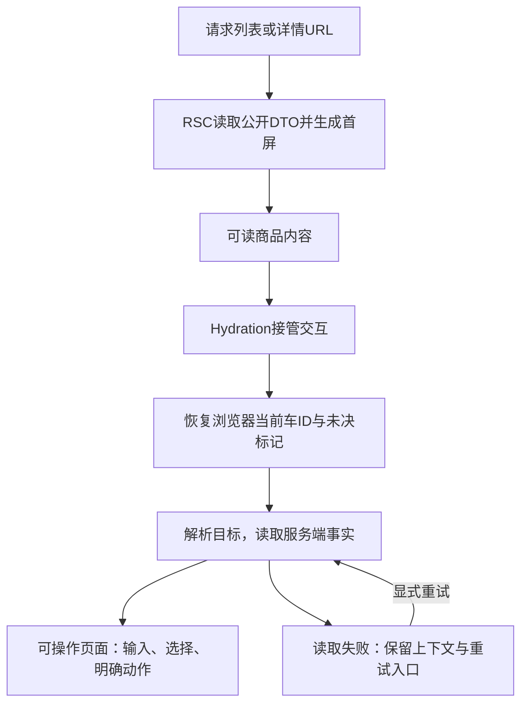

图表达Web首屏接管顺序，最终进入共享应用。Apps由Host验证工具结果、恢复原路由并通过Bridge读取目标，再进入同一套页面与交互协调；两者不共享运行时状态。首屏有HTML或Host已呈现卡片都不等于交易上下文已就绪。

列表RSC解析URL并读取公开商品首屏，详情RSC提供商品与规格；搜索控件、评论分页、数量输入和交易动作由Client协调。服务端只传可序列化公开DTO，不传原始商品对象、Decimal实例或秘密。Client Component仍可能参与首屏渲染，不能等同于“只在浏览器出现”。

浏览器持久ID和未决标记在客户端初始化后恢复，不能在服务端假定已有当前车。恢复期间展示明确状态，不因暂时尚未读到本地ID就自动创建新车。Hydration接管后，操作指向已解析的目标；公开首屏、交互可用和业务读取分别观察，不能把首屏有HTML当作交易可操作。

加载区保持上下文可理解，读取失败保留明确错误和重试入口；库存不足、版本冲突和未知结果使用各自反馈，不统一成“操作失败”。订单页面始终区分“已创建待支付”与“已支付”，原固定摘要可读，不在短暂请求过程中闪成另一笔单或空车。错误和成功提示属于当前目标，不因无关响应抢占当前页面。

### 响应式、可访问性与性能边界

沿用Product Design的繁体中文、黑白极简与响应式方向。列表/详情保证商品、规格和可购买原因可读；车页在桌面与窄屏都保留数量、选择、预估及错误关联；订单页完整展示单价、优惠、运费和应付，不能为缩短页面隐藏Human支付所需信息。Web与Apps使用同一完整页面组合、导航与控件；Apps的iframe视口按同一响应式规则适配Host可用宽度，不另做一套摘要布局或视觉样式。

搜索、数量和勾选控件有标签与可见焦点；键盘可完成选择、保存及支付，错误通过文字和可感知反馈关联原目标。异步更新不无故跳焦点；导航或弹窗的焦点由页面协调层处理，纯展示组件不抢焦点。倒计时只提示期限，屏幕阅读反馈应突出状态变化而非持续打断。真实键盘、读屏、缩放及Host限制属于实施验收，静态文档不证明通过。

性能先测公开首屏、API等待、Hydration、评论分页与Host往返，再局部优化。评论按需读取，查询只刷新受影响目标；不为减少请求缓存陈旧库存，不为加速首屏在构建时固化交易数据。Human点击支付后直接呈现服务端结果，不新增模型往返；无容量证据不引入预取交易、缓存平台或新的状态管理依赖。
