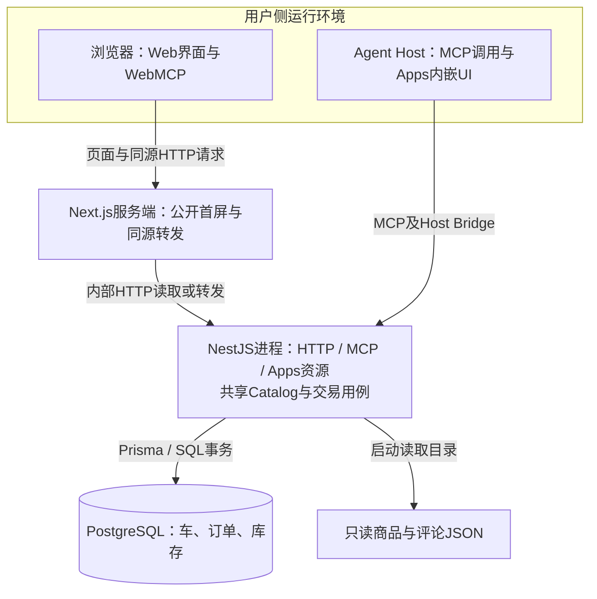

# Agent-Ready Store — 总体技术设计

**状态：商店当前技术方案（2026-10-31，Asia/Shanghai）。** 订单生命周期重构与Web/Apps完整应用复用已按Human授权实施，本文描述当前采用的架构；Human已确认人工验收通过，相关Change已同步正式Spec并归档，不据此扩大为全局基线整体Approved声明。T-11的完整复用限定替代已有明确Human批准；授权与历史批准分别追溯至[工程决策](ENGINEERING_DECISIONS.md)及[Change Tasks](../../openspec/changes/archive/2026-10-31-checkout-lifecycle-redesign/tasks.md)，实际交付事实见[DELIVERY_STATUS](DELIVERY_STATUS.md)。

## 阅读入口与设计边界

本文维护系统全景、全局约束与验证策略；详细设计按职责独立维护，一项设计只有一个正文来源。只加载当前任务相关章节，无需顺序读完全部文档。

| 需要了解的问题 | 正文来源 |
| --- | --- |
| 系统组成、入口协作、架构取舍与整体验证 | 本文 |
| 用户旅程、页面与状态协调、Web/Apps复用、环境适配 | [前端与交互设计](FRONTEND_DESIGN.md) |
| Catalog、后端分层、HTTP/共享契约、部署与安全边界 | [后端与运行设计](BACKEND_DESIGN.md) |
| Cart/Order/Inventory模型、状态、计价、幂等、事务与到期处理 | [交易核心设计](CHECKOUT_CORE.md) |
| 为什么这样选、哪些旧决策被替代 | [工程决策](ENGINEERING_DECISIONS.md) |
| 当前交付结果与证据缺口 | [交付状态](DELIVERY_STATUS.md) |

交易规则由服务端统一裁决，前端只维护交互状态；Cart、Order与Inventory的状态所有权见交易核心，HTTP与MCP适配同一用例。共享接口行为以[正式Spec](../../openspec/specs/)为准，代码定义见[contracts](../../packages/contracts/src/index.ts)，详细设计不另建DTO副本。具体增量仍由OpenSpec Change承接。

本次仅调整文档组织，不改变技术选型、业务契约或批准范围。拆分与维护规则见[产物契约](../workflow/PRODUCT_ENGINEERING.md#技术设计的分层与维护)。历史技术方案见[归档](archive/TECHNICAL_DESIGN_HISTORY.md)，旧交易实施说明见[实施历史](archive/CHECKOUT_CORE_IMPLEMENTATION_HISTORY.md)，均不作为当前状态依据。

## 体验目标与系统全景

商店同时服务直接浏览的Human和通过工具操作的Agent。用户从列表查询、筛选和比较商品，查看规格与评论，在持续购物车中准备商品，按本次选择创建固定订单，再由Human完成模拟支付；后续可以查询原单、继续选购或分享单订单。目录发现、解释价格和故障恢复与成交本身同样属于完整体验。

网站采用Next.js App Router与React；NestJS承载薄模块化API和MCP适配；Prisma/PostgreSQL保存购物车、订单和库存事实；商品与评论继续读取只读JSON。pnpm Monorepo组织Web、API、Apps、共享契约与完整购物应用，不增加独立库存服务或支付系统。

例：车里有A×3、B×2，用户只买A。生单后A整行移出并固定金额，B仍留车可编辑；用户可以继续把B生成第二笔订单，同时第一笔订单等待支付。Agent完成生单后直接展示订单，用户一次点击模拟支付，不必先等第一笔付款或新建另一辆车。

我们要改善的是三个体验：购买等待不阻塞选购、跨入口不丢上下文、失败恢复不重复购买。为此才引入下面的职责划分。

购物车解决“还想买什么”，订单解决“本次决定买什么、按什么金额支付”，库存解决“可承诺多少”。把这三者拆开，才能同时允许继续选购、独立待支付和固定金额。拆开的是生命周期和职责，不是部署服务：首版仍是一个API应用、一个PostgreSQL事务边界。

抽象只服务于现有消费者：Web、WebMCP、基础MCP和Apps复用同一业务用例；入口适配器只翻译协议和呈现结果。暂不建流程引擎、库存微服务、通用Repository框架、事件总线或插件体系。可扩展性来自“业务规则不依赖Host和页面”，而不是预先增加未使用的接口。

本方案延续[T-01～T-06](ENGINEERING_DECISIONS.md#技术决策归档--2026-10-29)中未被替代的技术栈、目录、前端与运行边界；T-08～T-11及T-11完整复用限定替代约束订单生命周期、Demo接续及共用应用边界。列表、详情、评论、购物车和订单共同组成商店，不因本次交易重构退化为单独支付演示。

### 设计驱动与约束

| 产品问题 | 设计响应 | 接受的代价与边界 |
| --- | --- | --- |
| 等待支付时仍要继续购物，金额不能随车变化 | 可变Cart与固定Order分离；生单同时转出整行并预留 | 多单导航、配额与关闭恢复增加复杂度；取消不自动回车 |
| 网页与Agent需得到同一价格和交易结果 | 后端用例统一计价和事务，协议适配器复用；前端共享完整购物应用 | Host与浏览器仍需独立环境适配和真实入口验证 |
| 请求超时不能造成重复购买，迟到结果不能改变用户正在看的页面 | 服务端持久幂等与同单恢复；前端按目标、版本和导航意图安装结果 | 保留请求键与未知状态，恢复时需要查询；不能用通用自动重试掩盖业务差异 |
| 多笔订单竞争有限库存 | 单库短事务协调订单、预留和库存；支付与关闭互斥 | 锁等待和热点商品会限制吞吐；没有容量证据前不拆服务 |
| 支持Agent操作，又保留人的最终购买控制 | 模型工具允许生单但无支付能力；Human在UI审阅固定摘要并支付 | Demo的ID接续不构成顾客身份或数据隔离，真实支付上线前必须重审权限 |

这里以用户结果组织架构，前端负责可理解、可继续的交互，后端负责不可被入口绕过的交易约束；Agent是这些用例的消费者。AI开发协作方法另见[AI_NOTES](../../AI_NOTES.md)，不作为运行时架构的一层。

### 系统全景与请求路径

Agent接入分为 MCP 与 WebMCP。MCP Apps 是 MCP 的交互式 UI 增强，复用现有 MCP Server、连接和业务用例，不构成额外入口或路径。支持 Apps 的 Host 展示内嵌 UI；不兼容时降级为 MCP 文本与结构化结果。降级保留可用工具能力；购买仍遵循适用契约与Human确认要求，不能把文本返回视为完整购买验收通过。无 Apps 时由网页订单入口承接Human支付；真实入口的验证记录见交付状态。验收覆盖 MCP 的 UI 增强与无 Apps 兼容模式，以及 WebMCP 页面工具。

`apps/mcp-app` 是 UI 源码与构建单元，静态 HTML 产物由 `apps/api` 的既有 `/mcp` 端点通过资源读取提供；目录独立不代表常驻服务独立。基础工具与 Apps 资源注册在同一 MCP Server，UI 经 Host Bridge 调用所属 Server 的工具。

图只表达运行边界与请求/数据访问方向，箭头不是源码依赖；Apps静态资源由NestJS提供，无独立Apps常驻服务。Web与Apps共享源码但各自运行，共享实现与环境适配见[前端架构](FRONTEND_DESIGN.md#5-前端架构与agent接入)。Web经Next进入API，Apps经Host Bridge进入同一MCP服务，不依赖网站Cookie或Next运行时。

Human可在网站或Apps点击模拟支付；Agent工具只承接查询、选购、生单、查单和取消。服务端统一裁决业务事实。Demo按ID接续而不验证自然人身份，UI动作与Agent工具的区分是产品交互边界，不宣称具备生产级授权隔离。

## 取舍、验证与演进条件

- **单一事实来源：** 固定商品数据在OrderLine，金额汇总在Order；查询投影和客户端缓存都不能改写它们。修改计价只影响新生单路径。
- **稳定的用例边界：** 新入口只需适配已有契约；不允许新入口另写库存或优惠逻辑。只有出现真实差异才扩展用例参数。
- **局部复杂度：** 库存锁、幂等、关闭原因只在后端维护；响应顺序在前端协调层维护；组件只呈现意图和结果。
- **明确演进触发：** 真实支付/身份权限将重新评审安全与订单状态，不假定demo接口直接可上线；只有容量证据才考虑缓存/队列；只有整车版本冲突成为实际瓶颈才考虑逐行模型。当前设计不预建这些扩展点。

### 质量目标与验收链路

面向开发者定位设计与实现、测试人员定位条件与判据、交付人员核对运行证据。下表引用现有需求，不新设指标或另一套验收任务；测试入口只说明如何验证。历史结算/搜索执行证据分别在[结算Tasks](../../openspec/changes/archive/2026-10-31-checkout-lifecycle-redesign/tasks.md)与[搜索Tasks](../../openspec/changes/archive/2026-10-31-grouped-multilingual-search/tasks.md)，最新运行版本、CI和真实Host缺口只维护在[交付状态](DELIVERY_STATUS.md)。本轮仅核对文档与源码，未重新执行业务测试。

| 目标与依据 | 环境/触发 → 可观察验收条件 | 设计与验证入口 | 证据及待确认边界 |
| --- | --- | --- | --- |
| 搜索确定、有界且无交易写入：[商品发现Spec](../../openspec/specs/product-discovery/spec.md) | 相同目录/库存下查询等价文字及多个目标 → 独立预算与稳定排序、组引用可解析、同名ID不混并；公开字段过滤、异常数据保真与评论不可信文本隔离；续页版本变化明确拒绝，五表交易摘要不变 | [搜索设计](BACKEND_DESIGN.md#分组搜索与文字匹配)及其单元、HTTP/MCP、真实DB测试入口；[目录测试](../../apps/api/test/catalog/catalog.test.ts)覆盖公开投影与评论 | 历史搜索Tasks已有对应记录；无生产级容量/延迟承诺 |
| 车编辑与选择：[CART-08](../product/REQUIREMENTS.md)、[AC-18](../product/REQUIREMENTS.md#ac-18) | 草稿未保存、外部版本变化及问题行 → 保护输入并显式核对，按完整选中集合报价/生单，不自动部分购买 | [前端交互状态](FRONTEND_DESIGN.md#54-交互状态与可继续的动作)、[车浏览器测试](../../e2e/cart-lifecycle.spec.ts)、[车命令测试](../../apps/web/test/cart-lifecycle-commands.test.ts) | 历史结算证据；报价不是库存或最终金额承诺 |
| 跨入口金额一致：[NFR-03](../product/REQUIREMENTS.md#nfr-03) | 阈值与舍入边界、生单后目录变化 → 服务端明细可对账、支付沿原单金额 | [交易计价](CHECKOUT_CORE.md#62-库存期限与计价事实)、[pricing测试](../../apps/api/test/cart/pricing.test.ts) | 历史结算证据；本轮未重跑，不以UI格式化替代金额验证 |
| 不超卖、幂等与原子提交：[NFR-04](../product/REQUIREMENTS.md#nfr-04) | 隔离PostgreSQL下同键、末件与配额竞争及故障注入 → 订单事实与库存净变化满足不变量，失败不部分提交 | [交易约束索引](CHECKOUT_CORE.md#交易约束与实现索引)连接锁序、SQL约束与DB测试 | 已有历史真实DB证据；Mock/HTTP成功码不足以单独证明 |
| 期限与释放：[NFR-02](../product/REQUIREMENTS.md#nfr-02)、[期限要求](../product/REQUIREMENTS.md#ac-08) | 锁等待跨截止/支付与关闭竞争 → 数据库时间拒绝新支付、只消费或释放一次；故障恢复补扫 | [期限与扫描](CHECKOUT_CORE.md#数据库运行与隔离验证)、[lifecycle-db测试](../../apps/api/test/cart/lifecycle-db.test.ts) | 功能/竞争证据不证明时延。五秒释放目标的设计负载、环境、观测起止点与统计口径**待确认**；需确认后实测，不承诺故障期上限 |
| 交互恢复与隔离：[AC-12](../product/REQUIREMENTS.md#ac-12)、[AC-19](../product/REQUIREMENTS.md#ac-19) | 丢响应、离页、重挂载、乱序与组分页失败 → 恢复原请求/订单，不自动重购/支付，不覆盖新目标 | [前端状态协调](FRONTEND_DESIGN.md#53-状态归属与保存范围)、[车命令](../../apps/web/test/cart-lifecycle-commands.test.ts)、[报价](../../apps/web/test/selection-quote.test.ts)、[订单命令](../../apps/web/test/order-lifecycle-commands.test.ts)、[Apps浏览器](../../e2e/mcp-app.spec.ts) | 历史自动化与Human记录分开引用；Host替身不能替代真实Host行为 |
| 页面可读可操作：[NFR-01](../product/REQUIREMENTS.md#nfr-01) | 桌面/移动、键盘与错误状态 → 保留完整金额与条件、可见焦点、错误关联和可恢复动作 | [前端体验边界](FRONTEND_DESIGN.md#59-响应式可访问性与性能边界)、[目录E2E](../../e2e/catalog.spec.ts)、[订单E2E](../../e2e/order-lifecycle.spec.ts) | 历史浏览器检查可复用；未记录的读屏/缩放/Host组合不能推定通过，不声明WCAG合规等级 |
| 入口与运行边界 | HTTP/MCP/Apps调用及服务重启 → 同一业务语义，保留来源校验、跨车接续和分享展示边界；dev/HMR及生产构建/启动可用，重启不seed/重置库存，测试库隔离 | [后端运行](BACKEND_DESIGN.md#63-运行拓扑与数据边界)、[MCP测试](../../apps/api/test/mcp/lifecycle-mcp.test.ts)、[WebMCP E2E](../../e2e/webmcp.spec.ts)、[CI](../../.github/workflows/ci.yml) | 当前CI结果与版本见交付状态；Demo无顾客身份隔离，不能推出生产安全保证 |
| 性能与可运维性 | 公开首屏/API/Host往返及释放积压需要在指定环境测量；指标不得从功能测试推算 | [前端性能边界](FRONTEND_DESIGN.md#59-响应式可访问性与性能边界)、[只读metrics](CHECKOUT_CORE.md#数据库运行与隔离验证) | 响应延迟、吞吐、可用性、恢复时限及告警阈值均**未设定/待确认**；生产目标当前不在范围，如纳入由Human明确场景和预算后设计/验证 |

### 验证边界与演进

并发检查最终订单数、订单状态与库存净变化，不仅检查HTTP成功码；用确定性协调验证关键竞争，Mock不替代事务或Host。金额反例涵盖989.99/990、999.99/1000、2000只减一次以及100.30的95.285舍入为95.29。业务测试不能指向演示业务库，测试故障注入不作为业务参数暴露。

详细新增验收场景集中于OpenSpec Design §12，实施Tasks、真实Host记录、CI具体run与Human验收才提供运行证据；配置存在、脚本模拟、静态图或历史通过计数不能代替当前验证。进度集中在交付状态，本文不重复维护里程碑清单。

同一Change已记录规划批准、实施授权、交易核心与完整共享应用的实现/审查/验证；后续Human验收与正式Spec同步已记录于归档Tasks；可直接查看的演示证据与当前CI结果仍按交付状态分别核对，不以本方案或自动化通过替代最终接受。旧D-01、D-04～D-07、D-21～D-24及T-05/T-07的批准不追溯改写；T-11完整复用限定替代有独立Human确认来源。

旧流程一次性切换已按Human具体授权执行，证据留当前Change Tasks；该事实不授权重清、再次seed或回退旧写服务。后续升级保持新车、订单和库存事实，按兼容数据的构建与服务更新执行；新流程长期保留、取消和到期不沿用一次性切换清理。

## 旧章节链接兼容

原章节锚点与新正文位置

以下仅为原章节锚点的跳转索引；正文维护在对应详细设计。

[查看对应详细设计](CHECKOUT_CORE.md#domain-model)

[查看对应详细设计](CHECKOUT_CORE.md#2-领域与数据模型)

[查看对应详细设计](BACKEND_DESIGN.md#21-商品发现与运行数据)

[查看对应详细设计](CHECKOUT_CORE.md#22-标识版本请求与来源)

[查看对应详细设计](FRONTEND_DESIGN.md#shopping-journeys)

[查看对应详细设计](FRONTEND_DESIGN.md#3-完整用户流程与各端差异)

[查看对应详细设计](FRONTEND_DESIGN.md#31-选择接续与多单导航)

[查看对应详细设计](FRONTEND_DESIGN.md#32-从选中报价到订单审阅)

[查看对应详细设计](CHECKOUT_CORE.md#order-state)

[查看对应详细设计](CHECKOUT_CORE.md#4-状态与异常体验)

[查看对应详细设计](FRONTEND_DESIGN.md#frontend-architecture)

[查看对应详细设计](FRONTEND_DESIGN.md#5-前端架构与agent接入)

[查看对应详细设计](FRONTEND_DESIGN.md#51-页面协作路由与上下文)

[查看对应详细设计](FRONTEND_DESIGN.md#shared-commerce-application)

[查看对应详细设计](FRONTEND_DESIGN.md#52-页面容器业务组件与展示复用)

[查看对应详细设计](FRONTEND_DESIGN.md#52-完整共享应用组件与环境接口)

[查看对应详细设计](FRONTEND_DESIGN.md#53-状态归属与保存范围)

[查看对应详细设计](FRONTEND_DESIGN.md#54-交互状态与可继续的动作)

[查看对应详细设计](FRONTEND_DESIGN.md#55-查询标识刷新与结果安装)

[查看对应详细设计](FRONTEND_DESIGN.md#56-关键交互如何贯穿各层)

[查看对应详细设计](FRONTEND_DESIGN.md#57-各端复用与协议适配)

[查看对应详细设计](FRONTEND_DESIGN.md#58-首屏交互接管与反馈)

[查看对应详细设计](FRONTEND_DESIGN.md#59-响应式可访问性与性能边界)

[查看对应详细设计](BACKEND_DESIGN.md#backend-guarantees)

[查看对应详细设计](BACKEND_DESIGN.md#6-后端共享契约与运行保障)

[查看对应详细设计](CHECKOUT_CORE.md#61-用例与一致性边界)

[查看对应详细设计](CHECKOUT_CORE.md#62-库存期限与计价事实)

[查看对应详细设计](BACKEND_DESIGN.md#63-运行拓扑与数据边界)

[查看对应详细设计](BACKEND_DESIGN.md#64-共享契约与失败语义)

[查看对应详细设计](BACKEND_DESIGN.md#65-运行数据初始化与安全边界)

## 分类发现增量（2026-10-31）

[catalog-discovery](../../openspec/changes/catalog-discovery/design.md)复用Catalog/Service与共享Page/Result：`GET /api/v1/catalog/categories`和MCP `list_product_categories`返回目录派生的分类原值；Web首屏并行加载商品与分类，共享SearchForm使用分类下拉框。无新数据库表或搜索依赖。Human已批准仅分类HTTP GET/HEAD和该MCP工具豁免请求到期清理；认证不豁免，其他商品/交易入口仍先清理。边界与版本语义见该Change，不修改历史批准。
