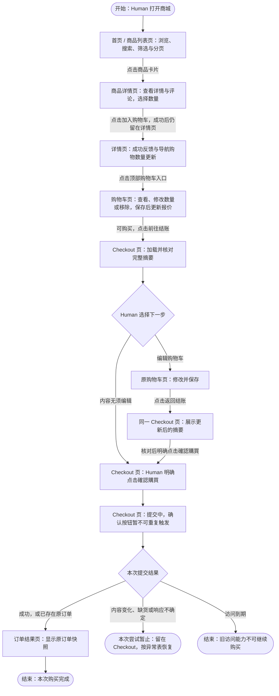
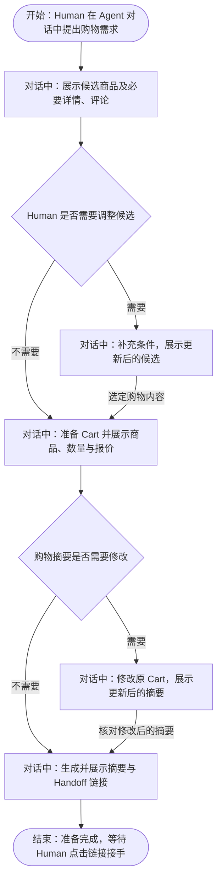
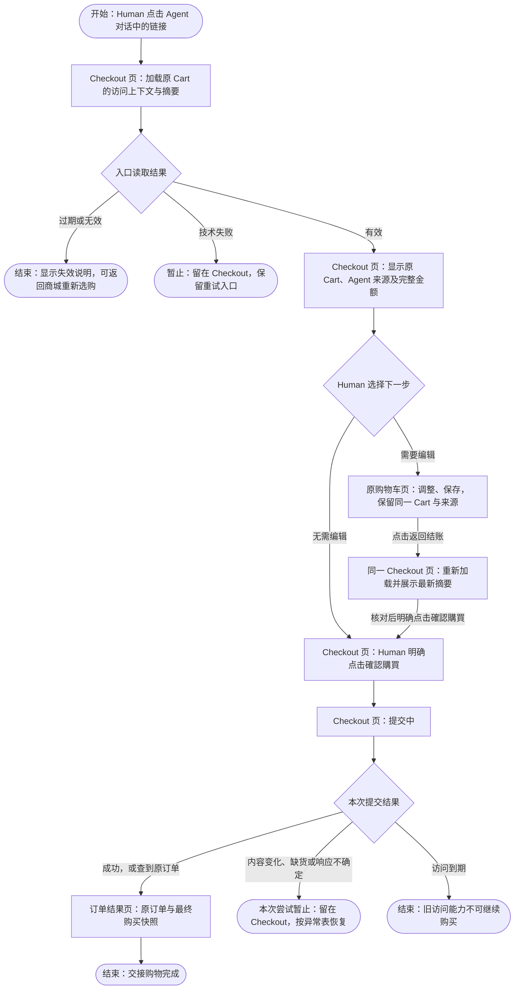
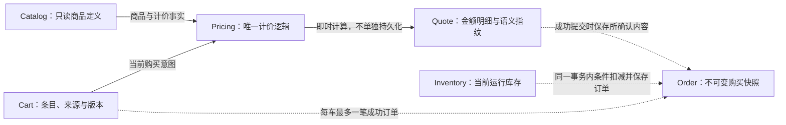
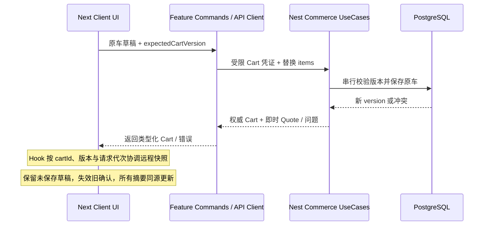
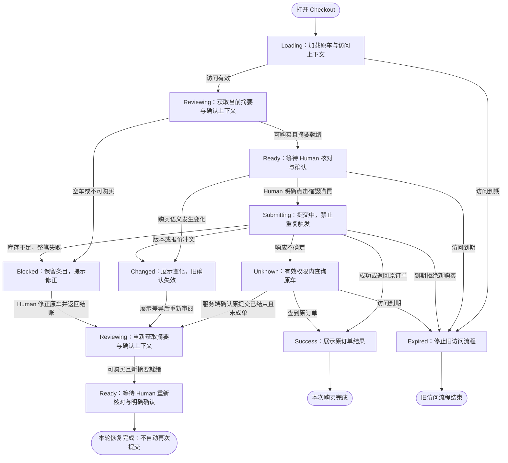
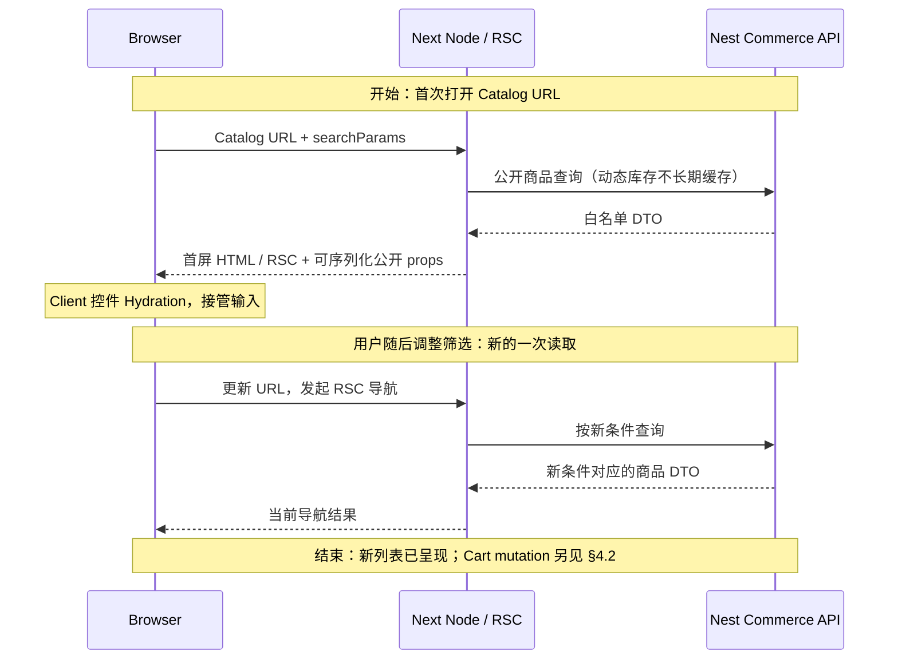
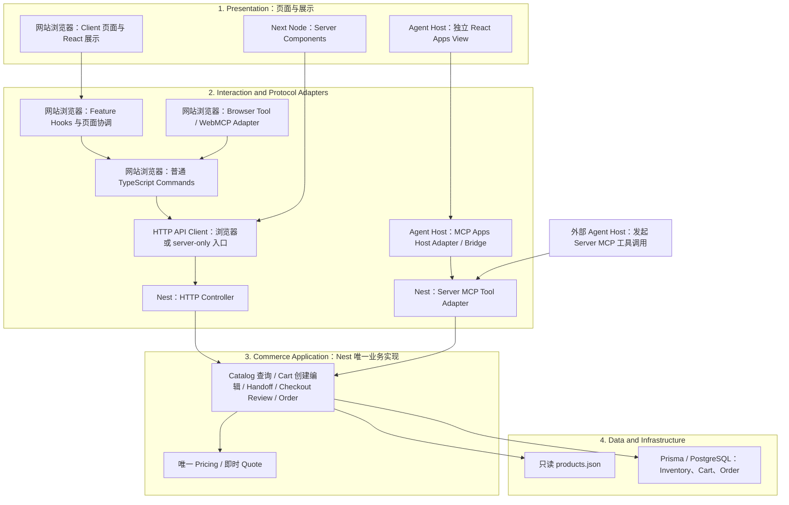

# Agent-Ready Store — Technical Design

**2026-10-30最新Human确认：** [D-01直接支付决定](../../DECISIONS.md#d01-direct-payment-20261030)将MCP Apps/WebMCP改为Human支付点击后经受保护UI直接下单并原地显示结果，不依赖Agent接续；基础MCP保留Host原生确认后Agent提交及当前兼容限制。下方较早的三入口统一Agent提交描述保留当时范围；最新机制见当前Change，本轮只修订Spec、不实施代码。


**2026-10-30 Human三入口与便利购物澄清：** [D-01当前边界](../../DECISIONS.md#d01-agent-convenience-20261030)保持MCP会话内、WebMCP全步骤工具及Apps内完成购买；Apps允许直接跳页和Agent跨步准备，不强制每页提示/点击，三入口均以减少操作为目标。最终须Human在结算界面亲自点击“支付/确认购买”，Agent不得代点；沿现有模拟结账，成功后才可提供外部订单详情链接。此补充替代增量规划中每步提示唤起/禁止直接跳页的限制；历史基线批准/验收保留，具体确认/权限及Host接续见[当前Change](../../openspec/changes/archive/2026-10-30-agent-confirmed-purchase/design.md)，尚未获技术方案或实施批准。

**2026-10-30 Human 需求变更（当前方向）:** [D-01 两步 Agent 购买确认](../../DECISIONS.md#d01-agent-two-step-20261030) 已将基础MCP/WebMCP/MCP Apps两步确认后的Agent代提交纳入当前需求，替代旧的C-01 Planned Enhancement范围判断。人先请求准备，审阅最终摘要后再明确确认，Agent才可执行已授权提交；普通Web人工路径与交易不变量保持。本文既有“七工具无提交/仅浏览器人工提交/代提交后置”描述保留为已批准旧设计及现有实现的范围，不作为新需求排除依据；新确认入口、可验证授权、提交通道和异常恢复须另行完成统一设计与OpenSpec规划，尚未获技术设计或实施批准。历史批准与验收不追溯改写。


**2026-10-30 Human 逐项操作修订：** [D-24](../../DECISIONS.md#d-24--电商逐项操作与购物快照新鲜度) 与 [S5 Design §4](../../openspec/changes/archive/2026-10-30-s5-webmcp/design.md) 已获批准，限定替代 Web 整车保存和干净页面仅手动刷新细节：Web/WebMCP 逐项操作、同车短暂互斥、进入/返回校准；旧 HTTP/基础 MCP 兼容，目标行严格校验、旧问题行可逐条修复且未修完不可结算。D-23 的版本权威、禁止重放及交易边界继续有效；实施状态以 Tasks §6 为准。
**2026-10-30 Human 限定修订：** [D-23](../../DECISIONS.md#d-23--服务端权威与购物车客户端简化) 批准 Web/WebMCP 购物车以服务端为准；编辑冲突或响应未知提示显式重新加载，刷新会放弃全部未保存修改，不逐项比较、合并、重放编辑或长期全局锁定。创建幂等、购买确认/未知结果恢复和服务端交易保障保持。此补充取代下文历史客户端冲突比较/编辑恢复细节，实施与验收见 [S5 Change](../../openspec/changes/archive/2026-10-30-s5-webmcp/design.md)。

**2026-10-30限定补充（Human Accepted）：** 确认材料与Cart截止一致、同步生单及成交价格固定的定义和批准来源见[D-21追加确认](../../DECISIONS.md#s3-confirmation-lifetime-20261030)；不另设支付或独立短期确认倒计时，既有绑定/重验与整体实施授权边界保持。

**S3限定补充（Human Accepted，2026-10-29）：** §8.2准入与commit边界、§8.3/§9.2结果访问与保留的相关历史Pending，按[D-21 S3限定补充](../../DECISIONS.md#s3-checkout-boundary-20261029)局部收敛；S3确认绑定与恢复/事务实施方案仍Proposed，不代表完整规划、实施或Git授权。

- **Status：Approved — Technical Design Baseline v0.5。**
- **日期：** 2026-10-29（Asia/Shanghai）。v0.5 承接已确认的架构与单 Cart Token 方向；Human 于本日批准结束本轮产品与技术设计阶段。
- **定位：** 前端主导的购物体验、共享全栈闭环与 Agent/UI 协作方案。本文回答从用户行为到状态、组件、契约和可信交易的设计推导，不是数据库实现手册。
- **权威依据：** [Requirements v0.2](../product/REQUIREMENTS.md)、[Product Design 五页/三稿及 UX 决策](../product/PRODUCT_DESIGN.md)、[D-01～D-22](../../DECISIONS.md)、[T-01～T-06](ENGINEERING_DECISIONS.md)。规则正文归原来源；本文解释实现映射。
- **最终批准记录：** Human，2026-10-29（Asia/Shanghai）；直接依据为本聊天「Design Phase Closure & Git History Consolidation」，明确要求将经过 Review 的 v0.5 标记 Approved 并归档。批准设计基线，不把 Proposed Implementation Details、L-01/P-04 等 Pending 或未验证能力自动转为 Approved/Passed。
- **授权边界：** 本轮仅归档、文档级核对、分批 Git Commit、按流程 Merge 与必要远程同步；不启动 S1、不创建 OpenSpec Change、不写业务代码、不安装或部署。

- **S2限定补充批准（2026-10-29）：** Human“批准这些建议”接受 [D-04补充](../../DECISIONS.md#d-04--交接链接有效期)及T-05 S2补充：L-01已解决为创建起24h、有效期内首次分享后完整24h；§9.3/9.4的现有恢复/每车Cookie方向及首次材料与Cookie均丢失的体验限制获接受；S2 Web/HTTP与S4 MCP写工具/交接/指标分期获接受。以下历史批准记录中的Pending/Proposed不覆盖该局部补充；具体实现与运行证据、P-04长期数据/结果权限和S3确认会话细化仍待完成。不授权业务实施或Git操作。

| 状态 | 本文适用范围 |
| --- | --- |
| Approved Architecture / Design Direction | T-01～T-06 的已确认范围；pnpm Monorepo、Next.js App Router/React/TypeScript、NestJS 内置 Streamable HTTP MCP、Prisma/PostgreSQL、三表、唯一 Pricing、七工具、24h Handoff、Human Hosted Checkout、原子交易与同车唯一订单 |
| Proposed / Implementation Detail | 下文前端组织、路由路径、TanStack Query、缓存与请求策略、统一访问期限建议、每车 Cookie、受保护凭证恢复方案及附录参数；保留为实施细化候选，不因基线批准视为已批准依赖 |
| 本次完整交付范围 | 基础 MCP、WebMCP、MCP Apps 与 Hosted Checkout；分 Slice 实施、分别验收，均需纳入本次交付 |
| Planned Enhancement | Agent 经有效 Human 授权代提交；不进入本次交付 |
| Pending Product Decision | WebMCP 新车可信来源、P-04 过期后的长期结果读取、清理与保留政策；L-01已由S2限定补充解决 |
| Pending Runtime Verification | 所有真实商城、事务、UI 与 Host 兼容性；静态设计不证明实现成功 |

## 1. Goals & Design Principles

以业务需求 → 用户旅程 → 领域对象 → 状态生命周期 → 所有权与数据流 → 技术机制 → 工程验证组织设计。目标是让 Human 和 Agent 准备同一购物意图，Human 在可信界面核对并明确确认，NestJS 保证最终事实。每项机制须有具体失败场景与可验证的不变量，不因框架能力增加层次。

已确认的 Next.js App Router + React + TypeScript、NestJS、Prisma/PostgreSQL、pnpm Workspaces 与共享 contracts 不重选。五页/三稿、唯一 Pricing、七工具、原子订单保持。Handoff 是分享同一 Cart 访问能力的行为，不是新实体、新车或新状态；共享访问与独立购买确认分开。无登录、真实支付、后台、Redis/MQ、Token 服务或额外 BFF。

## 2. User Journeys

本章从使用者所在的页面/界面出发，说明动作、可见反馈与去向。三张流程图均自上而下，圆角节点明确开始、结束或暂止；菱形表示条件分支。相同页面在不同阶段可重复出现，以表达编辑后返回而不画长回线。同页交互与异常恢复在文字/表格中说明，不以回线模拟刷新。图中的「页内状态」不是新页面；API、凭证与事务实现分别在后续章节解释。页面职责沿用 [Product Design §2～4](../product/PRODUCT_DESIGN.md#2-信息架构与页面职责)。

### 2.1 Human 直接购物：五页如何走通

Human 从首页开始发现商品；加购成功仍留在原页面，主动打开购物车才跳转。购物车负责修改，Checkout 负责核对与确认，成功后才到订单结果页。搜索、加购、评论翻页均不把用户自动带入 Checkout。



图中只展开一次选购与一次可选编辑；返回列表继续浏览、搜索无结果后调整条件、重复评论翻页都属于用户主动的页内/返回操作，不展开为循环。用户也可从列表或详情的顶部导航直接进入已有购物车；该入口不要求重新加购。**图中没有强制加购后跳转。** 列表快捷加购属于 UX-02 的可选项；若实现，也留在列表显示反馈，再由用户打开购物车。详情返回列表应恢复原搜索、筛选和分页；评论翻页保留商品及数量输入。成功后继续选购不能重新编辑已完成 Cart，新购买按新旅程处理。

下表补齐图中主线的异常分支，所有恢复操作都从用户当前页面开始：

| 所在页面 / 动作 | 触发的可见状态 | 用户下一步与去向 |
| --- | --- | --- |
| 列表搜索或详情/评论加载失败 | 当前页显示加载失败，保留查询条件/商品上下文 | 点击重试仍在原页；不伪装成空结果 |
| 详情商品售罄、库存异常或价格待确认 | 详情仍可阅读，显示具体原因，加购不可用 | 返回原列表继续选择；不创建可购买条目 |
| 打开尚无商品的购物车，或移除最后一件 | 购物车页空状态，结账不可用 | 点击选购入口回首页/列表；不显示空订单报价 |
| 购物车保存时数量无效或请求失败 | 原行错误，草稿保留 | 原页修正/重试；未保存数量不显示为已保存 |
| 购物车保存遇到并发修改 | 原页提示冲突与最新内容，保留本地草稿 | Human 核对后重新编辑；不自动覆盖另一标签页或 Agent 的修改 |
| Checkout 加载或 Review 失败 | Checkout 页内错误，确认不可用 | 原页重试 Review；也可进入原车编辑 |
| 确认时购买内容或报价变化 | 留在 Checkout，显示变动项及新摘要（Changed） | 重新核对后再次明确确认；不是自动提交，也不另开页面 |
| 确认时库存不足或商品不可购买 | 留在 Checkout，保留全部条目并标记问题（Blocked） | 点击编辑购物车 → 原 Cart 页调整 → 点击返回结账 → Checkout 重新审阅 |
| 提交后响应丢失 | 留在 Checkout，显示“結果尚未確認”（Unknown） | 查询原车；查到订单才进入结果页，仍不确定继续显示未知；服务端确认原提交已终止且未成单、访问有效时才重新审阅 |
| 当前访问能力已过期 | 当前 Cart/Checkout 显示失效状态，停止编辑与确认 | 返回商城或重新发起购物；到期后的长期结果访问仍待 P-04 |
| 刷新订单结果页 | 结果页加载原订单快照 | 有效权限内显示同一结果；读取失败留原页提示，不创建订单 |

正常路径验收应从首页实际点击完成五页跳转，再验证「详情加购后未跳页」「返回列表条件保留」「Checkout → 原车编辑 → Checkout」「未知结果恢复到原订单」；仅调用 API 不能证明该用户流程成立。

### 2.2 Agent 辅助选购：对话界面中的准备过程

基础 MCP 的 Agent 流程发生在支持工具调用的 Host 对话中，不经过商城五页。对话输入是购物意图，输出是商品信息、可调整的购物摘要以及交接链接；工具名与参数见 §6.2，不把工具调用列表当作用户页面流程。下图是一次辅助购物的典型交互，具体询问方式由外部 Agent 决定，不新增商城聊天页面。



图中只展开一次可选调整，不要求每轮重复比较；Human 可结束对话而不购物。查询无结果时在对话中说明并等待调整；商品不可购买或编辑冲突时反馈问题并读取最新 Cart，不假装调整成功。创建/分享响应丢失须恢复原车与原期限（§9.3），不自动生成另一次购买。Agent 对话中的选购意图不等于商城购买确认；该流程不包含提交订单。

### 2.3 Agent → Human：从对话链接进入共享 Checkout

交接的明确边界是 Human 点击对话里的链接。Human 的第一个商城页面就是 Checkout，不先经过首页、详情或购物车页；只有选择编辑时才去原购物车页。两种入口使用同一个 Checkout 和订单结果页。



交接图的“暂止”结束的是本次尝试，保留原车与访问期限，并非整个购物旅程失败。加载重试、Changed、Blocked、Unknown 的具体操作与去向复用 §2.1 异常表：重新审阅仍在 Checkout，编辑进入原车再返回，查到原订单才进入结果页；都不自动重新提交。Unknown 未能确定结果时保持原状态；保存失败不离开原车，移除至空车则按 §2.1 空车分支处理。交接后的访问到期在当前页面显示失效状态，不能通过返回/重试继续购买。Human 编辑后返回的仍是原 Cart，来源、优惠资格和首次交接期限均保持；不存在另一个 Agent Checkout 或 Handoff 业务页面。

用户流程验收覆盖：从真实 Agent 对话点击链接直达 Checkout、进入原车修改再返回、报价变化留页再次确认、缺货留页并由 Human 选择编辑、成功进入原订单结果、过期指引回商城。访问分享不创建新 Cart、不预留库存，所有入口复用 Commerce UseCases、Pricing 与订单交易逻辑。

## 3. Domain Model & Lifecycle

### 3.1 Cart 是旅程，不是账户

无用户系统意味着没有“此人拥有的所有订单”或跨设备身份。Cart 表示一次可编辑购物意图，ID 只定位该旅程；访问能力由受限凭证授予。普通购物与交接购物可以在同一浏览器存在，不能用一个全局当前 Cart 覆盖所有路由，也不能把 AGENT 车复制成 HUMAN 车来继续购物。服务端保存来源，前端只显示。

| 概念 | 业务含义、状态和关系 |
| --- | --- |
| Catalog | 只读商品事实和评论；原始 stock 只供首次库存初始化，不代表运行库存 |
| Cart | 商品 ID/数量与可信来源；可为空，OPEN 可编辑，存在唯一 Order 后派生 COMPLETED。凭证过期不代表 Cart 被删除 |
| Pricing | 服务端唯一计算规则与实现；不是某次报价数据，也不是前端工具函数 |
| Quote | Pricing 对当前 Cart 与目录事实产生的预估结果；非锁价、非库存预留、非独立交易表。失效商品可无有效报价 |
| Inventory | PostgreSQL 中每商品的运行数量；购买前可变化，缺货不隐式移除 Cart 条目 |
| Order | 一次成功购买的不可变快照；一个 Cart 最多一个 Order，失败不保存半单，不引入支付/发货状态 |



上图是领域关系图：实线表示报价计算输入/输出，虚线表示成功购买后的关联或事务约束，不表示用户必须依次访问这些对象。完整时间顺序见 §2 与 §4。

### 3.2 五个容易混淆的概念

| 概念 | 解决的问题 | 不能替代什么 |
| --- | --- | --- |
| Cart ID | 多页面、Agent 与 Human 找到同一旅程 | 不授予读取、编辑或购买权限 |
| Cart Version | 防止两个编辑者用旧内容覆盖新内容 | 不检测目录价格、优惠等外部变化 |
| Quote Hash | 标识完整购买语义，发现同总额换商品等变化 | 不授予权限，也不是递增版本号 |
| 访问凭证 | 限定谁可在期限内操作哪一车、哪些能力 | Handoff 访问不等于购买授权 |
| 购买确认上下文 | 绑定本次会话、车版本、完整报价及与签发时Cart截止一致的有效性 | 不是账户身份，也不能证明自然人 |

指纹覆盖 ID、名称、关键品牌/规格、数量、单价、优惠、来源、运费、币别与总额等确认内容；不只比较总额。仅库存减少但仍足量不应要求重新确认，不相关目录变化也不应误报。Cart.version 随实际条目变更递增；noop 不递增。报价实时计算，不保存多套 quoteVersion/quoteCartVersion 状态。

### 3.3 从业务规则推导保障

| 场景 / 来源 | 所需保障 | 机制与验证 |
| --- | --- | --- |
| 创建超时，Agent 重试；D-22 指标去重 | 同一创建意图只生成一车 | 创建请求标识 + 原始 payload 比较；响应丢失/编辑后重放测试 |
| Human 重复点击或成功响应丢失；ORDER-05/06 | 同车永不重复购买 | Order.cartId 唯一；重试读原快照，测试重启后仍只扣一次 |
| 两车抢最后库存 | 不超卖 | 数据库条件扣减，不能仅先读再写；真实并发连接竞争测试 |
| 多商品中一件不足 | 全买或全不买 | 短事务将所有扣减与订单写入一起提交/回滚；中途故障注入测试 |
| 旧摘要仍在屏幕；EX-01 | 变化内容须重新确认 | Cart Version + 完整语义 Hash + 独立确认上下文；同总额变更测试 |
| Handoff 访问/失败/编辑；D-04 | 24h 固定有效，不续期 | 签发时刻与固定期限，提交等待后重新校验；边界时钟测试 |

建车幂等管“创建旅程”，购买幂等管“完成该旅程”，事务管一次提交的原子性；三者职责不同，不能用一个客户端按钮禁用替代。

## 4. End-to-End State & Data Flow

### 4.1 三个维度独立建模

| 维度 | 状态与所有权 | 变更/一致性责任 |
| --- | --- | --- |
| 领域业务 | Catalog 只读；Inventory 为运行数量；Cart 为一次旅程；Quote 为即时计算；Order 为成功事实 | Nest 用例校验，PostgreSQL 保存 Cart/Inventory/Order；Order 存在推导完成态，不建 Handoff/Quote 表 |
| 访问生命周期 | cartId 只定位；单 Cart Token 授予车级访问；首次交接后固定24h，Token 期限不等于数据保留 | Nest 每次校验同一 Token 与当前期限；Cookie 仅传输。Checkout 上下文绑定会话但不新增访问身份，详见 §9 |
| 前端交互 | Loading、Reviewing、Ready、Submitting、Changed、Blocked、Unknown、Success、Expired | Checkout hook 管理可观察交互；服务端结果决定业务事实，不能把前端 Submitting 持久化为交易状态 |

### 4.2 跨层数据与请求归属

下面是一次 Cart 保存的请求/响应时序：从 UI 提交草稿开始，到原车远程快照与界面更新结束；响应箭头表示返回数据，不是页面循环。



RSC 只读取公开商品数据；Cart mutation 经浏览器 API Client 调用 Nest。响应处理由 Hooks 或 Adapter 的页面协调回调负责，Commands 只返回结果。以下规则用于一次编辑与后台刷新竞争，不增加持久化状态：

| 数据 / 标识 | 谁持有 | 更新与失效关系 |
| --- | --- | --- |
| 远程 Cart/Quote 快照 | Nest 权威，Query 为客户端内存副本 | 服务端返回后按 cartId 更新；快照带来源、条目、版本及即时报价，不能拼接不同响应的总额 |
| 编辑草稿与 baseVersion | useCartEditor 局部持有 | 从接受的快照建立；dirty 时刷新不覆盖草稿、不悄悄升级基准版本。成功保存后整体重置；冲突保留草稿让 Human 处理 |
| 请求代次 | 页面/Hook 的内存计数 | 用 cartId + 本地请求代次防迟到结果覆盖；低于已接受 Cart Version 的响应丢弃。版本相同的报价不能按 Hash 大小排序，且本地发起先后不保证不同服务端快照先后：有重叠读写时保存后另行重验，必要时取消/忽略旧读取 |
| Cart Version | Nest 编辑时维护 | 防旧编辑覆盖，不是请求序号；与草稿基准不一致产生冲突，同时使绑定旧版本的确认失效 |
| Quote Hash | Nest 根据完整购买语义计算 | 同总额也能变化；仅足量库存变化不应触发再确认。不同 Hash 不表示新旧大小，必须核对当前 Review |
| Checkout 状态 / 确认上下文 | useCheckoutFlow 内存持有 | Ready 必须对应完整 Review 快照；实际版本/语义变化或换车使确认失效，Changed 后重新审阅且等待新点击。普通 GET 不生成购买确认 |

跨 Cart 导航不创建新的服务端“访问上下文身份”：使用 cartId 隔离缓存，路由/组件卸载取消或忽略旧请求；同 cartId 重新兑换/权限失效时清该车私有缓存并递增本地请求代次。旧响应不得重新填入已清除的敏感视图或驱动另一车导航。取消 fetch 不等于撤销数据库提交。

**验证：** dirty 草稿遇后台刷新不变；并发保存返回低版本不倒退；同版本不同报价的乱序响应最终通过新 Review 重验；换 A→B→A 后旧响应不重新启用确认；RSC 刷新不假定已失效 Query，Query 失效也不假定刷新 RSC。

### 4.3 Checkout 交互状态

下图按一次交互阶段从上到下展开：先加载与审阅，再确认与提交，最后显示结果或恢复。恢复后的 Reviewing / Ready 在下方再次出现，表示同一状态的下一次进入，不是新增业务状态；不画跨越整图的向上回线。图中到达“等待新的明确确认”即结束本轮恢复，后续由 Human 发起下一次提交，不能自动重试购买。



重新审阅仍遇到不可购买或技术失败时，停留原页提示，按下表修正或重试读取；Unknown 查询仍不确定则保持该状态，不按未成单处理。它们不产生自动提交的循环。技术错误重试、主动离页及访问期限规则仍按下表与 §9 执行。

**Unknown 的关键竞态：** 提交仍在服务端等待/执行 → 前端超时 → 查询暂时返回 Cart OPEN/无 Order → 原提交随后 commit。故一次 GET 未发现订单、客户端请求已取消或等待超过某时长，都不能证明购买失败。前端保持 Unknown，不自动重发提交、不建新 Cart、不恢复编辑或确认按钮；在有效权限内有界查询，查到订单显示原结果，查询预算耗尽仍报告未知。只有收到可证明原尝试已终止且无订单的服务端结果，才可重新 Review；没有这种证据就不把 OPEN 当作安全重试信号。访问到期按原规则处理，不借恢复延长权限。S3 须验证重验/重试与尚在执行提交的协调；具体事务/API 方案留该切片，不为此预建订单任务表、持久 Submitting 状态或后台系统。

loading/reviewing 失败保留可重试读取提示；图中未罗列每种技术错误。ready 必须对应当前显示的完整摘要与确认上下文。submitting 禁止二次 UI 提交，服务端唯一订单仍为最终兜底；离开页面或取消 fetch 不代表服务器已取消购买。

changed 使用 Checkout 内显著 Inline Alert，说明变动项与新报价，重新取得确认上下文后等待新的明确点击；同总额换内容也如此。blocked 保留条目和问题原因，给原车编辑入口。unknown 显示“結果尚未確認”，不显示确定失败、不自动新建车；在有效权限内有限查询原车，只有服务端确认原提交已经结束且未成单后才能重新 Review。success 显示原快照，expired 停止新购买；到期后长期结果查询不在当前权限内默认开放。


| 状态 | 触发 / 允许操作 / 恢复 |
| --- | --- |
| Loading | 获取车或兑换中；不允许确认，读取失败可重试，不冒充空车 |
| Reviewing | 当前摘要与独立确认上下文获取中；等待，不提交旧上下文 |
| Ready | 完整摘要与上下文对应；允许明确确认或编辑，后台变化先使确认失效 |
| Submitting | 已发送明确确认；禁重复 UI 提交，离页后仍可能成单 |
| Changed | 版本或购买语义变化；显示差异，重新 Review 后等待新点击 |
| Blocked | 空车/不可购买/库存不足；保留原条目，允许原车编辑，不部分购买 |
| Unknown | 超时/断连无法确定提交结果；有效权限内查原车，成功展示原订单；一次未查到仍保持未知，原提交结束且未成单后再 Review |
| Success | 查到已保存原 Order；只读快照，不重新计价或提交 |
| Expired | 当前访问能力到期；停止读写/新购买，提示重新发起；长期结果恢复仍 Pending |

## 5. Next.js Frontend Architecture

### 5.1 五页与路由

保留 Product Design 的五页和首页/详情/Checkout 三份视觉方向。以下路径为 Proposed 实施映射，页面职责已确认；不新增页面体系。

| 页面 / 建议路径 | 数据与交互职责 |
| --- | --- |
| 首页/商品列表 `/` | 简洁介绍与推荐目录、搜索/筛选/分页；URL 可恢复查询，不在列表携带全部评论 |
| 商品详情 `/products/:productId` | 身份/规格/可购买状态、独立评论分页、加购反馈；同名按 ID 区分 |
| 购物车 `/cart/:cartId` | 同车条目编辑、移除、问题行与当前报价；可携带受限 `returnTo=checkout` 意图 |
| Checkout `/checkout/:cartId` | Handoff 入口和普通入口共用；只读摘要、金额明细、变化提示、原车编辑、明确确认 |
| 订单结果 `/checkout/:cartId/result` | 有效车权限内查询原订单；刷新不重新购买，不按当前目录重算历史金额 |

Cart ID 出现在 URL 只为恢复位置，不构成权限。returnTo 采用内部枚举/白名单，不接受任意外链。无权限、空车、加载失败、过期是页面状态，不增设账户中心。路由采用已确认的 Next.js App Router，不再另引 React Router。建议文件对应 `app/page.tsx`、`app/products/[productId]/page.tsx`、`app/cart/[cartId]/page.tsx`、`app/checkout/[cartId]/page.tsx`、`app/checkout/[cartId]/result/page.tsx`；共享 layout 提供导航/设计 Token，loading/error 边界隔离页面加载与失败。精确目录结构是实施细节，错误边界不能把权限错误转为“空车”。

#### 5.1.1 页面渲染与 Server / Client 分工

问题是既要可读首屏，又要保持库存和购买状态新鲜；全部页面做纯客户端会放弃 SSR/RSC 的展示目标，全部放 Server Components 又不能承载浏览器交互。采用服务端页面编排与局部客户端交互，避免在根 layout 一次性将整站标为客户端。

| 页面 | Server Component | Client Component 与失败处理 |
| --- | --- | --- |
| Catalog | 解析规范化 searchParams，向 Nest 公共 API 获取初始列表并渲染；查询失败展示局部错误/重试，不虚构空结果 | 搜索/筛选控件写 URL；导航触发新 RSC 列表，过渡中标记 pending，拒绝旧导航结果与新条件混用 |
| Product Detail | 向 Nest 取基础描述/规格与当前可购买信息；不存在与技术失败分开 | 数量、加购、独立评论分页；提交前刷新可购买信息，旧首屏不能保证库存 |
| Cart | 页面壳与 cartId 路由解析，不预取车秘密进入 RSC payload | CartClient 经同源可信 API 读取/编辑，管理草稿、版本冲突与 Query 缓存 |
| Hosted Checkout | 页面壳、说明与布局，不执行 Review 或提交 | CheckoutClient 兑换 Handoff、取原车、Review、显式状态流和确认；权限/报价/库存由 Nest 校验 |
| Order Result | 页面壳，不在共享服务端缓存嵌订单 | ResultClient 在有效车会话下读取 Nest 保存快照；未查到不自动报告购买失败或重下单 |

RSC 可获取 Nest 公共 HTTP API；Next 内不导入 Prisma、Pricing 或来源判定。RSC 负责渲染，Nest 负责业务，两者不构成两套 Commerce 服务。SSR 是首屏 HTML，RSC 描述服务端组件渲染/传输边界，Client Components 在首屏也可能参与预渲染，不能等同“只在浏览器执行”。验证分别检查首屏 HTML、客户端 bundle、交互接管和 API 调用链。

#### 5.1.2 缓存：基础事实与动态可购买状态

| 数据 | 建议策略与边界 | 陈旧/失败行为及验证 |
| --- | --- | --- |
| 描述、品牌、规格等基础事实 | 允许按目录 revision 复用公共数据；当前 API 若将库存与基础事实组合返回，整个响应按动态读取处理，不为缓存另造业务接口 | 目录切换使旧 revision 失效；验证刷新与导航不拼接不同商品/版本 |
| Catalog/Detail 内库存和 canPurchase | 首个 Slice 保守选择逐请求读取、不进入长期共享静态缓存；不缓存整个动态页面来保存库存 | 库存可在浏览后变化，客户端显示刷新状态；最终 Nest 重验。验证修改库存后新请求/导航可见 |
| 公开评论 ReviewPage | 按 productId/offset/catalogRevision 复用公开分页数据，不带车级凭证；与私有 CheckoutReview 分开 | 目录版本变化失效，逐页无遗漏；切商品不混页，失败不伪装为空评论 |
| Cart / Quote / Order / CheckoutReview | 车级动态数据，不进入 Next 跨请求共享数据/页面缓存，不经 CDN 公共缓存；受保护 HTTP 使用 no-store | 权限切换清缓存，过期不回放旧可操作 Checkout；双浏览器隔离与响应头测试 |
| 客户端缓存 | 同一资源/查询/访问上下文下短暂快照，mutation 后更新并失效相关 Query | 失效客户端 Query 不代表刷新 RSC；router.refresh 也不代表失效 Query，两者按数据所有权分别处理 |

不默认启用 ISR、Cache Components 或跨请求持久缓存。S1 锁定适用 Next/React 版本，依据该版本显式配置 fetch、路由渲染与响应头并验证；不能依赖历史默认缓存行为。浏览器返回/Router 预取也可能复用旧视图，进入 Checkout 仍须重新 Review；不得把 SSR 时间戳当购买保证。

#### 5.1.3 首屏到交互的时序与 Hydration



服务端向客户端只传可序列化公开 DTO（金额字符串），不传 Decimal 实例、函数、Cookie、服务 Token 或完整目录原件。首屏与客户端初次渲染使用同一 props/规范化参数，避免本地时区、随机 ID、浏览器存储或即时日期造成不一致；浏览器能力检测及 WebMCP 注册放客户端 effect，且正确清理。Hydration 错误不靠 suppressHydrationWarning 掩盖。

动态首屏若要注入 Query 初始数据，应限定公共 DTO、请求级 QueryClient、相同 key 与获取时间；首个 Slice 默认不同时用 RSC 与 Query 两处管理同一列表。Cart/Checkout 不服务端脱水秘密；SSR 渲染的按钮在 Hydration/授权读取完成前不能执行敏感操作。验证慢 JS/禁用 JS 可读商品首屏、控制台 Hydration 警告、导航中断/流式加载、框架边界泄露与浏览器 effect 重入。


### 5.2 模块职责与依赖规则

**场景 / 问题：** Human 点击与 WebMCP 调用要执行相同 Cart 操作，但 WebMCP 不是 React 组件，不能调用 Hook。Feature 是 catalog/cart/checkout 等业务模块的组织边界，不是新增运行层；用普通函数共享操作，用 Hooks 协调 UI，不建设通用命令总线或 SDK。

| 模块 | 允许依赖与责任 | 禁止的反向依赖 / 副作用 |
| --- | --- | --- |
| App Router 页面与入口 Adapter | Server 页面调用公共 server-only client；Client 页面组合 Feature Hooks/视图，承担导航与访问初始化；WebMCP Adapter 调用获允许的 Commands | 不直接操作数据库、复制计价或在页面加载时提交购买；WebMCP 不调用 Hooks/确认提交命令 |
| Feature Hooks | React 局部状态、Query 读取/mutation、Commands、缓存失效；向页面投影加载/错误/流程状态 | 不让 Commands、API Client 或展示组件反向导入 Hooks；跨 Feature 经小的显式操作/DTO 共享，不相互导入私有状态 |
| Browser Feature Commands | **普通 TypeScript 异步操作接口，不依赖 React Hooks、QueryClient、Next Router 或 DOM**；只接收类型化操作输入/取消信号，调用 API Client，返回类型化结果 | 不持有 UI 草稿/当前车全局变量、不导航、不写组件或 Query 状态、不实现 Pricing/权限规则；不用可注册任意操作的命令框架 |
| API Client | HTTP、凭证传输、DTO 运行时校验与错误归一；RSC 公共 client 和浏览器 client 分入口 | 不依赖页面/Hooks/Commands，不管理购物流程；server-only 内网地址与秘密不能进入客户端包 |
| 纯展示组件 | 公开 DTO 的显示投影、props 与用户意图回调；允许小的格式化/展示工具 | 不导入 API/Query/路由/Host SDK，不持有权限或重算报价；Client 操作区在外层适配 |
| Server MCP Tool Adapter（Nest） | 校验协议输入及适用连接身份，直接调用 Commerce UseCases，将结果映射成 structuredContent、文本与工具错误 | 不经过 Web/Hooks，不内部转发 HTTP，不复制业务规则 |
| MCP Apps Host Adapter（Host View 内） | Host Bridge、允许的工具调用/结果与展示投影，外部 Checkout 打开操作 | 不依赖 Next Router/RSC/网站 Cookie，不向展示 props 透传 Token、Challenge 或 MCP 原始响应 |
| packages/contracts | 共享公开类型与运行时 schema | 不依赖应用 Feature、React、Prisma 或原始目录秘密 |

依赖方向为「页面/Adapter → Hooks（仅 React）或 Commands → API Client → contracts」；页面/Feature 同时向下组合展示组件。可用具体函数如 replaceCartItems(input) 共享操作，不要求为每个函数创建类、repository 或接口包。Browser Commands 只是客户端 HTTP 操作，Nest Commerce UseCases 才是业务实现；不再新增一套 Service Commands 转发层；可信业务规则只在 Nest 用例维护，客户端输入提示不能代替服务端校验。

Human 路径：Hook 调用 Command，收到结果后协调 Query 与页面状态。WebMCP 路径：Adapter 调用同一个 Command，等待结果后通知页面协调层更新/失效对应 Query，并返回结构化结果；Adapter 可接收页面提供的 onCartChanged 回调，但不能导入 Hook 或自建第二个 Store。相同车的写操作由当前页面协调层避免 UI/工具同时发起；跨标签页/Agent 的竞争仍由服务端版本裁决，Commands 不承担全局锁。

组织建议仅为 Web 内各 feature 的 commands/hooks/components 与少量 WebMCP 适配文件、Nest 内 HTTP/MCP handler 与既有 UseCases；文件拆分按使用发生，不强制四层各建一目录。Hooks 传给 Command 的只是当次输入/版本，不传整个 QueryClient、组件 state 或流程对象。

**验证：** Commands 在无 React 渲染器的测试中可调用；WebMCP 不存在非法 Hook 调用；同输入两入口得到同语义结果和同一份 UI 快照。S1/S2 通过导入检查与相关测试核对边界，不为文档设计先安装依赖规则插件。

### 5.3 状态所有权与数据流

| 状态类别 | 权威与持有位置 | 更新与恢复策略 |
| --- | --- | --- |
| URL State | 搜索词、筛选、offset、当前 productId/cartId；路由解析 | 控件提交写 URL，浏览器前后退还原；条件变化重置 offset，非法参数明确反馈/规范化，不静默扩大查询 |
| Server State | 商品、评论、Cart/version、Quote、可购买问题、Order | Nest 服务端权威；Catalog RSC 数据与客户端 Query 各有单一管理范围，缓存仅为快照，按查询键隔离，mutation 成功更新/失效当前车相关查询 |
| Local UI State | 输入草稿、展开区、焦点、表单校验、加购反馈 | 页面/组件局部；取消编辑可丢弃，不把草稿显示成已保存商品数量或正式金额 |
| Checkout Flow State | loading/reviewing/ready/submitting/changed/blocked/unknown/success/expired | Checkout hook 的显式状态转换；确认上下文仅内存持有，刷新重新 Review，服务端裁决是否能提交 |
| 访问上下文 | 服务端验证的车级会话；前端仅知授权结果 | 秘密不存 URL query/localStorage/持久化 Query 缓存；换车隔离缓存和确认上下文 |

建议缓存键包含资源身份与全部查询参数，车缓存按 cartId 隔离，权限失效或重新兑换时清除该车缓存并忽略旧响应，防止闪现旧摘要。目录可短暂复用以减少往返，但库存只是显示时快照；进入 Checkout、从编辑返回、重新聚焦后的购买准备均重新验证。Cart/Order 使用受保护请求，不持久化到浏览器磁盘缓存。具体 staleTime 不在此固定。

自动重试只可用于安全、有限的读取；建车、编辑、签交接与下单不能由缓存库默认重试。领域冲突/过期不自动重试；下单未知先查原车。后台刷新不能覆盖编辑草稿，也不能在 ready 状态悄悄更换已确认摘要：发现版本/指纹变化即清确认上下文、转 changed/重新 Review。

#### 技术选择与成本集中对照（既定栈内细化）

| 场景 / 技术问题 | 选择与取舍 | 验证 |
| --- | --- | --- |
| 公开商品首屏与后续搜索 | 已确认 Next RSC/SSR 负责首屏与 URL 导航；接受 Node 渲染、API 等待与 Hydration 成本；纯 CSR 更简单但不符合此次已确定展示目标 | production 模式首屏 HTML、请求瀑布、导航与库存新鲜度 |
| Cart/评论等重复读取与失效 | TanStack Query 仍 Proposed，仅缓存必要客户端远程快照；fetch + hooks 少依赖但需自写失效/去重。Catalog 列表不同时建 Query 副本 | bundle 成本、mutation 后一致性、公开评论与私有缓存隔离 |
| 数量输入、流程反馈 | React 局部 state；Checkout 用现有有限状态表达，不增加全局 Store 或状态机框架，不复制 canConfirm 为可变状态 | 草稿/冲突/Unknown 及无效状态组合测试 |
| SSR 与客户端缓存共同存在 | 每种资源明确唯一读取编排；动态库存和车数据不共享长期缓存，公开目录/评论按版本复用；代价是部分新鲜读取增加请求 | 刷新/重入/两车隔离，确认旧 RSC/Query 都不能跳过 Nest 重验 |
| Web 与 Apps 重用展示 | 数据 props + 回调，框架适配留外层；按真实复用抽必要组件，不提前导出全站组件库或共享业务 Hook | 独立 React 容器、RSC import/序列化与真实 Host 验收 |

### 5.4 搜索、分页与请求竞态

搜索输入先是局部草稿，确认提交或防抖后通过 Next 导航写规范化 URL；防抖只是请求优化，不能改变查询规则。列表由当前 URL 驱动的 RSC 导航承载，客户端以 transition/pending 表达等待；不另起列表 fetch 写 DOM。自定义预取/客户端分页若后续引入，必须取消旧请求并按完整查询键/请求序号拒绝迟到结果。保留旧列表作过渡时须标示正在更新，不能把旧页数量和新筛选标签拼成新结果。空结果与请求错误分开。

筛选后按原推荐分数降序，同分稳定；Offset 有界。评论用独立 productId/offset/revision 键，连续读取可覆盖全部，切换商品不能追加上一商品评论。目录 revision 改变时清分页并重查，不承诺跨页库存快照。候选字段与资源保护参数见附录 A，不增毛利排序或搜索服务。验证：乱序响应、前后退、筛选换页归零、末页、空结果、评论无遗漏/重复。

### 5.5 加购、编辑与组件同步

Human 第一次加购创建普通 Cart，后续操作原车。建议每车串行提交完整 items 替换，带 expectedCartVersion；保存中局部锁定冲突操作，不把乐观金额当正式报价。服务端返回成功 Cart 后，用同一响应更新 CartLine、导航数量与 MoneyBreakdown，避免各组件分别发明数量/计价副本。

版本冲突时保留本地未保存草稿，读取最新 Cart，显示冲突及差异，让 Human 重新应用意图；不自动覆盖或把旧绝对数量变成增量重试。Agent 与 Human 并发同样遵守该规则。加购成功显示明确反馈和原车入口；失败显示商品级原因。组件本地输入可立即响应，但“已保存”和 Checkout 可用性必须等服务端。测试覆盖快速连续点击、慢请求、两标签页/Agent 并发、切车后的迟到响应与保存失败。

### 5.6 Handoff 兑换与跨路由连续性

链接直达 Checkout。建议 token 位于 fragment，入口在加载第三方资源/分析之前读取并移出地址栏，再通过受控请求兑换车级会话；组件等待兑换结果后查询原车。兑换与查询不能在 React 重渲染或 Strict Mode 生命周期中重复创建业务事实；同链接重复兑换应可安全重试，兑换不消费链接，不改变同一访问能力。

兑换成功以 cartId 固定上下文；进入 `/cart/:cartId` 编辑，返回相同 Checkout 并重新 Review，不建新 Cart、不改变来源、不延长 24h。兑换响应丢失时先用原车会话查询，必要时在原期限内重试兑换；刷新时 token 已移除且未建立会话，应提示重新打开原链接，不能凭 ID 补发权限。跨车路由切换清旧确认与敏感缓存。具体 cookie/兑换幂等设计仍需实施验证。

### 5.7 响应式、无障碍与设计复用

沿用 [Product Design §5～7](../product/PRODUCT_DESIGN.md#5-视觉规范现有设计表达归档) 的黑白极简方向、繁体中文界面和响应式职责。应用将颜色、字号、间距、边框、焦点样式收为少量 CSS Tokens；精确值参考现有视觉稿并按真实内容验证，不建设大型 Design System。桌面摘要/金额双栏，移动单栏；关键购买信息不能为适应小屏而隐藏。

数量输入与错误有可访问名称/关联说明，异步保存与加购结果用合适的 live region，错误不只用颜色。路由切换更新标题和主内容焦点；报价变化提示可被读屏发现，提交失败焦点进入错误摘要；等待时有文字状态，不只旋转图标。键盘、焦点、对比度、200%/400% 缩放和真实设备仍待验证，历史静态稿截图不能证明 React 实现通过。

### 5.8 关键组件设计与复用契约（Proposed）

本节将已有页面/状态设计落到可实施的组件边界，仍属于 v0.5 Draft 的实现建议，不代表组件已经存在或获独立验收。选择标准是「关键业务语义」或「明确复用场景」：金额、购买摘要、商品状态值得共享；Cart 编辑与 Checkout 流程需要完整交互设计，但主要在商城内复用，不为 Host iframe 强行通用化。

下面是组件组合树，不是执行流程。`[S]` 表示 Server 页面编排，`[C]` 表示 Client 交互边界，`[P]` 表示无框架/业务副作用的展示组件；P 可由 Server 或 Client 父组件渲染，不意味着必须增加 use client。

```text
CatalogPage [S]
├─ SearchControls [C] → URL 导航；不另持一份列表查询
└─ ProductCard [P] → AvailabilityBadge [P]
ProductDetailPage [S]
├─ AvailabilityBadge [P]
├─ ProductPurchasePanel [C] → 数量草稿、加购 Commands
└─ ReviewSection [C] → 独立评论分页
CartPage [S，页面壳] → CartClient [C，读取原车与编排]
└─ CartEditor [C] → CartLine、InlineAlert、MoneyBreakdown [P]
CheckoutPage [S，页面壳] → CheckoutClient [C，入口与访问初始化]
└─ CheckoutFlow [C] → PurchaseSummary、ConfirmationPanel、InlineAlert [P]
   └─ PurchaseSummary → MoneyBreakdown [P]
OrderResultPage [S，页面壳] → ResultClient [C，读取原订单]
└─ PurchaseSummary [P，成交快照模式]
MCP Apps View [独立 Client 入口]
└─ 按实际需要复用 ProductCard / AvailabilityBadge / PurchaseSummary
```

共享展示组件输入来自公开 DTO 的显式投影；跨框架只传可序列化数据。下列 TypeScript 是**文档接口草案**，DTO 与辅助类型的字段仍归 §7/附录 B，在切片中定义，不复制一套计价模型。回调只在 Client 边界内传递，RSC 不能把普通函数作为 props 序列化给 Client；需要浏览器动作的链接/按钮由 Client 适配层组装。Host Bridge、Next Router 与 Cookie 均留在适配层，展示组件不导入它们。

#### 5.8.1 MoneyBreakdown：解释金额，不生产金额

**场景与取舍。** Cart 展示当前估价，Checkout 展示待确认报价，结果页展示已成交金额，MCP Apps 也需要相同解释。各页拼装金额行容易漏掉优惠或把历史金额重算；共享一个语义明确的展示组件，比自由传入任意 label/value 列表更能维持一致性。它不读取 Cart、不调用 API，也不决定是否能购买。

```ts
type MoneyBreakdownProps =
  | { mode: 'estimate'; quote: Quote; updating: boolean }
  | { mode: 'confirmation'; quote: Quote; updating: boolean }
  | { mode: 'completed'; snapshot: OrderSnapshot };
```

- **数据/状态：** Quote 与 OrderSnapshot 均为服务端数据；组件不维护金额副本。父级通过 mode 区分「目前預估」「本次確認」「成交金額」，不靠颜色暗示。无报价时父级显示问题/空状态，不向组件传虚构的零金额。
- **呈现：** 顺序显示商品小计、满减、适用 AI 优惠、运费、总额，使用明确的标签与币别；严格采用同一报价/快照的字段，不自行加减推导或提前舍入。没有的优惠不能伪装成已享受，具体零优惠行显隐由切片在不遗漏金额解释的前提下细化。
- **更新/异常：** updating 标示旧值正在重新获取，父级阻止用旧摘要确认；失败时旧值如保留必须标为旧估价，不能冒充已更新报价。缺字段或币别非法由接口验证转为上层错误状态，不静默填零。
- **响应式/无障碍：** 可使用语义化明细列表，标签与金额读屏关联；移动端换行但保留全部分项。异步变化由父级统一公告，避免金额各行重复朗读。
- **验收：** 同一服务端样例在三页面/Host 展示的字段与金额一致；估价与成交模式文案不同；更新失败不清成零，成交结果不受当前目录变更影响；长金额、小屏与读屏顺序可核对。

#### 5.8.2 PurchaseSummary：同一份购买内容，区分当前与成交

**场景与取舍。** Checkout、Order Result 和MCP Apps 需要商品身份、数量、价格与金额汇总；三个专用摘要容易出现同名商品被合并、关键规格遗漏、历史名称被当前目录替换。采用两种明确数据模式，而不是几十个显示开关或允许内部自由 fetch 的通用摘要。

```ts
type PurchaseSummaryProps =
  | { mode: 'current'; cart: CartView; updating: boolean }
  | { mode: 'completed'; order: OrderResult };
```

- **职责：** 展示商品 ID/名称、关键品牌/规格、数量、单价/行小计、来源与适用金额分项，组合 MoneyBreakdown。当前模式只读呈现服务器 Quote/issues；完成模式只读订单快照，不请求实时商品补齐旧记录。
- **状态所有权：** 不持有选中商品、数量草稿、Quote 或确认上下文；更新由父级替换整份已验证快照。内部不混合不同响应的 items 与 total，商品按 ID 定位，不按名称去重。
- **交互边界：** 不内置确认、修改数量或路由跳转。商城页在摘要旁提供「編輯購物車」，由 CheckoutFlow 发出原车导航意图；Apps 提供 Host 允许的外部 Checkout 操作。结果页无需传一组禁用的编辑/购买回调。
- **异常/布局：** 空车或 quote=null 时保留服务端问题条目，解释不可结账，不呈现正常可确认总额；敏感访问错误由父级处理，不在组件里把无权限解释成空车。长商品名、小屏、问题标记均不能隐藏关键内容。
- **验收：** P001/P002 同名不同 ID 不合并；当前报价失效能说明原因；成交模式不露出编辑按钮；同总额换商品仍显示内容差异；Host/View 数据更新不重算或自动购买。

#### 5.8.3 ProductCard / AvailabilityBadge：复用展示，分离购买动作

**场景与取舍。** Catalog 与 MCP Apps 共用商品卡，详情也需要同一可购买原因。以 ProductSummary 为输入，AvailabilityBadge 统一原因表达；不将 Next Link、Host Bridge 或加购请求藏在卡片内部。

```ts
type AvailabilityBadgeProps = { availability: ProductAvailability };
type ProductCardProps = { product: ProductSummary };
// 导航/可选加购由相应环境的父级适配，名称仅为设计示意。
type ProductCardActions = {
  onOpenProduct: (productId: string) => void;
  onAddRequested?: (productId: string) => void;
  addState?: 'idle' | 'pending' | 'success' | 'error';
};
```

- **组合：** ProductCard 展示 ID、名称、品牌、价格、示意图及 Badge；Web 服务端可用语义链接包裹标题/图片，Client/Apps 操作区通过回调表达意图。Actions 不是从 RSC 传函数的接口，也不要求 MVP 必须实现列表快捷加购。
- **状态：** Badge 从 availability 的原因列表展示售罄、库存异常、价格待确认等，可同时多个，不自行按库存猜测覆盖服务端原因。加购中的请求状态由购买区 Hook 持有，卡片仅反馈；不能因短暂成功就宣布库存已预留。
- **错误/可访问性：** 图像缺失有占位与适当替代文本，价格零值如实显示并附不可购买说明；导航与加购是独立语义控件，不用嵌套按钮/链接或整卡点击拦截键盘。原始名称/描述不作为 HTML 执行。
- **验收：** 基础展示不导入 Next、Query、Cookie 或 Host SDK；Web 和独立 React Host 容器数据一致；异常商品状态不误导为免费/可购买；键盘能区分查看与可选加购，失败仍留在当前页。

#### 5.8.4 CartEditor：编辑草稿与权威快照分开

**场景与取舍。** Human 普通购物、交接后的原车编辑及两个标签页都会更新同一 Cart。把每行数量各自写入全局 Store 容易产生局部成功与旧总额；采用一车一份编辑草稿、完整替换 items 的保存意图与明确冲突状态。保存一轮整车改动，不逐行悄悄成交。

```ts
type CartEditorView = {
  cartId: string;
  latest: CartView;
  baseVersion: number;
  // 从 quantityInputs 与保留条目派生的合法保存输入；无效时为 null，不另存一份状态。
  draftItems: readonly CartItemInput[] | null;
  quantityInputs: Readonly<Record<string, string>>;
  inputErrors: Readonly<Record<string, string>>; // 从当前输入派生
  phase: 'clean' | 'dirty' | 'saving' | 'conflict' | 'error';
  feedback?: CartEditorFeedback;
};
type CartEditorProps = {
  view: CartEditorView;
  onQuantityInput: (productId: string, text: string) => void;
  onRemoveRequested: (productId: string) => void;
  onSaveRequested: () => void;
  onDiscardRequested: () => void;
};
```

- **唯一所有者：** CartClient 调用 useCartEditor（建议），该 hook 持有 baseVersion、草稿及保存状态，并使用 Cart Query/Commands；CartEditor 和 CartLine 是受控视图，不再复制一份草稿。latest 是远程快照，不能用其新 version 悄悄替换未保存草稿的 baseVersion。
- **输入：** hook 以 quantityInputs/inputErrors 持有行内原始输入文本及错误，CartLine 不另存第二份数量。draftItems 只从当前有效输入派生；有未通过校验的文本时 draftItems=null，草稿仍为 dirty，不能把上一份合法输入当成此次输入保存。保存时还须 Nest 重验，不能凭本地校验放行。草稿未保存时，金额仍标为原已保存内容的估价，提示先保存，不对草稿自行定价。
- **正常保存：** Hook 捕获 cartId、baseVersion 与完整 draftItems 后传入 Command；saving 暂停冲突编辑/重复保存。成功后按同车/请求代次应用服务端响应，更新 latest、baseVersion 与输入草稿，派生保存输入和展示金额，转 clean；再让用户前往/返回 Checkout，不在保存成功时自动提交订单。
- **冲突与刷新：** 人或 Agent 并发导致冲突时取最新内容，保留原草稿和基准用于差异提示，不自动覆盖。用户可放弃本地修改采用最新车；要保留修改则先核对最新条目并显式重新应用/保存。非冲突后台刷新也不能覆盖 dirty 草稿；同版新报价仅更新远程估价并清除旧购买确认。
- **其他失败：** 数量/商品问题映射到行，技术失败保留草稿并允许显式重试；expired/completed 是父级权限/领域状态，停止编辑并显示失效或原结果，不硬塞进本地保存 phase。换 cartId 重建编辑上下文，旧响应不可触发新车导航或覆盖新草稿。
- **验收：** dirty 草稿经历刷新仍保留；保存请求中的版本与草稿基准一致；冲突后没有自动覆盖请求；Cart A/B 双标签页隔离，Agent 编辑后冲突可解释；无效文本/空车/移除/请求失败均有正确反馈。Checkout 往返保持原车与来源。

#### 5.8.5 CheckoutFlow：复用两种入口的确认过程

**场景与取舍。** Human 普通 Cart 与 Handoff 入口都要走同一确认/恢复过程；分成两套 Checkout 会使再确认与 Unknown 行为不一致。入口差异留 CheckoutClient（普通读取或 Handoff 兑换），完成访问初始化后进入同一 CheckoutFlow，不传一个能跳过确认的 `isAgent` 开关。

```ts
type CheckoutFlowProps = { cartId: string };
// 展示组件不接收 Token、Challenge 或可直接执行 HTTP 提交的函数。
type ConfirmationPanelProps = {
  status: CheckoutStatus; // §4.3 的状态，非另一套流程
  canConfirm: boolean;
  canEdit: boolean;
  onConfirmRequested: () => void;
  onEditRequested: () => void;
};
```

- **状态与数据：** CheckoutFlow 内 useCheckoutFlow 持有 §4.3 状态、当前 Review 对应的 Cart/version/quoteHash 与内存确认上下文，并组合 Query/Commands。ConfirmationPanel 只表达明确点击意图；challenge 和会话绑定不作为 props 给 PurchaseSummary、Host 或日志。canConfirm/canEdit 是 hook 对当前状态的一次投影，不是第二份可独立修改的权限状态。
- **可见摘要绑定：** Ready 对应同一 Review 返回的完整摘要；点击时捕获该 Review 的版本、指纹和上下文，不把旧按钮与后台新总额拼接。异步检测到语义变化即清旧上下文、显示 Changed；重新 Review 就绪后仍等待一次新的明确点击。只有 Ready 且访问有效时接受确认意图，校验仍由 Nest 最终执行。
- **交互：** submitting 禁止重复确认与本页编辑；购买语义冲突显示差异，Blocked 保留全部条目并提供原车编辑，保存后回相同 Checkout 重新 Review。Unknown 仅允许恢复查询，查到 Order 转结果页；未确定前不显示重买按钮，服务端确认原提交已结束且未成单后才重新审阅。过期按 §9.2 停止操作。
- **生命周期：** 事件回调不在 render、effect、路由加载、WebMCP 注册或 Host 通知中自动调用。换车/刷新清确认并重新审阅；组件卸载或取消请求不代表订单回滚。重新进入时优先查询原车是否已完成。UI 重复点击保护不能替代唯一订单约束。
- **无障碍：** 提交中给出文字与 aria-busy；变化/缺货用统一错误摘要和行内关联提示，适当移动焦点。确认按钮仅提供清晰的「確認購買」意图，编辑与确认是不同操作；不额外增加支付步骤或强制弹窗。
- **验收：** 普通/Handoff 两入口跑相同流程；后台同总额换内容使旧确认失效；保存返回需重新 Review；多次点击只发一轮有效 UI 请求；断连/离页/重进找回原订单；换车不能携带旧上下文。MCP/WebMCP/Apps 没有该提交回调或可注册的提交命令。

#### 5.8.6 其他边界与验证安排

SearchControls 只拥有搜索输入草稿与导航 pending，URL 为已提交条件；ReviewSection 拥有当前商品评论页的请求状态，评论 DTO 仍归服务端。ProductPurchasePanel 负责本商品数量文本与加购反馈，成功更新同车快照而不强制跳页；其 mutation 使用 Cart Commands，不另建计价/来源逻辑。这些场景按 §5.4/5.5 验证，不提前抽成支持任意资源的通用表单平台。

组件与 Hook 的测试分层：纯展示核对 DTO → 可见内容、语义与可访问性；编辑/确认 hook 核对请求意图、状态及竞态；页面 E2E 核对五页导航和两种入口；真实 PostgreSQL/Host 测试证明交易与跨环境能力。金额计算正确性仍在服务端 Pricing 测试，不拿 UI 快照代替交易证据。组件测试样例覆盖加载、空、错误、小屏、长文本与键盘操作；具体测试工具沿用 §10 候选，不为本节新增依赖或 Storybook。

UI 复用按耦合程度分三档，不为四种入口抽成同一个工作流：

| 复用档位 | 组件与边界 | 工程组织 |
| --- | --- | --- |
| 高复用：Presentation Components | ProductCard、AvailabilityBadge、MoneyBreakdown、PurchaseSummary 及必要轻量展示；仅数据 props/意图回调，不 fetch、不持有权限、不算价格，不依赖 Next/Query/Cookie/MCP SDK | S1～S4 在 Web 内保持无框架耦合；S6 根据真实 Apps 使用抽必要导出，不预建大型 packages/ui |
| 有限复用：交互流程 | CartEditor、ProductPurchasePanel、SearchControls 复用展示与业务操作语义；网页的输入草稿、URL/Query 协调不能整体搬到 Host | Web 内继续组合 Hooks/Commands；Apps 仅按所需工具与 Host 交互提供适配，不复制整个 Next 页面 |
| 不跨宿主复用：购买确认 | CheckoutFlow 仅在 Web Hosted Checkout；Apps 可以显示摘要并引导打开它，不复制确认状态、Challenge 或最终提交 UI | 保持当前 Checkout Feature，不导出给 Apps，也不注册成 WebMCP 工具 |

MCP Apps 可有独立轻量 React 构建入口，与 Next 的 Node/RSC 入口分开；无需新增业务服务、通用跨宿主 UI 平台或共享业务 Hook。Host Adapter 先解包/校验允许的协议数据、剔除凭证，再给组件公开 DTO 或最小展示投影；只按字段映射，不建设泛型投影框架。回调由各自环境组装，原有 Props 契约不再复制。

上述组件是本次完整交付内的设计，不代表已实现或已验证 Host 支持；按 §10 核对 Next Server/Client import、序列化、独立 React 构建及敏感数据边界。

### 5.9 前端性能工程：先测量，再局部优化

**场景 / 取舍：** RSC 可减少部分交互脚本，但也引入服务端/API 等待；Query 缓存可减少读取，也可能增加 bundle、Hydration 与失效成本。未运行产品前不宣称性能收益，不新增缓存服务、指标后台或性能数值承诺。

| 观察项 | 真实链路与优先检查 | 验证方法 |
| --- | --- | --- |
| TTFB | Next 请求期渲染等待 Nest/数据库；避免串行重复查询、构建时访问动态 API，不用缓存私有数据换取数字 | production build/start 下记录服务端耗时与浏览器请求瀑布，区分冷启动/热请求 |
| LCP | 商品首屏内容、主图体积/尺寸及加载优先级；先量实际 LCP 元素，避免用大脚本阻塞可见内容 | 浏览器 Performance/Lighthouse 记录固定页面和设备/网络条件，核对图片加载与布局 |
| INP | 输入、防抖、数量编辑与状态同步是否阻塞；不在输入事件里重算整车金额或渲染无关列表 | 输入/保存场景性能录制，查看主线程长任务与重渲染范围 |
| Client Bundle / Hydration | 保持窄 use client 边界；检查 Query/Host SDK 是否扩散到公开页面，MCP Apps/WebMCP 适配只在需要的入口加载 | 生产构建产物与浏览器脚本/执行时间；首屏和关键交互无 Hydration 警告 |
| 请求与缓存成本 | 重复 RSC/Query 读取、聚焦刷新、评论页缓存和 Unknown 查询次数；取消/去重不省略关键重验 | 对照 Network 请求数/响应体、Query 命中与失效，分别测主线和异常恢复 |

S1 建立商品页面测量基线，S2/S3 增加编辑与确认场景，S5/S6 检查 Agent 适配的增量。记录应用 revision、构建模式、页面/数据与设备/网络条件，区分实验室观察与真实用户数据；只有测得瓶颈才优化，不把较低脚本量直接当作较好体验。具体工具/采样设置留相应 Slice。

## 6. Agent Integration & Shared UI

### 6.1 整体架构、运行环境与操作复用

基础 MCP、WebMCP、MCP Apps 与 Hosted Checkout 均属本次完整交付；分 Slice 仅表达实施顺序，三种 Agent 模式需独立取得实际调用/UI/降级证据。Host 不支持时明确限制并评估适用环境，不能只凭降级就宣布该模式完成。Agent 授权代提交仍后置，运行兼容性仍未验证。

下图自上而下展示四层**逻辑职责与调用方向**，不是用户流程。节点标注运行位置：Next Node、网站浏览器、Agent Host 或 Nest。四层不强制对应四个目录、进程或抽象类；部署仍为 Next Web、Nest API、PostgreSQL。数据响应沿调用返回，未另画回线。图中 HTTP API Client 是逻辑职责，浏览器与 server-only 入口是不同构建/运行边界，不共享秘密配置。



**调用分工：** Human 交互为 UI → Hooks → Browser Commands → HTTP → UseCases；WebMCP 的 Browser Tool 由 Adapter 注册、调用相同 Commands，其 URL 导航/缓存失效/反馈由页面协调回调完成，不调用 Hooks 或模拟 DOM 点击。公开商品 RSC 读取是页面服务端 client → HTTP 的直接读取，不绕回浏览器，也不为共享 Commands 强行变成 CSR。

Server MCP 为 External Agent Host → Nest MCP Adapter → UseCases，不经过 Web 页面或内部 HTTP 转发。MCP Apps 则由 Host 运行工具并投递允许的显示数据；View 的适用操作经 Host Bridge → MCP Adapter → UseCases，或请求打开外部 Hosted Checkout。View 不直接取得网站 Cookie、RSC 环境或浏览器 Commands；其 Token 等能力由适用 Host/协议适配范围处理，不送通用展示组件。

**取舍：** 共享服务端业务语义而不强制共享协议代码。HTTP Controller 与 MCP Adapter 各处理协议输入/输出，共同进入 Nest 权限/状态约束；Browser Commands 只在 Web/WebMCP 之间复用；Apps 经工具复用业务并以纯 React 组件复用展示。这样不用统一 Tool Runtime、Command Registry、跨协议注册器或额外 SDK，也不会在四种入口复制计价/交易。

#### 代表性操作复用矩阵

表中 WebMCP/Apps 栏说明适用适配方式，不要求完整复制 Server MCP 七工具，更不据表新增工具或页面入口。Apps 可以消费 Host 已有工具结果，无需为每项能力另做按钮。

| 业务操作 | Human Web | WebMCP 页面适配 | Server MCP | MCP Apps View / Host | 共享层与主要差异 |
| --- | --- | --- | --- | --- | --- |
| search_products | 搜索控件写 URL，RSC 查询并呈现 | 页面搜索经导航回调更新 URL；需要独立结构化查询时用现有 API Command，不另建列表 Store | search_products | 消费搜索结果展示商品卡；需要时经 Bridge 查询 | SearchProducts 语义相同；URL 导航是 Web 效果，不属于用例。一次页面导航不再并行发同条件 Query 查询 |
| get_product / reviews | RSC 详情；Client 评论分页走 API | 适用的详情/评论动作走公共 API，导航由页面协调 | get_product / list_product_reviews | 展示允许的详情/评论；按需工具分页 | GetProduct/ListReviews 与公开 DTO；不强制每页注册全部动作 |
| create_cart | 首次加购由 Hook → Command 创建普通车 | 加购复用 Command；新车可信来源仍 Pending，不自报 AGENT | create_cart | Host 可建车并投递摘要；View 无须独立建车流程 | CreateCart/幂等与校验共享；HTTP/MCP 入口提供各自允许的凭证与来源上下文 |
| update_cart | CartEditor 草稿保存 → Command | 同 Command；成功后更新/失效本页对应车缓存 | update_cart | 仅在所选 View 需要编辑时经 Bridge，带当前版本 | ReplaceCartItems、Cart Version 与错误语义共享；草稿与反馈各归所在环境 |
| get_cart | 进入/返回原车、准备结账或恢复时读取 | 有当前车访问权时调用已有读取，协调当前 UI | get_cart | 从 Host 数据或工具取得本地摘要快照 | GetCart/即时 Quote 共享；Host 与浏览器不共享内存缓存 |
| create_handoff | 原车 Checkout 不要求新增分享入口 | 不为凑齐工具强制注册；有已授权分享场景才适配 | create_handoff | 使用 Host 生成的链接/摘要，经 Bridge 请求或打开 Checkout | CreateHandoff 的同车分享/固定24h共享；各环境显示/打开链接方式不同 |
| checkout-review / submit order | 仅 Hosted CheckoutFlow：Review、明确点击、提交/恢复 | 不注册确认/提交工具，不模拟点击 | 无对应工具 | 只显示摘要并打开 Hosted Checkout，不复制最终确认 UI | ReviewCheckout/SubmitOrder 仅接可信 Web 确认链路；共享业务实现不等于所有协议获得提交能力 |

### 6.2 七个正式工具

| Tool | 输入（必需项无 `?`） | 结构化输出 / 主要错误 |
| --- | --- | --- |
| `search_products` | q?/category?/brand?/minPrice?/maxPrice?/purchasableOnly?/sort?/offset?/limit?/catalogRevision? | ProductSummary page；VALIDATION_ERROR/CATALOG_CHANGED/503 |
| `get_product` | productId | ProductDetail；NOT_FOUND/VALIDATION_ERROR/CATALOG_CHANGED |
| `list_product_reviews` | productId、offset?/limit?/catalogRevision? | 独立 ReviewPage；逐页可读全部评论，不执行评论指令 |
| `update_cart` | cartId、cartAccessToken、expectedCartVersion、items | CartView 与完整报价；本车编辑权、版本冲突拒绝覆盖，调用 ReplaceCartItems |
| `create_cart` | createRequestId、items `[{productId,quantity}]`（建议 MCP 非空） | CartView + cartAccessToken + 当前统一有效期信息；来源由可信 adapter 固定 AGENT；数量/库存/商品错误、创建幂等冲突 |
| `get_cart` | cartId、cartAccessToken | CartView 或有效权限内原 OrderResult；ACCESS_DENIED/CREDENTIAL_EXPIRED；不得仅凭 cartId 读取 |
| `create_handoff` | cartId、cartAccessToken | CartView + 完整报价、handoff URL/issuedAt/expiresAt、requiresHumanConfirmation；过期/完成拒绝新签发，重复有效调用不续期 |

七工具均调用共享 Commerce UseCases；读工具无写副作用，编辑检查本车权限与版本。工具注解与 Host 确认提示不能替代服务端权限或 Human 购买确认。五工具仅是已被七工具取代的历史范围；无 submit_order。

### 6.3 同一 Cart 的写入一致性与各环境快照

**S5 限定补充（2026-10-30）：** Human 已批准 [S5 WebMCP 规划](../../openspec/changes/archive/2026-10-30-s5-webmcp/proposal.md)并授权实施。下段“新车来源 Pending”及“JavaScript 声明不能取得优惠”为原设计阶段边界，现由 [D-07 S5 补充](../../DECISIONS.md#s5-webmcp-source-20261030)限定取代：WebMCP 工具新建车及成功接手编辑普通车具备 AGENT 优惠资格；额外身份认证/来源防伪后置，不宣称专用 HTTP 通道能防请求模拟。来源转换、版本与条目同事务提交，原权限期限不变；独立创建事实用于保持 D-22 统计，接手不补计创建。具体实现与验收证据留同一 Change，不改写历史归档或推定 S5 已获最终验收。

**写入唯一落点：** 四种入口的 Cart 写入均经 Nest Commerce UseCases，Cart Version 与数据库裁决并发；不建设跨 Host 客户端锁。冲突返回最新状态/处理指引，各环境保留自己的未保存意图供 Human/Agent 核对，不自动合并或静默覆盖。真正的来源由服务端入口确定，WebMCP 的 JavaScript 声明不能取得 AGENT 优惠；新车来源问题继续 Pending。

**同一页面内：** Human Web 与 WebMCP 共用 Browser Commands；Hook 或 Adapter 的页面协调回调将成功结果更新/失效同一 cartId 的 Query。脏草稿、请求代次、版本/指纹和确认失效仍按 §4.2/5.3；不把整份 UI state/QueryClient 传入 Commands，不另建工具 Store。WebMCP 注册/注销随页面能力与路由清理，离页后旧结果不能导航或更新另一车。

**不同运行环境：** Server MCP 只读写 Nest 权威状态，不自动推送到浏览器。Apps Host Adapter 接收其允许数据或主动工具读取，维护该 View 的局部远程快照，不共享 Web 的 Query、草稿或 Cookie。收到工具结果/通知先核对 cartId 与 Cart Version，低版本拒绝覆盖；同版本 Quote Hash 无大小顺序，按本地请求代次/通知关联判断，不能确定新旧则工具重读，不用迟到通知替换当前摘要。敏感凭证不进入通用 props。切车/失效清相关投影，独立确认上下文从不在 Host 间同步。

**新鲜度与成本：** 浏览器重入/准备 Checkout 时重新读取并 Review，Apps 在实际交互时按需工具读取；不同环境可能暂时显示不同时间的快照，这是允许的预估状态，不是两份业务权威。最终购买仍由 Nest 重验。无 WebSocket、Pub/Sub、跨 Host Event Bus、全局实时同步平台或额外缓存层。§10 分入口验证真实工具/页面调用及异常，不因基础 MCP 成功推定另外两种兼容。

## 7. Shared Business Contracts

`packages/contracts` 保存公开输入、输出、运行时验证和结构化错误。Web 与 MCP 使用同一业务语义，不要求 HTTP envelope、MCP structuredContent 和 Host Bridge 消息格式相同，不能直接返回数据库实体或原始 JSON。Zod 是既有 Proposed 建议，具体依赖尚未批准/安装。

| 契约 | 对 UI / Agent 的意义 |
| --- | --- |
| ProductSummary / ProductDetail | 列表轻量、详情完整但不嵌全部评论；公开字段白名单，不含 margin_rate 或内部推荐分数 |
| ReviewPage | 独立分页、原文保真、可逐页读全部；评论是数据而非可执行指令 |
| CartView | cartId、来源、派生状态、版本、条目、问题、当前 Quote/指纹与权限到期；各环境从自身接受的同车快照一致呈现，不宣称实时同步 |
| Quote | 商品/数量/单价/行小计及全部优惠/运费/总额；金额精确计算后以十进制字符串输出，前端仅格式化 |
| CheckoutReview | 当前完整摘要与独立确认上下文；不能被普通 get_cart 或共享 Cart Token 替代 |
| OrderResult | 原始不可变购买快照；有效车级权限内查询，刷新不重新计价 |

数据进入展示层遵循「协议结果 → 所在环境 Adapter 校验/去除秘密 → 公开 DTO 或必要 Presentation Projection → 组件 props」。投影只取组件需要的字段，不新增另一套业务状态模型或报价算法；同一快照的商品与金额整体传递。Cart Token、Challenge、服务端内部对象不属于展示契约；少量操作回调由 Web 或 Host 入口组装，具体 Props 仍唯一维护在 §5.8。

领域错误按恢复意图分为输入无效、权限/过期、并发版本冲突、购买语义变化、不可购买/库存不足、技术故障/未知结果；HTTP 与 MCP 映射同一语义。具体 code、envelope 和限值为实施细化，附录 B 保留 v0.2 草案供切片参考，不作为额外产品决策。MCP 同时提供 structuredContent 与可读摘要，create_handoff 必须返回 Cart/Quote 及 URL，不能只有链接。

## 8. Minimal Backend & Transaction Guarantees

### 8.1 支撑体验的最小全栈

沿用 pnpm Workspaces 的 `apps/web`（Next.js App Router）、`apps/api`（NestJS HTTP + MCP）与 `packages/contracts`。NestJS 薄模块化单体内，Catalog 负责目录索引/公开查询，Commerce UseCases 编排 Cart/Review/Order，Pricing 是唯一计价纯规则，Prisma/PostgreSQL 保存 Cart、Inventory、Order。无需每函数一套 repository/interface、微服务、Redis 或 MQ。

Catalog JSON 只读，Inventory 首次 seed 后不被启动覆盖；同名按 ID、零/负库存/零价样本保真。缺 Inventory 行禁止购买，不回退原 JSON stock。当前单实例目录生命周期内不可变；多实例/热更新一致性需另行设计。Pricing 计算，Quote 表达当前结果，Order 保存确认后事实。精确十进制、订单级 HALF_UP 及所有业务门槛沿用 Requirements §6；前端不复制公式。

### 8.2 从确认到原子订单

确认后的请求仍可能遇到另一编辑者或库存竞争，因此提交必须在短事务内重新检查访问权、确认上下文、车版本、当前语义报价与库存。先查有效权限内是否已有该车订单；若有返回原快照。未成单时才执行新购买重验、条件扣减和唯一订单写入；任一商品失败全部回滚。完成态由唯一订单存在推导，不能重新开放旧车。

短事务 + Cart 串行化 + 固定顺序库存条件更新是既有实现候选；Serializable + 有界重试也是候选，具体 SQL、Prisma API、锁等待/重试配置在交易切片验证。不能仅靠“先查库存再写”或客户端禁用按钮。排队期间可能过期，必须在获得提交执行机会后重验实际时间，不能用事务开始时间掩盖等待。准入与 commit 边界须在 S3 明确定义并测试。

订单保存商品身份/关键描述、数量、价格、全部报价分项、来源、车版本/指纹及规则/目录溯源，不存秘密、评论或内部毛利。成功后查询原快照；失败不保存半订单。数据库错误不能一律解释为重复成功，必须实际查到原订单。

### 8.3 恢复与生命周期

有效权限内允许读取已完成车的原结果；未知响应先查原车，永久同车唯一性独立于客户端重试。过期 Handoff 不可继续新购买。过期后的长期读取、Cart 清理、订单/指标保留为非阻塞 P-04，不推导永久查询权，不建设后台。清理前必须保护同车去重和有效 Agent 创建事实；不自动清卷或级联删除订单。

## 9. Security & Access Boundaries

### 9.1 单 Cart Token 与独立购买确认

Human 本次明确确认单 Token：Agent 和 Human 共享同一 Cart 的读/编辑能力，Handoff 只分享，不另签访问 Token。MCP Service Token 只认证连接和可信创建入口，不授予某车或购买权。Cart Token 验证不通过时不能泄露车内容；无论经 MCP 参数还是 Cookie 传递都执行相同能力与生命周期校验。

独立 Checkout 上下文绑定当前浏览器会话、cartId、Cart Version、Quote Hash 和有效性；完整摘要后由 Human 明确点击。Cart Token、ID、服务 Token 或 userApproved 布尔值均不能单独替代确认。基础 MCP/WebMCP 不提供提交工具；Nest 重验并原子成单。

匿名限制已接受：同 Token 持有者可能模拟浏览器完成 HTTP Review/提交；UI、Origin、CSRF 不能严格证明自然人。浏览器会话绑定仅防止确认上下文跨会话搬用，不升级为账户身份，不引入登录/验证码/授权中心。

### 9.2 最小统一访问期限（含待确认建议）

| 阶段 | 统一规则与状态 |
| --- | --- |
| 未首次交接的 Agent Cart | **Accepted / L-01 Resolved（S2补充）：** 服务端成功创建起固定24h；当前时间达到截止时刻即失效。原不设预交接超时候选被取代 |
| 首次 create_handoff | 在同车串行化下确认未完成且创建起24h仍有效，仅首次写 handoffIssuedAt；固定 expiresAt=issuedAt+24h，保证完整24h，不被创建截止时间截短。此后所有持有者、MCP参数与浏览器Cookie共用此期限；不保留更长管理权限 |
| 已交接且未到期 | 重复打开、编辑、失败、重试均不改变 issuedAt；共享同一有效能力，不能重新签发延长 |
| 已到期 | 单 Token 在各入口统一拒绝读写/兑换/Review/新购买；Cookie 或秘密恢复不续期，旧 Cart 不能再次生成有效链接。到期后额外结果访问依 P-04，不从幂等推导权限 |
| Human 直接 Cart，未交接 | **Accepted / L-01 Resolved：** 同样创建起固定24h；若有效期内首次分享，改用首次分享起完整24h。完成后仅在有效权限内只读原结果，不能编辑/再分享 |

Token 不内嵌会与首次交接冲突的第二套到期声明；Nest 从 Cart 的首次交接事实读取当前边界。交接前签发的 Cookie 即使浏览器未过期，服务端也按首次交接后的期限拒绝。客户端计时只为提示，实际时间/事务等待后重验由 Nest 裁决。数据保留另议，不因能力失效删除 Cart/Order。

L-01已由S2限定补充批准解决，不再阻塞期限选择；实现仍须验证边界。首次交接必须与提交/完成串行化，等待锁后用服务端当前时间重验创建期准入，已完成或到期不能首次分享。有效期内第一次分享触发已批准的期限切换，重复分享不续期。数据保留和过期结果访问仍归P-04。

### 9.3 单凭证恢复：选择一个实现候选

**Proposed 选择：每 Cart 一份随机高熵 Token，只保存一份受保护的可恢复密文。** 服务端解密后恒时比较呈交 Token，不再同时保存 verifier、Handoff Token、各自 Nonce/Key Version。使用成熟认证加密实现，密钥在数据库之外稳定配置、跨重启保留；格式的必要 nonce/tag 由库封装，不作为第二套业务生命周期。具体库/API 在切片验证，本文不固定算法参数。

选择理由：同一密文既支持验证又可在授权重试中恢复原能力，不必维护两套可推导状态；确定性派生也能重建，但需保护稳定 Cart 派生规则/密钥与轮换约束，当前不比加密随机值更简单。verifier-only 无法满足创建响应丢失恢复。候选比较已结束，v0.5 推荐仅实施密文方案，仍待本设计 Review，不并行保留可互换恢复机制或 Token 服务。

**创建请求的最小区分：** MCP 保持由可信服务 principal + createRequestId + 原始 payload 去重，服务器签发并安全恢复原 Token。普通 Human 浏览器没有该 principal，不再先建“浏览器创建身份”Cookie、初始化握手或跨标签页初始化锁。

**Proposed 简化：** Human 首次创建前，在 Client 使用安全随机源生成本次唯一 Cart Token，与 createRequestId 和原始 items 一起提交，Nest 保存同一 Token 的受保护材料并设置该车 HttpOnly Cookie。创建键绑定该 Token 的验证材料与 requestId；同 Token/同键/同原始请求重试回同车，异内容拒绝。重试呈交的就是原 Cart Token，用于验证该创建意图；不允许只凭 requestId/cartId 领取秘密。MCP 与浏览器创建仍共用 CreateCart 用例，仅凭证提供方式由可信 adapter 约束；普通 GET 不接受任意 Token 来创建 Cart。

浏览器只在此次请求/确认期间暂存 Token，不写磁盘、URL query、RSC 或 Query 缓存；成功后清内存，后续用 HttpOnly Cookie。请求断连且页面仍在时复用同 Token/同 requestId 重试，API 重启不影响服务端密文恢复。代价是 Token 在创建瞬间短暂可被页面脚本读取；Handoff 本身也要求 Client 处理 fragment，仍须同源/注入防护，不能声称 HttpOnly 能保护这个瞬间。Token 生成/格式、去重绑定与日志脱敏需 S2 验证，此为待 Review 的简化，不是新增 Accepted 安全承诺。

若浏览器在首次响应/Cookie 确认前刷新、关闭或丢失内存，且 Cookie 未送达，就不能仅凭公共 ID 恢复该车；显示无法确认创建结果，不自动重复建车或无证明补发 Token。跨重启的有效“同请求材料重试”可恢复，不承诺跨浏览器材料丢失的自动恢复。Human已在S2限定补充中接受该体验限制；P-04长期恢复仍Pending，不为它预建身份/凭证管理系统。若Cookie已送达且权限有效则查询原车。

create_handoff 已携有效 Cart Token，首次记录 handoffIssuedAt 后用同 Token 构造链接；重试原时间/同链接，不需第二种恢复秘密。过期、错 Token/错 MCP principal 或密文校验失败均拒绝；密钥丢失时技术失败，不补发新 Token/Cart 或延长期限。密钥稳定配置与必要运维步骤由实施切片验证，不在此设计轮换服务。

测试覆盖两种建车入口 commit 后丢响应、原材料重试、服务重启、同键并发/异内容、错凭证、编辑后重放、过期和密钥丢失；另测浏览器刷新前后 Cookie 已到达/未到达的边界。推荐仍为一份密文，不新增身份字段、第二套 Token 或恢复表。

### 9.4 同浏览器多 Cart：每车 Cookie 与确认绑定

**Proposed：** 每车 Cookie 名由经校验的固定格式 cartId 派生（例如 cart_<id>），值为该车相同 Token，HttpOnly、SameSite、适用 Secure、host-only。使用共同 API Path（例如 /api/v1），服务端只选 URL cartId 对应的 Cookie，其他车 Cookie 不授予目标车权限；header/body Token 若与 Cookie 冲突则拒绝，不猜测优先级。Cookie Path 是传输范围，不是安全隔离边界。

Cart A/B 以不同 Cookie 名和 cartId Query key 隔离；跨车清旧确认与脏草稿归属检查。浏览器会话绑定是既有短期确认机制的一部分，S3 优先复用现有同源 CSRF/会话上下文，不再预设额外“每页随机访问身份”、业务 scope 或服务端会话表。若实际方案没有可安全复用的浏览器绑定，S3 须说明满足既定绑定约束的最小材料，不得只用共享 Cart Token 冒充浏览器会话。刷新/换车重新 Review，绑定机制不授予 Cart 访问权限。

相较一个全局 currentCart Cookie，该方案无需维护整张 Cookie 权限映射或服务端会话仓库。代价是 Cookie 数/请求头大小随本浏览器 Cart 数增长；MVP 适用于少量并行 Cart，不承诺无限购物车。过期清理仅清对应 Cookie；若浏览器容量限制导致凭证丢失，明确要求重开有效分享链接，不能退回 ID-only。不自动淘汰仍有效的另一车，也不新建多车管理 UI。

Handoff fragment 只在 Client 读取，兑换请求验证同一 Cart Token 后设置该车 Cookie并清地址栏；失败/刷新恢复仍需原有效链接或已建立 Cookie，不进 RSC Payload、query、服务日志、分析或持久化 Query 缓存。兑换不改变服务端访问权和期限，不消费原链接，安全重复调用。

### 9.5 最小网络与不可信内容边界

同源反代、Cookie、Origin/CSRF 检查及敏感 no-store 沿用；MCP 检查服务身份与适用 Host/Origin，不因 loopback 省略权限。原始 Token 不进入公开 props、日志或浏览器可读持久存储。商品/评论纯文本与公开白名单，P005 不能触发编辑、签发或下单。Nest 每次重验，而非依赖 UI 禁用按钮。公网/秘密轮换仍需独立授权，不扩展后台系统。

## 10. Testing, Delivery & Evolution

### 10.1 验证围绕用户可观察结果

| 风险链路 | 必要证据（均为未来验证，非本轮结果） |
| --- | --- |
| Next 边界/缓存/Hydration | Server/Client import 边界、公开 props 无秘密、首屏 HTML、Hydration 警告、库存刷新、两会话隔离、RSC/Query 各自失效和 production 模式；Next 异步 Server Components 重点以集成/E2E 验证 |
| 搜索与阅读 | URL 前后退/参数组合、乱序请求、筛选排序/页边界、独立评论全读、异常商品与字段过滤 |
| Cart 跨入口同步 | 同车多组件一致、草稿不被刷新覆盖、版本冲突不丢修改、Agent/Human 并发、路由切换迟到响应隔离 |
| Checkout | 明确确认、同总额内容变化再确认、缺货保留、提交禁重、离页后未知结果、有效权限原结果恢复、查询无订单后原提交才 commit 的竞态、到期拒绝 |
| 多 Cart/统一期限 | A/B 双标签页各自读写/确认；打开 B 不覆盖 A；跨车迟到响应/旧确认拒绝；首次分享并发；Agent 与 Human 在相同边界到期；重复分享不续期、Cookie 移除不越权 |
| 凭证恢复 | §9.3 全部故障场景，包含服务重启后的同凭证/同链接/同期限与错凭证/错 MCP 作用域拒绝 |
| 交易与计价 | 精确金额边界、真实 PostgreSQL 并发/故障回滚、同车唯一订单、跨车不超卖、不可变快照 |
| 可访问性与视觉 | 五页关键状态、桌面/移动、键盘/焦点/读屏、对比度、缩放；对照既有三稿，不把静态预览测试当业务测试 |
| 四入口复用与隔离 | 同一 Cart 经 HTTP/MCP 修改的用例结果/报价/冲突语义一致；WebMCP 成功更新本页缓存且不调用 Hook；Server MCP 修改不假定自动更新 Web；Apps 拒绝错车/低版本通知、必要时重读；最终 Checkout 再 Review |
| UI / Host 边界 | 共享组件独立 React 渲染，不依赖 Next/Query/Cookie/MCP SDK；Host 原始响应先去秘密再入 props，Apps 只打开 Web Checkout，不含最终确认；无新增通用 Registry/业务服务 |
| Agent 运行 | 三模式分别发现/调用/权限/降级；记录实际 Host 与协议、脱敏调用和数据库结果，不以 curl/Inspector 代替真实 Codex |

Vitest、Nest 集成工具、Playwright 为测试工具建议，尚未安装；真实数据库测试不可用内存 mock 代替。完整金额/并发反例保留附录 D。GitHub Actions 未运行，无远程 CI 证据，不提前宣称覆盖通过。

### 10.2 纵向实施顺序

S1～S6 均服务于本次完整交付。S4 是基础购物闭环里程碑，S5/S6 是本轮交付内的接入工作，不是未来版本；完整交付需汇总三种接入的独立验收结果，未解决的不支持/失败必须交 Human 判断，不能自动删减范围。

| Slice | 端到端结果与门槛 |
| --- | --- |
| S1 商品发现 | Web/API/Inventory、列表详情与评论分页，同时验证真实 Codex 连接 NestJS 只读 MCP。锁依赖与契约，失败定位 transport/auth/schema/网络/Host，不推迟到完整交易后 |
| S2 Cart 与报价 | 同车编辑、版本冲突、共享 Pricing、创建幂等；先确认 L-01，再定稿并验证 §9.3 同 Token 的建车幂等与恢复边界 |
| S3 Hosted Checkout / Order | 显式状态流、独立确认、真实事务/并发、未知结果恢复；明确到期准入边界 |
| S4 完整 Agent Handoff | 七工具、固定 24h、凭证重放恢复、Human 接手编辑/确认、真实订单与数据库证据 |
| S5 WebMCP | 先明确可信来源，再验证页面工具生命周期、状态同步与降级 |
| S6 MCP Apps | 验证 Host 能力、资源隔离、Bridge、React 组件复用与外部 Checkout |

此表只表达架构依赖，不是第二套 Tasks。实施仍需 Human 批准与授权，正式变更由 OpenSpec 管理。本地 Compose 沿用 Web/API/PostgreSQL 三服务方向，数据库持久卷、首次 seed 不覆盖；依赖版本、实际启动命令、loopback 与 Host 可达性由 S1 验证，本文不声称一键启动成功。公网部署、登录/支付、多实例目录与代提交不进入本轮。

### 10.2.1 本地 Node 运行、网络与构建（Proposed 配置）

Compose 仍为 Next Web、Nest API、PostgreSQL 三服务，Web 需要 Node Server，不是静态导出站点。开发采用 Next dev/HMR 与 Nest watch，pnpm workspace 挂载需隔离容器 node_modules；演示构建运行 Next production Node Server 与 Nest build 产物。具体脚本、Node/Next/React/pnpm 版本、standalone 与否在 S1 验证，不编造现成启动命令。

- **Next Server → Nest：** server-only `API_INTERNAL_URL` 指向 Compose 服务名（例如 `http://api:3001`，端口仅建议）。构建时不得依赖尚未启动的 API/DB，因此动态目录获取放请求期；构建需联网预取的配置须显式取消或验证。
- **Browser → Nest：** 浏览器访问 Web 公共 origin（例如 loopback 3000），`/api/v1/*` 由 Next 配置级 rewrite/透明反代到 Nest，不为每个接口建 Route Handler/Server Action。该层只转发，不计算价格、提升权限或重写业务结果；若配置反代不能满足响应 Cookie/安全头，先定位再提出最小替代，不默建完整 BFF。
- **Cookie / Origin / CSRF：** Nest 设置浏览器公共 host 可用的车级 HttpOnly Cookie，路径覆盖 `/api/v1` 所需车请求，不设置内部容器 Domain；Secure 与本地 loopback 例外显式区分。反代保持 Set-Cookie、请求 Origin、响应 no-store，Nest 只信配置代理来源，不信任任意 forwarded headers；CSRF/Origin 仍由 Nest 校验。
- **Handoff：** URL 由固定公共 `WEB_ORIGIN` 构造，不用容器地址或未验证 Host；fragment 不发给 RSC/服务器，Client 兑换再查询原车。Next 公共页面预取不得触发兑换/Review/成单。
- **MCP：** 独立连接 Nest `/mcp` 的宿主 loopback 映射端口，与 Web 页面及 `/api/v1` 分开；不经过 Next Router 或 SPA fallback。保留协议头/流，记录真实 Host 所在机器与网络可达性，不自动开放公网。
- **配置：** `DATABASE_URL`、服务 Token、凭证/确认秘密仅 API 服务持有；`API_INTERNAL_URL` 仅 Next 服务端，`WEB_ORIGIN` 与可信 origin/代理 allowlist 显式配置。Browser 使用相对 API 路径，不需要公开服务秘密；`NEXT_PUBLIC_*` 仅公开构建期配置，变更可能需重建，不沿用 VITE_*。

验证包含 dev 与 production build/start 两种模式：重启不覆盖库存、Cookie 兑换/跨路由/CSRF、反代状态码/响应头、HMR、不触发构建期交易、首屏与动态缓存，以及真实 Codex 直连 MCP。测试数据库/volume 与演示隔离，不清理已有数据；未选择 Vercel、云服务或公网部署。

### 10.3 文档 Review 与剩余边界

本次 Final Architecture Alignment 仅细化 §5.2/5.8/6/7/10 的分层、操作与展示复用，不修改技术决策记录或凭证/交易方案。四层架构不映射额外进程/抽象框架，矩阵不增 Server MCP 工具；操作同步只用现有版本与重读。此前 Focused Refinement 收敛的技术候选保持：Commands/Hooks 依赖、客户端派生状态、普通 Web 建车恢复和确认绑定；不重新批准业务基线。S2 需审议创建响应前浏览器丢失材料的恢复限制，S3 需验证 Unknown 的在途提交竞态及最小浏览器绑定；两者不能用文档自查冒称解决。

本轮使用 ai-native-review 做设计自查，不是独立 Review 或运行验证。两旅程、领域/访问/UI 三维、单能力分享、固定24h、独立确认、多 Cart 隔离、重试无重复副作用已逐项检查文档；具体凭证/Cookie/异步/事务行为仍待测试。Product Design 历史截图只对应原资产，Next/MCP/WebMCP/Apps 均未在本轮运行。

Human 需确认 L-01 未交接与普通 Cart 期限，以及 §9.3/9.4 恢复/多车实施候选的残余风险。P-04 长期读取/保留与 WebMCP 可信新车来源继续 Pending。没有新增阻塞 S1 只读查询/真实 MCP 验证的问题；S2 生命周期不得在 L-01 未决时冒称已批准。全局 Technical Design v0.5 已获 Human 批准；上述 Pending、Proposed 实施细节及运行证据缺口继续保留，设计批准不自动授权业务实施。

### 10.4 设计阶段关闭与交接 — 2026-10-29

Human 已批准结束本轮产品与技术设计阶段。归档基线为 Requirements v0.2 Approved、Product Design v0.2 Approved（五页结构/三稿方向；完整运行验收未完成）、Technical Design v0.5 Approved；决策演进及原件保留。§5/§9/附录中的 Proposed Implementation Details 不自动升级；L-01、P-04、WebMCP 可信新车来源及相应恢复边界继续按原范围追踪。

本轮仅完成文档与 Git 收尾，无商城业务代码、业务 OpenSpec Change 或正式 Tasks；不存在要伪造归档的业务 Change。文档批准不是运行或 Host 兼容证明，实际验证仍按 §10.1 执行。历史 Draft/待 Review 说明保留当时语义，以本页最终批准记录为当前状态。

下一阶段仅记录为 **Implementation Phase — S1 Product Discovery**；等待 Human 发起，不在本轮提前创建其产物。

## 附录 A. 目录、查询与金额实施参考

以下保留 v0.2 候选细节，供当前切片验证，不能从字段/参数存在推导已批准。正文 §2/§5/§6 的业务不变量优先。

### A.1 原始 JSON 的读取和索引

API 启动时从只读挂载的 `references/products.json` 加载一次，校验顶层币别和产品结构，生成不可变 `catalogRevision`（原始文件内容哈希），建立 `Map<ProductId, Product>`、预归一化搜索文本和按商品分组的评论数组。30 件样例使用进程内筛选/排序即可；不增加搜索服务、Redis、Product/Category/Review 表或十万规模性能承诺。

重复 ID、缺失必需字段或不可解析金额属于启动失败，readiness 不通过；不能悄悄丢数据。已知合法边界样本允许加载：P001/P002 同名分 ID，P002/P016 零库存，P008 负库存，P010 零价格。负库存与零价格保留原值，不修改原件。评论纯文本保真，稳定定位可用 `productId + 原数组下标`，不用姓名作为 ID；不虚构供应商或变体。

Inventory 初始化后是**运行时库存唯一来源**。Catalog 的原始 stock 仅用于首次 seed/异常溯源；查询组合目录与 Inventory，缺 Inventory 行显示 `INVENTORY_UNAVAILABLE` 并禁止购买，不回退到原始 stock。商品存在性/单价/规格等来自当前目录。公开状态返回独立的原因列表，允许同时有多个阻断原因：`SOLD_OUT`、`INVENTORY_ANOMALY`、`PRICE_PENDING`、`INVENTORY_UNAVAILABLE`；`canPurchase` 仅在商品有效、价格正数且库存正数时为 true。

目录在单个 API 生命周期内不可热修改；开发修改需重启。MVP 单 API 实例，事务持有同一不可变目录引用；成单保存所用 revision。未来多实例/热更新前需另定目录版本切换与读一致性，不能假定各进程缓存天然同步。

### A.2 查询方向（已接受）与实施细节

建议查询 `q` trim + Unicode NFKC + 拉丁小写，在 name/brand/category/description 上按空白拆词，每词至少匹配一个字段、各词取 AND；不搜索 specs/reviews，不用文本得分改变推荐次序。空 q 允许浏览目录。筛选为 category、brand 精确匹配、minPrice/maxPrice 包含边界、`purchasableOnly` 默认 false。未知筛选值返回空集，格式错误/负价格/上下界颠倒返回校验错误；不自动放宽条件。

候选先筛选，再按原 `recommendation_score DESC, id ASC`（固定码点顺序）排序；客户端只可选择当前支持的 `recommendation`，不能切换毛利或任意排序表达式。推荐分数留内部，公开说明“依原始推薦分數排序”。替代是 OR 文本匹配或增加规格全文匹配，召回更多但更易产生不相关结果；无批准不默认扩展。

建议商品与评论均用 offset 分页：`offset=0`、`limit=12`，最大 `limit=50`，非负整数 offset；超界 limit 拒绝而非静默截断。q 最长 200 字符，具体资源保护值可在 Change 实测后调节，不是业务限购。响应有 `items,total,nextOffset,catalogRevision`，末页 `nextOffset=null`；评论按原数组顺序，逐页无遗漏、不重复。页面传回 revision，目录更换则返回 `CATALOG_CHANGED` 并从首页重查。库存随查询变化，不承诺跨页库存快照。

Offset 对当前静态小目录简单可验；Cursor 更适合持续变化的大目录，但需定义查询指纹和排序锚点，本次不增加该成本。查询原则已接受；具体参数/字段在切片细化，改变业务语义仍交 Human。预览样本不批准参数。

### A.3 唯一报价与 Money

业务公式与全部门槛唯一引用 [Requirements §6](../product/REQUIREMENTS.md#6-计价优惠与金额透明)及 D-09～D-13；本文只规定实现映射：建议 API 使用 `decimal.js` 明确 `ROUND_HALF_UP`，从规范十进制字符串构造，按精确值汇总/优惠，订单级商品应付统一保留两位后加运费，AI 优惠用差额反算。禁止 JS 浮点金额乘法、逐件提前舍入、前端或 MCP 单独实现优惠。

所有外部 Money 为 `{currency:"TWD", amount:"855.00"}` 或带 currency 的报价内两位小数字符串；JSON 不传 Decimal 对象、浮点 number 或 BigInt。Order.total 使用 PostgreSQL `numeric(20,2)`，快照内金额为字符串；数量仍为正整数。JSON 读取建议使用保留十进制字面量的解析器（例如 lossless-json，首个 Change 核对版本），避免未来小数先经 binary number 丢精度。总额溢出数据库精度时明确拒绝，不截断；数量只受有效整数表示、当前库存和请求资源边界约束，不增加业务限购。

空车返回 `quote=null, canCheckout=false`，不套普通运费产生“空订单报价”。库存不足的已有车保留条目，返回当前估价与 `issues`，但不可结账；失效商品不能凭旧数据补算正式可用报价，返回 `quote=null` 和问题行。价格为零仍可在详情显示原值和 PRICE_PENDING，不被计价函数自动当免费商品。


## 附录 B. HTTP/DTO 参考草案

具体错误码与路径为 Implementation Detail，不要求在全局文档提前锁定；切片应按正文共享语义细化。

### B.1 公共 DTO、报价和错误

建议 contracts 定义下列公开投影（字段集合由切片细化）：

| DTO | 字段 |
| --- | --- |
| ProductSummary | id/name/brand/category、price、availability（canPurchase/reasons/currentQuantity）、imagePath（按 ID 的静态资源映射或缺图标记）；不含 specs/reviews/margin_rate/recommendation_score |
| ProductDetail | Summary + description/specs、reviewOverview `{count}`；平均评分先不列必需字段，未来增加须明确定义；不内嵌评论列表 |
| ReviewPage | productId、catalogRevision、items `[{reviewId,user,rating,content,createdAt}]`、total/nextOffset；评论为不可信纯文本 |
| CartView | cartId/origin/status/cartVersion、items（身份、数量、当前价/小计/状态）、quote/quoteHash、issues、canCheckout、适用凭证的 expiresAt；完成后改为 OrderResult 引用，不重报价 |
| Quote | currency、items `{productId,name,quantity,unitPrice,lineSubtotal}`、subtotal/fullReduction/afterReduction/aiDiscount/merchandisePayable/shipping/total、appliedPromotions、pricingRuleVersion、quoteHash；金额两位字符串 |
| OrderResult | orderId/cartId/status=COMPLETED、snapshotSchemaVersion、snapshot、createdAt；只在车级有效权限内返回，无公开按订单 ID 枚举接口 |

一个**合成契约示例**（非原商品或真实调用）：可信 AI 来源，商品小计 1000.00，满减 100.00，满减后 900.00，AI 优惠 45.00，商品应付/总额 855.00，运费 0.00。create_handoff 返回 `cart: CartView`、`handoff:{url,issuedAt,expiresAt}`、`requiresHumanConfirmation:true`，URL 形如 `/checkout/{cartId}#handoff={token}`，服务端从固定 WEB_ORIGIN 构造完整地址，拒绝任意 redirectUrl。**必须同时返回商品、数量与分项报价，不能只返回链接。**

统一应用结果为 `{ok:true,data,requestId}` 或 `{ok:false,error:{code,message,details,retryable},requestId}`；UI 将 code 映射为 zh-TW 文案，message 不包含堆栈、SQL、秘密、其他车存在性。`details` 只含授权车的问题商品、字段、当前版本或重新报价指引；授权校验先于资源信息返回。

| code | HTTP | 含义 / 客户端动作 |
| --- | --- | --- |
| VALIDATION_ERROR | 400 | 参数/未知字段/不支持 schema 或数量格式无效；不自动修正 |
| ACCESS_DENIED / RESOURCE_NOT_FOUND | 403 / 404 | 无效凭证、scope 不符/资源不存在；未获车级权限时统一模糊资源信息，避免探测；协议身份未提供用 401 |
| CREDENTIAL_EXPIRED | 410 | 已确认的车级凭证过期，独立失效状态；不续期、不自动重建购买 |
| PRODUCT_NOT_PURCHASABLE / INSUFFICIENT_STOCK / EMPTY_CART | 409 | 无效商品/库存/空车，整笔拒绝；返回本车 issues，保留内容供编辑 |
| CART_VERSION_CONFLICT | 409 | 并发编辑使期望版本失效，获取最新车，不能自动覆盖 |
| QUOTE_CHANGED / CONFIRMATION_EXPIRED | 409 | 重新 Review、显著提示、等待明确确认；不能自动带新版本重提交 |
| IDEMPOTENCY_KEY_REUSED | 409 | 同创建键对应不同创建 payload，拒绝而非新建或覆盖 |
| CART_COMPLETED | 409 | 完成车不能编辑/重新签 Handoff；在有效读权内可返回原 OrderResult |
| CATALOG_CHANGED | 409 | 分页目录版本变化，重查；结账则重新报价并按内容比较决定再确认 |
| TEMPORARY_UNAVAILABLE | 503 | 技术错误/锁等待超时等；重试前结果可能未知，按正文 §8.3 查询原车，不误报业务失败 |

### B.2 HTTP API（Proposed）

前缀 `/api/v1`，开发与演示由 Next 配置级同源反代至 Nest API（具体配置在 S1 验证），浏览器同 origin。以下响应均使用 附录 B.1；接口级 DTO 与服务端运行时 schema 共用，不直接返回 Prisma/原 JSON。

| 方法 / 路径 | 输入与输出 | 权限 / 副作用 |
| --- | --- | --- |
| GET `/products` | 附录 A.2 条件与 offset/limit/revision → ProductSummary page | 公开只读、有界；聚合当前 Inventory |
| GET `/products/:id` | id → ProductDetail | 公开只读，默认无评论列表 |
| GET `/products/:id/reviews` | offset/limit/revision → ReviewPage | 独立只读评论查询，Web/Agent 共用 ListReviews |
| POST `/carts` | createRequestId、items（普通 Web 可空）、本次 Client 生成的 Cart Token（Proposed，见 §9.3） → CartView + 车级 cookie | 同源/CSRF 防护；origin 固定 HUMAN，不接受 origin/source/价格；不返回供 JavaScript 读取的 Cart Token |
| GET `/carts/:id` | → CartView 或 OrderResult | 车级浏览器会话；GET 不产生订单或预留库存；报价由当前内容即时计算 |
| PUT `/carts/:id/items` | expectedCartVersion、完整唯一 ID items → 新 CartView | 本车浏览器编辑权 + CSRF，OPEN；校验整车，清失效确认；来源不变 |
| POST `/handoffs/exchange` | cartId/token → 对应车 cookie + CartView | 同一有效 Cart Token + 同源请求；只兑换访问上下文，不能购买；URL fragment 清除后提交 body，无 token URL 日志 |
| POST `/carts/:id/checkout-review` | → 完整 CartView、quoteHash、confirmationChallenge、challengeExpiresAt | 同一 Cart Cookie + 浏览器会话绑定 + CSRF；不成单；建立与会话/版本绑定的确认上下文 |
| POST `/carts/:id/orders` | expectedCartVersion、expectedQuoteHash、confirmationChallenge | 仅本车有效访问权 + 浏览器确认上下文 + CSRF + Origin；执行正文 §8，成功首次 201，已成单重试 200 + replayed=true |

结果页使用同车受保护 GET，不新增永不过期订单 URL。目录只读查询可匿名；车 ID、订单 ID、MCP 服务 token 或 `userApproved:true` 单独出现均不能提交。HTTP PUT 复用 ReplaceCartItems；MCP 修改调用同一用例，无需专门复制接口。内部指标先用只读运维查询/脚本，不新增公开写指标接口。


## 附录 C. 最小持久化职责与演进

| Cart 字段 / 事实 | 唯一职责 |
| --- | --- |
| id / items / origin、必要证据 | 旅程定位、购买意图与不可伪造来源 |
| version | 真实编辑并发控制，不是报价计数 |
| encryptedCartToken | 同一受限能力的安全验证与授权恢复；Proposed 单密文方案，不另存 Handoff 密钥/Token/hash |
| handoffIssuedAt（可空） | 首次分享事实；expiresAt=issuedAt+24h 推导，不重复持久化多套期限 |
| create scope/key + 原始 payload 摘要 | 同创建意图去重与异内容拒绝；不能由已编辑 items 推导 |
| validAgentCreatedAt | 有效 Agent 创建事实一次记录，不随改空/到期/完成撤销 |
| Inventory.productId / quantity | 唯一运行库存，启动不覆盖 |
| Order.cartId UNIQUE / snapshot / quoteHash | 永久同车去重、不可变购买事实与语义溯源 |

不持久化 Quote/quoteVersion/quoteCartVersion、重复 Cart 完成标志或第二个 Handoff 凭证。确认上下文与浏览器绑定按短期机制处理，不新增 Cart 身份或独立授权表。L-01 若选择有限预交接期限，再说明所需字段，不提前建可互推到期字段。

| v0.4 双 Token 草案（Superseded） | v0.5 单 Token |
| --- | --- |
| 管理 Token 与独立 Handoff Token，各自验证和期限 | 一份 Cart Token，各入口统一能力，首次交接后共同24h |
| 兑换为另一套 checkout 访问 scope | 同 Token 的 HttpOnly Cookie 传输，购买仍需独立确认上下文 |
| 按用途保存多个 verifier/可重放秘密或派生机制 | 推荐仅一份随机 Token 受保护密文；分享重试复用调用方 Token |
| 管理权限可能晚于 Handoff 失效 | 禁止按同 Token 持有者区分期限；过期统一拒绝，长期结果另议 |

历史双 Token 为隔离分享与管理用途，但增加重复状态、恢复与期限交叉；Human 本次明确选择共享访问能力，旧草案不再是 MVP 方向。独立购买确认从未被该简化取消。记录来源与取代关系见 ENGINEERING_DECISIONS 的 T-05 演进。

## 附录 D. 完整金额与交易验证反例

### D.1 验证层次与覆盖

建议 Vitest 用于纯规则及 contracts，Nest HTTP 集成使用匹配版本的测试模块/Supertest；集成和并发测试使用真实 PostgreSQL，Playwright 覆盖正式 Web。具体工具版本在 Change 锁定，当前未安装或运行。不能用 SQLite、内存 Prisma mock 或串行单请求替代行锁/事务证明。

| 层次 | 必须验证的行为 / 依据 |
| --- | --- |
| Pricing 单元 | Requirements §6.2 全表、989.99/990、999.99/1000、2000 仅减一次、100.30 的 95.285→95.29、多个小数行不提前舍入；两种来源全分项对账 |
| Catalog / contracts | P001/P002 不合并，零/负库存/零价分类，字段白名单，P005 保真；筛选后排序、同分稳定、页边界及逐页评论全覆盖；未知字段/超界 limit/错误数量拒绝 |
| HTTP/MCP 共用 | 同目录/Cart 读取两 adapter 输出的 Quote 与错误语义一致；不另算价格，分页路径同用例；伪造 source/userApproved/price 被拒绝 |
| 凭证与来源 | 猜 ID/错车 token/服务 Token 冒充 Cart Token、无服务 bearer、非法 Origin、过期等号、访问/失败不续期、重发同 URL、跨页编辑同车来源、源自普通 HTTP 不得享 AI 优惠；无确认上下文不成单 |
| 交易集成 | 写 Order 前后/事务提交前注入测试故障，验证全部回滚；库存不足任一项整笔失败；成功快照不随目录修改变化；有效创建事实不随空车/过期/成交消失 |
| 并发（真实独立连接 + barrier） | 同车多次 orders 仅一 Order/一次扣减；不同车竞争最后库存不超卖；多商品有一项争抢失败全部回滚；编辑 vs 提交两个先后次序；获取锁期间过期拒绝新购买 |
| Quote 变化反例 | 每一商品/数量/单价/优惠/运费/总额变化都再确认；同总额换商品/优惠仍拦；仅库存降低仍足量不再确认；Review 与编辑竞态不绑定旧内容 |
| 响应丢失 / 重启 | DB commit 后丢弃响应，再请求原车/重试只返回原订单；查询无订单时原提交仍在执行，随后 commit 不触发第二次购买；commit 前断连/崩溃不产生半单；重启 API 后仍能恢复幂等；过期后的访问测试等 P-04 裁决 |
| UI / UX | Human 直接与 Agent Handoff 两条路径，直达共享 Checkout，编辑回原车、Inline 变更提示/缺货保留、独立过期/空车、未知结果；zh-TW，金额/摘要可见，桌面/移动、键盘/焦点/错误关联/缩放，承接 Product Design §7 未完成项 |

并发测试断言最终数据库状态：Order 数、Cart 状态、每项库存净变化、快照/总额/有效创建事实；异常 P008 允许保留 -1，不能用“所有库存非负”掩盖源数据边界。确定性 barrier 制造竞争，不靠随机 sleep 凑覆盖。测试专用失败注入不能暴露为线上购买参数。无数值吞吐/SLA 承诺，不建设生产压测平台。

GitHub Actions 后续在获远程授权后运行 lockfile install、typecheck/build、规则/契约、PostgreSQL 集成/并发及关键 Web 测试；保存实际 revision/run 与失败日志。当前无远程/业务 CI，拟写 YAML 也不能当作已在 Actions 通过。


## 附录 E. v0.4 → v0.5 章节映射

| v0.4 | v0.5 |
| --- | --- |
| 开头原则、§1 旅程 | §1 原则、§2 Human / Agent / 交接三张独立流程图 |
| §2 领域 | §3 领域/生命周期、§4 三维状态与跨层数据流 |
| §3 前端与 Checkout 状态 | §5 Next 架构；Checkout 状态前移 §4.3 |
| §4 Agent / §5 Contracts | §6 Agent 与共享 UI / §7 共享契约 |
| §6 后端/凭证恢复 | §8 后端、§9.3 单 Token 恢复与 §9.2 生命周期 |
| §7 安全 | §9 单能力、独立确认、统一期限、多 Cart 与最小安全 |
| §8 测试运行 | §10 验证、Slice 与本地运行，补多车/恢复测试 |
| 附录 C 双凭证状态 | 单能力字段与 Superseded 对照，恢复算法只保留一项候选 |

## 附录 F. Next.js 决策传播与资料边界

v0.4 阶段将 T-01 前端选择从 Vite 明确演进至 Next.js；T-02～T-06 约束不变。v0.3 的 React Router 建议已由 App Router 替代，TanStack Query 仍为 Proposed。Requirements 只需修正过时栈引用；Product Design 的五页/三稿、Workflow 与静态 HTML 设计资产无实质变化，无需重做或转成 Next 工程。原 v0.2→v0.3 映射继续记录历史，不代表当前版本仍为 v0.3。

2026-10-29 阅读官方 [Server/Client Components](https://nextjs.org/docs/app/getting-started/server-and-client-components)、[Caching](https://nextjs.org/docs/app/getting-started/caching)、[Self-hosting](https://nextjs.org/docs/app/guides/self-hosting)，用于机制参考；文档区分不同缓存模型，因此本文不固定默认行为或具体缓存 API。所选版本及其部署配置仍待 S1 核对，阅读资料不等于 Next 应用运行验证。凭证恢复 §9.3、匿名身份限制与 P-04 不因框架变化解决。
