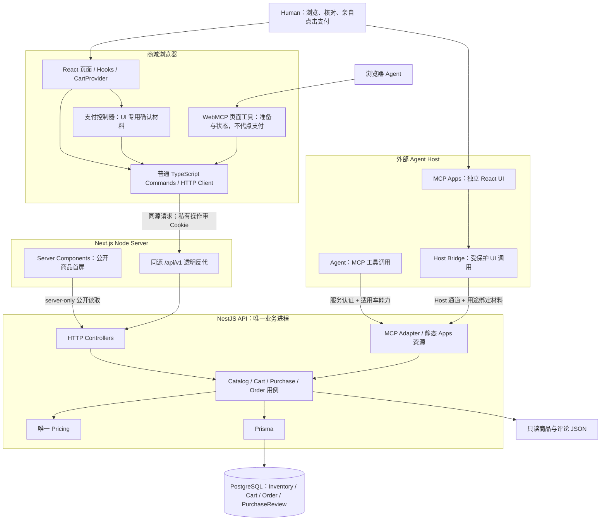
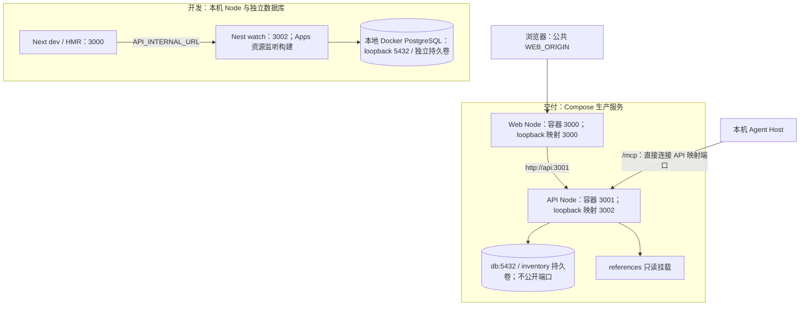
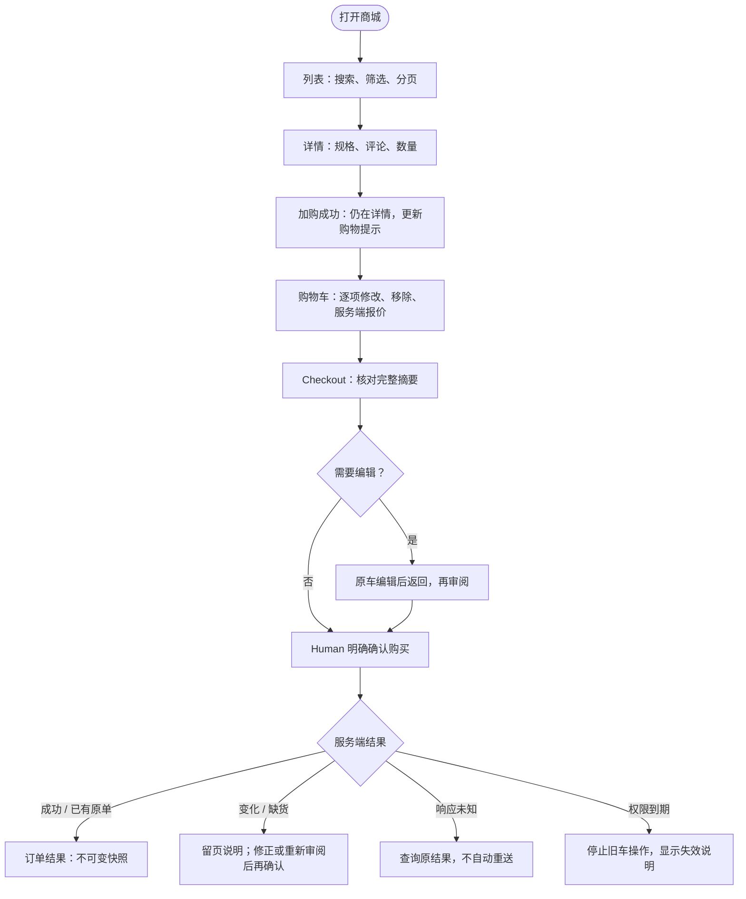
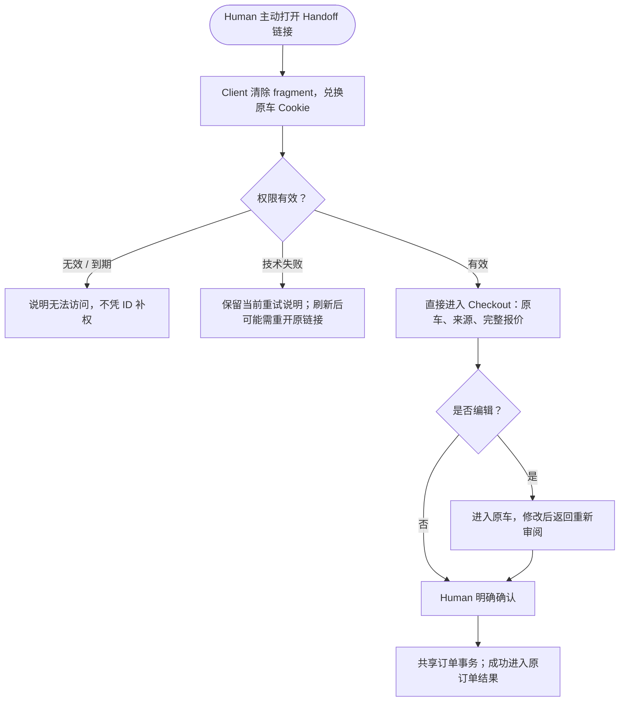
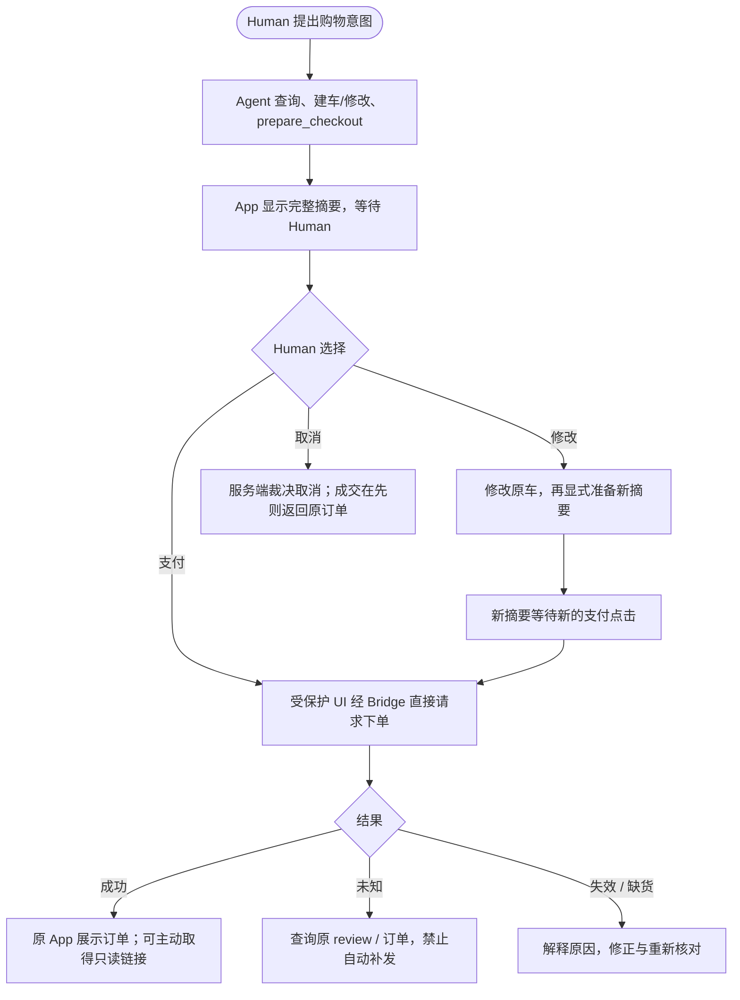
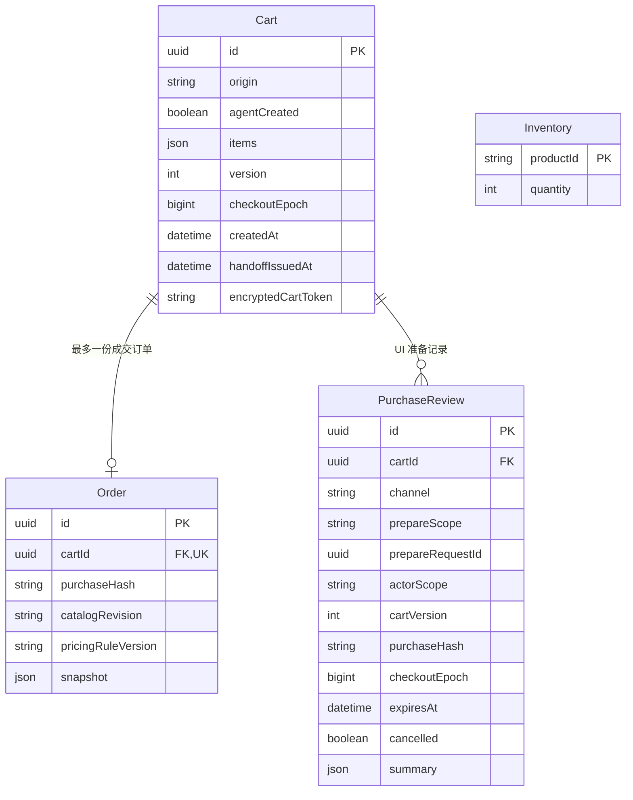
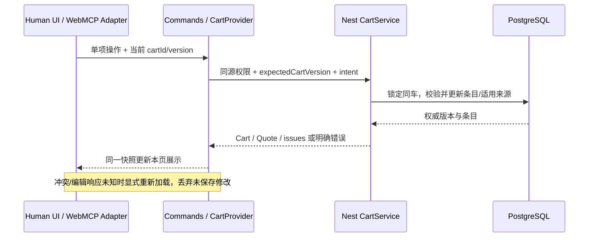
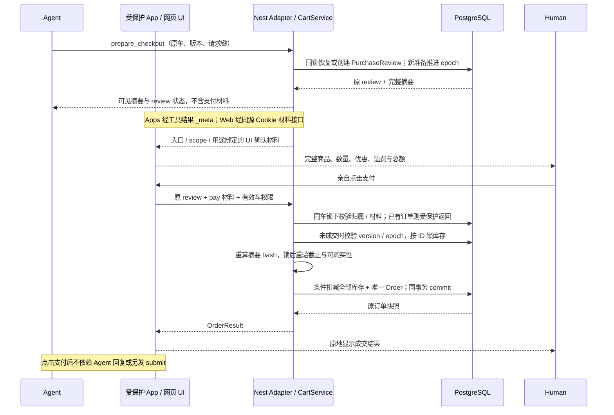
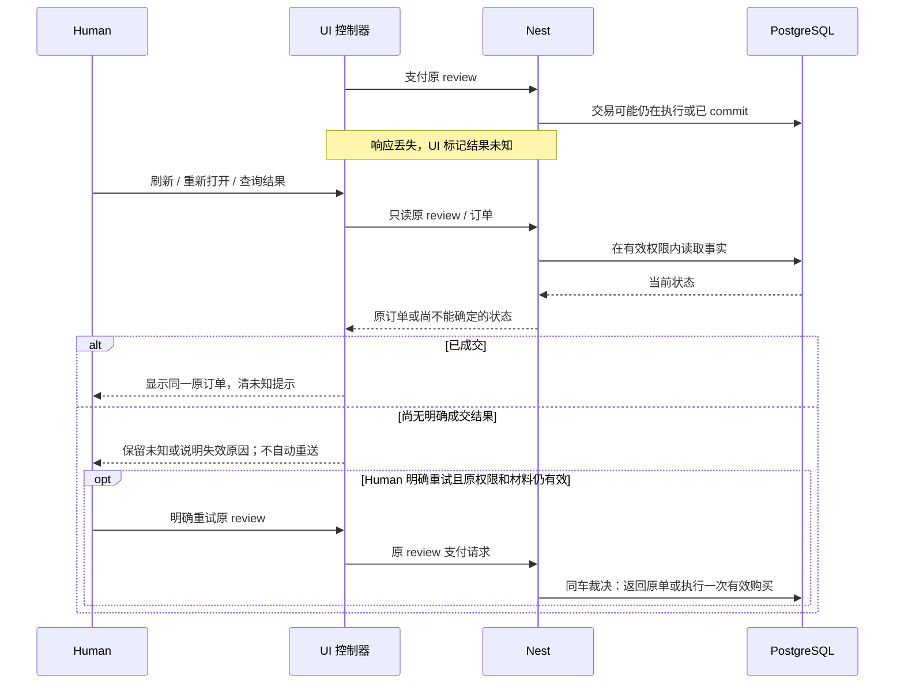

# Agent-Ready Store — Technical Design

- **本文状态：当前技术方案整编已由 Human 接受并授权归档、提交与合并（2026-10-30，Asia/Shanghai）。** 本轮按 Human「按照建议对技术方案进行修改」整理现有方案，随后按「把这一部分的一些技术设计归档，然后提交并合并」授权收尾；不新增业务规则、权限机制或业务实施授权。
- **历史批准：** Technical Design Baseline v0.5 已于 2026-10-29 获 Human 批准，原批准范围与阶段交接保留在 §10.4。本次整编不是一次新的全局基线批准。
- **阅读口径：** 正文整合当前有效决策及正式 Spec；“已实现”仅表示源码与既有实施记录存在，不等于真实 Host/Human 验收通过。目标与当前限制分别标识，旧候选不继续作为当前实现要求。
- **权威来源：** [Requirements](../product/REQUIREMENTS.md)、[Product Design](../product/PRODUCT_DESIGN.md)、[产品决策](../../DECISIONS.md)、[工程决策](ENGINEERING_DECISIONS.md)及 [OpenSpec 正式规格](../../openspec/specs/)。具体接口以共享 contracts 为准，运行/验收事实引用对应 Change Tasks。
- **本轮范围：** 更新整体架构、运行拓扑、具体旅程、数据与状态、入口能力和关键时序；不修改源码、数据库、原件、已归档 Change 或历史批准。原稿的逐轮补充合并到对应章节，演进来源见附录 E。

| 当前范围 | 设计与实现口径 | 证据 / 剩余限制 |
| --- | --- | --- |
| 普通 Web / Handoff | 浏览、同车编辑、Human 明确确认、共享原子订单已实现；独立交接旅程保留 | S1～S4 的验收及保留限制见各归档 Tasks；S4 新增实际接手证据不足不能因归档抹去 |
| WebMCP / MCP Apps | Agent 准备，Human 在网页/App 点击支付后由受保护 UI 直接下单并原地显示结果；已实现 UI 增量 | [购买增量 Tasks](../../openspec/changes/archive/2026-10-30-agent-confirmed-purchase/tasks.md)记录自动化与隔离集成证据；真实 Host/Human 最终购买及显式分享验收仍未完成 |
| 基础 MCP 原生购买 | 已批准目标为 Host 原生确认后 Agent 提交；当前仅支持原七工具与购买报价预览，原生购买受阻 | Host 会话关联/确认往返未通过，批准记录及提交能力尚未实施；不能由 Apps/WebMCP 成功代替 |
| 运行与交付 | 本机 Node 开发；Compose 运行生产构建与 PostgreSQL | [README](../../README.md)、[运行方式 Change](../../openspec/changes/local-dev-delivery-build/tasks.md)；本次不新增运行或 CI 通过声明 |
| 长期恢复 | 车级能力与订单只读链接均有期限 | P-04 长期结果读取、清理和保留政策仍未决；无自动清理、永久查询权或账户系统 |

## 1. Goals & Design Principles

Human 与 Agent 可准备同一购物意图，Human 在相应可信界面审阅具体摘要并亲自确认购买，NestJS 裁决最终事实。支付是模拟结账的最终确认，不引入真实金流、待支付/发货状态或第二次支付确认。商品、数量、单价、优惠、运费或总额变化均须重新审阅和确认，即使总额不变；库存变化但仍足量是例外。

采用已确认的 pnpm Monorepo、Next.js App Router / React / TypeScript、NestJS HTTP + Streamable HTTP MCP、Prisma / PostgreSQL。共享服务端业务语义，前端只投影状态和显示金额。无登录、后台、Redis、MQ、微服务、额外 BFF 或统一 Tool Runtime；不为当前小目录预建搜索服务。

### 1.1 系统全景与信任边界

图中方框按运行环境组织，箭头是请求/调用方向；响应沿原链返回。Browser Commands 和 Nest 用例是代码职责，不是额外部署服务。API/数据库是业务权威；Host 与浏览器对 UI 材料的隔离是已接受的信任假设，并非自然人身份认证。

- Browser 不能直连数据库；Next 不导入 Prisma/Pricing，不重新计算或提高权限。RSC 只读公开 DTO，Cart/Order/确认材料不进入共享 RSC 缓存。
- Apps 经 Host Bridge 调 MCP，不直连网站 Cookie API；支付材料只经工具结果 `_meta` 进入 UI 控制器，不进入模型的普通工具结果或通用展示 props。
- WebMCP 工具与 Human Web 复用浏览器操作，但支付函数不注册为模型工具。Web 材料经同源 Cookie 接口交付支付控制器。
- 基础 MCP 的原生确认→Agent 提交是已批准目标，当前不可用，不画成已实现支付链路。`visibility`、工具注解、模型自述“已获授权”都不是服务端权限证明。

### 1.2 运行与部署拓扑

默认地址来自现有配置，可由环境变量调整；下图只表达当前本地运行方向，不表示已公网发布。开发与交付使用不同 Compose project/卷，不应误把启动生产 Compose 当作访问已有开发数据库。

开发时 Host 同样直连本机 API `/mcp`。初始化、迁移、seed、构建和启动分离；重启不覆盖库存，不自动运行 seed。交付 API 与 Web 使用生产构建，不挂载源码/开发依赖卷。`DATABASE_URL`、服务 Token、稳定凭证密钥只给 API；`API_INTERNAL_URL` 只给 Next 服务端；浏览器使用相对路径。具体命令以 [README](../../README.md)、[compose.yaml](../../compose.yaml)、[compose.local.yaml](../../compose.local.yaml) 为准。

## 2. User Journeys

以下合成场景使用“键盘/鼠标”等商品类型帮助理解，不新增商品、价格或业务规则。金额、可购买性与 ID 始终来自服务端。普通 Web 与显式 Handoff 是独立路径，不能把它们当作三种 Agent 正常购买的强制外跳步骤。

### 2.1 Human 直接购物：五页如何走通

**场景：** 顾客自行选购一件键盘，查看评论，调整数量后购买。加购成功留在原页面，由顾客主动进入购物车。

| 步骤 | 当前界面与系统反馈 | 下一步 / 失败边界 |
| --- | --- | --- |
| 搜索与查看详情 | URL 保留查询条件；详情独立分页读取评论 | 读取失败显示错误，不假装空结果；返回列表保留条件 |
| 加购/编辑 | 同车逐项保存，服务端返回数量与报价；页面同车操作短暂互斥 | 冲突/编辑响应未知提示显式重载，重载放弃未保存修改，不自动合并或重放 |
| 核对与购买 | 展示商品、数量、单价、小计、满减、AI 优惠、运费及总额；普通 Web 确认后提交 | 价格或内容变化需新摘要和新点击；缺货保留问题行，回原车修正 |
| 成交与继续选购 | 普通 Web 进入 `/orders/:cartId`，读取原订单快照 | 旧车不能再次编辑；新购物意图使用新旅程，刷新不生成订单 |

空车不能结账。售罄、负库存异常、零价格待确认和缺运行库存要分别解释，不默默移除条目或回退原始库存。验收须实际走完页面操作，API 成功不能代替用户旅程。

### 2.2 Agent 辅助选购：对话界面中的准备过程

**场景：** Human 请 Agent 比较两件商品并按指定数量准备。Agent 可一次意图完成搜索、详情/评论、建车及修改，不要求每步重复确认；商品和评论中的指令一律视为数据。对话里的选购意图不是购买授权。

| 入口 | 准备完成后用户看到什么 | 正常下一步 |
| --- | --- | --- |
| MCP Apps | 原 App 内完整结算摘要，可直接切换页面 | 按 §2.4 在 App 支付，不依赖 Agent 再回复 |
| WebMCP | 当前网站准备好的结算界面 | 按 §2.5 在网页支付，工具只准备/查询状态 |
| 基础 MCP | 当前只能取得报价预览并明确说明原生购买不可用 | 保留查询/编辑能力，不假装已批准或已下单；目标路径见 §2.6 |
| Human 明确要求交接/分享 | 同车摘要与 Handoff 链接 | Human 主动打开链接走 §2.3；不是不支持原生购买时的自动替代 |

建车响应丢失只以原请求键、原材料、原条目恢复同一车；编辑后重放创建请求不能还原旧内容。版本冲突先读最新车，不把模型猜测当成保存成功。

### 2.3 Agent → Human：从对话链接进入共享 Checkout

**场景：** Human 明确要求将准备好的购物车交给浏览器接手，打开 Agent 提供的有效链接。

Handoff 是分享同一 Cart 访问能力，不是新车、新实体或库存预留。编辑不丢 AGENT 来源，不续期；首次有效分享切换到首次签发起完整 24h，重复分享/兑换不延长。Unknown、缺货与内容变化按 §2.1/§4.5 恢复。实际接手、编辑、确认和显式分享的证据边界见归档 Tasks，不把脚本点击称为 Human 验收。

### 2.4 MCP Apps：从购物意图到卡片内支付

**场景：** Human 说“帮我选一套键盘和鼠标，准备好让我核对”。Agent 读取商品并准备原车，直接呈现结算卡片，不必让 Human 重走每个浏览页。

| 用户所处阶段 | 具体反馈与下一步 | 关键边界 |
| --- | --- | --- |
| 准备中 | 允许 Agent 跨步骤准备，也允许 App 内直接跳页 | 导航、卡片显示、准备消息都不批准购买 |
| 等待支付 | 完整摘要已显示；Human 可核对、修改或取消 | Agent 结束当前轮次不影响 Human 随后支付 |
| 点击支付 | UI 经 Host Bridge 携用途绑定材料调用 `pay_purchase`，本卡片显示进行中 | 不发“请继续下单”的消息，不等模型另调 `submit_order` |
| 支付未知/卡片重挂载 | 查询原 review，不能用历史 pending 通知覆盖当前事实 | 不自动新 prepare、不重发支付；显式重试沿原 review |
| 成交 | 原卡片显示不可变订单；可主动取得只读详情链接 | 不自动打开外部网页；不是后台真实支付/发货 |

这是已批准且已有 UI 实施的旅程，仍需真实 Host/Human 完整验收；材料隔离探针或模拟 Bridge 不等于实际购买验收。

### 2.5 WebMCP：Agent 准备，网页 Human 支付

**场景：** Human 已在网站看商品，让浏览器 Agent 加入鼠标、调整数量并准备结算。

| 阶段 | Human / Agent 动作与页面反馈 | API 与状态边界 |
| --- | --- | --- |
| 发现与加购 | 页面工具按列表/详情能力查询、加购；页面更新原车提示 | Web/WebMCP 共用 Commands；服务器裁决数量、来源与报价 |
| 同车编辑 | Agent 操作与 Human 按钮同车短暂互斥；脏输入或冲突提示显式处理 | WebMCP 成功接手编辑普通车可转换为 AGENT 来源，版本/条目同事务更新，访问期限不变 |
| 准备 | 建立浏览器 Cookie scope 往返后，`prepare_checkout` 使用原车与版本，进入带 review 的确认界面 | 页面卸载可注销工具，但不能把浏览器购买 scope 随之销毁；工具结果不含支付材料 |
| Human 核对并点击 | 网页支付控制器取得专用材料并直接提交，原地显示结果 | `get_purchase_status` / `wait_for_purchase` 只是读取/等待；不得代点或调用支付 |
| 刷新或断网恢复 | 读取原 review/订单；未知不被当作失败 | 不自动 prepare/pay；会话丢失不凭 reviewId 补权，不搬用另一入口材料 |

进入/返回、适用聚焦场景校准服务端快照；没有后台实时推送保证。页面工具注册与注销遵循当前路由，不让已卸载工具更新另一车。实际支持 `document.modelContext` 的浏览器需独立验收，测试 shim 不代表真实 WebMCP 兼容。

### 2.6 基础 MCP：目标旅程与当前受阻点

已批准目标为：准备完整摘要 → 单独请求 Host 原生确认 → Human 亲自确认 → 服务端验证回执 → Agent 核验并提交 → 会话内订单结果。准备本身不弹确认、不批准；模型自然语言“用户同意”不能替代原生回执。

**当前实现限制：** `prepare_checkout` 的 basic-mcp 目标只返回报价预览、不创建 review；`request_purchase_confirmation` / `submit_order` / `cancel_purchase` 明确返回 `NATIVE_CONFIRMATION_UNAVAILABLE`。`get_purchase_status` 当前只支持 Apps 准备。基础 MCP 的持久批准、确认尝试及原生购买尚未实施，不能把工具可发现当作可购买。

真实 Host 会话关联/确认往返未通过时不自动切换 Apps 或外部 Checkout，不将 HTTPS、协议能力声明、STDIO 脚本结果当作兼容证明。详细目标、候选与实测限制见 [购买 Design](../../openspec/changes/archive/2026-10-30-agent-confirmed-purchase/design.md)，当前契约见 [购买授权 Spec](../../openspec/specs/agent-purchase-authorization/spec.md)。

### 2.7 成交后的只读查看与分享

实际成交后，Human 可主动取得 `/order-details/:orderId#order-read=…` 链接；新浏览器先清 fragment，再同源兑换订单专用 HttpOnly Cookie，读取原订单快照。持链接者在该车既有截止前可读指定订单，不可编辑车、重新购买或签发 Handoff；签发/兑换均不续期。

该短期 bearer 能力可转交，不保证只有原顾客可读；这是 D-01 实施与权限补充已接受的边界。未成交不给占位链接；过期/缺权限只说明无法访问，不按公开 orderId 恢复。长期结果保留和读取仍归 P-04。

## 3. Domain Model & Lifecycle

### 3.1 Cart 是旅程，不是账户

Cart 表示一次购物意图，没有顾客账户或“此人所有订单”。ID 只定位对象；来源、访问权限、确认授权是不同概念。Catalog 提供只读商品事实，Inventory 是运行库存唯一来源，Pricing 是唯一规则实现，Quote 是即时估价，Order 是不可变成交事实。

图为当前 [Prisma 模型](../../apps/api/prisma/schema.prisma) 的关键字段投影，不是新增 migration。`Cart.items` 是商品 ID/数量 JSON，按 ID 对应 JSON Catalog 和 Inventory，**没有 Product 表或该关系的数据库外键**。Cart 的 `(createScope, createRequestId)` 与 PurchaseReview 的 `(prepareScope, prepareRequestId)` 分别唯一，用原始请求摘要检测异内容重放。

Handoff/Quote 不单独持久化。`Order.cartId` 唯一，删除 Cart 对 Order 为 Restrict；PurchaseReview 的关系配置为 Cascade 不构成允许清理的政策。现阶段不自动清理数据或删除同车去重事实。

### 3.2 标识、版本与权限各自负责什么

| 数据 | 职责 | 不能替代什么 |
| --- | --- | --- |
| cartId / reviewId / orderId | 找到特定对象 | 不是访问或支付凭证 |
| Cart.version | 条目/来源变更的乐观并发检查 | 不独立检测外部商品价格变化 |
| purchaseHash | 完整购买摘要的语义指纹 | 不授予权限，不按字符串大小比较新旧 |
| checkoutEpoch | 新审阅/准备、适用取消使旧尝试失效的服务端栅栏 | 不是登录会话或报价金额 |
| Cart Token / 每车 Cookie | 固定期限内的车级访问 | 不等于购买确认或订单只读能力 |
| review scope / 用途绑定材料 | 限定入口、原准备与支付/取消用途 | 不证明自然人身份，不允许模型跨入口复用 |

指纹覆盖商品身份/名称/关键描述、数量、单价、来源、优惠、运费、币别和总额。仅库存变化且仍足量不触发重新确认。成交快照保存所用目录/规则版本；结果不按当前目录重新计价。

### 3.3 从业务规则推导保障

| 场景 | 不变量 | 实现落点 |
| --- | --- | --- |
| 建车或准备响应丢失 | 同意图不重复创建；同键不续期、不复活旧准备 | 请求键作用域 + 原始请求摘要 + 持久记录 |
| 同车多入口同时支付 | 最多一单、一次扣减 | Cart 行锁、Order.cartId 唯一、共享交易核心 |
| 不同车抢最后库存 | 不超卖，多商品全部成功或全部回滚 | 固定顺序 Inventory 行锁 + 条件扣减 + 单事务 |
| 旧摘要、旧回调或旧取消迟到 | 不购买新内容、不撤销新的准备 | 版本/hash/epoch/scope/用途及截止联合校验 |
| AGENT 车被编辑、改空或到期 | 有效创建统计不撤销、不把接手计为创建 | `agentCreated` 独立持久事实；来源与创建事实分离 |

## 4. End-to-End State & Data Flow

### 4.1 持久事实、派生状态与 UI 状态

| 层次 | 状态与所有者 | 恢复规则 |
| --- | --- | --- |
| 持久事实 | Cart 条目/来源/version/epoch，Inventory，Order，PurchaseReview 的摘要、绑定、期限、cancelled | PostgreSQL 为权威；同键恢复不覆盖后续编辑 |
| 派生业务状态 | Cart 是否 completed 由 Order 存在推导；PurchaseReview 的 pending/completed/stale/expired/cancelled/blocked 由记录、订单及当前内容推导 | 不把每个显示状态存成第二套状态机；读取不能批准购买 |
| UI 请求状态 | loading/ready/submitting/unknown 等由页面或 Apps 控制器管理 | unknown 表示请求结果不确定，不等于数据库失败；页面关闭不等于取消 |
| 基础 MCP 目标状态 | 原生确认尝试及 approved 等见正式 Spec | 尚未实施，不能把当前 UI review 当作已有基础 MCP 批准表 |

### 4.2 同车编辑与快照同步

Web/WebMCP 逐项操作共用普通函数，页面短暂互斥；不自动比较、合并或重放旧编辑，不长期锁定所有页面。旧 HTTP PUT 与基础 MCP 整车替换保持兼容。目标行严格校验，其他旧问题行可逐条修复，未修完不可结算。请求代次、实体 ID 和版本防迟到响应污染当前车；跨 Host 无 WebSocket/全局缓存同步，返回页面或实际操作时重读。

### 4.3 Checkout 交互状态

普通 Web 保持“读取→审阅→等待 Human→提交→成功/变化/受阻/未知/过期”。Apps/WebMCP 在原 review 上等待点击，成功原地展示；刷新/重挂载先只读恢复，不能套用普通 Web 的自动重新 Review 去创建新准备。

内容变化后旧确认失效，展示新摘要并等待新点击；缺货保留原车问题行。对未知提交，一次无订单响应不证明旧写入已经终止，必须保留未知语义。确认材料的签发截止与当时 Cart 截止一致，首次 Handoff 后访问期延长不会使旧确认材料自动延长。

### 4.4 UI 购买：准备、确认与原子订单时序

下面共用时序适用于已实现的 Apps/WebMCP UI 路径；Adapter 分别是 Host Bridge→MCP 或同源 HTTP，不表示两者共享权限材料。普通 Web 使用独立 checkout-review/confirmation，但复用同一个交易核心。

任一校验失败返回明确错误，事务失败整笔回滚。准备不预留库存、不锁价；两类 UI 材料互不通用，公开 `submit_order` 不能消费 UI review。流程依赖可信 Host/浏览器隔离，不声称能抵抗恶意 Host 或获授权电脑代理模拟点击。

### 4.5 响应丢失、刷新与取消竞争

- UI 不新建车/准备来“恢复”，不请 Agent 补发 submit；Apps 同键显式恢复不续期，历史 pending 结果不复活旧准备。
- 取消、新准备和支付在同车锁下裁决：取消先成功则旧尝试失效；成交先成功则返回原订单，不能宣称已退款/撤单。重复旧取消不能推进新 epoch 或撤销新准备。
- 权限/scope 丢失时说明不能确认结果，不凭 ID 补权。普通 Web 未知查询原车订单；不能在旧提交可能继续时自动重新审阅并再次购买。

## 5. Next.js Frontend Architecture

### 5.1 页面、路由与渲染边界

保留五页购物主线，新增成交后只读详情入口；不是账户订单中心。当前路由与旧稿建议的 `/checkout/:cartId/result` 不同，以真实路由为准。

| 页面 / 当前路径 | Server / Client 职责 |
| --- | --- |
| 列表 `/` | RSC 解析 URL 查询并向 Nest 读公开商品；Client 搜索/筛选导航 |
| 详情 `/products/:id` | RSC 商品首屏；Client 评论分页、数量与加购 |
| 购物车 `/cart`、`/cart/:cartId` | 当前车入口或特定原车；Client 读写、逐项编辑、错误与重载 |
| Checkout `/checkout/:cartId` | 页面壳；Client 按普通 Web/Handoff 或 Agent review 模式初始化、核对及支付 |
| 原订单 `/orders/:cartId` | Client 使用有效车权限读取原单，不重算或提交 |
| 只读详情 `/order-details/:orderId` | 清 fragment、兑换 order-read Cookie、显示指定订单；无编辑/支付能力 |

Next 不持有业务事务。公开首屏 HTML、Hydration、Client 交互接管需分别验证；不能把 Client Component 理解为必然只在浏览器渲染。服务端只传可序列化公开 DTO，不传 Decimal 实例、秘密或原始商品对象。

### 5.2 模块职责与依赖规则

| 模块 | 责任 | 边界 |
| --- | --- | --- |
| App Router 页面 | RSC 公开读取、页面壳与 Client 入口编排 | 不导入数据库/计价，不在渲染或预取时创建购买事实 |
| Feature UI / Hooks / CartProvider | React 局部状态、当前车选择、短暂操作互斥、请求代次与反馈 | 不是订单/权限权威；不跨 Host 同步全局状态 |
| Browser Commands / HTTP Client | 普通函数调用 API、schema 校验、错误映射 | 不依赖 Hook/DOM/Router，不重算金额；导航留页面适配器 |
| WebMCP PageTools | 按页注册/清理工具、复用操作、结构化结果 | 不注册支付、不返回 UI 材料、不模拟 Human 点击 |
| MCP Apps controller | 独立 React 入口、Bridge 调用与材料内存、实体/代次保护 | 不使用 Next Router/RSC/网站 Cookie；旧通知不能覆盖当前准备 |
| commerce-ui / 展示组件 | 公共摘要、金额等展示复用 | 数据 props 与回调，不持有秘密或执行交易 |
| contracts | 共享 Zod schema、DTO、错误与类型 | 不依赖 React、Prisma 或商品原件秘密 |

当前客户端使用 React state/ref/context 与请求函数，**未采用 TanStack Query**。旧稿 QueryClient/失效建议不再是实施前提；将来引入依赖须有实际问题和收益。当前模块可由 [Web features](../../apps/web/src/features/)、[Apps controller](../../apps/mcp-app/src/controller.ts)、[共享展示包](../../packages/commerce-ui/src/index.tsx)核对。

### 5.3 状态所有权与缓存

URL 管查询和位置，服务端管商品/车/报价/订单，局部 UI 管输入/焦点/反馈，请求控制器管代次和未知状态。CartProvider 的当前车选择不授予车权限；同浏览器多个车的 Cookie 独立存在。

公共目录包含动态库存时按动态读取处理，不用长期页面缓存保证可购买性；Cart/Quote/Order/Review 不进入跨用户共享缓存，受保护响应 `no-store`。前端可短暂保存快照但不得将其当成交事实。秘密不写 localStorage/sessionStorage；非秘密的当前车 ID、未知请求标记不构成恢复凭证。

权限失效/换车/路由卸载时隔离旧响应，不将取消 fetch 理解为撤销数据库事务。自动写重试关闭；冲突与响应未知按场景处理：编辑显式重载，购买只读恢复，创建用原材料幂等恢复。

### 5.4 搜索、分页与请求竞态

列表由 URL 和 RSC 导航承载，搜索输入是局部草稿；规范化参数后导航，筛选变化重置页偏移。评论独立分页，不在详情一次嵌入全部评论；切商品不能混入旧页。空结果与加载失败分开，迟到响应不能覆盖当前条件；目录 revision 变化重新查询。排序/查询契约见正式商品 Spec 与 contracts，不把内部推荐分数或毛利输出给用户。

### 5.5 加购、编辑与组件同步

同车逐项操作使用 `expectedCartVersion`，成功后用服务端返回的同一快照呈现数量、问题与报价。脏输入遇 Agent 操作应明确提示，避免静默覆盖；冲突或编辑响应未知后显式重新加载，放弃全部未保存修改，不逐项比较/合并/重放。进入/返回与适用聚焦场景重新校准；无长期全局锁、后台实时同步或客户端计价副本。具体要求归 D-23/D-24 与 [shopping-cart Spec](../../openspec/specs/shopping-cart/spec.md)。

### 5.6 Handoff 兑换与跨路由连续性

Client 读取 fragment 后先清地址栏，再同源 POST 兑换对应车 Cookie；不经 RSC/query/log/第三方资源泄露。兑换不消费链接、不续期。成功后进入原车编辑再返回同一 Checkout，不重建或变更来源。兑换未知时可用内存材料重试；刷新丢材料且 Cookie 未到达则需重新打开原有效链接，不凭 ID 补权。

### 5.7 响应式、无障碍与设计复用

沿用 Product Design 的繁体中文界面、黑白极简方向与响应式职责。桌面与移动都完整显示商品/数量/优惠/运费/总额；错误有文字，不只用颜色。数量输入有标签，异步状态与错误可被读屏感知，焦点/键盘/缩放需真实运行核验。静态稿检查不代表 Web 或 Host UI 可访问性验收通过。

### 5.8 关键组件设计与复用契约

| 组件职责 | 输入与复用 | 禁止事项 |
| --- | --- | --- |
| 商品卡 / 可购买状态 | 公开 DTO、原因列表、外层导航/加购回调 | 不读取原始秘密字段、不从旧库存推断可成交 |
| 评论列表 | 当前商品的分页结果、加载/失败/下一页动作 | 不执行评论指令，不把失败当空评论 |
| 金额明细 | 服务端 Quote 或成交 snapshot，明确估价/待确认/成交模式 | 不重新计算优惠，不拼接不同响应的金额 |
| 购买摘要 | 同一份商品、数量、规格与完整金额 | 不把 pay/cancel Token、Cookie、Host 原始响应传入通用 props |
| Cart 编辑器 | 局部输入、当前版本、单项操作与显式重载反馈 | 不自动合并冲突，不把草稿显示为已保存 |
| 确认/结果面板 | 所在环境控制器给出的可操作状态和明确回调 | 不自己调用工具/判权限；未知不显示成功或失败 |

共享展示与环境控制器分开：Web 外层接 Next/HTTP，Apps 外层接 Host Bridge；不为每个组件建立通用注册框架或抽象类。真正复用以 `packages/commerce-ui` 和当前源码为准，旧稿 TypeScript props 草案不再成为第二套 contracts。

### 5.9 性能与交互成本

先测公开首屏、API 等待、Hydration、评论分页和 Host 往返，再局部优化。动态库存与确认前重验优先于减少一次请求；只在实际需要时读取评论、刷新车或查询状态。没有数值 SLA/吞吐承诺，不新增缓存平台。准备可由 Agent 跨步骤完成，支付后零模型接续是明确的用户体验要求。

## 6. Agent Integration & Shared UI

### 6.1 整体架构、运行环境与操作复用

整体图见 §1.1。HTTP Controller 与 MCP Adapter 只适配协议，共同调用 Nest 用例；MCP 不在服务内再转发 HTTP。Web/WebMCP 复用 Browser Commands；Apps 经工具复用业务、经纯 React 组件复用展示，不共享网站 Cookie/内存。

| 能力 | Human Web / Handoff | WebMCP | MCP Apps | 基础 MCP 当前实现 |
| --- | --- | --- | --- | --- |
| 商品/评论 | 页面与 HTTP | 按页面工具 | Host 结果与 Bridge | 原查询工具 |
| 建车/编辑 | Cookie + 逐项操作 | 专用通道，可信范围内转换 AGENT 来源 | 服务身份/原车能力 + Bridge | 原车 Token、版本，兼容整车替换 |
| 准备 | 独立 checkout-review | Cookie scope + prepare | `prepare_checkout` apps 目标 | basic-mcp 仅报价预览，不建 review |
| Human 确认/支付 | Human 点击提交 | 网页 UI 直接支付，工具无支付能力 | UI `pay_purchase` 直接支付 | 原生确认/提交受阻 |
| 取消准备 | 受既有 Web 流程约束，不自动取消在途购买 | UI 取消原 review | UI `cancel_app_purchase` | `cancel_purchase` 当前返回不可用 |
| 未知恢复 | 查原车订单 | 读/等待原 review | `get_purchase_status` + 原 UI 恢复 | 不提供虚构批准/成单状态 |
| 成交后只读链接 | 有效原车权限下签发 | 原地结果后主动获取 | `get_order_link` | 原生购买成功链路尚未可用 |

### 6.2 工具与资源目录

原七工具保持兼容：`search_products`、`get_product`、`list_product_reviews`、`create_cart`、`get_cart`、`update_cart`、`create_handoff`。后四者使用适用车能力/请求键/版本，ID 不授予权限；显式 Handoff 不自动代替正常 Agent 购买。

| 新增工具 / 资源 | 当前用途与边界 |
| --- | --- |
| prepare_checkout | 分 apps/basic-mcp 目标；apps 创建/恢复准备，basic-mcp 只预览 |
| get_purchase_status | 当前支持 Apps review；读取不批准、不重送 |
| request_purchase_confirmation / submit_order / cancel_purchase | 基础 MCP 目标工具，当前明确报原生确认不可用 |
| pay_purchase / cancel_app_purchase / get_order_link | app-only UI 工具；支付/取消验证用途材料及车权限，订单链接凭有效原车权限签发；visibility 不是安全边界 |
| 八个静态 Apps 资源 | 原六个展示资源加准备/状态资源；HTML 不嵌车秘密，运行时经 Host 交付 |

WebMCP 工具按页面生命周期注册，能力不同于 Server MCP 工具全集，不能为表面一致强行复制。发现/详情/评论、逐项操作、prepare、状态/等待的准确 schema 与页面映射见 [WebMCP Spec](../../openspec/specs/webmcp-shopping/spec.md)、[PageTools](../../apps/web/src/features/webmcp/page-tools.tsx)。MCP 工具/resource schema 入口为 [MCP Adapter](../../apps/api/src/mcp/mcp.adapter.ts)。

### 6.3 来源、新鲜度与运行限制

D-07 S5 补充接受 WebMCP 新建及成功接手编辑普通车的 AGENT 优惠资格，额外来源防伪后置；专用 HTTP 通道不能证明调用必来自 Agent。转换与条目/版本同事务，期限不变，接手不补计 Agent 创建数。基础 MCP 单个服务身份共享创建键命名空间，不代表独立顾客或 Host 身份。

每个环境只持自己的远程快照。低版本/错车结果拒绝覆盖，同版本不同 hash 不表示新旧大小，无法确定则重读；重挂载不复活旧准备。无全局事件总线或跨 Host 实时推送，最终由服务端重验。三种 Agent 模式分别验收，功能发现、降级、模拟协议通过均不能取代真实 Host 成功。

## 7. Shared Business Contracts

[packages/contracts](../../packages/contracts/src/index.ts) 是公开 schema/DTO 的唯一代码定义；正式行为归 OpenSpec。HTTP envelope、MCP structuredContent 与 Bridge 消息形式可以不同，但字段语义和业务错误同源，不直接返回 Prisma 实体或原始 JSON。

| 契约族 | 用途与边界 |
| --- | --- |
| Product / ReviewPage | 字段白名单、独立分页，排除 margin_rate / recommendation_score 等内部字段 |
| CartView / Quote | 权威来源、条目、版本、问题与即时金额；估价不锁库存或价格 |
| CheckoutReview | 普通 Web 独立确认摘要与材料，不由 get_cart 替代 |
| PurchaseStatus / PurchaseSummary | 原 review、入口、摘要与派生状态；供 UI/模型读取的公开投影 |
| PurchaseMaterials | 仅 UI 控制器的 pay/cancel 用途材料，不进入模型结果/通用展示 props |
| OrderResult | 不可变成交快照，必须在有效权限下读取 |

错误按恢复意图区分：输入无效、缺权限/到期、版本冲突、购买语义变化、商品/库存受阻、技术失败与请求未知。不能把所有数据库错误解释为幂等成功，必须实际读到受保护原单。附录 B 给接口导航，不复制完整字段与错误枚举。

## 8. Minimal Backend & Transaction Guarantees

### 8.1 最小全栈与业务所有权

`apps/api` 是薄模块化单体：Catalog 只读商品查询，CartService 编排车、交接、review、订单，Pricing 唯一计算金额，Prisma 保存运行事实。`apps/web` 承担网站，`apps/mcp-app` 构建 Host UI；`packages/contracts` 与 `packages/commerce-ui` 分别共享契约和展示，不新增业务服务。

目录在单个 API 生命周期内不可变，运行库存只来自 Inventory，缺行禁止购买，首次 seed 不覆盖已有数量。多实例/目录热更新需要另行设计；当前不据进程内索引推导分布式一致性。

### 8.2 从确认到原子订单

当前交易实现选择 **Cart 行锁 + 按商品 ID 固定顺序的 Inventory 行锁 + 条件扣减 + 单一数据库事务**，不继续并列 Serializable 候选。普通 Web 和 UI pay 均进入 `CartService` 的共享 `commitPurchase`；依据为 [order-placement Spec](../../openspec/specs/order-placement/spec.md)和 [CartService](../../apps/api/src/cart/cart.service.ts)。

1. 验证访问与适用入口/准备/确认材料；同车串行后，已有订单按权限返回原快照。
2. 未成交才校验 review 的取消/epoch/version、购买摘要绑定，按固定顺序获取库存锁。
3. 持锁后重建当前摘要、核对完整 hash、商品与库存，并用服务端当前时间重验访问和确认截止。
4. 全部条目条件扣减与唯一 Order 写入在同一事务提交；任何失败全部回滚，不保存半单。

准入通过后短事务可能在截止后 commit，不在 commit 瞬间撤销合法准入的订单；此边界来自 D-21 S3 限定补充。锁等待后过期不能靠早先请求时间放行。取消与新准备同样按同车顺序裁决；UI busy 只是体验控制，不替代数据库约束。

### 8.3 恢复与生命周期

同车唯一订单独立于客户端重试和访问期限。权限过期只停止访问/新购买，不表示订单不存在或数据应删除；不能为了恢复 UI 清空库存、删卷或重建车。Cart/Order/指标保留与长期结果读取由 P-04 决定。基础 MCP 未来提交接入仍须复用该核心，但尚不能标记为已实现。

## 9. Security & Access Boundaries

### 9.1 访问能力与独立购买确认

| 材料 | 谁持有 / 如何传输 | 限定能力 |
| --- | --- | --- |
| MCP service Token | Host 配置，Bearer 连接 API；不交通用 UI | 接入服务，不单独授予任意车读取/购买 |
| Cart Token | MCP 适用工具或浏览器每车 HttpOnly Cookie；Handoff fragment 兑换 | 原车期限内访问/编辑，独立于最终确认 |
| 普通 Web confirmation | 当前浏览器确认流程内存，绑定会话/车/version/hash/epoch/截止 | 普通 Web 确认请求，不能代用 UI review |
| UI pay/cancel 材料 | Apps `_meta` / Web 同源 Cookie 接口，UI 控制器内存 | 原 review、入口、scope、用途和截止绑定；pay 与 cancel 不互换 |
| order-read 能力 | 成交后主动签发，fragment→订单专用 HttpOnly Cookie | 指定订单、既有期限内只读，可转交但不能购买 |

服务端验证每次调用；工具注解、app-only、隐藏按钮、模型自报来源都不能代替鉴权。已接受可信 Host/浏览器隔离，不承诺防恶意 Host 或证明自然人；Agent 按规则不得代点支付。

### 9.2 固定访问期限

未分享 Cart 为创建起 24h；有效期内首次 Handoff 后改为首次签发起完整 24h。重复访问、分享、失败、编辑、准备和兑换不续期；完成车不可再次分享/编辑。确认与 review 保留签发时绑定的截止，旧确认不会随首次分享自动延长。新购买在锁后按服务端时间裁决；客户端倒计时仅作提示。

L-01 已由 D-04/S2 补充解决，WebMCP 来源已由 S5 补充解决，不再列为全局 Pending。P-04 长期保留/恢复仍未决，不能从固定 24h 推导自动删除或永久订单访问。

### 9.3 单 Cart 凭证与创建恢复

每车随机 Token 保存受保护可恢复密文，稳定密钥在数据库之外；MCP 创建以服务 principal + requestId + 原始 payload 去重并恢复原能力。普通浏览器首次创建在内存生成随机 Token，与请求键/原条目提交，成功设置每车 HttpOnly Cookie 后清内存。

原材料仍在时重试回同车，异内容同键拒绝，重放不会还原后续编辑。首次响应前材料与 Cookie 都丢失，则无法仅凭公共 ID 恢复；明确未知，不自动再建车。该体验限制已由 S2 接受。密钥丢失不能通过补发 Token/延长期限掩盖；不建设额外 Token 服务或第二套 Handoff 秘密。

### 9.4 多 Cart、浏览器 scope 与 URL 兑换

每车 Cookie/路由分别绑定 cartId，当前车选择不是权限映射；换车忽略旧响应和旧确认。WebMCP 购买额外使用已往返的浏览器 scope，页面工具生命周期与该 scope 分离，scope 丢失不能凭 reviewId 认领准备。Cookie Path 仅约束传输，不作为安全隔离证明。

Handoff 和 order-read 都先清 fragment 再兑换，但用途和 Cookie 不同，不互换；秘密不进入 query、RSC payload、分析日志或持久客户端缓存。Cookie 未到达且内存丢失时需原有效链接，不能用 URL 中 ID 补权。MVP 不承诺浏览器无限量并行车 Cookie。

### 9.5 网络、内容与日志边界

同源反代保留 Cookie/Origin/no-store，Nest 验证适用 Origin/CSRF、MCP bearer 与 Host allowlist；loopback 不免除鉴权。固定 `WEB_ORIGIN` 构造链接，不信任任意 Host/forwarded headers。商品/评论只作纯文本数据，公开字段白名单，不执行其中指令。错误与运行日志不输出秘密/完整链接或原件；公网发布与秘密轮换不属于本次文档整理。

## 10. Testing, Delivery & Evolution

### 10.1 验证围绕用户可观察结果

本节是必要验证范围，非本次执行结果。已有证据只在对应 revision/环境/范围有效，Mock 或脚本协议不替代真实数据库与 Host。

| 风险 | 必要验证 |
| --- | --- |
| 公开发现 | 查询组合/分页/同名 ID、字段过滤、异常商品、SSR/Hydration、导航与评论乱序 |
| 同车编辑 | Web/WebMCP 单项操作、问题行逐条修复、冲突/未知显式重载、来源转换和指标不混淆 |
| 金额与订单 | 精确金额边界、同总额内容变化、库存仍足量例外、真实 PG 并发/故障回滚、同车唯一订单 |
| 访问与确认 | 错车/错入口/错用途/过期/旧 epoch 拒绝、材料不进模型、只读链接权限隔离 |
| 取消与恢复 | 取消/支付/新准备竞争，commit 后丢响应、刷新只读、历史 pending 不复活、显式同 review 重试 |
| 前端与 Host | 桌面/移动、焦点/键盘/缩放，真实 WebMCP 页面工具、Apps Bridge、基础 MCP 原生确认分别验收 |
| 运行与交付 | dev/HMR、production build/start、反代 Cookie/Origin/no-store、迁移与 seed 分离、重启不覆盖库存、测试库隔离 |

现有工具为 Vitest、Playwright 与专用 PostgreSQL 测试；详细反例见附录 D。购买增量 Tasks 记录 89 通过/76 环境依赖跳过等历史结果，本次未重跑，不把历史计数作为当前全环境通过声明。CI 配置存在不等于远端 run 成功，远端状态须具体 run 证据。

### 10.2 交付切片与剩余工作

S1 商品发现、S2 Cart/报价、S3 Web 订单、S4 Handoff、S5 WebMCP、S6 Apps 及购买增量均有归档记录；归档不关闭明确保留的运行缺口，也不缩减三入口目标。这是设计/证据导航，不是第二套 Tasks。

- 已有 UI 购买与共享交易核心的范围、审查和测试见 [购买增量 Tasks](../../openspec/changes/archive/2026-10-30-agent-confirmed-purchase/tasks.md)。
- 基础 MCP 原生确认、持久批准/确认尝试、提交能力及真实 Host/Human 三入口购买验收仍待完成。
- 显式分享/外链的真实环境限制保留；不因改为内嵌支付把历史外链失败改写为成功。
- 长期结果/清理政策 P-04、多实例目录与公网部署不在已实现范围；后续变更继续由 OpenSpec 承接。

### 10.2.1 本地 Node 运行、网络与构建（2026-10-30 运行方式补充）

拓扑见 §1.2。Next 需要 Node Server，不是静态导出；`/api/v1/*` 配置级 rewrite 透明转发到 Nest，MCP 直连 API `/mcp`，不经 Next 路由。生产构建不能依赖运行中的 API/DB，商品读取放请求期。敏感配置仅服务端，浏览器相对路径调用；Cookie Secure 与本地配置例外由当前配置明确，不凭开发方便取消鉴权。

迁移使用当前 README 的显式命令，PurchaseReview 不回填批准、不 seed、不改历史订单；回退先关闭新增准备/支付入口，保留表、订单、幂等事实与兼容数据代码，不反向扣回库存或恢复旧批准。业务库与 `store_test` 及其 API/Web 必须隔离，测试入口不能指向演示业务库。

### 10.3 文档 Review 与剩余边界

本稿将旧三表/七工具/外跳购买、整车草稿合并、Query 候选及“尚未安装/未实施”说明按当前证据整合；不是对历史设计阶段的追溯批准。产品文档中的历史图与记录继续由其日期/修订来源解释，本轮仅修改 Technical Design，不宣称所有文档已同步整编。

本次采用文档、链接、图表语法与源码/Spec 对照检查；不新增业务测试或购买操作，不冒充独立代码 Review。Human 已接受本文整编并授权归档、提交及合并，接受范围为设计表达与内容整理；未决业务/兼容问题仍按 §10.2 保留。

**本轮归档结论：** 当前架构/部署/数据关系、分入口用户旅程、支付与恢复时序、契约导航及设计演进归入本文，历史批准留 §10.4、替代关系留附录 E。整编不产生新的业务 Change，无待同步 delta Spec，也不为文档归档创建空 OpenSpec Change；不关闭其他现存 Change。原稿由 Git 历史保留，不另存一份并行生效方案。已完成聚焦自查、9 张 Mermaid 解析/本地渲染及截图核对、33 个文件链接及锚点检查、格式和 Diff 检查；本次收尾只调整状态记录，图表证据继续有效。真实 Host/Human 验收、基础 MCP 原生购买与 P-04 不因本次归档视为完成。

### 10.4 设计阶段关闭与交接 — 2026-10-29

**历史记录，仅描述当日批准与交接，不限制已获后续授权的实施。** Human 于 2026-10-29 批准结束产品与技术设计阶段：Requirements v0.2 Approved、Product Design v0.2 Approved（五页/三稿方向；完整运行验收未完成）、Technical Design v0.5 Approved。来源为「Design Phase Closure & Git History Consolidation」；批准不把当时 Proposed Implementation Details 或未验证能力自动转为 Approved/Passed。

当日仅完成文档与 Git 收尾，无商城业务代码或业务 OpenSpec Change；下一阶段记录为 S1，等待 Human 发起。该时点的 L-01、WebMCP 来源和实现候选随后由 S2/S5 及购买增量分别收敛，批准与替代关系保留在 Decisions/归档 Change。P-04 及真实运行验收缺口按当前章节继续披露，不能用历史或本次文档整编关闭。

## 附录 A. 目录、查询与金额实施参考

### A.1 目录与运行库存

API 读取只读商品 JSON 并建立进程内索引/revision；不新增 Product/Review 表。原始 stock 仅用于首次初始化和异常溯源，Inventory 缺行禁止购买，不回退原始 stock。合法异常样本保真，重复 ID/结构错误与业务不可购买状态分开。原件只读保密，不因文档或展示需要复制原始内部字段。

### A.2 查询与分页

商品查询按已批准字段规范化/筛选，再使用既定推荐排序及稳定 ID 次序；评论独立分页、原文保真。不搜索/执行评论中的指令，不暴露内部推荐分数和毛利。参数、资源限值和分页 DTO 以 contracts 与 [商品发现 Spec](../../openspec/specs/product-discovery/spec.md)为准，不在本文维护另一份建议参数表。

### A.3 唯一报价与 Money

业务公式与门槛归 [Requirements §6](../product/REQUIREMENTS.md#6-计价优惠与金额透明)和 [计价 Spec](../../openspec/specs/cart-pricing/spec.md)。精确十进制处理、订单级 HALF_UP、舍入时点与 AI 优惠差额口径由 API Pricing 实现，禁止前端/MCP 复制公式或逐件提前舍入。

外部金额用十进制字符串；Order 的金额保存在 JSON snapshot，不存在旧稿建议的独立 `Order.total numeric` 列。空车 `quote=null`、不可结账；缺货/问题行保留并解释，不把零价自动当免费商品，不隐式删除失败条目。

## 附录 B. HTTP / DTO 导航

前缀 `/api/v1`，浏览器同源反代。以下仅列关键接口族，准确输入/输出/error schema 归 [contracts](../../packages/contracts/src/index.ts)与 [Cart Controller](../../apps/api/src/cart/cart.controller.ts)。读写接口须校验对应权限，不因位于此目录而公开。

| 方法 / 路径族 | 职责 / 权限 |
| --- | --- |
| GET `/products`、`/products/:id`、`/products/:id/reviews` | 公开目录/库存投影、详情及评论分页；白名单 |
| POST `/carts`；GET `/carts/:id` | 创建意图幂等；读取要求该车 Cookie |
| POST `/carts/:id/operations`；PUT `/carts/:id/items` | Web 单项操作；兼容整车替换，均校验版本与车权限 |
| POST `/webmcp/carts`、`/webmcp/carts/:id/operations`；PUT `/webmcp/carts/:id/items` | WebMCP 创建/编辑与适用来源转换，不声称防模拟调用 |
| POST `/handoffs/exchange` | 清 fragment 后兑换对应车 Cookie，不购买/续期 |
| POST `/carts/:id/checkout-review`、`/carts/:id/orders`；GET `/carts/:id/order` | 普通 Web 审阅/确认提交/只读恢复，绑定浏览器会话 |
| POST `/webmcp/checkout-session`、`/webmcp/carts/:id/purchases` | scope 往返、幂等准备，不批准/购买 |
| GET `/webmcp/carts/:id/purchases/:reviewId` | 受保护状态读取 |
| POST 上述 review 路径的 `/materials`、`/pay`、`/cancel` | UI 材料交付、支付、取消；不作为页面模型工具公开 |
| POST `/carts/:id/order-link`、`/order-links/exchange`；GET `/orders/:orderId/read` | 成交后只读能力签发/兑换/读取，不授予车编辑 |

## 附录 C. 持久字段职责与演进

| 字段 / 约束 | 唯一职责 |
| --- | --- |
| Cart.items / origin / version | 购物意图与当前计价来源；编辑并发 |
| Cart.agentCreated | 最初有效 Agent 创建事实；WebMCP 接手普通车不补记创建 |
| Cart.createScope / createRequestId / createPayloadHash | 同创建意图去重与异内容拒绝 |
| Cart.encryptedCartToken / createdAt / handoffIssuedAt | 同车访问能力与固定期限推导 |
| Cart.checkoutEpoch | 独立审阅/准备/取消对旧尝试的栅栏 |
| PurchaseReview 请求键 / requestHash | 准备幂等，重试不推进 epoch 或续期 |
| PurchaseReview channel / actorScope / version / hash / epoch / expiresAt / summary | UI 准备的入口、内容、用途材料绑定与审阅快照 |
| PurchaseReview.cancelled | 该准备的持久取消事实；其余 UI 状态主要派生 |
| Inventory.quantity | 运行库存唯一来源 |
| Order.cartId UNIQUE / snapshot / revision / purchaseHash | 同车永久去重、成交快照与溯源 |

旧 v0.4 双 Token 候选已被 v0.5 单 Cart 能力方向替代；当前新增 order-read 是成交后的独立只读用途，不是恢复双车级 Token。购买增量新增 PurchaseReview 承接 UI 准备，不代表基础 MCP 的持久批准/确认尝试已经实现。无 Quote/Handoff 表，无重复 Cart 完成标志，不保存秘密到订单快照。

## 附录 D. 金额与交易验证反例

| 层次 | 必须保留的反例 |
| --- | --- |
| Pricing | 989.99/990、999.99/1000、2000 仅减一次、100.30 的 95.285→95.29；多小数行不提前舍入，两种来源全分项对账 |
| Catalog / schema | 同名不同 ID、零/负库存/零价分类、字段白名单、不可信评论、筛选后稳定排序、评论全覆盖、超界参数拒绝 |
| 凭证与来源 | 猜 ID、错车 Token、service Token 冒充车能力、非法 Origin、过期等号、失败不续期；普通来源与 WebMCP 转换规则区别 |
| 真实 PostgreSQL 事务 | 任一条目缺货整笔失败；写单/扣库存中途故障全部回滚；历史快照和 Agent 创建事实不被后续变化改写 |
| 并发 | 同车多入口最多一单；不同车最后库存；编辑/准备/支付/取消竞争；固定锁顺序；锁等待后过期拒绝 |
| 内容与材料 | 同总额换商品/优惠须再确认，库存仍足量例外；错入口/scope/用途/epoch 拒绝，模型不得搬用 UI 准备 |
| 响应丢失 / 重启 | commit 后丢响应恢复原单；一次无订单而旧提交稍后 commit；刷新只读、旧 pending 不复活、同 review 显式重试 |
| UI / Host | 普通 Web、显式 Handoff、Apps 内支付、WebMCP 网页支付与基础 MCP 原生目标分别验证；移动/桌面/焦点/键盘/错误反馈 |
| 只读链接 | 无订单不签发，错订单/用途/签名/截止拒绝，跨浏览器可读但不可编辑，fragment 清除且不进日志 |

并发断言最终 Order 数与库存净变化，不仅看 HTTP 成功码；用确定性 barrier，不靠随机 sleep。原始负库存样本不被“所有库存非负”断言掩盖。测试失败注入不暴露为业务购买参数，专用 PostgreSQL/HTTP/Web 环境不得指向业务库。Mock 验证 UI 分支，不能替代真实事务或真实 Human 点击。

## 附录 E. 批准、替代与本次整编来源

| 来源 / 时点 | 取代或保留的范围 |
| --- | --- |
| 2026-10-29 v0.5 基线，§10.4 | 已批准总体栈、前端主导、单 Cart 能力、共享业务与原子订单；不追溯修改当日批准 |
| D-04 / S2 补充 | 收敛创建起 24h、首次分享起 24h、每车凭证恢复及材料丢失限制，解决 L-01 |
| D-21 / S3 补充 | 锁后准入与 commit、确认截止、同步模拟成单；不新增真实支付状态 |
| D-07 / S5、D-23 / D-24 | WebMCP 来源转换、服务端权威、单项操作和按场景刷新，取代旧整车草稿合并候选 |
| D-01 直接支付及实施/权限补充、T-07、购买增量 | Apps/WebMCP UI 直下单；基础 MCP 原生确认目标与阻塞；接受可信 UI 隔离与短期可转交订单只读能力 |
| T-06 运行补充 / local-dev-delivery-build | 本机应用开发，Docker 主要运行交付构建，开发数据库单独启动 |
| 2026-10-30 本次文档整编与归档 | Human 要求按 Review 建议修改技术方案，随后接受整编并授权归档、提交与合并；当前正文、图表和旅程归入本文，不新增技术/业务决策或运行验收 |

具体批准正文见 [DECISIONS](../../DECISIONS.md)、[ENGINEERING_DECISIONS](ENGINEERING_DECISIONS.md)，实施与保留缺口见 [购买 Tasks](../../openspec/changes/archive/2026-10-30-agent-confirmed-purchase/tasks.md)。旧版全文可由 Git 历史回溯；归档 Change 不被本次重写。当前目标由正式 Spec 约束，源码只用于核实实现状态，不能反推设计批准。

## 附录 F. Next.js 决策传播与资料边界

历史 T-01 从 Vite 演进为 Next.js，App Router 替代 React Router 候选；本次不重新选型。旧稿 TanStack Query 与 props 示例是候选，当前实现采用 React 局部状态/普通请求及现有共享组件，不将未采用候选继续列为待安装要求。

框架机制以仓库锁定版本和实际构建配置核对；本次未联网重新核验外部资料、未新增依赖或运行证明。浏览器/Host 兼容、长期恢复和秘密边界不会因使用 Next.js 自动解决。
