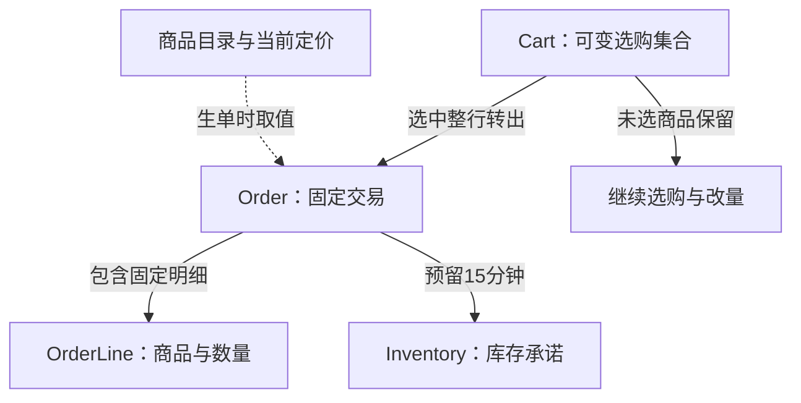
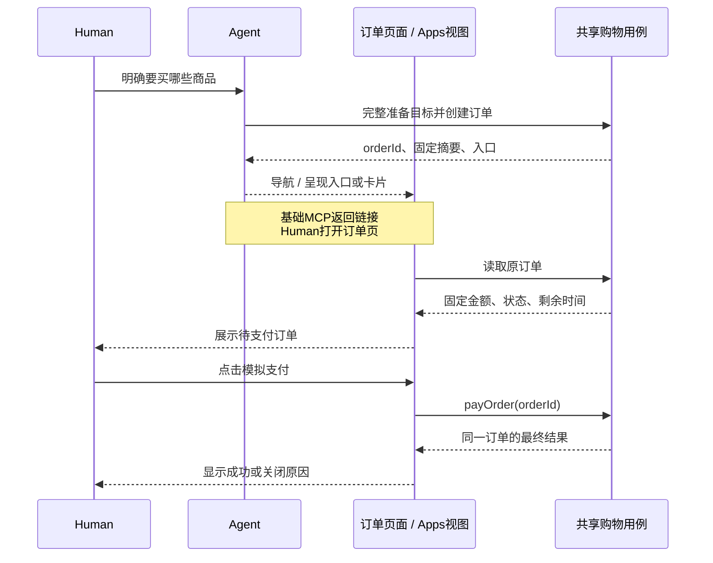
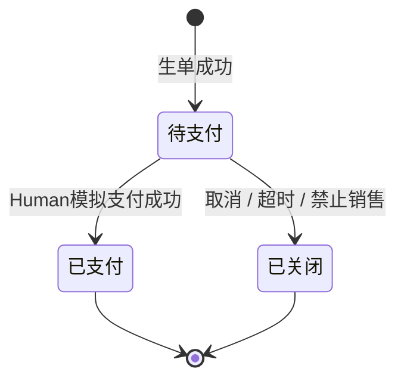
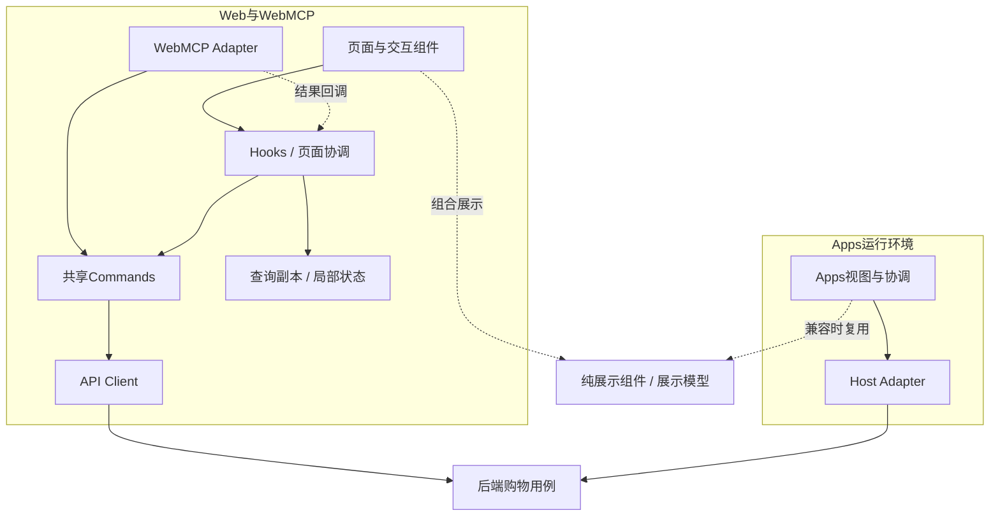
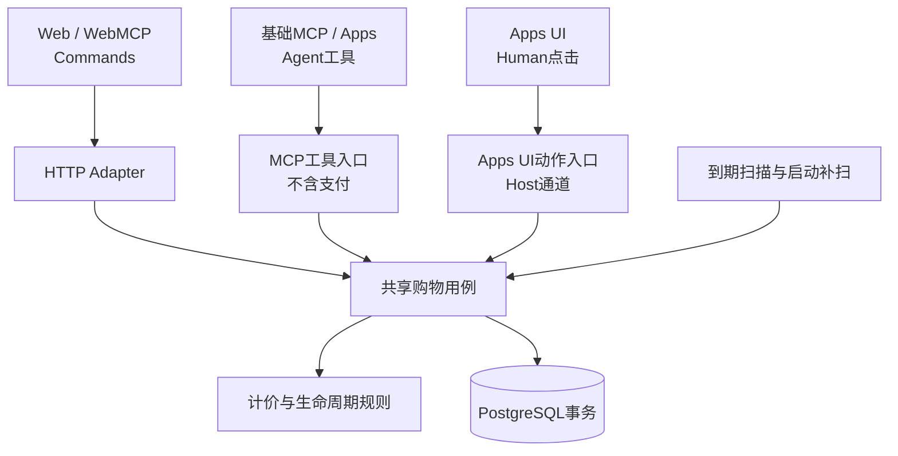

# Agent-Ready Store — Technical Design

## 以订单为中心的购物体验与架构

本文说明业务模型、各端用户流程、状态与交互、前端复用及后端保障。设计选择与取舍见[技术决策 T-08～T-11](ENGINEERING_DECISIONS.md#order-lifecycle-decisions)，接口与事务的具体约束见[OpenSpec Design](../../openspec/changes/checkout-lifecycle-redesign/design.md)。[历史基线](TECHNICAL_DESIGN_HISTORY.md)与[交付状态](DELIVERY_STATUS.md)独立维护。

阅读顺序：体验目标 → 业务模型 → 各端流程 → 状态与异常 → 前端架构 → 后端保障 → 取舍与验证。Next.js、NestJS和PostgreSQL组成薄模块化单体；前端协调交互，后端维护唯一业务事实。

### 1. 体验目标与设计中心

例：车里有A×3、B×2，用户只买A。生单后A整行移出并固定金额，B仍留车可编辑；用户可以继续把B生成第二笔订单，同时第一笔订单等待支付。Agent完成生单后直接展示订单，用户一次点击模拟支付，不必先等第一笔付款或新建另一辆车。

我们要改善的是三个体验：购买等待不阻塞选购、跨入口不丢上下文、失败恢复不重复购买。为此才引入下面的职责划分。

购物车解决“还想买什么”，订单解决“本次决定买什么、按什么金额支付”，库存解决“可承诺多少”。把这三者拆开，才能同时允许继续选购、独立待支付和固定金额。拆开的是生命周期和职责，不是部署服务：首版仍是一个API应用、一个PostgreSQL事务边界。

抽象只服务于现有消费者：Web、WebMCP、基础MCP和Apps复用同一业务用例；入口适配器只翻译协议和呈现结果。暂不建流程引擎、库存微服务、通用Repository框架、事件总线或插件体系。可扩展性来自“业务规则不依赖Host和页面”，而不是预先增加未使用的接口。

### 2. 业务模型：从可变选购到固定交易

图表达业务关系，不表示数据库表/外键：商品目录在生单时提供当前价格与摘要，随后固定到Order/OrderLine；目录引用不要求Product落关系表；Cart条目继续使用现有JSON，Order与OrderLine承载固定快照。一辆Cart可产生多笔独立Order；库存是跨订单共享资源，继续购物不会改变旧订单。

| 模型 | 负责的事实 | 不负责的事实 |
| --- | --- | --- |
| Cart | 持久购物上下文、可编辑商品与数量、version、来源归因；一车多单 | 用户身份、结算锁、订单付款状态；不另建Session |
| Order | 全局唯一ID、来源cartId、固定金额和优惠资格、支付/关闭事实、预留截止、创建幂等 | 继续跟随购物车或目录价格变化 |
| OrderLine | 生单时完整数量、商品摘要、单价和行金额的唯一权威 | 从当前商品目录重建历史交易内容 |
| Inventory | 实际未售量quantity、预留量reservedQuantity；可售量为二者之差 | 客户端倒计时、页面是否仍打开 |
| Product/定价规则 | 生单前的商品事实与当前计价依据 | 覆盖已生成订单快照 |

Order与OrderLine共同组成不可变交易快照，不另存重复商品JSON或purchaseHash。Cart的JSON条目仍复用现有结构，首版不为减少偶发版本冲突新增逐行修订体系。读模型CartView/OrderView是权威数据投影，不是新的领域实体。

必须保持：选择整行且数量一致；生单、移出车行与预留全有或全无；同键不重复生单；有效待支付默认每车最多10笔；同一预留只能消费或释放一次。这些约束如何通过数据库保证，见§6；本节只定义业务边界。

车和订单长期落库，ID用于demo接续，无业务TTL；库存预留才有固定15分钟期限。Demo不设计身份、凭证或服务端访问隔离，分享仅约束页面展示，不把这一简化描述成生产级授权方案。

### 3. 完整用户流程与各端差异

共同主线是“咨询/选购 → 明确目标 → 生单 → 展示固定订单 → Human支付或关闭”，各端只改变交互载体。下图聚焦Agent辅助路径，省略协议与数据库细节；普通Web由Human直接发起生单。

| 入口 | 正常路径 | 恢复/限制 |
| --- | --- | --- |
| 普通Web | 搜索→加购→车内改量/勾选→生单→同订单页模拟支付 | 首次全不选，提供全选；页面内保留有效选择，新商品不自动勾选 |
| WebMCP | Agent按意图搜索/加购/选行→生单→直接导航订单页→Human支付 | 复用Web Commands；仅启用工具不跳页，晚到结果不抢用户导航 |
| 基础MCP | Agent完成准备与生单→返回可打开的订单入口→Human网页支付 | 不能宣称Host已自动打开页面；页面打开失败仍保留同orderId，不重生单 |
| MCP Apps | Agent或专用UI生单→内嵌订单摘要→Human点击模拟支付 | 实例绑定orderId；重挂载先读原单，使用Host适配器而非Next Router |
| 分享 | 单订单分享视图→有效待支付可模拟支付→展示结果 | 不显示来源车、兄弟订单或取消，不修改当前车指针；非权限隔离 |

AI优惠在创建订单时按入口固定：MCP/WebMCP/Apps专用入口生单享资格，普通Web不享；仅咨询/加购不触发，人工支付不取消已固定资格。各端展示统一金额，UI不独立计算折扣。

### 4. 状态与异常体验

图中是业务展示状态，不是数据库枚举；请求“提交中/结果未知”也不是新的订单状态。

| 业务事实 | 存储映射 | 页面动作 |
| --- | --- | --- |
| 待支付且未到期 | status=CHECKOUT，closedAt为空 | 支付、取消、继续购物 |
| 已支付 | status=PAID，paidAt有值 | 显示结果，可继续购物 |
| 已提交关闭 | status=CHECKOUT，closedAt有值，closeReason记录原因 | 显示原因，返回选购 |
| 截止已到但关闭尚未提交 | status=CHECKOUT，closedAt为空，服务端判定到期 | 禁用新支付、查询结果；不能覆盖已在途支付的成功结果 |

数据库主状态只有CHECKOUT、PAID。服务端统一派生effectiveStatus、canPay/allowedActions，UI不各自实现状态机。SALE_BLOCKED只适配已有商品状态，不扩建商品管理后台。

| 维度 | 状态来源 | 处理原则 |
| --- | --- | --- |
| 订单业务状态 | 数据库支付/关闭事实 | 已提交终态不可逆，支付后不是新建第二个订单 |
| 期限有效性 | 服务器当前时间与reservationExpiresAt | 截止后拒绝新支付；读取与重试不续期 |
| 页面请求状态 | 当前目标的提交中、成功、失败、结果未知 | 不写回订单业务状态；未知不等于失败，不锁全局购物 |
| 当前导航 | currentCartId、当前orderId、普通/分享视图 | 查看订单不隐式切车，分享不更改currentCartId |

本地倒计时到点只能禁用新的支付并查询事实，不能认定关闭事务已完成。截止前已完成服务端准入的支付允许短事务提交；迟到的PAID结果不能被本地“超时”覆盖。取消与后台到期先保留既有终态，再按取锁后数据库时间裁决关闭原因，详见Change §5～6。

异常交互只按目标收敛：商品准备不完整不自动部分购买；结果未知查询原请求而非另起新单；已有车A时打开B订单先只展示，继续B购物才确认接续。车内默认全不选、分享视图不显示来源车与取消入口等规则见OpenSpec §8～9，不在状态层重复实现。

### 5. 前端架构与跨端复用

实线表示调用与状态管理，虚线表示结果回调或展示复用；该图不要求新增Store、类或包。WebMCP调用Command，不调用React Hook；页面协调层统一安装结果，页面通过Hook订阅查询副本和局部状态。Apps有自己的Host运行环境，复用契约和展示能力，不依赖Web路由。

Next.js继续负责页面组合、目录首屏和浏览器交互边界；交易相关视图读取动态服务端结果，不把静态目录/构建缓存当库存或订单事实。纯展示组件可用于服务端或客户端树，选择/倒计时/点击区才进入客户端协调层。MCP Apps保留独立Host运行边界。

| 状态 | 所有者 | 生命周期 |
| --- | --- | --- |
| 商品、可售量、车版本、订单金额及终态 | API/数据库；客户端查询副本 | 按目标查询键cartId/orderId；进入、返回、焦点恢复和操作完成后校准 |
| 当前车ID、订单入口、未决请求键 | 入口上下文/持久客户端存储 | 请求前保存关键键；不把完整服务端对象当本地事实库 |
| 勾选集合、数量输入、弹窗、当前请求状态 | 页面/feature协调层 | 页面内局部状态；提交前保存数量，外部变更需核对 |
| effectiveStatus/allowedActions、金额摘要 | 服务端投影 | 各端直接消费；不重算业务状态或金额 |
| 倒计时和金额格式化 | 展示层 | 倒计时只提示，终态仍由服务端决定 |

推荐职责：CartPage组合CartItems/SelectionSummary；OrderPage组合OrderSummary/Status/Actions；Hooks协调读写结果；Commands只执行请求；Adapter接收明确用户意图。具体文件路径沿现有feature组织，不为分层机械增加目录。

共享操作路径：Web按钮→Hook→Command；WebMCP→相同Command→页面协调回调；两者最终调用同一API用例。协调层按cartId/version安装CartView，低版本或其他车响应不得覆盖当前车。订单按orderId隔离，已提交终态不能退回待支付；未知请求只禁用其自身重复操作，其他购物可继续。

统一订单路由`/orders/{orderId}`，不同状态改变内容和按钮，不再在“结算页/成功页/失败页”之间搬运业务状态。普通视图与分享视图复用摘要，差异在外层操作区与导航，不另写一套订单规则。首版不引入WebSocket、全局流程Store或通用状态机库。

#### 5.1 复用边界

| 层/位置 | 共享内容 | 明确不共享 |
| --- | --- | --- |
| contracts | DTO、运行时schema、错误码、selectedItems与OrderView形状 | React、Next Router、Host SDK、Prisma |
| API Commerce用例 | 生单、支付、关闭、幂等与库存/金额规则 | 页面跳转、对话措辞、当前浏览器车指针 |
| Web Commands | 无React的HTTP操作函数；Web与WebMCP共同调用 | Hook、QueryClient、全局busy、业务重新计价 |
| Web Hooks/协调层 | 查询订阅、请求状态、结果安装、刷新与导航条件 | 服务端状态转移、自动重放新购买 |
| MCP/Apps适配器 | 协议输入输出、Host视图、目标上下文传递 | 复制Commerce规则、导入Next路由/浏览器全局状态 |
| 展示组件/展示模型 | 金额明细、订单摘要、状态标签、商品展示 | 网络、Host调用、授权判定、库存计算 |

不强迫Apps复用Next组件。共享契约和纯展示逻辑是必需边界；只有运行时兼容且确有两个消费者的组件才提取共享包。避免为“统一”把Host SDK、路由和交易规则塞入一个万能购物组件。

### 6. 后端保障与不同情况的调度

这里的“调度”有两层：Agent/UI按意图串联用例；服务端到期任务批量执行关闭用例。两者都不成为独立流程引擎，也不持有跨用户思考时间的数据库锁。

Apps UI动作与Agent工具是不同调用角色，即使复用Host传输，也不能把UI支付开放成Agent工具。图中的Adapter是逻辑入口，不表示新增进程、公共框架或强制包拆分。具体Host通道由入口适配器封装，不改变用例接口。

| 情况 | 调度及失败语义 |
| --- | --- |
| 咨询 | 只查询目录/预估，不创建订单、不占库 |
| 加购 | 每次操作有幂等键；批量请求完成后展示一次车，部分失败如实保留成功项 |
| 明确购买 | 完整目标准备成功后生单；A成功B失败不得只买A；已成功准备不是全链路事务，不回滚用户其他操作 |
| 生单 | 先恢复原键，再校验车版本、选择集合、预算、10笔配额和库存；失败不转出、不占库 |
| 支付/取消 | 只操作指定orderId；终态重复调用返回原事实，不锁来源车 |
| 超时 | API内定时扫描、启动补扫，按订单与有序库存锁执行关闭；默认每秒扫描，正常负载目标5秒内释放 |
| 网络结果未知 | 原请求键/订单ID查询与重试；不另造新购买意图，不自动换车或续期 |
| 页面切换/响应乱序 | 按目标隔离结果；Cart按version，Order按已提交终态和请求顺序接受更新；疑似冲突重读 |
| 跨车接续 | 打开B订单不覆盖已有A；仅“继续这次购物”才确认接续B，既不合并也不删除A |

锁顺序、库存计数、截止和幂等细节集中在Change §6，避免在每个入口复制。无Redis、队列或浏览器独占计时器；数据库是唯一交易事实来源。

持久化只保留必要事实：Cart条目与version；Order固定金额、状态和幂等来源；OrderLine固定商品明细；Inventory实际量与预留量；车操作幂等记录。正常库存满足`0 <= reservedQuantity <= quantity`，异常样例不可售。生单同时转行/预留/写单，支付消费预留，关闭释放预留；幂等记录与写入同事务提交。物理字段、锁序和验证反例集中在OpenSpec §3、§5～6、§12，本文不另维护一份算法。

### 7. 取舍、验证与演进条件

- **单一事实来源：** 固定商品数据在OrderLine，金额汇总在Order；查询投影和客户端缓存都不能改写它们。修改计价只影响新生单路径。
- **稳定的用例边界：** 新入口只需适配已有契约；不允许新入口另写库存或优惠逻辑。只有出现真实差异才扩展用例参数。
- **局部复杂度：** 库存锁、幂等、关闭原因只在后端维护；响应顺序在前端协调层维护；组件只呈现意图和结果。
- **明确演进触发：** 真实支付/身份权限将重新评审安全与订单状态，不假定demo接口直接可上线；只有容量证据才考虑缓存/队列；只有整车版本冲突成为实际瓶颈才考虑逐行模型。当前设计不预建这些扩展点。

验收按风险：纯金额与状态投影测试、真实PostgreSQL事务/竞争/回滚、前端乱序与目标隔离、各入口真实Host与Human流程。具体场景集中于OpenSpec Design §12，验证进度与证据在交付状态中记录，不混入架构说明。
