# Agent-Ready Store — Technical Design

**状态：商店完整目标技术方案（2026-10-31，Asia/Shanghai），本轮文档整合及检查后提交合并已获Human授权。** 本文统一描述既有架构与已采用的订单生命周期重设计，不是新的整体Approved声明。商品发现等已有实现继续复用，订单重设计尚未实施；当前交付事实见[DELIVERY_STATUS](DELIVERY_STATUS.md)，不能将目标方案整体表述为已经交付。

## 阅读入口

本文是了解整个系统的唯一技术方案正文。按“业务目标与领域 → 用户旅程与业务状态 → 页面/组件/交互数据流 → 跨端协作 → 后端与运行验证”组织；读者不必阅读旧方案或Change才能理解系统。技术选择及替代关系见[工程决策](ENGINEERING_DECISIONS.md)，具体增量接口、迁移和验收场景见[当前Change](../../openspec/changes/checkout-lifecycle-redesign/design.md)。

| 阅读问题 | 正文位置 |
| --- | --- |
| 商店提供什么，系统如何组成 | §1 体验目标与系统全景 |
| 商品、购物车、订单和库存如何关联 | §2 领域与数据模型 |
| Human和Agent如何完成购物与接续 | §3 完整旅程、§4 状态与恢复 |
| 页面、组件、状态、请求与多入口如何协作 | §5.1～5.5 职责与状态，§5.6 完整交互，§5.7～5.9 跨端与体验 |
| 如何保证统一契约、计价、库存及可复现运行 | §6 后端用例、共享契约与运行边界 |
| 如何验证以及何时扩展 | §7 验证与演进 |

历史方案与批准记录统一收于[归档](archive/TECHNICAL_DESIGN_HISTORY.md)，仅供追溯；关键推导见[技术讨论记录](../ai-collaboration/AI_COLLABORATION_TECH_DECISIONS.md#order-lifecycle-discussion)。本文件不维护历史逐轮记录或实施流水账。

## 1. 体验目标与系统全景

商店同时服务直接浏览的Human和通过工具操作的Agent。用户从列表查询、筛选和比较商品，查看规格与评论，在持续购物车中准备商品，按本次选择创建固定订单，再由Human完成模拟支付；后续可以查询原单、继续选购或分享单订单。目录发现、解释价格和故障恢复与成交本身同样属于完整体验。

网站采用Next.js App Router与React；NestJS承载薄模块化API和MCP适配；Prisma/PostgreSQL保存购物车、订单和库存事实；商品与评论继续读取只读JSON。pnpm Monorepo组织Web、API、Apps、共享契约与展示代码，不增加独立库存服务或支付系统。

例：车里有A×3、B×2，用户只买A。生单后A整行移出并固定金额，B仍留车可编辑；用户可以继续把B生成第二笔订单，同时第一笔订单等待支付。Agent完成生单后直接展示订单，用户一次点击模拟支付，不必先等第一笔付款或新建另一辆车。

我们要改善的是三个体验：购买等待不阻塞选购、跨入口不丢上下文、失败恢复不重复购买。为此才引入下面的职责划分。

购物车解决“还想买什么”，订单解决“本次决定买什么、按什么金额支付”，库存解决“可承诺多少”。把这三者拆开，才能同时允许继续选购、独立待支付和固定金额。拆开的是生命周期和职责，不是部署服务：首版仍是一个API应用、一个PostgreSQL事务边界。

抽象只服务于现有消费者：Web、WebMCP、基础MCP和Apps复用同一业务用例；入口适配器只翻译协议和呈现结果。暂不建流程引擎、库存微服务、通用Repository框架、事件总线或插件体系。可扩展性来自“业务规则不依赖Host和页面”，而不是预先增加未使用的接口。

本方案延续[T-01～T-06](ENGINEERING_DECISIONS.md#技术决策归档--2026-10-29)中未被替代的技术栈、目录、前端与运行边界；T-08～T-11只改变订单生命周期、Demo接续与相应协调。列表、详情、评论、购物车和订单共同组成商店，不因本次交易重构退化为单独支付演示。

### 1.1 系统全景与请求路径

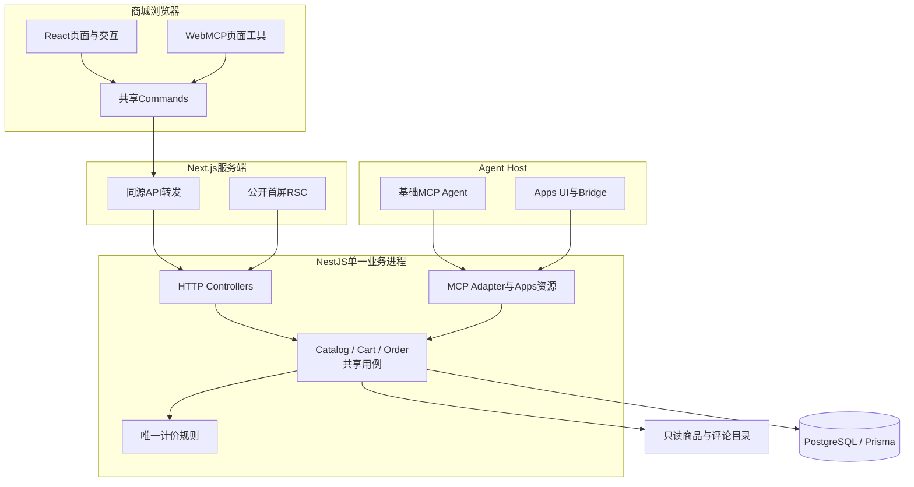

图中是调用方向，响应沿原链返回；Commands、Adapter和用例是代码职责，不是新增部署进程。浏览器只访问同源API，Next负责公开首屏及透明转发，MCP直接进入Nest；MCP适配器调用同一用例，不在服务内部绕回HTTP。Apps通过Host Bridge进入服务，与网站不共享React上下文或Cookie。

Human可在网站或Apps点击模拟支付；Agent工具只承接查询、选购、生单、查单和取消。服务端统一裁决业务事实。Demo按ID接续而不验证自然人身份，UI动作与Agent工具的区分是产品交互边界，不宣称具备生产级授权隔离。

## 2. 领域与数据模型

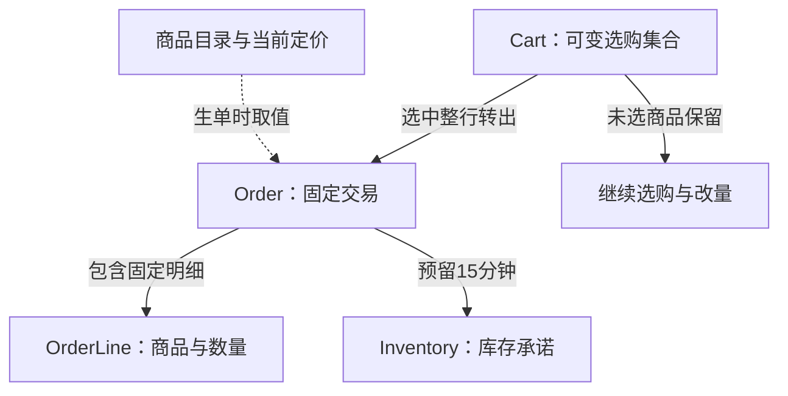

图表达业务关系，不表示数据库表/外键：商品目录在生单时提供当前价格与摘要，随后固定到Order/OrderLine；目录引用不要求Product落关系表；Cart条目继续使用现有JSON，Order与OrderLine承载固定快照。一辆Cart可产生多笔独立Order；库存是跨订单共享资源，继续购物不会改变旧订单。

| 模型 | 负责的事实 | 不负责的事实 |
| --- | --- | --- |
| Cart | 持久购物上下文、可编辑商品与数量、version、来源归因；一车多单 | 用户身份、结算锁、订单付款状态；不另建Session |
| Order | 全局唯一ID、来源cartId、固定金额和优惠资格、支付/关闭事实、预留截止、创建幂等 | 继续跟随购物车或目录价格变化 |
| OrderLine | 生单时完整数量、商品摘要、单价和行金额的唯一权威 | 从当前商品目录重建历史交易内容 |
| Inventory | 实际未售量quantity、预留量reservedQuantity；可售量为二者之差 | 客户端倒计时、页面是否仍打开 |
| Product/定价规则 | 生单前的商品事实与当前计价依据 | 覆盖已生成订单快照 |

Order.cartId是必填、非唯一的来源关联；OrderLine按orderId与productId唯一，保存从车转入的完整数量。OrderLine加订单支付/关闭事实构成最小预留归属账本，不另建Checkout或独立预留生命周期。

Order与OrderLine共同组成不可变交易快照，不另存重复商品JSON或purchaseHash。Cart的JSON条目仍复用现有结构，首版不为减少偶发版本冲突新增逐行修订体系。读模型CartView/OrderView是权威数据投影，不是新的领域实体。

必须保持：选择整行且数量一致；生单、移出车行与预留全有或全无；同键不重复生单；有效待支付默认每车最多10笔；同一预留只能消费或释放一次。这些约束如何通过数据库保证，见§6；本节只定义业务边界。

车和订单长期落库，ID用于demo接续，无业务TTL；库存预留才有固定15分钟期限。Demo不设计身份、凭证或服务端访问隔离，分享仅约束页面展示，不把这一简化描述成生产级授权方案。

### 2.1 商品发现与运行数据

商品ID是唯一身份，同名商品仍分别展示和购买。列表提供必要摘要，详情提供基本信息、规格和评论概览，评论通过独立分页读完；描述和评论都只作为不可信文本。公开DTO排除毛利、推荐原始分数等内部字段，不直接传递原始目录对象。

Catalog在API生命周期内读取只读目录并建立进程内索引与revision，不新增Product/Review数据库表。原始stock仅用于初始化或异常溯源；运行库存始终来自Inventory，缺行时不可购买，不能回退原始stock。零库存、负库存、零价格等样本保真并解释原因，不静默修正为可售商品。预留启用后公开库存使用quantity减reservedQuantity，与订单自身的有效预留区分。

查询先执行确定性文本匹配及必要筛选，再按既定推荐分数降序、同分稳定ID顺序排列；不引入毛利加权、语义搜索或搜索服务。商品与评论均有界分页，非法参数明确拒绝。固定目录、库存和条件时结果稳定；翻页间可售量变化不承诺跨页快照，目录revision改变则重新开始，不拼接旧版本。参数和限值由[商品发现Spec](../../openspec/specs/product-discovery/spec.md)及contracts维护。

### 2.2 标识、版本、请求与来源

| 材料 | 唯一职责 | 不代表什么 |
| --- | --- | --- |
| productId | 区分商品，包括同名商品 | 不携带价格或库存承诺 |
| cartId / currentCartId | 来源车关联 / 当前入口的购物指针 | 不证明身份，不因订单状态自动换车 |
| Cart.version | 服务端车快照版本，保护JSON条目写入 | 不是订单支付版本，客户端不可自增后重放 |
| orderId | 从创建到支付/关闭持续定位同一订单 | 订单存在不等于已支付 |
| 创建/车操作请求键及载荷校验 | 原意图重试去重、拒绝同键异内容 | 不证明用户授权，不允许续期或复活 |
| createdByChannel / aiEligible | 固定本单生单通道与AI优惠资格 | 不从车来源继承，不因读单或支付者变化而升级 |
| Cart创建归因 | 按车记录最初有效创建事实 | Agent接手或生单不补算一次建车 |

数据库保存业务事实和必要幂等记录；查询投影与页面草稿不另建实体。Cart没有“存在订单即完成”的标志，Order没有支付后换号的第二生命周期。商品管理、账户、物流、真实金流和退款不属于当前模型。

## 3. 完整用户流程与各端差异

普通Web主线从列表开始：URL恢复搜索/筛选/页码 → 详情查看规格与评论 → 明确数量并加购 → 车页保存改量、勾选和核对预估 → 创建订单 → 审阅原单并支付/取消 → 查看结果或继续购物。空结果、加载失败、不可售、空车和订单关闭都有独立反馈，不将失败伪装成没有数据。

Agent辅助主线是“咨询/选购 → 明确目标 → 生单 → 展示固定订单 → Human支付或关闭”，各端只改变交互载体。下图聚焦Agent辅助路径，省略协议与数据库细节；普通Web由Human直接发起生单。

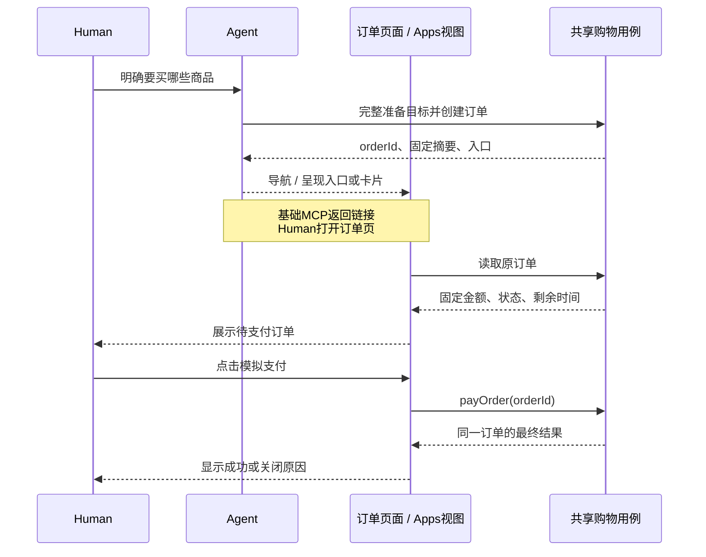

| 入口 | 正常路径 | 恢复/限制 |
| --- | --- | --- |
| 普通Web | 搜索→加购→车内改量/勾选→生单→同订单页模拟支付 | 首次全不选，提供全选；页面内保留有效选择，新商品不自动勾选 |
| WebMCP | Agent按意图搜索/加购/选行→生单→直接导航订单页→Human支付 | 复用Web Commands；仅启用工具不跳页，晚到结果不抢用户导航 |
| 基础MCP | Agent完成准备与生单→返回可打开的订单入口→Human网页支付 | 不能宣称Host已自动打开页面；页面打开失败仍保留同orderId，不重生单 |
| MCP Apps | Agent或专用UI生单→内嵌订单摘要→Human点击模拟支付 | 实例绑定orderId；重挂载先读原单，使用Host适配器而非Next Router |
| 分享 | 单订单分享视图→有效待支付可模拟支付→展示结果 | 不显示来源车、兄弟订单或取消，不修改当前车指针；非权限隔离 |

AI优惠在创建订单时按入口固定：MCP/WebMCP/Apps专用入口生单享资格，普通Web不享；仅咨询/加购不触发，人工支付不取消已固定资格。各端展示统一金额，UI不独立计算折扣。

### 3.1 选择、接续与多单导航

车页首次全不选，提供全选；页面内保留仍有效的显式选择，新加商品不自动勾选，离页不承诺保留。数量先保存再生单；外部改量或版本变化后展示最新车并重新核对。Agent直接购买只选本次意图涉及的整行，不受页面默认选择影响，也不顺带购买旧车其他行。明确“将A改为1件并购买”可连续执行；数量意图有歧义才澄清。显式预算、币种与规格必须在生单时校验；任何选中行失败都整笔拒绝，未选问题行不阻止合法选择。

Cart就是持久购物上下文：浏览器保存currentCartId，Host携带cartId；有ID先恢复，无ID且无法找回时才幂等初始化。关闭窗口、缓存TTL、本地ID丢失均不删除服务端数据，保存的车链接仍可恢复。不提供主动新建/切车，也不因付款、满额或失败自动换车。

本人跨端携带cartId和orderId；没有当前车或已是同车时接续原车。已有A车而打开B车订单，先只展示B订单；点击“继续这次购物”才确认是否切换到B，既不合并也不删除A。分享入口始终只展示单订单，不改变当前车。车操作显式定位cartId，订单操作显式定位orderId，不能根据页面位置猜测写入目标。

购物入口同时提供车与有界待支付订单列表，历史订单分页读取；空车也能发现原订单和继续加购。创建订单、打开页面和支付成功分别报告：导航失败可重开原orderId，不能重生单。WebMCP明确加购后一次展示车，明确购买则直接进入订单；仅启用工具不导航。Apps每个实例恢复自己的订单，旧卡片不能覆盖另一订单。

### 3.2 从选中报价到订单审阅

普通Web的车页展示所选行及其金额汇总：勾选变化或数量保存后，以最新车版本和选择集合向共享计价用例取得无占库预估。没有选择时不生单；未保存的数量不是报价或创建依据。预估只计算选中商品的门槛和运费，不把整车报价当作本单金额。前端只格式化服务端结果，不自行算优惠，也不拼接不同响应的明细。

生单在短事务中按当时条件重新校验并固定金额，返回订单与剩余车快照；Human随后审阅该订单的完整商品、数量、单价、优惠、运费、应付及截止，点击模拟支付。若预估与生单间价格变化，展示实际订单快照供Human决定支付或取消，不能继续显示旧预估。Agent明确购买可以直接生单，不把一次预估调用设成强制中间步骤。

**Order本身就是固定审阅对象。** 新流程移除PurchaseReview、Cart.checkoutEpoch及确认签名，不在订单前后增加Review、批准签发或重复准备步骤。重新打开只读取原orderId，既不重新确认一份报价记录，也不延长预留。Human点击后由Web或Apps UI直接调用支付用例并显示结果，不等待Agent继续回复；Agent可选购、生单、查单和取消未支付单，但没有模拟支付工具。取消或状态查询有多个候选订单时先明确目标。

订单创建和读取结果直接带普通入口与分享入口，不要求另调取链接工具。明确加购通常展示车，但用户要求留在当前页时遵循；内部加购后直接生单的购买请求不插入车页导航。商品、评论或模型自述不能替代用户意图。

## 4. 状态与异常体验

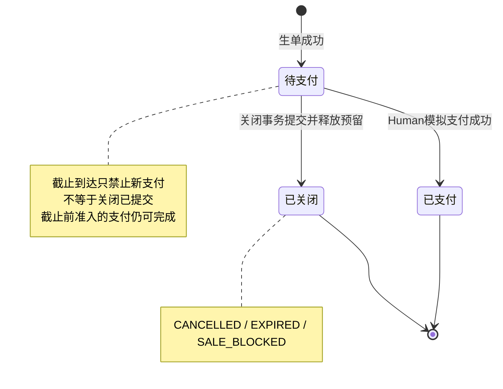

图表达已提交业务事实的转移，不是数据库枚举；待支付节点包含“已到截止但关闭尚未提交”的中间观察窗口，此时不可新发起支付。请求“提交中/结果未知”也不是新的订单状态。

| 业务事实 | 存储映射 | 页面动作 |
| --- | --- | --- |
| 待支付且未到期 | status=CHECKOUT，closedAt为空 | 支付、取消、继续购物 |
| 已支付 | status=PAID，paidAt有值 | 显示结果，可继续购物 |
| 已提交关闭 | status=CHECKOUT，closedAt有值，closeReason记录原因 | 显示原因，返回选购 |
| 截止已到但关闭尚未提交 | status=CHECKOUT，closedAt为空，服务端判定到期 | 禁用新支付、查询结果；不能覆盖已在途支付的成功结果 |

数据库主状态只有CHECKOUT、PAID。服务端统一派生effectiveStatus、canPay/allowedActions，UI不各自实现状态机。关闭原因限定为CANCELLED、EXPIRED、SALE_BLOCKED；PAID必须有paidAt且无closedAt，已提交关闭不可复活。SALE_BLOCKED只适配已有商品状态，不扩建商品管理后台。

| 维度 | 状态来源 | 处理原则 |
| --- | --- | --- |
| 订单业务状态 | 数据库支付/关闭事实 | 已提交终态不可逆，支付后不是新建第二个订单 |
| 期限有效性 | 服务器当前时间与reservationExpiresAt | 截止后拒绝新支付；读取与重试不续期 |
| 页面请求状态 | 当前目标的提交中、成功、失败、结果未知 | 不写回订单业务状态；未知不等于失败，不锁全局购物 |
| 当前导航 | currentCartId、当前orderId、普通/分享视图 | 查看订单不隐式切车，分享不更改currentCartId |

本地倒计时到点只能禁用新的支付并查询事实，不能认定关闭事务已完成。截止前已完成服务端准入的支付允许短事务提交；迟到的PAID结果不能被本地“超时”覆盖。取消与后台到期先保留既有终态，再按取锁后数据库时间裁决关闭原因，详见Change §5～6。

订单创建后商品/数量固定；改量须取消后重新选购。取消、到期或禁止销售释放整单预留，但不自动回车、不修改后来加购的行或兄弟订单。关闭页面、结束Agent对话、Abort网络请求都不代表取消；已支付单不能取消或退款。普通停售只影响新单，已有有效预留仍可支付；明确禁止销售则关闭未支付单并释放整单预留。

异常按目标恢复：创建失败不移行、不占库；支付事务回滚保留此前已创建的订单、快照及原预留，仍受原截止约束。网络未知不能当成失败或已释放库存。创建未知按原车与创建请求键恢复，支付/取消未知按原orderId查事实，重试不换键、不续期。到期后原单只可查看；用户明确重新购买才重新选购、使用新请求键和当前价格创建新单，不复制旧锁价。

## 5. 前端架构与Agent接入

前端将§2的领域事实组织成§3的用户旅程，并把§4的业务状态转换成可理解、可恢复的交互。阅读本节可以追踪一次改量、生单或支付如何穿过组件、页面协调、Commands与服务端，再更新页面。以下组件名表达职责，实施时沿现有feature组织，不要求逐项新建文件、Hook或共享包。

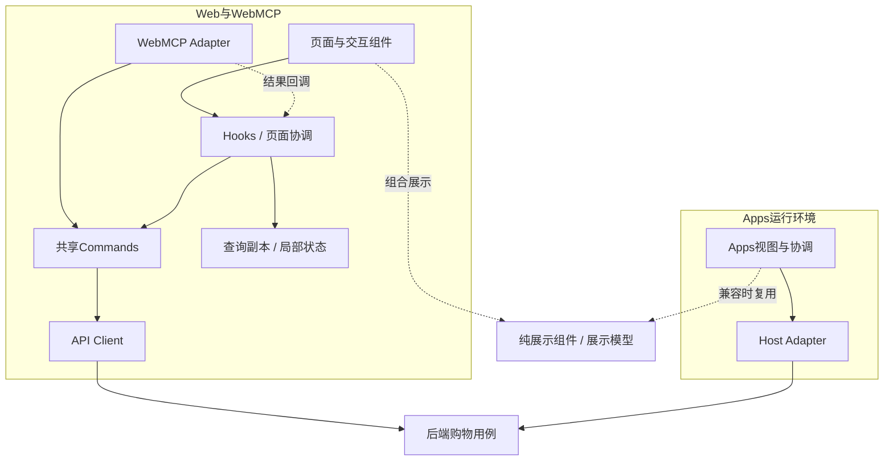

页面与WebMCP调用同一组无React依赖的Commands；Hooks/页面协调层负责请求归属、查询副本、输入保护与导航。Apps保持独立环境控制器，通过Host Adapter复用后端用例和适用展示组件。图中的层次不代表新的Store、服务或框架；前端不重写金额、库存或订单状态规则。

### 5.1 页面协作、路由与上下文

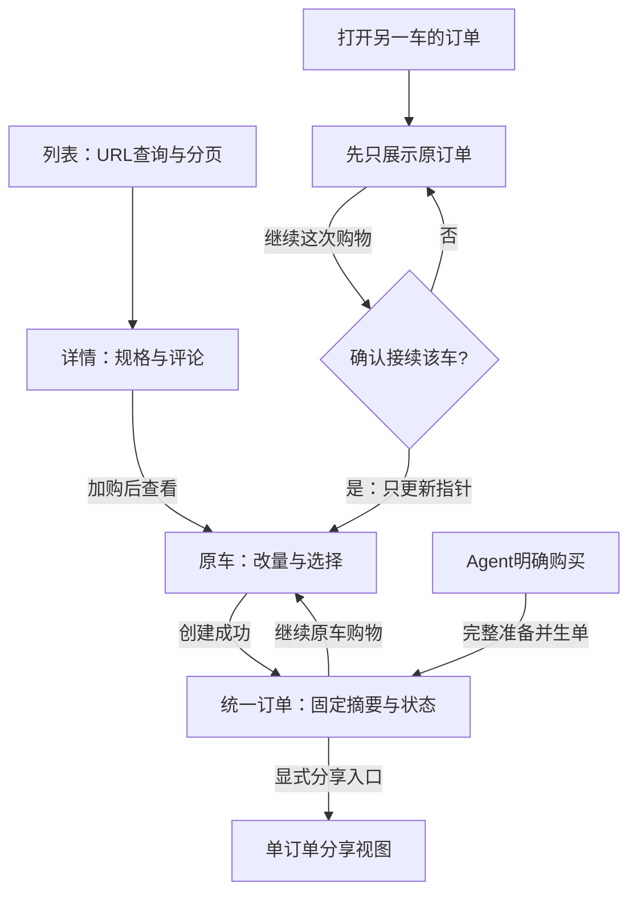

箭头表示用户流程，不表示所有入口都会自动导航；基础MCP须由Human打开网页，Apps在卡片内呈现。分享视图不提供返回来源车的入口。

| 页面 | 读取与交互 | 离开、返回及接续 |
| --- | --- | --- |
| 商品列表 `/` | URL查询驱动列表；搜索草稿、筛选、分页与商品卡 | 提交查询后导航，筛选变化重置偏移；返回按URL恢复，不用另一套全局搜索Store |
| 详情 `/products/{productId}` | 商品与规格首屏，评论独立分页，局部数量输入与加购 | 切商品隔离旧评论和请求；加购更新原车上下文，不把详情输入当车内已保存数量 |
| 购物车 `/cart`、`/cart/{cartId}` | 读取目标车，逐行改量/删除、选择与预估，发现关联订单 | 返回读取最新车；选择仅在页面内保留有效部分，不承诺离页持久化；有草稿先保护并核对 |
| 订单 `/orders/{orderId}` | 原单固定摘要、截止、状态、支付/取消/继续购物 | 直达或刷新先查原单，不生单、不准备Review；返回购物车继续原上下文 |
| 单订单分享视图 | 相同订单摘要，有效待支付可模拟支付 | 不显示来源车、兄弟订单或取消；不更改currentCartId；展示限制不是权限隔离 |

当前车指针由入口上下文管理，页面只持自己的productId/orderId及查询位置。查看B车订单不会隐式把A车切成B；“继续这次购物”才按§3.1确认接续。订单路由中的ID只解释为orderId，不能复用旧`/orders/{cartId}`语义。旧Checkout及旧只读凭证入口的退场由Change切换约束处理，不保留两套购买页面状态。

导航与业务成功分开：生单成功但导航失败时显示原订单入口；用户已主动离页时，迟到结果仍归原目标，不能强制跳回订单。仅打开WebMCP不导航；明确加购通常展示车，明确购买在内部准备后直达订单，不插入车页中转。用户要求停留当前页时遵循该意图。

### 5.2 页面容器、业务组件与展示复用

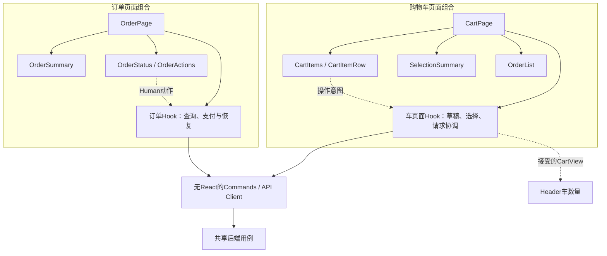

实线表示组件组合或调用，虚线表示意图回调/快照投影。组件通过props消费状态，页面协调层统一接受结果，不建立两份车版本或订单事实。

| 层 / 代表职责 | 输入、输出与协作 | 维护边界 |
| --- | --- | --- |
| App Router页面壳 | 解析路由、读取公开首屏、组合Client入口 | 不导入Prisma/计价，不在渲染或预取时写购物事实 |
| CartPage及页面Hook | 消费CartView、选择、草稿和请求状态；协调保存、报价、生单和返回导航 | 统一处理结果，子组件不各自维护另一份车版本 |
| CartItems / CartItemRow | 展示已保存数量，编辑局部草稿；回调绝对设量、移除、勾选意图 | 草稿与已保存值可区分，失效行有原因，不把未提交输入显示成已写入 |
| SelectionSummary / OrderList | 展示服务端选中预估、选择问题和原车关联订单入口 | 不按整车金额推导所选金额，不把待支付列表当独立业务事实库 |
| OrderPage及页面Hook | 读取原orderId；协调查询、支付、取消与未知恢复 | 普通/分享模式在外层决定动作区域；不重新创建订单或Review |
| OrderSummary / OrderStatus / OrderActions | 固定快照、状态标签、倒计时、明确动作回调 | 不自行决定支付可用性、重算金额或调用Host |
| ProductCard / ReviewList / MoneyBreakdown | 公开商品、独立评论页、服务端金额明细及展示模式 | 通过props和回调复用；不泄漏内部字段，不把评论指令当操作 |
| Commands / API Client | 明确目标、请求键、版本与载荷；返回结构化成功或失败 | 普通TypeScript函数，不依赖React、DOM、Router或QueryClient |
| WebMCP / Apps环境适配 | 页面工具生命周期或Bridge调用，转换输入/输出并交给各自协调层 | 不复制Commerce规则，不跨Host共享React上下文 |

Header与行数量读取同一个被接受的CartView，不从草稿分别累加；订单各组件读取同一份OrderView，支付结果由外层一次接受后共同呈现。

复用现有`packages/commerce-ui`中适用能力。Web与Apps可以共享纯React展示及格式化，但路由、查询控制器、Host SDK、页面焦点由环境保留。只有运行时兼容且存在真实消费者才抽共享包，不为统一外观引入万能购物组件或通用注册框架。

### 5.3 状态归属与保存范围

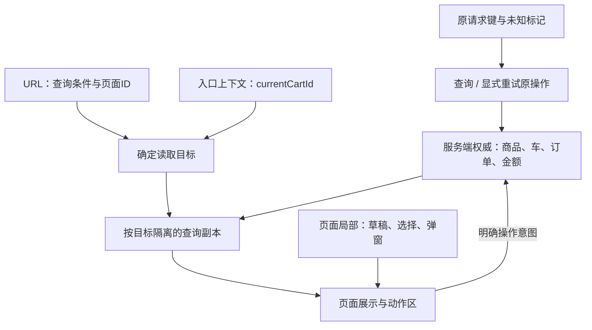

图中没有“草稿直接写入查询副本”或“倒计时写入订单终态”的路径。请求键在发出写操作前保存；持久ID只用于定位，不构成身份。

| 状态 | 权威 / 前端归属 | 保存及更新规则 |
| --- | --- | --- |
| 商品、可售量、CartView、OrderView | API/数据库；页面或feature的查询副本 | 只安装目标匹配的服务端结果；缓存不是库存或成交承诺 |
| 查询条件、页码、productId/orderId | URL / 页面入口 | URL承载可恢复的位置；搜索框草稿尚未提交时只在局部 |
| currentCartId、原订单入口 | 浏览器/Host入口上下文 | ID可持久保存用于接续，不证明身份，不因支付或空车自动清空 |
| 请求键、未知标记 | 操作协调层及必要持久客户端存储 | 发写请求前保存，未知时保留；不能靠完整本地对象重建交易事实 |
| 数量输入、勾选、弹窗、焦点 | 页面/feature局部状态 | 输入不是已保存数量；外部变化需核对；新商品不自动勾选 |
| 选中Quote | API计价；本页请求副本 | 关联车版本与选择集合；变化后旧结果不得作为当前预估 |
| effectiveStatus / allowedActions | 服务端投影 | UI消费业务动作条件，再叠加本目标的提交中/未知等交互限制 |
| 倒计时、格式化文字 | 展示层 | 到点只禁用新支付并查事实，不写闭单终态、不改金额 |

沿用React state/ref/context与请求函数，不因使用“查询副本”或“查询键”引入TanStack Query。当前车Provider只承接跨页面确需共享的指针、车结果与操作协调，不吸收全部订单、搜索、表单或支付状态。每个订单有自己的请求状态，不能以一个全局busy阻塞继续购物。

### 5.4 交互状态与可继续的动作

本表是客户端呈现和操作协调，不是新增订单状态机。业务终态和期限由§4决定，表单校验、请求状态与导航可以独立变化。

| 场景 | 用户看到什么 | 动作与恢复 |
| --- | --- | --- |
| 首次读取 | 明确加载状态，无伪造金额或空订单 | 取得事实后展示；失败提供读取重试，不把失败当空数据 |
| 数量有未保存修改 | 输入草稿与保存反馈 | 先保存改量，再核对选择/报价后生单；不拿草稿数量直接下单 |
| 勾选变化或报价加载 | 选中集合与“预估更新中” | 旧预估不冒充当前金额；新生单仍须明确目标与服务端校验，报价不是授权或锁价 |
| 保存中 | 原目标的处理中状态 | 防止同车冲突写入，不排队自动重放；无关订单可继续操作 |
| 外部变更 / 版本冲突 | 最新事实需核对，草稿有丢弃提示 | 显式重载并重新选择；不自动合并、换版本重放或静默覆盖输入 |
| 创建中 | 明确正在创建待支付订单 | 原请求保留；不重复新建，成功才展示订单入口与剩余车 |
| 创建结果未知 | 尚不确定是否生单，提供查询/原请求重试 | 按cartId及原创建键恢复，不换键、不把一次未查到当确定失败 |
| 支付/取消中 | 原订单动作处理中，固定摘要仍可读 | 防止该单重复或冲突操作；其他订单及选购不受长期锁定 |
| 支付/取消结果未知 | 状态待确认，不宣称失败或库存已释放 | 查询原orderId，显式重试遵循原操作；不另建单或自动支付 |
| 截止已到 | 禁止新支付、查询服务器结果 | 不用本地超时覆盖截止前准入后提交的PAID |
| 已支付 / 已关闭 | 服务端结果或关闭原因 | 隐藏支付/取消，按视图提供继续购物或返回选购；不自动回车 |

输入错误允许原页修正；库存或额度拒绝要给出具体原因和可访问的原订单入口。用户可关闭页面，但关闭页面/Abort只结束当前观察，不等于撤销服务器事务。

### 5.5 查询标识、刷新与结果安装

下列是逻辑查询标识，用于隔离结果；不要求新建缓存库、持久查询表或统一框架。查询副本可沿现有feature state/ref维护。

| 查询 | 标识所需信息 | 更新/失效条件 |
| --- | --- | --- |
| 商品列表 | 规范化查询、筛选、排序、页偏移；返回目录revision | URL改变发新读取，旧条件结果不得覆盖；目录变化重启分页 |
| 详情 / 评论 | productId；评论还含页位置及目录revision | 切商品不拼接旧评论；加载失败不当评论为空 |
| 当前车 | cartId，结果携带version | 首次进入、返回、干净页聚焦、车写成功后校准 |
| 选中预估 | cartId、服务端车版本、选中商品与完整数量、请求代次 | 改量/选择/车版本变化后重取；旧选择响应不能更新当前金额 |
| 原车订单列表 | cartId及分页范围 | 生单、支付、取消或返回页面后重新校准；不依赖车是否为空 |
| 原订单 | orderId及本页读取代次 | 进入、返回、操作后、未知恢复或截止提示后读原单；不重建 |

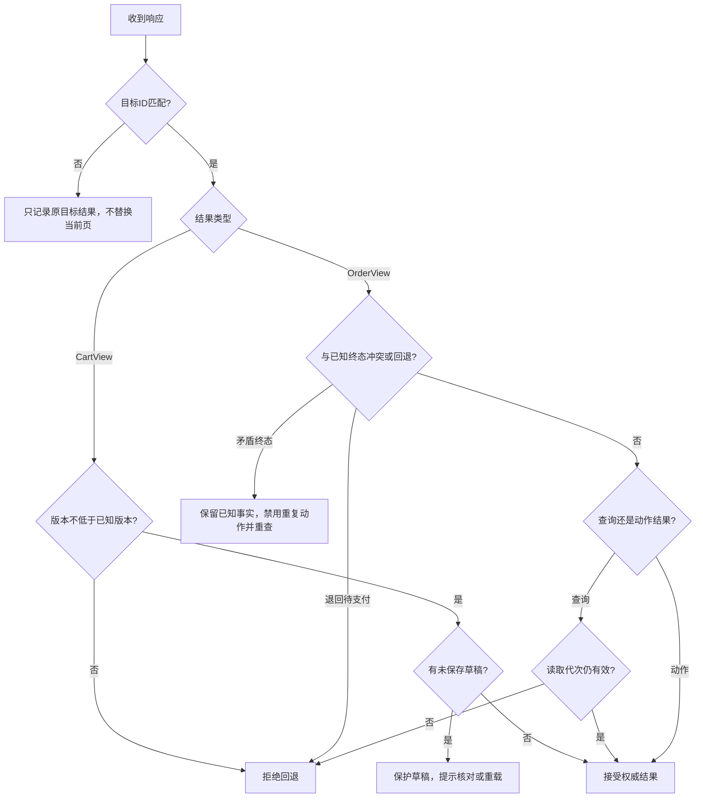

图表达结果接受规则，不是新的业务状态机。晚到的支付/取消动作结果仍须纳入原订单恢复，不能仅凭读取代次丢弃；本地截止或closedAt为空的超时投影不是已提交终态。

无脏输入时可接受最新车；存在草稿时提示核对，不静默覆盖。页面已离开时结果仍保留原请求/订单恢复事实，但不劫持导航或焦点。API写结果与后续重读分别携带目标，不依据“现在在哪一页”猜测应更新哪辆车。

动态库存、车、Quote与Order不进入跨上下文共享缓存，动态接口保持no-store。操作成功优先消费服务端已返回的权威结果，必要时补读受影响的关联视图，而非机械全站刷新。首版无WebSocket、跨Tab事件总线或跨Host实时推送；其他入口在返回/聚焦/显式读取时校准，提交仍由服务端验证。

### 5.6 关键交互如何贯穿各层

#### 改量 → 权威车快照 → 选中预估

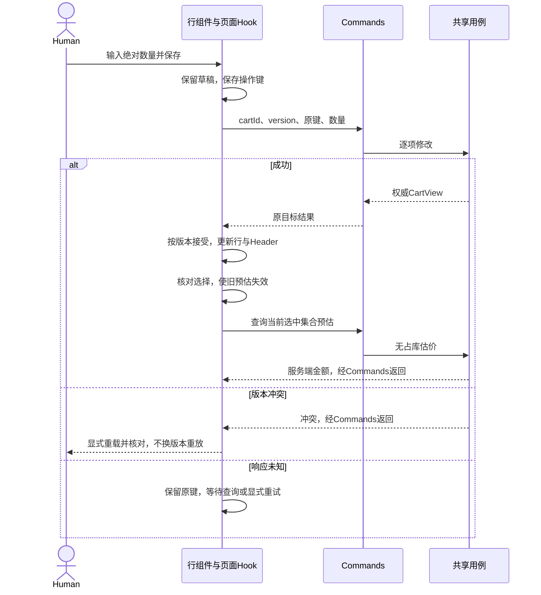

#### 选中生单 → 分别更新车与订单 → 条件导航

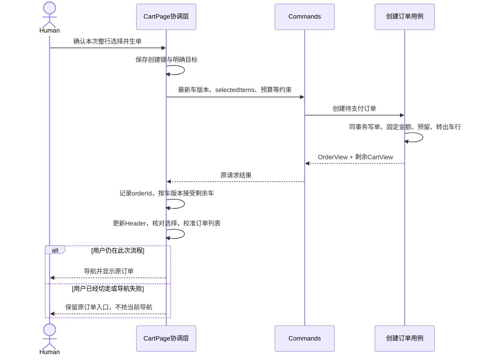

上图展开创建成功后的结果安装；创建失败整笔回滚，不先猜减车行。创建未知按原cartId和请求键恢复，不能换键重建。已转出行不再保留选择，金额切换为Order固定快照。

#### 原单支付 → 查询事实 → 恢复同单

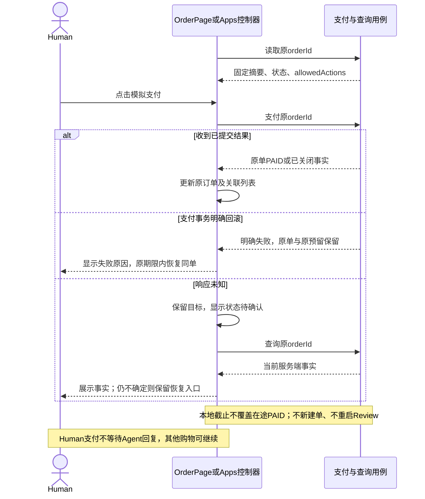

支付事务回滚保留原单与原预留，仍受原截止约束；查询未见PAID不能证明在途提交失败。明确重试仍针对原订单，来源车内容不因支付变化。

| 跨端接续 | 结果处理 | 呈现与恢复 |
| --- | --- | --- |
| WebMCP | 调相同Command，按车/订单目标接受结果 | 未切走才导航；仅启用工具不跳页 |
| Apps | Bridge控制器消费相同契约，隔离实例 | 内嵌呈现，重挂载读取原orderId |
| 基础MCP | 返回固定摘要与原订单入口 | Human打开网页，不声称Host已自动打开 |
| 当前车与订单来源不同 | 先只展示原订单 | 继续购物才确认切换指针，不合并两车 |

以上路径共享§6的用例和事务，但多次准备操作不是一个数据库大事务。A准备成功、B失败时A可留车，界面如实报告，不能自行缩成只买A。

### 5.7 各端复用与协议适配

| 能力 | Web | WebMCP | 基础MCP | MCP Apps |
| --- | --- | --- | --- | --- |
| 商品/详情/评论 | 页面与HTTP | 按页面注册查询工具 | 查询工具返回结构化公开数据 | Host结果与展示组件 |
| 恢复车/逐项编辑 | 当前车、显式操作 | 复用相同Commands、携带目标车 | MCP调用共享Cart用例 | Bridge调用，隔离实例快照 |
| 选中预估/创建订单 | 选行与UI生单 | 明确购买后调用并导航 | 生单后返回摘要和网页入口 | Agent或专用UI生单后内嵌展示 |
| 支付 | Human UI | 网页Human UI，工具无支付 | Human打开网页完成 | Human在卡片内点击 |
| 查单/取消 | 指定orderId的UI动作 | 工具读取/取消原单 | 工具读取/取消原单 | 实例绑定原单，分享视图无取消 |
| 结果恢复 | 原请求键/原订单 | 不抢新导航、不换键 | 不假定Host已打开页面 | 重挂载先读原单、不重生单 |

| 层 | 共享范围 | 保留在环境内 |
| --- | --- | --- |
| contracts | DTO、运行时schema、错误语义 | 不依赖React、Prisma、Router或Host SDK |
| Nest用例 | 计价、库存、生命周期、幂等 | 不管理浏览器指针、焦点或页面导航 |
| Web Commands | Web按钮与WebMCP共用HTTP操作 | Hooks管理查询与反馈，Adapter管理工具生命周期 |
| 展示组件 / 展示模型 | 金额明细、商品卡、固定订单摘要和状态标签 | 页面外壳、网络、支付调用与Host适配不强行共享 |
| Apps控制器 | 经Bridge消费同一契约和用例 | 实例归属、Host通知、重挂载与UI动作协调 |

Server MCP通过Streamable HTTP调用共享用例，返回结构化公开数据及可读摘要，不在服务内部绕回HTTP。WebMCP按当前页面注册/清理工具，不复制Server工具全集；旧页面回调不能更新新页。Apps静态资源不嵌交易上下文或秘密，运行时由Bridge交付数据，不依赖网站Cookie、Next Router或RSC。

查询工具继续复用；新用例及工具映射由[Change §8](../../openspec/changes/checkout-lifecycle-redesign/design.md)维护，旧prepare/review、原生批准与独立取链接工具不作为新购买链兼容要求。Agent工具不暴露支付；Human通过网页或Apps UI直接支付。工具可用、页面已显示与实际支付成功分别验收，不用一个入口的成功代替另一个。

### 5.8 首屏、交互接管与反馈

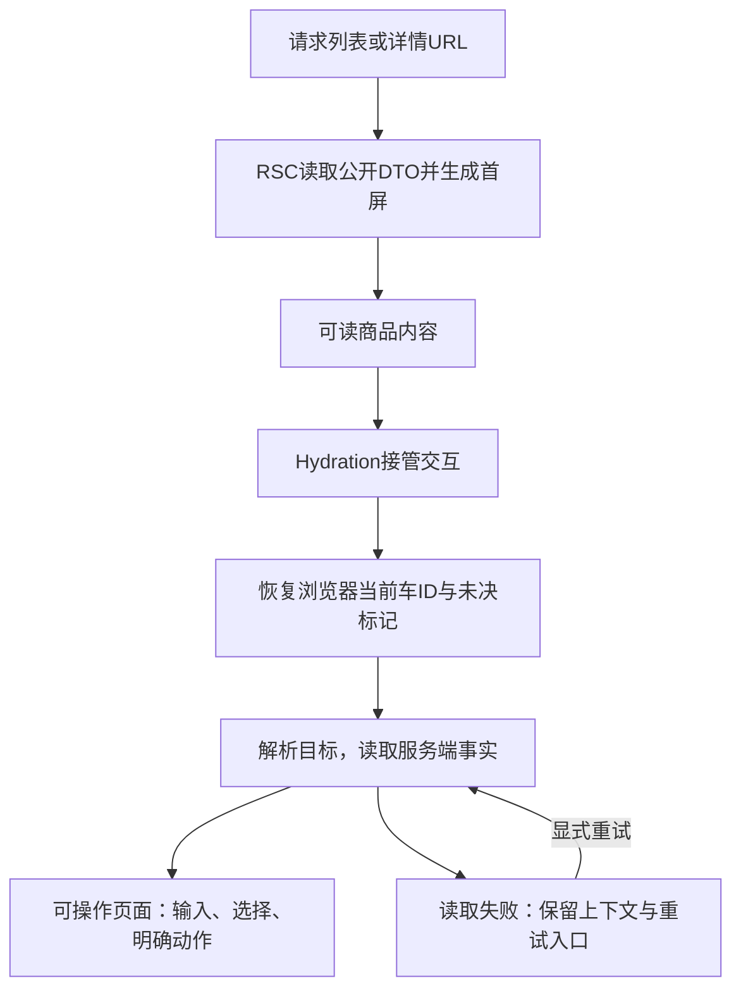

图只表达网站接管顺序，Apps由Host初始化；首屏有HTML不等于交易上下文已就绪。

列表RSC解析URL并读取公开商品首屏，详情RSC提供商品与规格；搜索控件、评论分页、数量输入和交易动作由Client协调。服务端只传可序列化公开DTO，不传原始商品对象、Decimal实例或秘密。Client Component仍可能参与首屏渲染，不能等同于“只在浏览器出现”。

浏览器持久ID和未决标记在客户端初始化后恢复，不能在服务端假定已有当前车。恢复期间展示明确状态，不因暂时尚未读到本地ID就自动创建新车。Hydration接管后，操作指向已解析的目标；公开首屏、交互可用和业务读取分别观察，不能把首屏有HTML当作交易可操作。

加载区保持上下文可理解，读取失败保留明确错误和重试入口；库存不足、版本冲突和未知结果使用各自反馈，不统一成“操作失败”。订单页面始终区分“已创建待支付”与“已支付”，原固定摘要可读，不在短暂请求过程中闪成另一笔单或空车。错误和成功提示属于当前目标，不因无关响应抢占当前页面。

### 5.9 响应式、可访问性与性能边界

沿用Product Design的繁体中文、黑白极简与响应式方向。列表/详情保证商品、规格和可购买原因可读；车页在桌面与窄屏都保留数量、选择、预估及错误关联；订单页完整展示单价、优惠、运费和应付，不能为缩短页面隐藏Human支付所需信息。Apps按Host实际可用空间组合摘要与动作，不强搬整页网站布局。

搜索、数量和勾选控件有标签与可见焦点；键盘可完成选择、保存及支付，错误通过文字和可感知反馈关联原目标。异步更新不无故跳焦点；导航或弹窗的焦点由页面协调层处理，纯展示组件不抢焦点。倒计时只提示期限，屏幕阅读反馈应突出状态变化而非持续打断。真实键盘、读屏、缩放及Host限制属于实施验收，静态文档不证明通过。

性能先测公开首屏、API等待、Hydration、评论分页与Host往返，再局部优化。评论按需读取，查询只刷新受影响目标；不为减少请求缓存陈旧库存，不为加速首屏在构建时固化交易数据。Human点击支付后直接呈现服务端结果，不新增模型往返；无容量证据不引入预取交易、缓存平台或新的状态管理依赖。

## 6. 后端、共享契约与运行保障

`apps/api`按Catalog、Cart、Order/库存生命周期与Pricing职责组织，复用同库事务；具体文件拆分服从现有消费者，不为每个职责建立服务或通用Repository。HTTP Controller与MCP Adapter处理协议输入、输出和错误映射，用例维护业务规则，Prisma承担持久化。

这里的“调度”有两层：Agent/UI按意图串联用例；服务端到期任务批量执行关闭用例。两者都不成为独立流程引擎，也不持有跨用户思考时间的数据库锁。

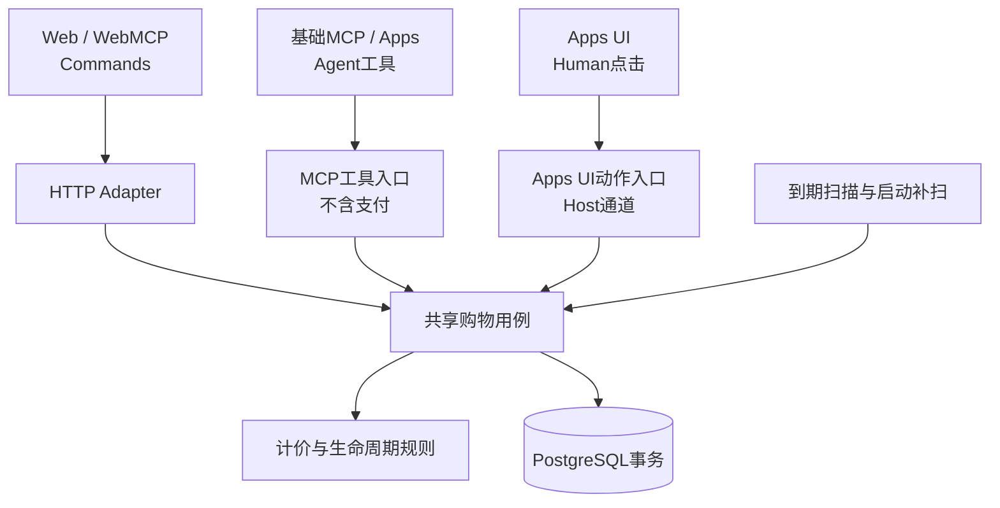

Apps UI动作与Agent工具是不同调用角色，即使复用Host传输，也不能把UI支付开放成Agent工具。图中的Adapter是逻辑入口，不表示新增进程、公共框架或强制包拆分。具体Host通道由入口适配器封装，不改变用例接口。

§5.6说明UI/Agent如何发起和恢复操作；本节只定义其依赖的用例、一致性和运行边界。前端的加载、选择和导航不进入数据库状态，服务端终态也不由页面请求顺序决定。

锁顺序、库存计数、截止和幂等细节集中在Change §6，避免在每个入口复制。无Redis、队列或浏览器独占计时器；数据库是唯一交易事实来源。

持久化沿用§2实体，另保留必要的车操作幂等记录。以下说明用例及不变量；物理字段、完整锁序和验证反例集中在OpenSpec §3、§5～6、§12。

### 6.1 用例与一致性边界

| 用例 | 同一短事务内的保障 | 恢复边界 |
| --- | --- | --- |
| 加购、改量、删除 | 车变更、version递增与操作幂等记录一起提交 | 原键同载荷返回原结果；同键异载荷拒绝；去重先于旧版本校验 |
| 创建订单 | 恢复原请求后，对新请求校验来源车版本、完整选中集合、预算/规格、配额及可售量；固定金额、写Order/OrderLine、增加reserved、删除选中车行和递增version一起提交 | 原键恢复同orderId及当前状态，即使车行已移出、价格已变、原单已关闭；不同键竞争同车旧版本不能都成功 |
| 支付 | 锁原Order及其库存，校验未关闭、锁后数据库截止、有效预留和原快照；quantity与reserved同时减本单数量，更新同单为PAID | 不重算价格、不插入第二笔订单、不比较当前车版本；重复支付返回原事实 |
| 取消/到期/禁止销售 | 锁订单及库存，释放reserved并写关闭事实 | 已支付/已关闭先返回已有事实；未关闭单锁后达到截止则记EXPIRED，未到期才按请求原因关闭；不重复释放、不改写原因 |

创建协调来源车与所选库存；支付/关闭只协调目标订单与库存，不锁来源车。库存按统一商品顺序取锁，关闭与支付共享协调边界；禁止销售状态变更也必须参与该协调，避免检查后状态改变。没有覆盖15分钟审阅期的数据库锁。具体锁序、参数和并发反例由OpenSpec维护。

单车配额只计CHECKOUT、未关闭且未到期的订单，env默认10笔。新单在Cart短事务内完成计数与准入，避免并发超额；同键恢复先于配额检查。下调配置不取消已有单，只暂停新增；满额显示已有订单入口，不能自动换车绕过。该额度不提供自然人级防囤占。

### 6.2 库存、期限与计价事实

正常库存保持`0 <= reservedQuantity <= quantity`，reserved对应尚未消费或物化释放的订单预留。预留增加reserved、不减少quantity；支付同时减少二者；关闭只减少reserved。例如实际10件，预留3件和2件后可售5件；第一单支付后实际7、预留2、可售仍5；第二单取消后可售7。持有有效预留的订单不因公开可售为0而被拒付。异常库存不得新增预留。

创建在完成锁等待和校验后记录服务端创建时刻，截止固定为其后15分钟；锁后数据库时间达到截止即拒绝新支付。后台释放尚未提交时，占用仍计入reserved，可能短暂少卖但不能超卖；公开查询不能自行扣除超时占用形成另一口径。到期单不占待支付笔数配额，与库存实际释放是两回事。默认每秒扫描、正常负载5秒内释放是待验证目标；故障后补扫，不能承诺故障期间时延。

计价仅使用本单所选商品，未选商品不贡献优惠门槛。沿用[D-09～D-13金额规则](../../DECISIONS.md#统一价格计算语义d-09d-13)：优惠前商品小计满NT$1,000减100一次；再对有AI资格的商品金额打95折，精确十进制计算并在订单级HALF_UP至两位；运费按优惠前小计满NT$990免运，否则100，最后加到商品应付金额。车报价是无占用预估，生单固定单价、优惠、运费、币种、总额与计价规则版本；支付不按后续涨跌价或活动调整重算，客户端不能覆盖金额。

AI资格由服务端生单入口确定，不接受客户端自报资格，也不从Cart来源继承；这不证明具体用户身份或严格防伪AI来源。Cart创建归因仍单独保留。指标区分建车、订单创建、未支付、关闭与PAID，只有PAID计购买成功或收入；读单和人工支付不会改写生单来源。

### 6.3 运行拓扑与数据边界

| 运行环境 | 连接与职责 |
| --- | --- |
| 浏览器 | Web/WebMCP通过相对路径调用Next同源API转发；不直连数据库 |
| Next服务端 | RSC读取公开API，透明转发交易请求；API_INTERNAL_URL仅在服务端使用，不复制Nest用例 |
| NestJS | 同进程HTTP Controllers、Streamable HTTP MCP适配及Apps资源；调用Catalog/Cart/Order/库存与唯一计价用例，经Prisma访问PostgreSQL |
| Agent Host / Apps | 基础MCP直连API的`/mcp`；Apps经Host Bridge调用适配入口，不依赖网站Cookie或Next运行时 |
| 本机开发 | Web/API在本机Node运行，Docker只提供独立开发PostgreSQL；保留HMR与监听构建 |
| Compose交付 | Web/API使用生产构建，PostgreSQL不公开容器端口；目录只读挂载，数据库持久卷与开发环境分离 |

环境地址及启动命令见[运行入口](../../README.md)、[交付Compose](../../compose.yaml)和[开发Compose](../../compose.local.yaml)。初始化、迁移、seed与启动分离，重启不覆盖库存。数据库连接及服务端秘密不进入浏览器；本次订单重构不新增部署服务或公网发布要求。

### 6.4 共享契约与失败语义

[packages/contracts](../../packages/contracts/src/index.ts)是共享schema、DTO和错误定义的代码入口，OpenSpec是正式行为来源。当前contracts仍包含旧流程，新订单契约须随授权实施更新，不能用旧代码反推目标模型。HTTP envelope、MCP structuredContent与Bridge消息包装可不同，业务含义必须一致；不返回Prisma实体或原始JSON。

| 契约族 | 对消费者的承诺 |
| --- | --- |
| Product / ReviewPage | 公开字段白名单、可购买原因、目录版本与独立分页 |
| CartView | 服务端车ID、条目、版本与问题；存在问题行不阻止其他合法选择生单 |
| 选中Quote | 指定选择集合的无占用预估，与当前请求关联；金额与库存均不构成承诺 |
| OrderView / OrderLine | 同一原单的固定摘要、金额、状态、截止、可用动作及入口；终态与到期投影分开 |
| 操作结果 | 明确目标、请求恢复所需信息与权威快照；生单同时返回原订单和剩余车 |

金额以精确十进制计算，对外以十进制字符串表达。商品折后金额在订单级舍入，AI优惠展示额从已舍入金额反算以便对账；不逐件提前舍入、不用浮点显示值回写服务端。UI及工具展示同一完整金额明细。存储字段与请求载荷详述留Change，不维护第二份DTO草案。

| 结果类型 | UI与Agent应如何恢复 |
| --- | --- |
| 输入/商品/数量无效 | 指出具体问题，修正目标后才发新操作，不默默截断或少买 |
| 版本/选择冲突 | 读取最新车、保护并核对输入；不能自动换版本重放 |
| 配额或库存不足 | 保留原车与已存在订单，展示原因；不换车绕过、不部分占库 |
| 已支付/已关闭 | 返回原单事实，不再支付/释放，不把重复调用变成另一结果 |
| 依赖或事务失败 | 返回明确技术失败，遵守原子回滚边界；不能伪装为空数据或幂等成功 |
| 网络结果未知 | 客户端未知而非业务终态；保存原键/ID后查询或显式重试原请求 |

状态读取无写入副作用，不重新批准、计价、占库或续期。普通查询和渲染不会隐式生单；客户端错误展示不替代服务端状态。

### 6.5 运行、数据初始化与安全边界

Next以Node Server运行而非静态导出；生产构建不依赖运行中的API/数据库，目录读取发生在请求期。同源`/api/v1`转发不承接计价或事务，MCP直连Nest的`/mcp`。环境变量区分浏览器可见配置和server-only配置；开发与交付数据库/卷分离，业务库与测试库更须隔离。

正常启动不自动seed、重置库存或删除交易数据；首次初始化与迁移使用显式命令。目录异常样本保留，Inventory缺失不猜测补量。重设计的旧数据一次性切换有单独授权与目标环境核对，详见Change迁移章节，不能将切换清理复用为日常取消/到期处理。

链接使用配置的Web来源构造，不信任任意Host头；错误与日志不泄漏秘密或原件。目录公开投影与不可信文本边界见§2.1。

HTTP与MCP继续校验适用的输入、网络来源和服务接入边界；Demo省略车/订单身份凭证、签名和Review，不允许客户端覆盖价格、绕过状态校验或让Agent代点支付。原商品查询的服务身份/Host约束继续适用，不把MCP服务身份解释为顾客身份。后续若开放公网、真实支付或多用户隐私，须先重新设计访问控制，而非宣称现有按ID演示已满足。

## 7. 取舍、验证与演进条件

- **单一事实来源：** 固定商品数据在OrderLine，金额汇总在Order；查询投影和客户端缓存都不能改写它们。修改计价只影响新生单路径。
- **稳定的用例边界：** 新入口只需适配已有契约；不允许新入口另写库存或优惠逻辑。只有出现真实差异才扩展用例参数。
- **局部复杂度：** 库存锁、幂等、关闭原因只在后端维护；响应顺序在前端协调层维护；组件只呈现意图和结果。
- **明确演进触发：** 真实支付/身份权限将重新评审安全与订单状态，不假定demo接口直接可上线；只有容量证据才考虑缓存/队列；只有整车版本冲突成为实际瓶颈才考虑逐行模型。当前设计不预建这些扩展点。

验证按可观察行为和风险选择，复用Vitest、Playwright及独立PostgreSQL测试环境。下面按正文的体验与实现边界组织验证，不是本轮已执行清单；前端优先覆盖§5.4的交互状态及§5.6的完整链路，再以真实数据库与Host验证其依赖。

| 范围 | 必要证据 |
| --- | --- |
| 商品发现 | 查询组合、稳定排序/分页、同名ID、字段过滤、异常样本、目录revision变化与评论注入隔离 |
| 前端基本体验 | 首屏HTML/Hydration、URL返回、评论与查询乱序、桌面/移动/键盘/焦点/缩放、空/错/加载状态 |
| 车与选择 | 幂等加购、绝对设量/删除、脏输入保护、版本冲突、选中集合预估、问题行隔离、不自动部分购买 |
| 金额与优惠 | 免运与满减阈值、95折舍入、明细对账、各生单入口资格、锁价后活动变更及超时重购 |
| 数据库交易 | 真实PostgreSQL验证转行/写单/预留全有或全无，支付回滚保留原单、库存竞争、同键重试与配额并发 |
| 截止与恢复 | 支付/取消/到期竞争、取锁跨截止、终态只提交一次、重启补扫、丢响应、晚到结果不回退 |
| 多端与分享 | 基础MCP网页接手、WebMCP真实导航、Apps重挂载与UI支付、跨车不自动覆盖、分享展示边界 |
| 运行与交付 | dev/HMR、生产构建和启动、反代动态响应、重启不重置库存、独立测试库及切换演练 |

并发检查最终订单数、订单状态与库存净变化，不仅检查HTTP成功码；用确定性协调验证关键竞争，Mock不替代事务或Host。金额反例涵盖989.99/990、999.99/1000、2000只减一次以及100.30的95.285舍入为95.29。业务测试不能指向演示业务库，测试故障注入不作为业务参数暴露。

详细新增验收场景集中于OpenSpec Design §12，实施Tasks、真实Host记录、CI具体run与Human验收才提供运行证据；配置存在、脚本模拟、静态图或历史通过计数不能代替当前验证。进度集中在交付状态，本文不重复维护里程碑清单。

正式实施前，在同一Change补齐Delta Specs/Tasks并传播产品决策与基线的限定差异；旧D-01、D-04～D-07、D-21～D-24及T-05/T-07不因本文整合被追溯改写。当前没有从材料中发现必须新裁决的阻塞性契约问题，Host接续、库存竞态与释放时延仍待实施验证。

未来切换采用清空旧流程数据、统一进入新流程的已选方向，不回填旧单或维持双流程；保留目录/评论，库存按受控种子初始化。具体范围、环境核对与步骤仍在Change，本文不授权执行清理。新流程下的长期保留、取消和到期也不沿用该一次性切换清理。
