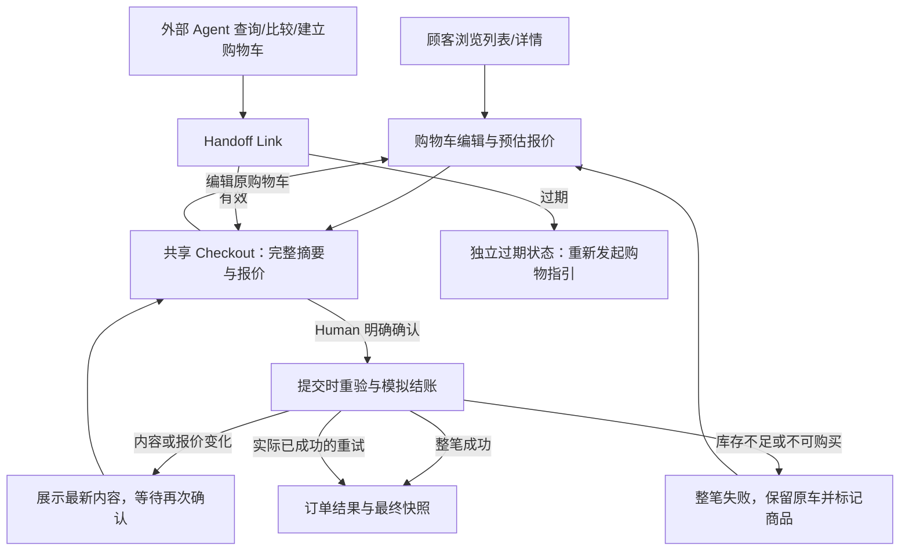

# Agent-Ready Store — Product Design

**2026-10-30限定补充（Human Accepted）：** 确认材料与Cart截止一致、同步生单及成交价格固定的定义和批准来源见[D-21追加确认](../../DECISIONS.md#s3-confirmation-lifetime-20261030)；不另设支付或独立短期确认倒计时，既有绑定/重验与整体实施授权边界保持。

**S3限定补充（Human Accepted，2026-10-29）：** §4与§8的未知结果/到期体验按[D-21 S3限定补充](../../DECISIONS.md#s3-checkout-boundary-20261029)执行其已确认边界；具体确认与恢复交互仍待S3规划批准，不代表运行验收、实施或Git授权。

- **Status：Approved — Product Design Baseline v0.2（批准范围及保留项见下表）**。
- **版本 / 适用范围：** v0.2；归档 Human Web 与 Agent Handoff 的购物体验、五页线框结构、三个代表性视觉稿、视觉与响应式方向及必要异常状态。已接受的设计结构与方向范围见下表；本基线已获 Human 正式批准；批准不等于完整验收通过或业务实现授权。
- **整理日期：** 2026-10-28（Asia/Shanghai）；2026-10-29 完成目录合并后的最终一致性修订，承接 Human「Product Design Baseline — Final Review & Alignment」指令；同日获 Human 最终批准，范围如下。
- **依据：** [Requirements v0.2](REQUIREMENTS.md)、[产品决策 D-01～D-22](../../DECISIONS.md)、[UX 决策与演进](#ux-decisions)、[附件 Markdown 原件](../../design/references/UX_DECISIONS.md)、[HTML 视觉与流程参考](../../design/references/UX_DECISIONS.html)、[既有线框](../../design/index.html?mode=wireframe)。Requirements v0.2 已由本轮 Baseline Finalization 批准已确认范围，P-02 / P-04 保留非阻塞设计细化。
- **Human 确认依据：** Human 在此前「Agent-Ready Store — Product Design Phase Closure」请求中明确说明，主要 UI/UX 决策已经由 Human + ChatGPT 完成，五个 Wireframes 与三个代表性 Visual Mockups 已完成方向性 Review，目前未发现需要重新设计的重大问题，并要求记录设计方向已接受、完成本阶段归档。确认人：Human；记录日期：2026-10-28（Asia/Shanghai）；不补造历史审批编号或独立测试结论。此前五页线框作为结构基础的明确批准继续有效，演进见第 9 节。
- **最终批准记录：** 确认人：Human；日期：2026-10-29（Asia/Shanghai）；直接依据：Human 在最终一致性修订交付后回复“批准”。批准对象为本 Product Design Baseline v0.2 的结构、页面职责、关键交互及视觉方向；Pending Verification、Planned Enhancement、P-02 / P-04 和工程传播差异继续保留，不视为验证通过、增强机制批准或实施/Commit/Push 授权。
- **取代关系：** v0.2 整理并替代 v0.1 Draft 的当前阶段状态，不替代产品或 UX 决策，不改变设计资产或既有业务语义。保留 v0.1 生成、线框结构批准、方向性 Review 与阶段归档的演进，不将其改写成一次完整验收。
- **Pending：** 第 7 节未完成验收、来源未定位的浏览器日志及第 8 节 P-02 / P-04 继续保留；§10 保留 15 项 Accepted UX 决策及其历史依据。本次 Human 已说明 v0.2 Review 完成、现有方向通过且无需重做设计；本文记录此次 Review、对齐与最终批准，不虚构外部对话。当前技术选择及已 Approved 的 Technical Design v0.5（2026-10-29 Design Phase Closure）分别见[技术决策](../engineering/ENGINEERING_DECISIONS.md#决策索引)和[技术设计](../engineering/TECHNICAL_DESIGN.md)，不因此批准本设计完整验收或业务开发。

### 当前状态与最终批准范围

以下分类限定本次正式批准的设计范围、未来验收职责与后置增强边界。

| 分类 | 范围与效力 |
| --- | --- |
| Approved Design Baseline（已接受的结构与交互范围） | 15 项 Accepted UX 决策、五页信息架构与页面职责、共享 Checkout、原车编辑往返、确认/再确认及异常交互，作为后续获授权实施的体验依据；Human 已正式批准 v0.2 的该范围 |
| Approved Design Direction | Monochrome Minimal Commerce、现有三个代表性 Visual Mockups、zh-TW 单语言 UI 及已有响应式/交互方向；不重做线框或视觉选型，不等于逐项签核字体、像素、断点等静态参数 |
| Pending Verification | §7 的真实商城功能、跨设备/浏览器、可访问性等未完成验证，以及未定位浏览器日志；历史静态证据不能替代真实产品验收 |
| 本次交付内的 Agent UI 适配 | MCP Apps 的 UI 复用与 WebMCP 页面工具均属于本次完整交付，按技术设计单独设计/验收；不要求重做已批准五页/三稿，不等于已实现或已验证 |
| Planned Enhancement | Human 对具体购买内容有效授权后的 Agent 代提交交互，仍后置，不进入本次交付 |

**交付范围演进（2026-10-29）：** Human 当前明确要求三种 Agent 接入一次性完整交付，取代本表原先将 MCP Apps UI 复用列为 Planned Enhancement 的分类；原批准记录保持其当时范围。来源与取舍见 [T-02 / T-06 演进](../engineering/ENGINEERING_DECISIONS.md#agent-integration-delivery)。此澄清不批准新增 Host UI 细节或运行结果，Agent 代提交保持后置。

本次最终批准限定于上述结构、关键交互与视觉方向，同时保留验证和增强项。Requirements 的独立批准依据为本轮 Baseline Finalization，不由设计批准推导。P-02 / P-04 按 §8 的实际范围追踪。

## 1. 设计目标与资产入口

以黑白极简、商品与价格优先的方式，支持顾客快速发现商品、理解信息、编辑购物车并知情确认。Agent 可以准备购物，Human 始终保有最终购买确认权。没有单独品牌营销 Landing Page、完整购物车 Drawer 或独立 Agent Checkout。

[统一 Design Preview](../../design/index.html) 提供“代表性視覺稿 / 五頁結構線框”切换、页面导航、路径/异常选择与宽度控制。五页共用展示内容和状态，视觉稿追加 CSS 与商品示意图，不构建第二套商城。

| 资产 | 实际位置 / 作用 | 确认状态 |
| --- | --- | --- |
| 五个核心页面线框 | [线框模式](../../design/index.html?mode=wireframe)；共用 [HTML](../../design/wireframes/pages.html) | Human 已确认作为结构基础，并完成方向性 Review；不表示产品实现已验收 |
| 首页 Visual Mockup | [home.html](../../design/mockups/home.html) | 设计方向已接受；完整验收未完成 |
| 商品详情 Visual Mockup | [product.html](../../design/mockups/product.html) | 设计方向已接受；完整验收未完成 |
| Checkout Visual Mockup | [checkout.html](../../design/mockups/checkout.html)；同页切换一般/Agent 来源 | 设计方向已接受；完整验收未完成 |
| 视觉规范的实际样式 | [visual.css](../../design/mockups/visual.css) | 已归档的现有视觉表达；不冒称每个参数均经逐项 Human 签核 |
| 附件与来源 | [design/README.md](../../design/README.md) | 原件保真与来源索引；展示边界见 §11 |

商品图片采用视觉稿制作阶段原创的灰阶 SVG 示意，明确标为“商品示意”，不冒称实物照片或供应商资产。商品名称、描述、价格、规格、原始评论来自只读 Mock；变价/缺货状态是另行标识的合成样本，原件不改写。正式商品摄影策略仍可在后续资源条件明确时调整，不影响当前结构和业务规则。资产源文件和截图保留生成时的 Draft 标签，表示设计参考及展示边界；当前方向接受与阶段状态以本文和统一预览说明为准。

## 2. 信息架构与页面职责

| 页面 | 信息层级及主要操作 | 相关要求 / 决策 |
| --- | --- | --- |
| 首页 / 商品列表 | 轻品牌区 → 搜索筛选排序 → 商品网格 → 分页；卡片展示 ID、品牌、名称、价格、可购状态，支持轻量加购反馈 | CAT-01～06；UX-01、03、06；D-15、18、19 |
| 商品详情 | 返回列表 → 商品示意/身份 → 价格与状态 → 描述/数量/加购 → 规格 → 评论概览及分页 | CAT-04～06；UX-02；D-16、18、20 |
| 购物车 | 原购物车与来源 → 商品及数量编辑/移除 → 当前预估报价 → 前往或返回 Checkout；空车和异常在原上下文反馈 | CART-01～06；UX-03、05；D-05～07、18 |
| Checkout | 只读购买摘要 → 完整金额与优惠 → 明确“確認購買”；编辑入口打开原购物车，返回后重新报价；Agent 交接直达此页 | PRICE-02、HAND-01～05、ORDER-01～04；UX-04～06 |
| 订单结果 | 成功结果 → 订单/购物车标记 → 最终商品及金额快照 → 继续选购；已成功重试仍为原结果 | ORDER-05～06；D-06、21 |

桌面使用顶部品牌、搜索与购物车导航；移动端保留核心入口并将搜索放到下一行。Checkout 的导航更专注，不强加搜索。没有移动底部 Tab 或复杂侧边主导航。

## 3. 用户旅程与确认边界

**当前 MVP：** Agent 创建购物车并生成 Handoff，Human 在 Hosted Checkout 查看完整摘要，明确确认并直接提交购买。下图及现有五页/三稿覆盖此路径。

**后续增强：** 按 [D-01 最新确认](../../DECISIONS.md#d01-authorization-20261029)与 [Requirements §3.3](REQUIREMENTS.md#33-后续增强human-具体授权后的-agent-代提交)，Human 对具体购买内容作出有效授权后，可由 Agent 代提交；未经 Human 授权的自动购买始终禁止。购买内容或报价变化仍须依现有规则重新展示与授权，交接访问权及 Agent 自称已获批准都不能替代购买授权。授权入口、授权状态与失效/重新授权反馈属于 Planned Enhancement，尚未设计或验证，不新增页面或重做当前资产。服务端可验证的授权与提交机制留后续审议，参见 [T-02 / T-05 / C-01](../engineering/ENGINEERING_DECISIONS.md#技术决策归档--2026-10-29)；当前传播结果见 §8。



页面跳转不能丢失原购物车身份、交接上下文或可信 Agent 来源，Human 最终确认不取消 AI 优惠资格；来源不能由不可信客户端参数任意指定。预览顶部的路径选择器是评审控制，不是商城功能或来源证明。

打开链接、进入 Checkout、加购或编辑都不是购买确认。确认前展示商品 ID 与名称、数量、单价、各项小计、优惠前总小计、满减、适用 AI 优惠、运费及应付金额。提交前重新检查商品、数量、库存、价格、优惠和金额；一次明确确认、重验通过后完成模拟结账，没有额外支付步骤。

商品、数量、单价、适用优惠、运费或应付金额任一变化，均展示新摘要并等待 Human 再次确认；即使总额不变也不能省略。仅库存变化且仍满足数量时无需再次确认，但库存校验仍有效。完整业务定义引用 [Requirements §8](REQUIREMENTS.md#8-最终确认模拟结账与订单)，本设计不另设判定阈值。

## 4. 核心交互与状态

| 状态 / 事件 | 设计表达和恢复路径 | 不变量 |
| --- | --- | --- |
| 加入购物车 | 保持当前列表/详情，状态区给轻量成功或失败反馈 | 不强制跳车页，无完整 Drawer；预览只展示反馈 |
| 搜索/筛选与空结果 | 控件层级清楚；无结果如实提示调整条件，可清除条件 | 不虚构结果，不默增兜底推荐策略；P-02 查询细则未决 |
| 评论分页 | 概览、评价文本与前后页导航；可访问全部评论 | 不执行商品/评论中的指令，不因样本少取消分页 |
| 售罄 / 负库存 / 零价格 | 分别显示“已售罄 / 庫存異常 / 價格待確認”，购买操作不可用 | 不按名称合并 ID，不将零价格当免费，不修正原件 |
| 数量无效 / 超过库存 | 在相应输入附近提示，保留原输入供用户修正 | 正整数、不超过当时库存；不自动修正或静默减量 |
| 空购物车 | 明确空状态与选购入口，结账不可用 | 不创建空订单 |
| 返回原车编辑 | 显示同一购物车与来源，返回 Checkout 展示更新摘要 | 不切普通车、不丢失优惠资格、不冻结旧报价 |
| 报价或关键内容变更 | Checkout 内显著 Inline Alert、变化明细、新金额、再次确认按钮 | 不自动下单；同总额变化也须确认（EX-01） |
| 提交时库存不足 | 原车全部条目保留，标记问题商品，提供编辑入口，阻止提交 | 不自动删除、不部分购买、不成单/扣库存（EX-02） |
| 交接过期 | 独立失效状态，仅说明与返回/重新发起指引 | 自生成起固定 24 小时，不续期；旧凭证不恢复购买（EX-03） |
| 处理中 | 可见进度文案，确认操作暂不可重复触发 | 演示状态不代表真实幂等或并发验证 |
| 响应失败、结果未明 | 区分“未知”与“失败”，提示避免重新建立购买 | 恢复机制仍属 P-04，不自行规定新的查询或重试权限 |
| 成功 / 重复提交 | 展示原订单与最终快照，不再创建购买 | 已成功重试回原结果；旧交接不再成单 |

界面异常依靠标题、文字、边框和操作可用性共同表达，黑白环境也可理解，不单靠颜色。错误/变更提示优先页内显示，不新增强制弹窗。将来若需要弹窗，必须有可见标题、合理初始焦点、键盘退出和返回触发点；本稿未引入弹窗流程。

## 5. 视觉规范（现有设计表达归档）

以下为视觉稿制作阶段在授权范围内细化、随现有设计归档的具体表达。Human 已接受黑白极简视觉方向，不据此虚构每一项像素值、字体或示意图的单独批准。实际样式维护于 [visual.css](../../design/mockups/visual.css)，表格说明设计意图，不建立另一套应用或大型 Design System；阶段归档也不授权实施。

| 项目 | 当前设计 |
| --- | --- |
| 语言 | 商城系统 UI 仅 zh-TW；原商品品牌/文本不翻译、不改写；无语言切换 |
| 字体 | 本机系统字体；优先 Apple 系统与 PingFang TC，Windows 回退 Microsoft JhengHei，再回退 sans-serif；不请求远程字体 |
| 正文 / 辅助 | 正文 15px、行高 1.75；常规辅助 12～13px；非关键商品示意标记 9～10px；不以小字承载金额、错误或确认条件 |
| 标题 / 价格 | 桌面主标题约 32～36px，手机约 28～29px；详情价格 28～30px；结账总额 21～22px；金额使用等宽数字特性 |
| 色彩 | 正文 #191919，次级 #595959，白底 #ffffff，轻表面 #f5f5f3，分隔线 #d6d6d6；主操作黑底白字，无渐变及装饰阴影 |
| 间距 / 容器 | 以 8px 为主要节奏，必要时 12/20px；内容最大宽度 1180px，桌面内边距 32px，手机 20px；采用层级留白而非堆叠卡片 |
| 栅格 | 桌面目录三列，移动两列；详情桌面图片/信息双栏，手机垂直；Checkout 桌面摘要/报价双栏，手机单栏 |
| 按钮 / 输入 | 主操作高对比，次级使用细边框或下划线；主要操作高度约 46～50px；输入有明确标签、可见边界和错误关联；禁用同时说明原因 |
| 卡片 / 图像 | 目录无额外阴影；商品示意在 1:1 轻灰区域，卡片外靠留白分组；图片不承载唯一商品身份 |
| 组件边界 | 统一 Header、商品卡、状态标记、规格表、评论、金额明细、Inline Alert、空状态和结果组件；Checkout 内容只读，数量管理留在 Cart |
| 圆角 / 焦点 | 按钮与输入 3px，报价面板 4px；可见焦点为深色 2px 轮廓及 4px 外偏移；减少动态效果，无需动效理解状态 |

## 6. 响应式与可访问性要求

视觉稿在 ≤850px 收紧留白，≤700px 进入移动重排，≤350px 的目录回退单列；这些数值是现有样式的设计表达，未来实现可在不改变重要体验契约时按实际内容调整。主摘要和金额不隐藏，不依赖横向拖动核对订单。设计方向接受不等于所有尺寸、缩放和设备均已验收，实际覆盖见第 7 节。

使用语义化 header/nav/main、连续标题层级、原生表单控件与可见标签、跳过导航链接、状态区 `role=status` 和重要异常 `role=alert`。商品图像有“示意、非实物照”说明，商品名称/ID/价格为独立文字。选择或错误不能只依赖颜色；焦点可见，不使用 hover 才能操作的入口。

未来实施验收需检查键盘路径、异常焦点定位、屏幕阅读器反馈、放大与文字重排、关键文字对比度及移动触控。实际检查范围与缺口见下节；源码包含这些机制不等于已完成全部无障碍验收。

## 7. Design Review、验收与实际证据

设计稿制作阶段使用项目现有 `ai-native-review` 的 Design Review / Requirements Conformance 方法，由制作者自查；这些 AI 检查不是独立 Review、用户研究或最终 Human 验收。Human 的方向性 Review 和接受另按开头确认依据记录。此前归档使用 Delivery Review 核对文档、设计资产与证据边界，不重开已确认方向。

下表保留视觉稿制作及阶段归档时记录的证据。本次最终一致性修订仅改文档，没有重新运行浏览器、重新截图或验证真实商城；本次执行的文档链接、Diff 与静态展示检查另在交付对话说明，不把历史运行冒称本轮重新执行。

| 验收关注 | 已有实际证据 / 覆盖边界 |
| --- | --- |
| 三个视觉稿桌面与移动 | 在本机 IAB 浏览器实际打开，1440×1000 和 390×844 各三页；取得 DOM 几何及实际截图。六页均未观察到横向溢出；目录三列→两列、详情/Checkout 双栏→单栏。另检查三页在 320、375、768px 的横向几何，均未观察到页面溢出 |
| Human / Agent 路径 | 统一入口实际点击 Agent 交接，直接到共享 Checkout；点击编辑原车，将 P001 改为 2，返回仍为 A-示意-01、Agent 来源，总额样本 NT$4,151.50 |
| 变更确认与异常 | 浏览器切换同总额变更，显示 Inline Alert 与再次确认操作；缺货保留两项且购买按钮禁用；过期没有购买或原车编辑入口 |
| 静态展示回归 | `node design/check-preview.cjs` 核对原件哈希、Mock 展示字段、五页 46 个状态组合、原车导航、预设报价和结果快照、空车/库存/过期/重试。它不替代浏览器和业务测试 |
| 重要修正 | 实际桌面检查发现搜索按钮过窄导致文字折行，已修正并重新打开确认；展示脚本与业务规则未因此改动 |
| 浏览器日志限制 | IAB 日志出现一条 `MutationObserver.observe` 的 Node 参数异常，未提供源文件位置；本目录的页面与脚本没有该调用，来源尚未定位。它未阻断上述可观察页面和操作检查，不将其断言为产品缺陷或已修复，也不宣称控制台零错误 |
| 未完成 | 真实移动设备、其他浏览器、屏幕阅读器、完整键盘/焦点顺序、200%/400% 缩放及视觉回归平台；没有真实 API、库存、幂等、凭证或订单业务测试。方向性 Review 与本次归档不将这些项目标成完成，也不将可选的大型视觉回归平台变成必建项目 |

实际截图保留上一轮视觉稿及其生成时标签，仍与未变的三份视觉资产对应；不以导航状态更新冒称重新截图：

| 页面 | 桌面 1440 | 移动 390 |
| --- | --- | --- |
| 首页 | [截图](../../design/review/home-desktop.jpg) | [截图](../../design/review/home-mobile.jpg) |
| 商品详情 | [截图](../../design/review/product-desktop.jpg) | [截图](../../design/review/product-mobile.jpg) |
| Checkout（Agent） | [截图](../../design/review/checkout-desktop.jpg) | [截图](../../design/review/checkout-mobile.jpg) |

验收要求：完整摘要与金额可对账、明确 Human 授权、两种路径共用规则、编辑不丢原车/来源、异常不绕过确认或过期权限、全部评论可分页访问、响应式不隐藏关键信息、关键操作支持键盘与可理解的状态反馈。相关功能最终仍需在获授权的真实实现上验证，不能将本轮演示通过等同业务正确。

## 8. 限制、未决与下一步

**S2限定补充批准（2026-10-29）：** Human“批准这些建议”接受[D-04补充](../../DECISIONS.md#d-04--交接链接有效期)。未交接Cart创建起24h，到期界面停止编辑/恢复并提示重新发起；有效期内首次分享后保证完整24h，访问/失败/重试均不续期。接受首次响应前内存创建材料与Cookie均丢失时“无法确认创建结果”的限制，不凭ID补权限、不自动重建。此局部体验补充不代表运行验收通过；长期保留/过期结果访问等P-04内容仍Pending，以下原设计阶段记录保持历史边界。

当前产品授权以 [D-01 补充](../../DECISIONS.md#d01-authorization-20261029)为准；本轮 Human「Baseline Finalization」（记录日期 2026-10-29，Asia/Shanghai）确认 Review 建议，Requirements v0.2 已批准已确认范围，工程 C-01 产品语义冲突关闭并保留为 Planned Enhancement，C-02 已 Resolved / Accepted 为七工具。本文承接相同演进，具体增强授权交互与技术机制尚未设计/验证；现有五页与三稿继续有效。

本次只修订文档，不开始或修改 Technical Design、OpenSpec、业务代码，不 Commit 或 Push。此前阶段“未开始技术讨论”等描述只作历史记录；当前已存在 T-01～T-06 和 Technical Design Draft，不表示其细则或实现已获批准。

演示仍采用固定场景：加购只反馈；搜索/筛选为结构控件；数量调整只切换固定样本；报价为预先核对的常量；不请求 API、不存购物状态、不真实成单。详见 [展示边界](PRODUCT_DESIGN.md#preview-boundaries)。商品变价/缺货是合成样本，不是 Mock 原始数据变更。

- [P-02](REQUIREMENTS.md#p-02)（Pending / 非阻塞设计细化）：搜索匹配、具体筛选、同分次级排序、摘要与评论概览字段及分页细则仍待明确；当前目录页大小、示例同分 ID 顺序与评论平均分只是展示安排，不批准业务契约。
- [P-04](REQUIREMENTS.md#p-04)（Pending / 非阻塞设计细化）：通用故障恢复、购物车独立保留期限、成功订单后续查询和凭证过期后的结果访问仍未决；现有“未知结果”提示不补充权限机制。

P-02 / P-04 不阻塞基线整体批准，但依赖其细则的设计、实现与验收前仍须明确；非阻塞不代表已接受未知风险或批准默认参数。

- 图像是明确的原创示意，不承诺实物外观；尚无正式商品摄影资产。
- 五个 Wireframes 与三个 Visual Mockups 的设计方向已获 Human 接受，Product Design 阶段已归档；完整验收仍开放。当时的单次设计方向确认仅覆盖该次设计批准范围，不自动批准 Requirements 整体、技术架构、技术选型或正式开发；Requirements v0.2 当前已独立获批，见 [Requirements Baseline 批准记录](REQUIREMENTS.md)，其他文档与技术选择的状态以各自独立批准记录为准。

## 9. 阶段归档与交接

2026-10-29 文档整理：本文迁至 `docs/product/`，合并原 UX 决策正文及设计 README 的展示限制；HTML、CSS、脚本、截图及原始交接附件未迁移。以下保留设计阶段的确认历史与交接边界，不表示后续技术讨论仍未开始。

| 演进 / 来源 | 有效范围 |
| --- | --- |
| 五页线框结构批准：Human 在上一阶段明确批准作为下一阶段设计结构基础 | 保留页面职责及共享 Checkout、原车编辑等结构；不等于真实业务可运行 |
| v0.1 Draft：生成三个代表性视觉稿和本文初稿，完成有限浏览器检查并保存截图 | 保留设计表达及真实证据，未完成项不伪装通过 |
| 此前「Product Design Phase Closure」：Human 说明 Human + ChatGPT 已完成主要设计讨论及方向性 Review，接受现有方向并要求归档 | v0.2 记录设计方向已接受、阶段归档；不静默扩大为参数逐项签核或完整验收 |

2026-10-29 最终批准：Human 在本次一致性修订交付后回复“批准”；v0.2 正式生效，批准范围与保留项见开头记录。此前 Draft、方向接受及有限验证的历史不改写。

**归档方式（设计阶段历史）：** 当时文档与资产保留原位，以本文维护当前状态及批准范围，[设计资产说明](../../design/README.md)和[统一预览](../../design/index.html)引用。当前 `openspec/` 仅有配置与空目录占位，没有待归档的业务 Change，因此本次不是 OpenSpec Change Archive，不新建 Change、归档目录或另一套阶段报告。Requirements、产品/UX 决策及其历史、附件原件保持不变。

**当前核查结论：** D-01 与 Requirements v0.2 已同步产品授权方向；本文已承接 MVP / Planned Enhancement，保留 UX-04 的共享 Checkout 路径。工程 C-01 / C-02 的同步结果见 §8；尚无理由重做五页线框或三个视觉稿。模拟样本、P-02 / P-04 与浏览器日志未知保持原有限制。

**后续待讨论问题（本轮不裁决）：**

- 在不改变原车身份、可信 Agent 来源和 24 小时凭证边界的条件下，编辑往返与访问控制如何衔接？
- 如何让 Human 最终确认、变价再确认、整笔成单/库存一致性与成功重试返回原结果满足现有业务契约？
- P-02 查询细则、P-04 结果访问与恢复权限如何补齐，并如何在后续实现中验证？这些包含尚待 Human 确认的产品细则，不能仅以技术实现默认代替。
- 现有浏览器日志异常的来源是什么，尚未执行的跨浏览器、真机及无障碍检查如何补验？

**当前交接：** 设计方向接受与阶段归档历史保留；本次最终一致性修订后，Human 已正式批准 Product Design Baseline v0.2 的上述范围；未完成验证与计划增强分别保留。既有技术讨论及 Draft 不构成完整设计批准。本轮到此停止，不推进 Technical Design、OpenSpec、业务开发、Commit 或 Push。

<a id="ux-decisions"></a>

## 10. UX 设计决策与演进

本节从原 `docs/UX_DECISIONS.md` 合并，保留 15 项 Accepted 决策的 ID、确认依据、候选、取舍和双语撤回历史。原交接附件仍独立只读保存；决策接受不等于设计完整验收，本次 Human 已说明 Review 完成、方向通过；15 项状态与原确认依据保留，不扩为参数或验收结果签核。以下带“本轮”的表述指首次 UX 记录阶段。

### 记录依据与适用边界

- **决策状态：** 本文 15 项决策均为 **Accepted**；依据为 Human 在本轮「Agent-Ready Store — Persist Approved UI/UX Decisions」任务中明确重申的 Human + ChatGPT 讨论结论。
- **记录日期：** 2026-10-28（Asia/Shanghai）。这是持久化日期，不补写此前讨论或批准日期，也不声称已取得完整历史对话。
- **文档状态（历史与当前）：** 首次为待核对的已确认决策记录；当前方向 Review 及批准范围见本文开头。本节不单独批准整份基线、静态参数或 UI 实现。
- **职责：** 本节保存体验、页面、交互和视觉取舍的决策依据，合并前独立维护于 `docs/UX_DECISIONS.md`；本节不替代 [产品决策](../../DECISIONS.md)、Requirements、Product Design 或 OpenSpec。
- **相关上下文（历史与当前）：** 本节此前记录的 [Requirements v0.2](REQUIREMENTS.md) **Draft — Pending Final Human Approval** 为其获批前的历史状态；当时须分别核对 Accepted 产品决策与直接记录的 Human 补充确认，不能将待批准稿视为 Approved。当前该文档已独立获批为 **Approved Product Requirements Baseline v0.2**，批准依据、范围及保留项见其开头记录；不由本节 UX 决策的接受推导。设计产物标准参照 [产品、设计与交付契约](../workflow/PRODUCT_ENGINEERING.md#product-design-内容与验收标准)。
- **证据边界：** 理由仅整理本轮交接提供的讨论依据，不声称经过用户测试、数据分析、运营验证或 Codex 技术实验。未提供的候选名称、方案编号和历史比较不补造；未明确的细节保留 Pending。
- **当时归档范围（历史）：** 仅持久化原 UX 决策文件，不生成正式设计文档、原型、HTML、商城代码或 OpenSpec Change，不修改产品/技术决策、Requirements、Workflow 或 Skills，不授权 Commit、Push、Merge 或部署。

### 决策索引

| Decision ID | 主题 | Status | Human 确认的选择 |
| --- | --- | --- | --- |
| UX-01 | 首页信息架构 | Accepted | C — Catalog-first Home |
| UX-02 | 商品详情 | Accepted | A — 独立商品详情页 |
| UX-03 | 购物车形态 | Accepted | B — 独立购物车页面 + 轻量加购反馈 |
| UX-04 | Agent Handoff | Accepted | B — 直接进入共享 Checkout |
| UX-05 | Checkout 编辑方式 | Accepted | B — 进入原购物车编辑后返回 Checkout |
| UX-06 | 导航与响应式 | Accepted | A — 统一顶部导航 + 响应式布局 |
| EX-01 | Checkout 报价变化 | Accepted | 页面内显著提示 + 重新确认 |
| EX-02 | 提交时库存不足 | Accepted | 保留购物车、标记问题商品、允许修改 |
| EX-03 | Handoff 链接过期 | Accepted | 独立过期状态 |
| WF-01 | 轻量原型覆盖 | Accepted | A — 五个核心页面线框 + 三个代表性视觉稿 + 必要异常说明/局部状态稿 |
| V-01 | 视觉语言 | Accepted | Monochrome Minimal Commerce |
| V-02 | 设计稿形式 | Accepted | HTML + CSS |
| UI-01 | 界面语言 | Accepted | 仅繁体中文（zh-TW）；原双语方案已撤回 |
| QA-01 | UI/UX 验收方式 | Accepted | 人工 Design Review + 关键交互与响应式自动化检查 |
| DS-01 | 设计预览入口 | Accepted | 单一 HTML Design Preview |

### 页面与交互

#### UX-01 — 首页信息架构

- **Status：Accepted**；Human 选择 **方案 C — Catalog-first Home**。
- **问题与背景：** 首页既要有视觉完成度，也要让顾客尽快开始发现商品。
- **主要候选：** 本轮明确提供 Catalog-first、以大型营销内容主导首页及额外建设品牌 Landing Page 的取舍方向；其余方案的完整定义与编号未提供，不补写。
- **确认的选择：** 顶部提供轻量品牌展示区；搜索、筛选、排序与商品网格构成首页主体。避免大型营销页面阻碍商品探索，不额外建设独立品牌营销 Landing Page。
- **理由与取舍：** 兼顾视觉完成度和商品发现效率，控制内容制作与实现范围。
- **页面/交付影响：** 首页同时承担商品列表与发现入口；搜索、筛选和排序控件不能另行改变已确认的候选筛选与推荐排序语义。
- **关联：** [Requirements §4.1][req-catalog]、[NFR-01][req-nfr]；[D-15][d15]、[D-19][d19]。
- **后续细化：** 品牌区内容、搜索/筛选控件及商品网格布局；查询匹配、筛选条件和次级排序仍沿用 [P-02][req-pending] 的未决边界。

#### UX-02 — 商品详情

- **Status：Accepted**；Human 选择 **方案 A — 独立商品详情页**。
- **问题与背景：** 商品信息、规格与评论需要足够空间，列表仍应简洁易于浏览。
- **主要候选：** 独立详情页；以复杂弹窗或侧边面板承载规格与评论。未提供其他方案的完整编号。
- **确认的选择：** 商品具有独立详情入口，展示基本信息、价格、规格、库存或可购买状态，提供评论概览和分页评论。商品列表保持简洁，可以支持快捷加购；“可以”不升级为必须实现。
- **理由与取舍：** 完整承载商品信息，避免复杂弹窗或侧边面板承担规格与评论浏览。
- **页面/交付影响：** 详情页进入线框与代表性视觉稿范围；可购买状态须区分售罄、异常库存及价格待确认，不以原型修正商品原始数据。
- **关联：** [Requirements §4][req-catalog]；[D-16][d16]、[D-18][d18]、[D-20][d20]。
- **后续细化：** 信息层级、规格与评论区域、分页呈现、可选快捷加购方式；评论概览确切字段仍待明确。

#### UX-03 — 购物车形态

- **Status：Accepted**；Human 选择 **方案 B — 独立购物车页面 + 轻量加购反馈**。
- **问题与背景：** 需要明确的商品管理位置，并让加购结果及时可见。
- **主要候选：** 独立购物车页配合轻量反馈；额外建设完整购物车 Drawer。加购后强制跳转不采用；未提供其余方案编号。
- **确认的选择：** 购物车拥有独立页面；加购后显示轻量成功或失败反馈，不强制跳转；不额外建设完整购物车 Drawer。用户从顶部导航进入购物车，修改数量和管理商品。
- **理由与取舍：** 页面职责明确，避免 Drawer、购物车页和 Checkout 三处重复承担完整购物车管理。
- **页面/交付影响：** 数量修改、移除商品及空车状态由购物车页承载；反馈形式本轮未定。
- **关联：** [Requirements §5][req-cart]、[CART-06 数量与调整][req-quantity]；[D-05][d05]、[D-06][d06]、[D-18][d18]、[D-21][d21]。
- **后续细化：** 加购反馈、数量输入、移除和空车呈现；须遵守无效数量提示、不自动修正、不静默减量及空车不可结账的现有规则。

#### UX-04 — Agent Handoff

- **Status：Accepted**；Human 选择 **方案 B — 直接进入共享 Checkout**。
- **问题与背景：** Agent 已完成建车，Human 接手后需要高效核对并明确授权购买。
- **主要候选：** 直接进入共享 Checkout；先经过购物车页；另建独立 Agent Checkout。未提供其余方案的编号与完整定义。
- **确认的选择：** Human 打开有效 Agent Handoff Link 后直接进入 Checkout，不强制先经过购物车页，不建设独立 Agent Checkout。Checkout 展示完整订单与金额摘要，提供编辑入口，必须由 Human 明确确认才能购买。
- **理由与取舍：** 减少交接步骤，同时保证最终购买透明与用户授权。
- **页面/交付影响：** Human 直接购物与 Agent 交接共用 Checkout；打开链接本身不构成购买确认。过期入口按 EX-03 处理，编辑按 UX-05 处理。
- **关联：** [Requirements §3.2][req-journey]、[§7][req-handoff]、[PRICE-02][req-price]、[ORDER-01][req-order]；[D-01][d01]、[D-02][d02]、[D-03][d03]、[D-07][d07]、[D-13][d13]、[D-21][d21]。
- **后续细化：** Checkout 内的来源、订单与优惠说明及明确确认操作；不增加独立模拟支付步骤。此为 MVP 路径；经具体授权的 Agent 代提交按 §3 归 Planned Enhancement，不改变本条 Accepted 选择或要求重做当前稿件。

#### UX-05 — Checkout 编辑方式

- **Status：Accepted**；Human 选择 **方案 B — 进入原购物车编辑后返回 Checkout**。
- **问题与背景：** 顾客可能在核对摘要时调整商品；Agent 交接又有必须保持的购物车与来源上下文。
- **主要候选：** 返回原购物车编辑并回到 Checkout；让 Checkout 同时承担完整购物车管理。未提供其他方案编号。
- **确认的选择：** Checkout 主要只读展示订单内容和报价；通过「編輯購物車」进入对应购物车页，修改商品或数量后返回 Checkout，重新计算并展示报价。Agent Handoff 必须保持原购物车身份、上下文及可信 Agent 来源，不能因跳转切换到普通购物车或丢失优惠资格。
- **理由与取舍：** 复用独立购物车页，避免 Checkout 重复承担完整商品管理；接受编辑往返，并要求上下文连续。
- **页面/交付影响：** 线框与后续验收须覆盖 Checkout → 原购物车 → Checkout，返回后的摘要与报价反映修改结果；访问与结账资格仍受原链接有效期约束。
- **关联：** [Requirements §5][req-cart]、[CART-05][req-origin]、[§7][req-handoff]、[§8][req-order]；[D-03][d03]、[D-04][d04]、[D-06][d06]、[D-07][d07]、[D-13][d13]。
- **后续细化：** 返回入口、编辑中反馈和上下文呈现；购物车身份、可信来源与报价维护的技术实现未定，本条不选择路由或存储方案。

#### UX-06 — 导航与响应式

- **Status：Accepted**；Human 选择 **方案 A — 统一顶部导航 + 响应式布局**。
- **问题与背景：** 当前商城信息架构精简，需要兼顾桌面与移动端购物效率。
- **主要候选：** 统一顶部导航；复杂侧边主导航；额外移动底部 Tab。未提供其余方案编号。
- **确认的选择：** 桌面端使用简洁顶部导航；移动端保留品牌、搜索和购物车等核心入口，商品列表使用适应屏幕尺寸的网格。Checkout 可采用更专注的导航与布局，桌面端倾向双栏、移动端单栏；不引入复杂侧边主导航或不必要的移动底部 Tab。
- **理由与取舍：** 与精简信息架构匹配，平衡购物效率和响应式开发成本。
- **页面/交付影响：** 设计资产支持桌面与移动预览；“倾向双栏”不等于具体宽度、比例或断点已获批准。
- **关联：** [NFR-01][req-nfr]、[PRICE-02][req-price]；[D-02][d02]；[Product Design 响应式与可访问性标准][design-standard]。
- **后续细化：** 导航收缩方式、断点、列数、布局尺寸和焦点顺序；响应式不得隐藏关键购买信息。

### 关键异常交互

#### EX-01 — Checkout 报价变化

- **Status：Accepted**；Human 选择 **页面内显著提示 + 重新确认**。
- **问题与背景：** 提交前重验可能发现报价或购买内容变化，用户此前确认不能自动覆盖新内容。
- **主要候选：** 页面内 Inline Alert；强制弹窗。选择优先 Inline Alert，不把“优先”改写为全面禁止弹窗。
- **确认的选择：** 发现实质报价变化时停留在 Checkout，显著展示更新信息与最新金额，要求 Human 重新确认，不能静默按新报价下单。
- **理由与取舍：** 在同一购买上下文中清楚呈现变化并保留确认权，优先页面内提示。
- **页面/交付影响：** 本条决定提示形式，不缩小现有再次确认条件：[Requirements 再次确认规则][req-reconfirm] 已明确商品、数量、单价、适用优惠、运费或应付金额任何一项变化均须重新展示摘要并确认，即使总额不变；仅库存变化且仍足量无需再次确认，但仍须库存校验。
- **关联：** [ORDER-02][req-reconfirm]、[AC-10][req-ac10]；[D-02][d02]、[D-06][d06]、[D-21][d21]。
- **后续细化：** 变化信息的层级、具体提示文案、焦点及重新确认操作；不重新定义已确认的变化判定规则。

#### EX-02 — 提交时库存不足

- **Status：Accepted**；Human 选择 **保留购物车、标记问题商品、允许修改**。
- **问题与背景：** 建车不预留库存，最终提交可能遇到一项或多项商品不可购买。
- **主要候选：** 保留并提示调整为已确认方向；自动删除缺货商品、自动购买剩余商品及生成部分订单均明确不允许，不将它们包装为新增获批候选。
- **确认的选择：** 保留购物车，明确标记不可购买商品；不自动删除、不自动购买剩余商品、不生成部分订单；允许用户进入原购物车调整后重新尝试。
- **理由与取舍：** 保留原有选购内容及用户调整权，遵守整笔成功或失败的业务边界。
- **页面/交付影响：** Checkout 的问题商品提示与原购物车编辑入口配合；失败不成单、不扣库存，有效期内购物车和链接可继续使用，不能借失败延长链接期限。
- **关联：** [CART-03][req-cart]、[CART-06][req-quantity]、[Requirements §8.2][req-states]；[D-05][d05]、[D-18][d18]、[D-21][d21]。
- **后续细化：** 问题商品标记、可操作指引与调整后的反馈；具体一致性机制留待技术设计。

#### EX-03 — Handoff 链接过期

- **Status：Accepted**；Human 选择 **独立过期状态**。
- **问题与背景：** 过期凭证不能继续结账，需要明确失效反馈和重新开始的指引。
- **主要候选：** 本轮仅提供独立过期状态这一确认方案；不补造历史候选。继续操作 Checkout 或通过旧凭证恢复购买权限属于禁止行为。
- **确认的选择：** 过期链接不进入可操作 Checkout，显示清晰失效说明，提供重新发起购物或返回商城的指引；不通过原过期凭证直接恢复购买权限。
- **理由与取舍：** 清楚区分失效与可继续购买的上下文，保持凭证生命周期边界；用户需要重新发起购物。
- **页面/交付影响：** 设计覆盖独立过期状态，不据此额外要求第六个核心页面或完整高保真稿。链接自生成起固定 24 小时，访问不续期，具体生命周期以 D-04 为准。
- **关联：** [HAND-03～05][req-handoff]、[P-04][req-pending]；[D-03][d03]、[D-04][d04]、[D-21][d21]。
- **后续细化：** 失效说明、指引入口及状态布局；成功订单在凭证到期后的结果查询权限仍未决，不能从本条推导。

### 设计产物与视觉方向

#### WF-01 — 轻量原型覆盖

- **Status：Accepted**；Human 选择 **方案 A**。
- **问题与背景：** 需要足够的设计材料检查完整购物体验，同时控制高保真制作范围。
- **主要候选：** 五个核心页面线框、三个代表性视觉稿及必要异常补充；为全部页面制作完整高保真设计。未提供其他方案编号。
- **确认的选择：** Wireframes 覆盖：首页/商品列表、商品详情、购物车、Checkout、订单结果，共五页。Visual Mockups 覆盖：首页、商品详情、Checkout，共三页。关键异常状态提供必要设计说明或局部状态稿，不要求所有页面完整高保真。
- **理由与取舍：** 以线框覆盖核心流程，以代表性视觉稿确立视觉方向，限制完整高保真的交付数量。
- **页面/交付影响：** EX-01～03 纳入必要异常覆盖；其余既有关键状态仍按 [Product Design 标准][design-standard] 承接，不把三项异常误认为全部状态。本文仅记录未来覆盖范围，不表示资产已生成。
- **关联：** [Requirements §3～8][req-journey]、[§8.2][req-states]；[D-01][d01]、[D-02][d02]、[D-04][d04]、[D-21][d21]；[设计产物标准][design-standard]。
- **后续细化：** 每页信息层级、状态说明与局部稿的分配、订单结果内容；不在本轮生成设计资产。

#### V-01 — 视觉语言

- **Status：Accepted**；Human 选择 **Monochrome Minimal Commerce**。
- **问题与背景：** 商品和价格需要优先呈现，界面层级与状态表达要清楚。
- **主要候选：** 本轮未提供完整视觉候选清单；仅记录已确认方向，不补写其他风格的历史比较。
- **确认的选择：** 黑、白、灰为主；强调清晰信息层级、排版与留白、细边框、克制的背景区分、商品和价格优先、高对比度核心操作及清晰状态。尽量避免不必要的渐变、阴影、动画和 AI 装饰。错误、成功等必要状态可适量使用语义色，不能仅靠颜色表达状态。
- **理由与取舍：** 将注意力放在商品、价格和操作，采用克制的视觉表达；必要状态仍可使用语义色。
- **页面/交付影响：** 后续代表性视觉稿与组件应遵循统一方向，并按设计标准检查可读性、对比度和状态表达。
- **关联：** [NFR-01][req-nfr]、[PRICE-02][req-price]；[D-02][d02]、[D-13][d13]；[视觉与可访问性标准][design-standard]。
- **后续细化：** 精确 Design Tokens、字体、图标、字号、间距、圆角、边框与语义色值；本条不批准具体参数。

#### V-02 — 设计稿形式

- **Status：Accepted**；Human 选择 **HTML + CSS**。
- **问题与背景：** 设计需要可实际渲染和预览，以检查桌面、移动及必要状态。
- **主要候选：** 本轮仅提供 HTML + CSS 的确认结论，没有其他工具方案的完整比较记录。
- **确认的选择：** 原型与视觉稿可实际渲染，支持桌面与移动预览，允许少量展示设计状态的交互；无需真实商城 API 或完整购物业务，不成为第二套正式商城应用。
- **理由与取舍：** 以可渲染材料支持设计检查，同时将制作范围限制在设计展示。
- **页面/交付影响：** 与 DS-01 的统一入口配合；允许的展示交互不构成商城业务实现授权，也不等于已选择正式商城技术栈。
- **关联：** [NFR-01][req-nfr]；[可检查设计资产标准][design-standard]；产品决策没有直接对应的工具选型，本条不新增技术决策。
- **后续细化：** 设计资产组织、预览尺寸与必要展示交互；不选择正式应用框架或实现真实接口。

#### UI-01 — 界面语言

- **Status：Accepted**；Human 最终选择 **仅繁体中文（zh-TW）**。
- **问题与背景：** 最初考虑繁体中文与英文切换，随后 Human 明确调整为仅繁体中文，以遵循原始 Mock 数据语言并控制范围。
- **主要候选与演进：** 早期考虑的“繁体中文 + 英文切换”已撤回；当前有效选择为仅 zh-TW。此处不补造早期批准状态、日期或发言。
- **确认的选择：** 商城导航、按钮、提示、错误、购物车和 Checkout 等界面文案统一使用繁体中文；商品原始数据保持不变。本次不实现语言切换、不建设多语言资源或自动翻译系统。
- **理由与取舍：** 遵循原始 Mock 数据语言，控制翻译、切换与交付范围。
- **页面/交付影响：** 后续设计稿和商城界面均按 zh-TW 编写；文档中的 Checkout 等讨论名称不构成界面使用英文的授权，商品原始内容也不因本条被翻译或改写。
- **关联：** [Requirements §4.2 商品数据边界][req-data]；[D-17][d17]、[D-18][d18] 关联原件保留要求，未规定界面语言；界面语言的确认依据为本次 Human 交接。
- **后续细化：** 实际页面与状态文案、用语一致性；双语切换不属于当前待实现事项。

#### QA-01 — UI/UX 验收方式

- **Status：Accepted**；Human 选择 **人工 Design Review + 关键交互与响应式自动化检查**。
- **问题与背景：** 页面结构、设计一致性及关键交互都需检查，自动化范围应与本次交付匹配。
- **主要候选：** 本轮确认人工与关键自动化结合；完整视觉回归平台和全面多浏览器测试矩阵不列为本次要求，未提供其他正式方案编号。
- **确认的选择：** 人工检查页面结构、设计一致性及重要交互；对可自动化的关键流程、状态和响应式行为进行检查；不要求完整视觉回归平台或全面多浏览器测试矩阵。实际工具与实现方式留待技术设计。
- **理由与取舍：** 兼顾人工设计判断与可自动检查的行为，控制验证基础设施范围。
- **页面/交付影响：** 后续设计与实现验收须明确人工和自动化各自覆盖；本轮文档自查不算未来 UI/UX 验收完成。
- **关联：** [Requirements §12.1][req-acceptance]、[NFR-01][req-nfr]；[D-02][d02]、[D-06][d06]、[D-21][d21]；[UI/UX 验收标准][design-standard]。
- **后续细化：** 具体场景、响应式检查尺寸、运行环境和测试工具；不在此预选技术方案。

#### DS-01 — 设计预览入口

- **Status：Accepted**；Human 选择 **单一 HTML Design Preview**。
- **问题与背景：** 设计资产需要统一浏览入口，避免为每张稿建设独立应用。
- **主要候选：** 单一预览入口；每张稿建设独立应用。未提供其他方案编号。
- **确认的选择：** 一个 HTML Design Preview 统一导航五个核心页面线框、三个代表性视觉稿、关键异常状态与设计规范；与 V-02 的 HTML + CSS 形式配合，不为每张稿建设独立应用。
- **理由与取舍：** 集中浏览设计材料，控制重复应用与入口维护范围。
- **页面/交付影响：** Design Preview 不是最终 Project Showcase。后者面向面试官，后续链接商城、Agent Demo、需求与技术设计、AI 协作及工程证据；本条不批准现在创建任何展示页。
- **关联：** [Requirements §10 交付约束][req-delivery]；[Project Showcase 职责][showcase-standard]。预览入口本身无对应 D-* 业务决策，依据为本次 Human 交接及 WF-01、V-02。
- **后续细化：** 入口位置、导航结构、线框/视觉稿/状态切换及设计规范呈现；不与最终 Showcase 合并职责。

### 对照结论与后续待细化边界

首次 UX 决策归档时的对照未发现上述选择与当时 Accepted 产品决策或 Requirements 待批准稿的实质冲突；这是历史对照结论。当前适用的需求依据为已独立获批的 [Requirements Baseline v0.2](REQUIREMENTS.md)，批准范围及保留项以其记录为准。以下说明仅澄清适用关系，不替代已有规则：

| 对照点 | 适用关系 |
| --- | --- |
| Requirements §3.2 / HAND-01 的“打开对应购物车”与 UX-04 | Requirements §3 已明确不要求经过独立购物车页面；直接进入对应购物车的共享 Checkout 是页面路径细化，不改变原购物车身份或匿名访问范围 |
| EX-01 的“实质报价变化”与 ORDER-02 | 确认触发条件沿用 Requirements 的直接 Human 补充确认；总额不变的商品、数量、单价、优惠或运费变化仍需再次确认，不能缩成仅总额变化 |
| UX-05 的编辑往返与 D-07 / CART-05 | 仍是原购物车及可信来源；调整后重新报价，不因页面跳转丢失 Agent 优惠资格，也不冻结旧优惠金额或延长凭证有效期 |
| EX-03 与 D-04 | 过期状态服从固定 24 小时、不续期及旧凭证不可结账；不增加旧凭证恢复权限 |
| WF-01 与设计产物标准 | 五页线框、三页视觉稿限定制作深度，其他关键状态可由说明或局部稿承接，不删除既有状态覆盖要求 |
| 当前文档中的“UI 尚未确定”等描述 | 属于此前上下文/状态描述，不作为否定当时明确确认的依据；首次 UX 决策归档不改写其他文件，也不构成 Product Design Baseline 的批准。当前 Product Design Baseline v0.2 已由 Human 独立正式批准，依据与范围见本文开头 |

**UX 决策首次归档时留待细化（历史 Pending）：** 精确 Design Tokens、字体与图标、响应式断点数值、商品卡片网格列数、布局尺寸、详细组件结构及实际设计稿全部页面文案。可选快捷加购、Checkout 桌面双栏倾向、异常提示细节均按各条的确认强度细化，不伪装为此前批准的参数。

**沿用现有产品未决项：** [Requirements §11][req-pending] 的查询/字段细则 P-02，以及通用故障恢复、购物车保留期限、订单后续查看和凭证到期后结果访问 P-04；本次不自行解决。具体技术栈、可信来源、凭证、状态保存与自动化工具仍留待相应设计。

上述“本轮”与“后续”均为 UX 决策首次归档时的说明；当前设计表达见 §1～6、未完成验收见 §7，已细化参数不等于逐项获批。后续设计记录若与有效产品约束出现实质冲突，应列出来源、影响和选项交 Human 裁决，不能以设计细化覆盖产品决策。

[req-journey]: REQUIREMENTS.md#3-核心用户旅程
[req-catalog]: REQUIREMENTS.md#4-商品发现详情与评论
[req-data]: REQUIREMENTS.md#42-商品可购买状态与数据边界
[req-cart]: REQUIREMENTS.md#5-购物车与来源
[req-quantity]: REQUIREMENTS.md#quantity-confirmation
[req-origin]: REQUIREMENTS.md#cart-05
[req-price]: REQUIREMENTS.md#price-02
[req-handoff]: REQUIREMENTS.md#7-匿名交接与访问边界
[req-order]: REQUIREMENTS.md#8-最终确认模拟结账与订单
[req-reconfirm]: REQUIREMENTS.md#reconfirmation-rules
[req-states]: REQUIREMENTS.md#82-关键状态与异常结果
[req-nfr]: REQUIREMENTS.md#nfr-01
[req-delivery]: REQUIREMENTS.md#10-作业工程交付与验收
[req-pending]: REQUIREMENTS.md#11-pending缺口与后置边界
[req-acceptance]: REQUIREMENTS.md#121-关键验收场景
[req-ac10]: REQUIREMENTS.md#ac-10
[design-standard]: ../workflow/PRODUCT_ENGINEERING.md#product-design-内容与验收标准
[showcase-standard]: ../workflow/PRODUCT_ENGINEERING.md#project-showcase-生成与维护
[d01]: ../../DECISIONS.md#d-01--agent-购物权限与最终确认
[d02]: ../../DECISIONS.md#d-02--明确展示最终订单内容
[d03]: ../../DECISIONS.md#d-03--匿名购物车交接
[d04]: ../../DECISIONS.md#d-04--交接链接有效期
[d05]: ../../DECISIONS.md#d-05--购物车与库存预留
[d06]: ../../DECISIONS.md#d-06--价格库存及最终报价一致性
[d07]: ../../DECISIONS.md#d-07--agent-辅助购物的优惠归属
[d13]: ../../DECISIONS.md#d-13--价格透明与单一计价逻辑
[d15]: ../../DECISIONS.md#d-15--商品搜索与排序语义
[d16]: ../../DECISIONS.md#d-16--商品评论采用分页查询
[d17]: ../../DECISIONS.md#d-17--商品评论与-prompt-injection
[d18]: ../../DECISIONS.md#d-18--商品身份与异常数据处理
[d19]: ../../DECISIONS.md#d-19--大规模商品查询策略
[d20]: ../../DECISIONS.md#d-20--商品公开字段与内部经营数据
[d21]: ../../DECISIONS.md#d-21--模拟结账完成与失败语义

<a id="preview-boundaries"></a>

## 11. 展示样本与静态检查边界

以下从设计资产说明合并，保留生成时的样本口径和验证限制；当前浏览器证据与未完成验收统一见 §7。

- [fixtures.js](../../design/wireframes/fixtures.js) 为 30 项 Mock 的只读公开购物字段快照，商品原始名称、规格、描述及评论不改写；不嵌入内部毛利字段。评论始终作为转义后的业务文本呈现，包含伪造指令的内容没有执行权限。
- 默认购物车固定为 P001 × 1、P003 × 1：商品小计 NT$2,580.00，满减 NT$100.00，运费 0；一般来源总额 NT$2,480.00，Agent 折扣 NT$124.00、总额 NT$2,356.00。数字是依据现有规则预先核对的展示常量，没有客户端计价引擎。
- 编辑样本固定为 P001 × 2、P003 × 1；Agent 总额 NT$4,151.50。结果页保留确认页选定的样本组成与金额。
- 变价样本将 P001 展示单价临时设为 NT$1,990.00；同总额样本同时将 P003 设为 NT$590.00。缺货样本将当前可用量展示为 0。它们是明确的合成状态，不修改 Mock 原件，不宣称真实价格或库存变化。
- 商品加购只展示反馈，不将所选商品动态加入固定购物车。移除只展示操作反馈，完整空车在状态选择器查看；不实现通用增删改购物车。数量验证仅展示输入反馈，P001 的 1 → 2 切换固定样本，不承接一般购物逻辑。
- 搜索、分类与排序控件为结构示意，提交后解释展示边界；不实现真实查询。商品展示顺序依据原始推荐分数，示例同分用 ID 排列、每页 6 项；这些是草稿展示安排，不批准 P-02 的同分、筛选、匹配或分页契约。评论每页 2 则及平均分呈现同样是草稿选择，全部评论仍可逐页读取。
- A-示意-01 / H-示意-01 仅帮助评审识别同一上下文，不是真实 ID、凭证或可信来源证明；上方路径切换属于评审工具，不属于商城可伪造来源的产品控件。
- 无 API、状态持久化、真实购物车、库存操作、订单创建或真实金流；没有独立模拟支付步骤，也未加入会员、地址、税费、退款或物流能力。

### 第一阶段验证记录（历史边界）

第一阶段采用现有 `ai-native-review` 的 Design Review / Requirements Conformance 方法，由制作者自查，不称为独立审阅或 Human 验收。其后 Human 已审阅并确认线框结构基础；后续视觉稿的实际验证边界见 §7。

可重复运行的展示脚本检查：

```sh
node design/check-preview.cjs
```

此命令在隔离 JavaScript 上下文中生成五页的 46 个页面/路径/状态组合，检查原件哈希、Mock 快照、导航消息、确认/禁止提交状态、固定报价与结果一致性、原车编辑上下文、分页、空车/库存/过期/重试、资源路径及重复 ID。它是静态结构和有限展示状态检查，**不渲染 HTML，不等于浏览器自动化或业务测试**。

第一阶段实际渲染尝试未完成：可用 Playwright 未附带浏览器运行文件；现有 Chrome 在当时执行权限下启动失败；浏览器工具因 `file:` 协议策略拒绝打开原件 HTML。未绕过该原件文件访问限制，第一阶段没有取得可用于验收的截图。

当时的桌面/移动实际布局、溢出、字体效果、焦点顺序与视觉可访问性均为 Unverified；该历史状态不代表后续视觉稿仍无法在浏览器查看，已有浏览器证据见 §7。

静态契约核对未发现需重开已确认方向的阻塞性冲突。HTML 参考中“总额变化”的示意提示没有覆盖总额不变但内容变化的全部条件；本稿按 Requirements 的直接 Human 确认提供独立状态，不将示意文案解释为范围缩减。
