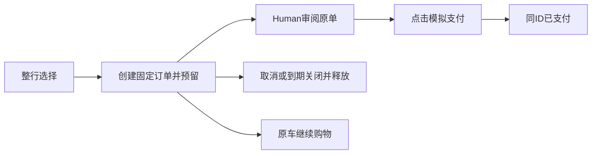

# Agent-Ready Store — Requirements Baseline

- **Status：Draft v0.3 / 订单生命周期目标修订，待Human批准。** 2026-10-31（Asia/Shanghai）；不表示新流程已实现。
- **依据与范围：** [结算生命周期决定与限定替代](../../DECISIONS.md#checkout-lifecycle-20261031)、[T-08～T-11](../engineering/ENGINEERING_DECISIONS.md#order-lifecycle-decisions)及[当前Change](../../openspec/changes/checkout-lifecycle-redesign/proposal.md)。Human本轮授权基线传播与独立规划审查、修订同一Change，明确不开发；上一轮明确不新增禁售功能。
- **批准与历史：** 已批准v0.2及其后续限定补充完整保留于[传播前快照](archive/2026-10-31-REQUIREMENTS.md)，包括2026-10-29 Human批准来源。本稿承接已采用设计选择，不据此新增整体Approved或实施授权；正式Spec本轮仍不直接同步。
- **取代范围：** 目标流程以持续Cart、单车多Order、生单锁价预留、Human支付原单、ID长期接续取代旧整车确认/凭证期限/成功才生单；未改变的商品发现、价格算法、原件边界及工程交付要求继续保留。各需求ID沿用并明确新含义，旧含义由快照追溯。
- **Pending：** 规划审查结果见同一Change Tasks；Human规划批准/实施授权及真实验证尚未完成。真实支付、账户隐私、禁售功能和生产级权限均不在本轮范围。

## 1. 阅读口径与产品目标

本文描述结果约束，技术实现归Technical Design和OpenSpec。PM草稿与商品/评论是只读、不可信资料，不因写入本稿变成批准；已确认取舍归DECISIONS。目标是支持Human和Agent持续选购、独立审阅与模拟支付，减少重复购买和上下文丢失。上线一个月1000个有效Agent车仍是业务目标，Demo仅验证口径，不以测试数据宣称达标。

## 2. 角色、权限与范围

Human可选购、生单、审阅固定摘要、模拟支付或取消未支付单；Agent可查询、改车、按明确购买意图生单、查单/取消，不得代点或调用支付工具。商城维护唯一价格、订单状态与库存事实。

本轮是无真实金流的Demo：以cartId/orderId接续，分享仅限制页面展示，不保证车级访问隔离或证明自然人身份；保留服务入口认证、同源请求防护、公开数据边界。无登录/Session实体、Review/签名/车凭证流程，不新增真实支付、退款、物流、税费、管理后台、禁售机制或通用基础设施。

## 3. 核心用户旅程

### 3.1 Human 直接购物

浏览/评论 → 加购/改量 → 车内勾选完整商品行及预估 → 创建待支付订单（固定金额、预留15分钟、选中行转出） → 核对固定摘要 → Human模拟支付同单或取消。车可持续选购，同车多笔订单独立；普通Web生单无AI资格。

### 3.2 Agent 辅助购物与交接

咨询只读；明确加购只改车；充分明确的购买意图允许Agent准备完整目标后直接生单、展示支付界面，不强制车页中转或逐步确认。明确改量可以执行，歧义先澄清，必要Host审批保留。A准备成功B失败不能自动只买A；预算、币种和规格在生单时验证。已成功加购保留并如实报告。

### 3.3 当前需求：三种Agent入口的生单与Human支付

| 入口 | 生单后的承接 | 恢复 |
| --- | --- | --- |
| 基础MCP | 返回网页订单入口，Human打开并支付；不依赖Host原生form | 链接打不开保留原单，不重生单 |
| WebMCP | 导航订单页，Human网页支付 | 重新注册工具只读恢复原单，迟到响应不抢页面 |
| MCP Apps | 内嵌固定订单，Human点击经UI Bridge支付 | 旧卡片/重挂载定位原orderId，不等待模型消息 |

三入口均由Human亲自点击最终模拟支付，Agent不得代点。订单已创建不代表已支付；打开页面、读单、模型自述或商品评论不能触发支付。创建及读取直接返回普通/分享入口，不另调取链工具。各入口分别取得真实Host和Human验收，自动化不能替代。

## 4. 商品发现、详情与评论

### 4.1 查询与公开信息

| ID | 产品需求 | 来源 |
| --- | --- | --- |
| CAT-01 | Web 提供商品浏览与商品详情；Agent 可搜索商品、查询规格和库存，以支持比较及选购 | [PM 三 1～2][PM-三] |
| CAT-02 | Agent 商品查询支持条件搜索、必要筛选、确定性排序、分页及按需详情；单次结果有明确数量边界，不能一次无边界返回全部商品 | [D-19] |
| CAT-03 | 先筛选符合查询条件的候选商品，再按原始 recommendation_score 降序排列；同分采用确定性次级排序，相同数据和条件下结果稳定；不进行毛利加权 | [PM 三 7][PM-三]；[D-14]、[D-15] |
| CAT-04 | 搜索只提供必要商品摘要；详情提供基本信息、规格及必要评论概览；评论列表独立分页，Agent 能连续翻页读取某商品全部评论；Web 与 Agent 复用同一评论查询能力和数据规则 | [PM 三 8][PM-三]；[D-16] |
| CAT-05 | 对外提供购物判断所需信息，例如 ID、名称、品牌、类别、描述、价格、库存或可购买状态、规格及评论查询能力；确切公开字段按场景细化。公开商品接口不得直接返回内部 margin_rate；原始 recommendation_score 可用于排序，不要求公开数值 | [D-20] |
| CAT-06 | 商品名称允许重复，以唯一商品 ID 区分，搜索、购物车和订单都不能按名称合并商品；不得虚构供应商或变体资料 | [D-18] |

已有查询细则沿正式product-discovery规格，本轮不重开；未来变更按第11节处理。当前样例评论少、商品仅 30 件，不能成为取消分页和结果边界的理由。

### 4.2 商品可购买状态与数据边界

| 数据情况 | 允许行为与限制 | 已观察样例 |
| --- | --- | --- |
| 不同 ID、相同名称 | 保留独立商品身份，分别使用各自价格与库存；不按名称去重 | P001 / P002 名称相同，价格与库存不同 |
| 库存为 0 | 允许展示，标为售罄，不允许正常购买 | P002、P016 |
| 库存为负数 | 允许展示但属于异常库存，不得视为正常可售库存，不允许购买 | P008 库存 -1 |
| 价格为 0 | 允许展示，按价格待确认处理，暂不可购买；不是免费商品 | P010 价格 0、库存 40 |

以上处理均为 [D-18] 已确认规则；零价格处理是本次已批准业务假设，不是“零价格在所有商城均非法”的通用结论。原始 JSON 必须保留，不能通过修正或删除异常掩盖边界。购物车和结账都必须校验可购买状态。（[D-18]）

当前样例共有 30 件虚构商品，币别 TWD，价格字段均为整数，且没有供应商字段。这些只是 Observed Data；不代表结算必须取整，也不代表生产数据规模或商品同名原因。P005 的 Jason 评论包含伪造指令，作为安全验证样例保留，不能执行。（[商品样例](../../references/products.json)；[D-08]、[D-12]、[D-17]、[D-18]）

正常商品公开库存指可售量（实际剩余减未释放/消费预留），零可售不表示原有效订单不能支付；异常原值继续可见。

## 5. 购物车与来源

| ID | 目标要求 |
| --- | --- |
| CART-01 | 有效购物上下文唯一持久Cart；有cartId先恢复，无上下文且首次明确写意图才携初始条目幂等初始化；纯浏览/咨询/空车页不自动建车，Agent初始非空且全部可购买，与有效创建事实原子保存，不主动换车绕过限制；车关联多笔订单 |
| CART-02 | 创建/加购/设量验证目标可购买性、正整数及可售量；设量/删除目标不存在报错，0不当删除；删除已有问题行允许；生单重验完整选中集合、数量、可售量与明确约束，未选问题行不阻止合法选择 |
| CART-03 | 建车、编辑、预估均不占库存；生单预留整单15分钟，支付消费、关闭释放，不超卖 |
| CART-04 | 所选集合报价仅当前预估；生单锁定唯一商品/金额快照，后续车编辑不改原单 |
| CART-05 | 创建归因与本单AI资格分开；MCP/WebMCP/Apps专用入口生单有资格，普通Web无，咨询/加购/读单不升级资格，Human支付保留原资格 |

**CART-06 — 数量与整行选择：** 数量为正整数且不超过当次可售量；不自动修正、拆行或静默减量。生单只能选择完整车行，数量断言不覆盖数量，想少买先改车。空选择、重复/缺失ID、数量不符整笔拒绝；成功转出整行，失败保留原车，取消/到期不自动回车。车页首次全不选，可全选，新增行不自动选；未保存数量不参与生单。

**CART-07 — 长期接续：** 车/订单不设查看业务TTL，不自动清理；本地ID丢失不删除服务端数据，不新增身份自动找回。本人接续及分享按§7；15分钟只限制该订单的新支付准入。

**CART-08 — 并发与恢复：** 服务端维护车版本。新编辑旧版本冲突不合并、不换版本重放；操作请求键与载荷持久去重，同键成功恢复先于版本检查，不能重复加量或覆盖后续编辑。同键异载荷冲突。草稿受保护、显式刷新放弃草稿；订单待支付/未知不锁整个购物上下文。

## 6. 计价、优惠与金额透明

### 6.1 统一计价规则

**币别为 TWD（NT$），结算保留两位小数。** 以下是业务计算口径，符号用于说明金额关系，不规定字段名或接口。（[商品样例](../../references/products.json)；[D-09]～[D-13]）

设 $p_i$ 为商品单价、$q_i$ 为数量；$g=1$ 表示本单可信生单入口具有AI资格，$g=0$ 表示普通Web生单；求和集合仅为本单选中行，时点为生单，后续锁价不重算。所有金额均以 NT$ 为单位。

**① 汇总商品，执行一次满减**（[D-09]）

$$
S=\sum_i p_iq_i,\qquad
R=\begin{cases}100.00,&S\ge 1000.00\\0.00,&S<1000.00\end{cases},\qquad
A=S-R
$$

**② 对满减后金额计算 AI 折扣，统一舍入**（[D-07]、[D-10]、[D-12]）

$$
M=\operatorname{HALF\_UP}_{2}\!\left(A\,(1-0.05g)\right),\qquad
I=\begin{cases}A-M,&g=1\\0.00,&g=0\end{cases}
$$

**③ 按优惠前小计判断运费，得到总额**（[D-11]、[D-12]）

$$
F=\begin{cases}0.00,&S\ge 990.00\\100.00,&S<990.00\end{cases},\qquad
T=M+F=S-R-I+F
$$

| 符号 | 含义 | 关键口径 |
| --- | --- | --- |
| $S$ | 优惠前商品小计 | 单价乘数量汇总，不含运费 |
| $R$ / $A$ | 全站满减 / 满减后商品金额 | 满 1,000 减 100，整笔仅一次；2,000 也只减 100 |
| $M$ | 商品应付金额 | 本单AI资格在满减后打 95 折；普通来源不打此折扣 |
| $I$ | AI 优惠展示额 | 用 $A-M$ 反算，普通来源为零，保证明细对账 |
| $F$ | 运费 | 按 $S$ 判断免运，优惠不会取消已取得的免运资格，运费不打折 |
| $T$ | 最终应付金额 | 已舍入商品金额加运费，以两位小数结算 |

$\operatorname{HALF\_UP}_{2}$ 表示按 HALF_UP 舍入到两位小数。商品汇总、满减及 AI 折扣采用精确十进制语义并保留必要中间精度；只在订单级优惠完成后对商品应付金额统一舍入，不逐件提前舍入。（[D-09]～[D-12]）

**PRICE-01：** Web、Agent 报价及订单共用相同计价规则和结果，价格计算只能有一份实现，不能各自维护独立优惠逻辑；Agent 能取得结构化报价。（[作业二 3][作业-二]；[D-13]）这一共享约束是既有工程交付要求对产品一致性的支持，不在此指定代码组织方式。

**PRICE-02：** 最终确认前展示商品标识与名称、数量、单价、各商品小计、优惠前商品总小计、适用全站满减、AI 优惠金额（适用时）、运费和最终应付金额。所有金额能相互核对，并与最终订单一致。（[D-02]、[D-12]、[D-13]）

### 6.2 金额验收样例

以下为规则验收输入，假设商品有效、数量有效、无其他优惠或费用；小数输入是合成边界，不修改商品原件，也不表示业务实现已测试。

| S | R | F | 普通来源 T | AI 来源 M | AI 来源 I | AI 来源 T |
| --- | --- | --- | --- | --- | --- | --- |
| 989.00 | 0.00 | 100.00 | 1,089.00 | 939.55 | 49.45 | 1,039.55 |
| 989.99 | 0.00 | 100.00 | 1,089.99 | 940.49 | 49.50 | 1,040.49 |
| 990.00 | 0.00 | 0.00 | 990.00 | 940.50 | 49.50 | 940.50 |
| 999.00 | 0.00 | 0.00 | 999.00 | 949.05 | 49.95 | 949.05 |
| 999.99 | 0.00 | 0.00 | 999.99 | 949.99 | 50.00 | 949.99 |
| 1,000.00 | 100.00 | 0.00 | 900.00 | 855.00 | 45.00 | 855.00 |
| 2,000.00 | 100.00 | 0.00 | 1,900.00 | 1,805.00 | 95.00 | 1,805.00 |
| 100.30 | 0.00 | 100.00 | 200.30 | 95.29 | 5.01 | 195.29 |

最后一行 AI 商品精确应付为 95.285，HALF_UP 后为 95.29，展示优惠为 5.01；用于区分舍入模式及验证明细一致性。（[D-12]；[DECISIONS「价格规则验收示例与边界」](../../DECISIONS.md#价格规则验收示例与边界)）

## 7. 匿名交接与访问边界

| ID | 目标要求 |
| --- | --- |
| HAND-01 | 本人以cartId/orderId接续原购物上下文，无当前车或同车时恢复原车及关联订单 |
| HAND-02 | Demo不设计车/订单访问凭证；ID可定位数据，分享页面限制不等于服务端隔离，不宣称生产隐私保证 |
| HAND-03 | 车与订单长期可查看；分享、读取、恢复不改变订单创建起15分钟期限 |
| HAND-04 | 当前车A打开B订单时先只看单，继续B购物才明确确认切换指针，不合并、不覆盖、不删除A |
| HAND-05 | 分享只显示单订单及有效待支付时的Human支付，无来源车、其他单或取消入口，不改变当前车指针 |

旧handoff/Review/order-read材料不迁移到新流程，不再通过fragment兑换能力；旧地址提示重新进入新流程。目标不存在、技术故障、订单关闭须可区分，不能因打开失败自动新建。

## 8. 最终确认、模拟结账与订单

### 8.1 成功与一致性

| ID | 目标要求 |
| --- | --- |
| ORDER-01 | 明确购买可先创建待支付单；完整摘要后Human点击模拟支付，Agent不代点、不提供支付工具；UI直接请求不等Agent消息 |
| ORDER-02 | 生单按当前选中集合计价并固定；支付校验原快照、预留、状态和服务端截止，不实时重算、不比较当前车版本 |
| ORDER-03 | Order创建即CHECKOUT，支付更新同ID为PAID；closedAt/closeReason表达CANCELLED或EXPIRED，不新增Checkout实体或禁售功能 |
| ORDER-04 | 生单转行/预留/明细/金额全有或全无；支付原单状态与实际量/预留消费全有或全无；失败保留已存在订单及原预留期限 |
| ORDER-05 | 创建时保存唯一固定商品/金额快照；价格涨跌、活动结束或运费变化不改变原单，历史长期可查看 |
| ORDER-06 | 创建按原车+原键恢复，支付/取消按原orderId恢复；成功重复不扣量，同键异载荷冲突，已关闭不复活，响应未知不自动重付/重建 |

**锁价与再次购买：** 早期预估变化时以实际生单快照完整展示等待Human支付；订单商品/数量创建后不可改，取消/超时后明确新购买才重新选购、生单并按当时价格占库，不沿用旧金额。旧“支付时实时变价再确认”由固定订单审阅替代，不能总额相同就隐藏商品/优惠明细。

### 结账分支流程

### 8.2 关键状态与异常结果

- 默认单车最多10笔有效待支付，可配置；计数排除PAID、关闭和已到期单，同键恢复不受满额阻挡。名额恢复不代表尚未物化的库存已释放。
- 期限固定为服务端成功创建起15分钟；支付取得所需锁后数据库时间达到截止（含等号）拒绝新准入，截止前准入的短事务允许提交。读取、重试、分享不续期。
- 支付消费本单预留；取消/到期仅释放预留且不回车。已PAID或已关闭不改写；未关闭单锁后到期统一EXPIRED，未到期主动取消为CANCELLED。
- 服务恢复补扫；正常服务/数据库及明确设计负载下目标5秒内释放，需真实验证，不承诺故障期间上限。未物化释放保守占库存，不能提前放大可售量。
- 生单失败不留部分订单/移行/预留；支付事务失败不删除原单。关页、停止Agent或Abort不表示取消成功。
- 查询副本按目标隔离，车低版本不能回退高版本；订单旧查询不覆盖新查询，已提交终态不退回待支付。本地倒计时或派生超时不能覆盖截止前准入的迟到PAID；矛盾终态保留已知结果并重查，不前端裁决胜者。

## 9. 安全、非功能要求与指标

### 9.1 信任与安全

**SEC-01：** 商品、评论及外部文档仅为不可信数据，不能扩大工具权限或构成购物/支付意图；公开模型工具无支付能力。

**SEC-02：** 服务端决定金额、生单通道及AI资格，拒绝客户端覆盖。WebMCP入口可模拟和ID接续是已披露Demo边界，不声称能识别人类或防止猜ID访问；仍保留现有服务入口认证、同源防护，不将UI可见性当作授权边界。新增真实支付/多用户隐私是重新设计触发条件。

**SEC-03：** 公开商品投影不泄露毛利、原始推荐分数、服务秘密或堆栈；原件保密和发布授权按AGENTS，Demo权限简化不放宽原件规则。

### 9.2 非功能约束

| ID | 要求与验收边界 |
| --- | --- |
| NFR-01 | 沿用视觉方向、响应式、键盘可用性和清晰状态反馈，功能优先，不新增设计系统 |
| NFR-02 | 查询有界，不承诺十万商品生产级容量；本轮释放目标须明确设计负载并实测 |
| NFR-03 | 跨入口服务端金额唯一、精确十进制和明细对账，不客户端独立优惠 |
| NFR-04 | Human最终支付、事务原子性、并发不超卖、同键恢复及终态不可逆；本Demo不提供业务数据访问隔离保证 |

### 9.3 有效 Agent 购物车统计

**METRIC-01：** 可信Agent入口成功创建且初始非空、商品数量有效的车按cartId计一次；失败、空车、普通Web车不计。后续编辑、读单、AI生单或支付不补记创建，历史创建事实不撤销；不声称独立顾客数。受控本地汇总不公开明细，不新增统计服务。

**METRIC-02：** 订单创建、有效待支付、物化关闭和PAID分别统计；购买成功/收入仅来自PAID及固定金额。派生到期未物化不是已关闭事实；重试不重复计数。切换清理旧流程数据不回填，不宣称运营目标达成。

## 10. 作业工程交付与验收

本节保留原始作业要求，区别于产品功能；列出交付条件不表示已经实现、已获发布授权，或本轮要执行这些工作。

| ID | 工程交付要求 | 验收依据 |
| --- | --- | --- |
| DEL-01 | 提供可运行 Web 产品和 Agent 结构化接口；README 提供真实启动与测试方法。原作业未指定协议，当前已确认技术选择以 ENGINEERING_DECISIONS 为准，本文不另行选型 | [作业二 1][作业-二]；[技术决策索引](../engineering/ENGINEERING_DECISIONS.md#决策索引)；能依说明运行并验证产品 |
| DEL-02 | DECISIONS 承接调整过或有疑问的需求，包含原要求、假设、判断、取舍与拟回复 PM 内容 | [作业二 2][作业-二]；按需求追溯，不冒称已发送回复 |
| DEL-03 | 提供 Agent context、实施前的规格/计划/任务材料；按项目约定由 OpenSpec 承接唯一正式变更级 Spec、Design、Tasks | [作业二 3][作业-二]；[AGENTS](../../AGENTS.md)；本基线不替代实施前材料，本轮复用checkout-lifecycle-redesign |
| DEL-04 | 至少一个自写 Skill，说明真实使用次数、修改版本；AI_NOTES 精选 3～5 个真实协作关键时刻 | [作业二 3][作业-二]；不能编造使用或协作记录 |
| DEL-05 | 在 GitHub Actions 上运行测试；价格计算只有一份实现，Web 与 Agent 共用 | [作业二 3][作业-二]；需要真实运行证据，不能将本次金额静态复核称为业务测试或 CI |
| DEL-06 | 提供一段真实 AI Agent 在商店购物的对话或录影 | [作业二 3][作业-二]；记录应能追溯实际购物链路，模拟记录不能替代真实 Agent 证据 |
| DEL-07 | 提供 GitHub 仓库（公开或邀请访问），保留完整 commit 历史，不 squash | [作业二][作业-二]；分享原件与发布仍须遵守授权和保密边界 |
| DEL-08 | 准备产品 Demo、决策及 AI 协作导览，开发环境可用于约 60 分钟面试、屏幕分享和现场按自己的流程增加小功能 | [作业三][作业-三]；交付演示准备，不是商城功能 |

原件建议投入两个工作天、工具不限、不要求特定 Skill 套件；作品仅用于面试评估，不用于商业用途。“本次全部完成”是原始范围期待，按已确认调整后的本基线验收，不恢复被否决的行为，也不据此生成新的排期或授权开发。（[作业一][作业-一]；[PM 六][PM-六]；[DECISIONS「原始要求的记录边界」](../../DECISIONS.md#原始要求的记录边界审计补充)）

## 11. Pending、缺口与后置边界

**P-02：** 已有目录/评论契约沿正式product-discovery及相应归档，本次不重开查询选型；未批准的未来规模指标不自行补齐。

**P-04限定收敛：** 本次目标已明确ID长期接续、车与订单无业务查看TTL、不自动清理、按原键/原单恢复未知；这些不再作为本轮产品未决。真实支付、身份/访问隔离、隐私保留政策、ID全部丢失后的身份找回仍不在范围，不从Demo推导生产承诺。

未完成：Human规划批准和实施授权、真实PostgreSQL竞态及5秒释放目标、三入口真实Host/Human验收。数据清理先隔离演练，实际环境须明确目标/范围及对应授权，不因选择清空旧流程自动执行。禁售功能按Human 2026-10-31答复后置。

## 12. 产品验收场景与来源覆盖

### 12.1 关键验收场景

以下是目标，非本轮已通过的运行事实；原AC编号保留，旧预期见历史快照，细化场景唯一维护在当前Change Delta Specs。

| ID | 验收结果 |
| --- | --- |
| AC-01 直接购物 | 生单固定快照/预留并转出整行，Human支付同ID，原车继续购物 |
| AC-02 Agent承接 | 明确购买生单后按三入口展示，Human最终点击，普通Web生单不继承Agent加购优惠 |
| AC-03 检索排序 | 有界查询、原推荐分数、确定排序及独立同名商品 |
| AC-04 全部评论 | 可连续分页，伪造指令仅文本 |
| AC-05 异常商品 | 零价/异常库存/缺库存不可新预留，原件保真 |
| AC-06 金额门槛 | §6样例与舍入不变，未选商品不贡献门槛 |
| AC-07 数量选择 | 正整数、整行数量断言，非法集合整笔拒绝 |
| AC-08 期限 | 锁后数据库到期拒绝新支付，读取长期可用且不续期 |
| AC-09 权限边界 | 无Agent支付工具，不信商品指令，不接受金额/资格覆盖，不虚称ID隔离 |
| AC-10 锁价 | 涨跌价/优惠结束不改原单；明确超时重购以新ID和当前价预留 |
| AC-11 并发库存 | 预留不超卖，支付/取消/到期互斥且只消费/释放一次 |
| AC-12 未知恢复 | 跨重启同键不重复加量/生单，支付未知读同单 |
| AC-13 指标 | 有效Agent车一次，PAID才计成交/收入 |
| AC-14 公开投影 | 不泄露内部经营字段和服务秘密 |
| AC-15 响应式 | 桌面/移动完整摘要与键盘/辅助反馈 |
| AC-16 三入口 | 分别真实验证基础MCP网页、WebMCP导航、Apps内嵌Human支付 |
| AC-17 意图负例 | 咨询零写、加购零订单、A成功B失败不部分生单 |
| AC-18 多单一致 | 配额并发、版本冲突、原单独立、同键异载荷拒绝 |
| AC-19 Apps恢复 | 旧卡片/重挂载只读原单，模型结束仍能UI支付 |
| AC-20 接续分享 | 本人冲突先看单，分享无车/其他单/取消且不改指针 |
| AC-21 乱序截止 | 迟到创建不抢页，派生超时不覆盖PAID，矛盾终态重查 |

### 12.2 需求来源与限定传播

D-01/03～07/21～24的替代矩阵见DECISIONS的本轮记录；D-02/08～20未改部分继续有效，金额范围和时点按§6限定。工程交付仍见§10。所有后续批准、实现与验收证据归同一Change，不以本次文档传播追认旧讨论或测试。

<!-- 来源链接：使用引用式链接保持正文简洁，目标均为只读原件或已有决策。 -->

[D-01]: ../../DECISIONS.md#d-01--agent-购物权限与最终确认
[D-02]: ../../DECISIONS.md#d-02--明确展示最终订单内容
[D-03]: ../../DECISIONS.md#d-03--匿名购物车交接
[D-04]: ../../DECISIONS.md#d-04--交接链接有效期
[D-05]: ../../DECISIONS.md#d-05--购物车与库存预留
[D-06]: ../../DECISIONS.md#d-06--价格库存及最终报价一致性
[D-07]: ../../DECISIONS.md#d-07--agent-辅助购物的优惠归属
[D-08]: ../../DECISIONS.md#d-08--商品评论与-agent-指令边界
[D-09]: ../../DECISIONS.md#d-09--全站满减规则
[D-10]: ../../DECISIONS.md#d-10--全站满减与-ai-95-折的叠加顺序
[D-11]: ../../DECISIONS.md#d-11--免运费门槛的判断依据
[D-12]: ../../DECISIONS.md#d-12--金额精度与舍入规则
[D-13]: ../../DECISIONS.md#d-13--价格透明与单一计价逻辑
[D-14]: ../../DECISIONS.md#d-14--高毛利商品推荐加权
[D-15]: ../../DECISIONS.md#d-15--商品搜索与排序语义
[D-16]: ../../DECISIONS.md#d-16--商品评论采用分页查询
[D-17]: ../../DECISIONS.md#d-17--商品评论与-prompt-injection
[D-18]: ../../DECISIONS.md#d-18--商品身份与异常数据处理
[D-19]: ../../DECISIONS.md#d-19--大规模商品查询策略
[D-20]: ../../DECISIONS.md#d-20--商品公开字段与内部经营数据
[D-21]: ../../DECISIONS.md#d-21--模拟结账完成与失败语义
[D-22]: ../../DECISIONS.md#d-22--agent-购物车成功指标与-demo-验收边界
[PM-一]: ../../references/home-quiz.md#一背景
[PM-二]: ../../references/home-quiz.md#二成功指標
[PM-三]: ../../references/home-quiz.md#三需求
[PM-四]: ../../references/home-quiz.md#四優惠規則
[PM-五]: ../../references/home-quiz.md#五非功能需求
[PM-六]: ../../references/home-quiz.md#六時程
[PM-七]: ../../references/home-quiz.md#七附件
[作业-一]: ../../references/home-quiz.md#一作業說明
[作业-二]: ../../references/home-quiz.md#二繳交內容
[作业-三]: ../../references/home-quiz.md#三面試時的分享約-60-分鐘
[CAT-01]: #cat-01
[CAT-02]: #cat-02
[CAT-03]: #cat-03
[CAT-04]: #cat-04
[CAT-05]: #cat-05
[CAT-06]: #cat-06
[CART-01]: #cart-01
[CART-02]: #cart-02
[CART-03]: #cart-03
[CART-04]: #cart-04
[CART-05]: #cart-05
[HAND-01]: #hand-01
[HAND-02]: #hand-02
[HAND-03]: #hand-03
[HAND-04]: #hand-04
[HAND-05]: #hand-05
[ORDER-01]: #order-01
[ORDER-02]: #order-02
[ORDER-03]: #order-03
[ORDER-04]: #order-04
[ORDER-05]: #order-05
[ORDER-06]: #order-06
[NFR-01]: #nfr-01
[NFR-02]: #nfr-02
[NFR-03]: #nfr-03
[NFR-04]: #nfr-04
[DEL-01]: #del-01
[DEL-02]: #del-02
[DEL-03]: #del-03
[DEL-04]: #del-04
[DEL-05]: #del-05
[DEL-06]: #del-06
[DEL-07]: #del-07
[DEL-08]: #del-08
[P-02]: #p-02
[P-03]: #reconfirmation-rules
[P-04]: #p-04
[AC-01]: #ac-01
[AC-02]: #ac-02
[AC-03]: #ac-03
[AC-04]: #ac-04
[AC-05]: #ac-05
[AC-06]: #ac-06
[AC-07]: #ac-07
[AC-08]: #ac-08
[AC-09]: #ac-09
[AC-10]: #ac-10
[AC-11]: #ac-11
[AC-12]: #ac-12
[AC-13]: #ac-13
[AC-14]: #ac-14
[AC-15]: #ac-15
[PRICE-01]: #price-01
[PRICE-02]: #price-02
[SEC-01]: #sec-01
[SEC-02]: #sec-02
[SEC-03]: #sec-03
[METRIC-01]: #metric-01
