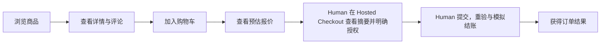
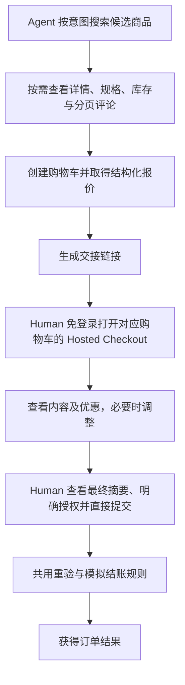
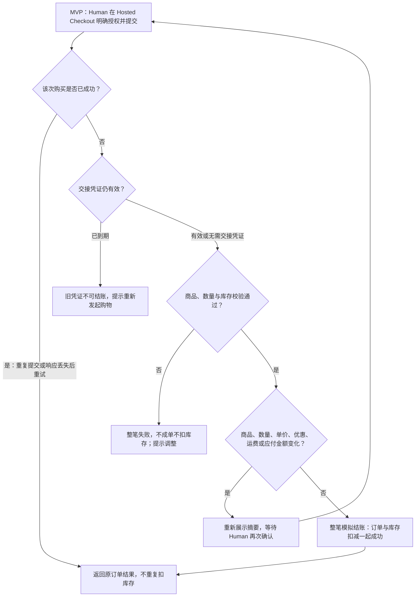

# Agent-Ready Store — Requirements Baseline

**2026-10-30最新Human修订：** [D-01直接支付决定](../../DECISIONS.md#d01-direct-payment-20261030)明确Apps/WebMCP支付后由UI直接下单，不再依赖Agent接续；基础MCP保留Host原生确认后Agent提交及当前限制。本轮只修订Spec、不实施代码，较早的三入口统一代提交范围记录以上述最新决定及§3.3为准。

**2026-10-30 Human 需求范围修订：** [D-01 两步 Agent 购买确认](../../DECISIONS.md#d01-agent-two-step-20261030) 为三入口当前购买授权要求，限定替代本文旧的“Agent代提交后置/本轮不交付”范围。基础MCP、WebMCP、MCP Apps统一采用先准备结账、再由人确认具体购买、Agent执行提交。普通Web人工提交保留；具体授权机制与接口待设计、OpenSpec规划及实施授权，不能据此宣称已实现。下文2026-10-29来源/批准表保留历史，不扩为新设计批准。

**2026-10-30 Human 逐项操作修订：** [D-24](../../DECISIONS.md#d-24--电商逐项操作与购物快照新鲜度) 与 [S5 Design §4](../../openspec/changes/archive/2026-10-30-s5-webmcp/design.md) 已获批准，限定替代 Web 整车保存和干净页面仅手动刷新细节：Web/WebMCP 逐项操作、同车短暂互斥、进入/返回校准；旧 HTTP/基础 MCP 兼容，目标行严格校验、旧问题行可逐条修复且未修完不可结算。D-23 的版本权威、禁止重放及交易边界继续有效；实施状态以 Tasks §6 为准。
**2026-10-30 Human 限定修订：** [D-23](../../DECISIONS.md#d-23--服务端权威与购物车客户端简化) 批准 Web/WebMCP 购物车以服务端为准；编辑冲突或响应未知提示显式重新加载，刷新会放弃全部未保存修改，不逐项比较、合并、重放编辑或长期全局锁定。创建幂等、购买确认/未知结果恢复和服务端交易保障保持。此补充取代下文历史客户端冲突比较/编辑恢复细节，实施与验收见 [S5 Change](../../openspec/changes/archive/2026-10-30-s5-webmcp/design.md)。

**2026-10-30限定补充（Human Accepted）：** 确认材料与Cart截止一致、同步生单及成交价格固定的定义和批准来源见[D-21追加确认](../../DECISIONS.md#s3-confirmation-lifetime-20261030)；不另设支付或独立短期确认倒计时，既有绑定/重验与整体实施授权边界保持。

**S3限定补充（Human Accepted，2026-10-29）：** §8与§11 P-04的到期准入、有效权限内订单查询及无自动清理边界，按[D-21 S3限定补充](../../DECISIONS.md#s3-checkout-boundary-20261029)局部细化。长期保留期限及新的过期结果访问仍Pending；下文历史Pending在此范围内被补充，不代表完整S3规划、实施或Git授权。

- **Status：Approved Product Requirements Baseline**
- **版本 / 适用范围：** v0.2 已批准基线；本次 Home Quiz 的 Human Web 与 External Agent 辅助购物 MVP，以及§3.3三入口中经Human具体确认后的分入口下单需求。
- **整理日期：** v0.1 首次整理于 2026-10-28；v0.2 修订于 2026-10-29（Asia/Shanghai）。
- **依据：** [原始需求与作业约束](../../references/home-quiz.md)、[商品样例](../../references/products.json)、[当前产品决策](../../DECISIONS.md)中的全部 Accepted [D-01]～[D-22]（含 [D-01 最新 Human 授权边界](../../DECISIONS.md#d01-authorization-20261029)）；本轮 Human + ChatGPT Review 由 Human 当前修订指令明确转述并确认，来源追溯见 §1.3。
- **批准记录：** Human 于本轮「Agent-Ready Store — Baseline Finalization」指令明确确认集中 Review 建议，并授权将已确认范围定稿；确认人：Human；记录日期：2026-10-29（Asia/Shanghai）。批准覆盖本文 MVP 产品行为及明确后置边界；P-02 / P-04 非阻塞且未批准具体细则。不补造外部对话或更早审批日期，不代表 Technical Design、实现或测试通过。
- **本聊天直接批准：** Human 于 2026-10-29（Asia/Shanghai）在本聊天回复“批准”，针对上一轮交付的 Requirements v0.2 待批准稿作最终确认，覆盖产品行为、MVP / Planned Enhancement 划分及 P-02 / P-04 非阻塞 Pending 的保留。此前 Baseline Finalization 记录保持；并行新增的 C-02 七工具等工程确认沿其独立来源，不将本条扩为新的批准。此确认不授权 Commit、Push、Technical Design 或业务实施。
- **取代关系：** v0.2 由待批准整合稿转为已批准产品需求基线；保留 v0.1 Draft 历史与 D-01～D-22 的确认、理由及演进。
- **Pending：** P-02 / P-04 保留为非阻塞的设计细化事项，不阻塞本 Requirements 的整体批准；依赖细则的设计、实现和验收仍须先明确。见第 11 节，本轮不批准未经确认的细则或实施。

- **S2 限定补充批准（2026-10-29）：** Human“批准这些建议”确认 [D-04 当前补充决定](../../DECISIONS.md#d-04--交接链接有效期)：未交接Cart创建起24h、有效期内首次分享后完整24h，以及创建材料与Cookie均丢失时的恢复限制。此为v0.2的已批准局部补充；P-04的数据保留与过期结果读取继续Pending，不代表整体业务实施或Git授权。

**快速导航：** [核心流程](#3-核心用户旅程) · [商品规则](#4-商品发现详情与评论) · [计价公式](#6-计价优惠与金额透明) · [交接](#7-匿名交接与访问边界) · [结账异常](#8-最终确认模拟结账与订单) · [待明确事项](#11-pending缺口与后置边界) · [验收场景](#12-产品验收场景与来源覆盖)

本文回答产品最终应该做什么。除第 10 节单列的作业工程交付要求外，正文为产品行为及其验收依据；不规定布局、技术栈、协议、接口形状、数据库或代码结构。

## 1. 阅读口径与产品目标

### 1.1 来源及权威

| 标记 | 含义与使用方式 |
| --- | --- |
| Source Requirement（原始要求） | PM 草稿或作业原文明确写出的要求。未被调整的内容在本基线中承接，不因被收录就冒称已获单独批准 |
| Accepted Decision（已确认决策） | Human 已确认的产品取舍；相应行为按当前有效结论整合，不沿用已被补充解决的历史 Pending |
| Observed Data（样例事实） | 当前 JSON 中可观察的数据，不是通用业务规则，也不是生产规模或运营效果证据 |
| Pending（未决） | 资料不足或尚未批准的细则；不能当作实施约定。仅依赖该细则的设计与验收需待明确 |

正文中的 Decision 编号可点击直达对应条目；PM / 作业来源可点击直达原件章节，编号保留到具体需求项。Decision 调整原始草稿时，以已确认结论为准。上游未改变的原始能力继续保留；不得从样例数据或当前实现反推新规则。

所有购买均须先取得 Human 对完整具体购买内容的明确确认；三种 Agent 入口的当前两步流程见 §3.3 与 [D-01 两步 Agent 购买确认](../../DECISIONS.md#d01-agent-two-step-20261030)。准备结账与执行最终提交分离；Agent执行不替代Human决定。

### 1.2 背景、目标与成功指标

商店同时服务人类顾客和顾客使用的外部 AI 助理。顾客能够自行选购，也能让 Agent 查询、比较、准备购物车，再由顾客明确确认购买。目标是提供可被 Agent 使用的购物能力，并减少非预期购买，保持购买内容、价格与授权清楚。（Source：[PM 一][PM-一]、[PM 三 1～4、9][PM-三]；[D-01]、[D-02]）

PM 草稿描述下一季营销方向和“我没有要买这个”的客服投诉，但没有运营数据佐证；这些是原始背景陈述，不是已验证事实或新的排期承诺。

上线一个月内达到 **1,000 个有效 Agent 购物车**是业务目标。本次 Demo 验收流程和统计口径，不要求达到真实运营数量，也不能用构造数据宣称达标。当前没有达成数据。（[PM 二][PM-二]；[D-22]）

### 1.3 v0.2 变更说明与来源追溯

| 变更 / 状态 | 直接来源 | 本文承接与边界 |
| --- | --- | --- |
| 最新 Human 已确认：所有购买先获具体授权；MVP 由 Human Hosted Checkout 确认并提交；报价或实质内容变化重新授权 | Human 本轮修订指令第 1～2 项；[D-01 补充确认](../../DECISIONS.md#d01-authorization-20261029) | §1～3、ORDER-01、SEC-02、NFR-04、AC-01/02/09/10；授权边界不等于整份基线 Approved |
| 历史2026-10-29后续方向 / Planned Enhancement：Agent 取得服务端可验证有效授权后可代提交 | 同上；不是对历史泛化预授权场景的整体批准 | §2、§3.3、§11.3；不进入 MVP 必交付及本轮实施范围，具体增强机制仍待设计 |
| Pending 分类：P-02 / P-04 非阻塞于 Requirements 整体批准，产品细则仍未决 | Human 本轮修订指令第 3～4 项 | §11；不指定查询参数、访问/保留期限或恢复方案，不把技术草稿建议转成 Accepted 产品规则 |
| 保持不变：价格公式、库存、Handoff 有效期、订单一致性及其他 Accepted Decisions | Human 本轮修订指令第 5 项；既有 D-02～D-22 及直接 Human 补充确认 | §4～9、现有验收与来源覆盖继续适用；本次不修改 Technical Design、工程决策或业务代码 |

本表记录本轮直接 Human 指令确认的结论；不声称已读取完整 Human + ChatGPT Review 对话。本轮 Baseline Finalization 指令完成整份 v0.2 已确认范围的批准；本表保留此前修订的来源记录。

## 2. 角色、权限与范围

| 角色 | 产品能力与边界 |
| --- | --- |
| Human 顾客 | 可使用普通Web人工提交，或在Agent准备最终摘要后明确确认该次购买，Apps/WebMCP由UI直接下单，基础MCP由Agent提交 |
| External Agent | 基础MCP、WebMCP、MCP Apps均可查询、建车/编辑、准备结账；Apps/WebMCP由Human支付点击的受保护UI直接下单，基础MCP仅在有效Host原生确认后由Agent提交 |
| 商城 | 提供服务端权威摘要，验证车级访问与独立购买确认，重验并保证金额、库存、订单和重试一致性 |

以上来源：[PM 三 1～4、8～9][PM-三]；[D-01]～[D-08]、[D-13]、[D-16]～[D-21]。

本次 MVP 包含：Web 购物、Agent 结构化购物能力、商品与评论查询、购物车、匿名交接、优惠计价、Human 在 Hosted Checkout 直接确认授权并提交、模拟结账、保存订单，以及有效 Agent 购物车统计口径。三种Agent入口另须覆盖§3.3的准备、确认与分入口下单。

三入口的准备与Human具体确认纳入当前需求，提交执行者按§3.3分流；普通Web人工提交继续支持。未授权自动下单始终禁止，具体技术机制待设计，不因本需求修订自动批准实施。（[D-01 两步 Agent 购买确认](../../DECISIONS.md#d01-agent-two-step-20261030)）

本次仍不包含：真实金流、独立模拟支付步骤、物流履约、建车库存预留、永久交接凭证、秘密毛利加权、免费商品购买、无边界全量商品返回及十万商品的生产级基础设施与性能验收。（[作业一][作业-一]；[D-04]、[D-05]、[D-14]、[D-18]、[D-19]、[D-21]）

未增加会员、地址收集、税费、退款或售后管理等新能力；原始资料未定义这些业务。若后续设计需要将其纳入流程，应先明确范围，不能将常见电商惯例自动当作本次要求。

## 3. 核心用户旅程

以下展示 MVP 必须支持的购物车购买路径，由 Human 在 Hosted Checkout 直接确认授权并提交，不要求用户经过独立的购物车页面。原始需求要求提供购物车能力，未要求“立即购买”；本次不因此新增直接购买入口。所有订单仍须满足完整摘要、Human 对具体内容的明确授权及提交时重验的要求；三种Agent入口当前的准备、具体确认与分入口下单要求见 §3.3。（[PM 三 1～4][PM-三]；[D-01]、[D-02]、[D-06]）

### 3.1 Human 直接购物

MVP 由顾客自行选购，在 Hosted Checkout 查看摘要、明确授权并提交；提交后的重验、失败与重试见[结账分支流程](#结账分支流程)。

如果商品失效、数量无效或库存不足，不能静默购买部分商品，需反馈问题并让顾客调整；报价或关键购买内容实质变化时，应展示新内容并再次确认。（[PM 三 1、9][PM-三]；[D-02]、[D-05]、[D-06]、[D-21]）

### 3.2 Agent 辅助购物与交接

上述为 MVP 路径：Agent 准备购物车，Human 在 Hosted Checkout 最终确认授权并直接提交；两条购物路径共用计价与结账规则。

Agent 来源由可信业务流程维护；Human 最终确认不改变其 AI 优惠资格。链接可以在生成后固定 24 小时内重复打开未完成购物车，访问不续期；过期需重新发起购物，不能通过旧凭证继续结账。重复提交和响应丢失不能造成重复购买。（[D-01]～[D-07]、[D-13]、[D-21]）

### 3.3 当前需求：三种Agent入口的准备、确认与分入口下单

依据[D-01最新UI直接支付决定](../../DECISIONS.md#d01-direct-payment-20261030)，并保留[便利购物/最终Human点击边界](../../DECISIONS.md#d01-agent-convenience-20261030)：

| 入口 | 必须提供的体验 |
| --- | --- |
| 基础MCP | 数据及购买流程留在Agent/Host会话内，采用Host原生确认后Agent提交；当前Host会话关联/确认往返未通过，不支持时明确不能购买、不自动外跳或改Apps；实际成功后才可提供外部只读订单链接 |
| WebMCP | 工具覆盖发现、详情/评论、购物车、准备、Human确认等待/承接及结果状态；Agent便利准备，Human网页支付后由受保护UI直接下单并原地显示结果，不开放模型自批支付能力 |
| MCP Apps | 内嵌业务页面允许直接切换，也允许Agent按购物意图跨步骤准备并展示所需页面；仅需要Agent处理的动作使用提示/工具接续，不强制每页点击或模型往返；Human最终在结算页点击支付后由受保护App请求直接下单，摘要/结果均在App展示，不依赖支付后的Agent接续，成功后才可提供外部订单详情链接 |

1. **准备：** Human发起请求，Agent读取原车并在相应载体展示完整最终摘要；三入口允许Agent完成必要多步准备并直接呈现结算摘要，不强制Human重走每个浏览步骤；Apps可直接跳页或通过Agent处理。准备、导航提示、打开卡片均不批准、不成单。
2. **确认和提交：** Human在结算确认界面（基础MCP为会话内结算视图）审阅后亲自点击“支付/确认购买”，Agent不得代点；服务端验证并绑定原车/具体内容：Apps/WebMCP的UI支付请求直接完成下单并原地显示结果，不等待Agent接续/另发submit；基础MCP取得有效Host原生确认后由Agent核验并提交；正常流程不要求复制文本、返回对话或额外点击继续；“支付”为现有模拟购买最终确认，不新增真实金流/待支付或第二次确认。WebMCP工具可覆盖确认等待/状态承接，但调用本身不是Human证明，不能代用UI支付。
3. **变化与恢复：** 沿用ORDER-02全部再次确认条件和足量库存例外，提交重验/整笔事务/同车幂等；提示词、模型自述或userApproved不能批准，未知不另建车或自动重送购买，成功后的链接仍受权限及期限约束。

普通Web/Handoff既有独立路径保留，不作为上述新正常旅程的强制外部确认步骤。三入口确认材料、Host/会话绑定、工具与资源映射、结果链接权限/期限及真实Host能力尚待设计验证；本需求边界不批准具体接口、安装或业务实施。三入口须分别验收，准备阶段可选消息不证明批准/成交，支付后UI无需发送消息或唤醒Agent；直接导航不批准购买。基础MCP真实Host确认缺口单列，HTTPS或STDIO脚本通过不代表会话内购买已可用。

## 4. 商品发现、详情与评论

### 4.1 查询与公开信息

| ID | 产品需求 | 来源 |
| --- | --- | --- |
| CAT-01 | Web 提供商品浏览与商品详情；Agent 可搜索商品、查询规格和库存，以支持比较及选购 | [PM 三 1～2][PM-三] |
| CAT-02 | Agent 商品查询支持条件搜索、必要筛选、确定性排序、分页及按需详情；单次结果有明确数量边界，不能一次无边界返回全部商品 | [D-19] |
| CAT-03 | 先筛选符合查询条件的候选商品，再按原始 recommendation_score 降序排列；同分采用确定性次级排序，相同数据和条件下结果稳定；不进行毛利加权 | [PM 三 7][PM-三]；[D-14]、[D-15] |
| CAT-04 | 搜索只提供必要商品摘要；详情提供基本信息、规格及必要评论概览；评论列表独立分页，Agent 能连续翻页读取某商品全部评论；Web 与 Agent 复用同一评论查询能力和数据规则 | [PM 三 8][PM-三]；[D-16] |
| CAT-05 | 对外提供购物判断所需信息，例如 ID、名称、品牌、类别、描述、价格、库存或可购买状态、规格及评论查询能力；确切公开字段按场景细化。公开商品接口不得直接返回内部 margin_rate；原始 recommendation_score 可用于排序，不要求公开数值 | [D-20] |
| CAT-06 | 商品名称允许重复，以唯一商品 ID 区分，搜索、购物车和订单都不能按名称合并商品；不得虚构供应商或变体资料 | [D-18] |

文本匹配、具体筛选条件、同分规则、分页参数及评论概览字段尚未确定，见第 11 节。当前样例评论少、商品仅 30 件，不能成为取消分页和结果边界的理由。

### 4.2 商品可购买状态与数据边界

| 数据情况 | 允许行为与限制 | 已观察样例 |
| --- | --- | --- |
| 不同 ID、相同名称 | 保留独立商品身份，分别使用各自价格与库存；不按名称去重 | P001 / P002 名称相同，价格与库存不同 |
| 库存为 0 | 允许展示，标为售罄，不允许正常购买 | P002、P016 |
| 库存为负数 | 允许展示但属于异常库存，不得视为正常可售库存，不允许购买 | P008 库存 -1 |
| 价格为 0 | 允许展示，按价格待确认处理，暂不可购买；不是免费商品 | P010 价格 0、库存 40 |

以上处理均为 [D-18] 已确认规则；零价格处理是本次已批准业务假设，不是“零价格在所有商城均非法”的通用结论。原始 JSON 必须保留，不能通过修正或删除异常掩盖边界。购物车和结账都必须校验可购买状态。（[D-18]）

当前样例共有 30 件虚构商品，币别 TWD，价格字段均为整数，且没有供应商字段。这些只是 Observed Data；不代表结算必须取整，也不代表生产数据规模或商品同名原因。P005 的 Jason 评论包含伪造指令，作为安全验证样例保留，不能执行。（[商品样例](../../references/products.json)；[D-08]、[D-12]、[D-17]、[D-18]）

## 5. 购物车与来源

| ID | 产品需求 | 来源 |
| --- | --- | --- |
| CART-01 | Human 可将商品加入购物车；Agent 可建立购物车。购物车明确关联商品 ID 和数量，供顾客确认购买内容，并在校验失败时支持用户调整 | [PM 三 1～2][PM-三]；[D-02]、[D-05]、[D-18]、[D-21] |
| CART-02 | 购物车与结账均校验商品可购买状态，提交时检查数量、库存、价格、优惠与应付金额；不能因先前加入成功而跳过重验 | [D-06]、[D-18] |
| CART-03 | 建立购物车不预留库存，不提供 24 小时锁库存承诺；提交时依当前库存判断是否可购买。不同购物车可以面对同一份可变库存，但不能通过并发购买破坏成单与库存的一致性 | [D-05]、[D-21] |
| CART-04 | 购物车展示当前预估报价，不是永久价格承诺；报价、可购买状态和库存可以变化，提交前按第 8 节处理 | [D-06] |
| CART-05 | 区分购物车来源与最终确认者；可信流程建立的 Agent 购物车由 Human 确认后仍享有 AI 优惠资格；普通来源不能享受专属折扣；不可信客户端参数不能任意伪造来源 | [D-07]、[D-10] |

**CART-06 — 数量与调整（本轮 Human 补充确认，2026-10-28）：**

- 加入商品或修改数量时，数量必须是正整数，且不超过当时的当前库存；本次不额外设置业务限购上限。
- 支持修改数量和移除商品；空购物车不可结账。
- 无效数量或超过库存时提示问题，不自动修正输入。
- 加入后库存仍可因其他订单减少。若已有购物车数量超过最新库存，应提示调整，不静默减量；提交时再次验证库存。

**确认来源：** 本轮对话中 Human 对修订后的完整数量规则回复“采用这组规则”。本条直接记录本次确认，不声称 DECISIONS 已同步；原 P-01 已解决。购物车独立于交接凭证的保留期限仍待后续明确。

前述Cart的访问期限新增 **CART-07（Accepted，S2补充）**：Human/Agent未交接Cart创建起固定24h；期限内首次分享后统一以首次分享起完整24h为准。两阶段均不因读取/编辑/失败/重试续期，到期等号失效，不允许过期后首次分享。规则与批准来源见 [D-04当前补充决定](../../DECISIONS.md#d-04--交接链接有效期)。访问期限与Cart数据保留期限是不同约束，后者仍归P-04。

## 6. 计价、优惠与金额透明

### 6.1 统一计价规则

**币别为 TWD（NT$），结算保留两位小数。** 以下是业务计算口径，符号用于说明金额关系，不规定字段名或接口。（[商品样例](../../references/products.json)；[D-09]～[D-13]）

设 $p_i$ 为商品单价、$q_i$ 为数量；$g=1$ 表示可信 Agent 来源，$g=0$ 表示普通来源。所有金额均以 NT$ 为单位。

**① 汇总商品，执行一次满减**（[D-09]）

$$
S=\sum_i p_iq_i,\qquad
R=\begin{cases}100.00,&S\ge 1000.00\\0.00,&S<1000.00\end{cases},\qquad
A=S-R
$$

**② 对满减后金额计算 AI 折扣，统一舍入**（[D-07]、[D-10]、[D-12]）

$$
M=\operatorname{HALF\_UP}_{2}\!\left(A\,(1-0.05g)\right),\qquad
I=\begin{cases}A-M,&g=1\\0.00,&g=0\end{cases}
$$

**③ 按优惠前小计判断运费，得到总额**（[D-11]、[D-12]）

$$
F=\begin{cases}0.00,&S\ge 990.00\\100.00,&S<990.00\end{cases},\qquad
T=M+F=S-R-I+F
$$

| 符号 | 含义 | 关键口径 |
| --- | --- | --- |
| $S$ | 优惠前商品小计 | 单价乘数量汇总，不含运费 |
| $R$ / $A$ | 全站满减 / 满减后商品金额 | 满 1,000 减 100，整笔仅一次；2,000 也只减 100 |
| $M$ | 商品应付金额 | AI 来源在满减后打 95 折；普通来源不打此折扣 |
| $I$ | AI 优惠展示额 | 用 $A-M$ 反算，普通来源为零，保证明细对账 |
| $F$ | 运费 | 按 $S$ 判断免运，优惠不会取消已取得的免运资格，运费不打折 |
| $T$ | 最终应付金额 | 已舍入商品金额加运费，以两位小数结算 |

$\operatorname{HALF\_UP}_{2}$ 表示按 HALF_UP 舍入到两位小数。商品汇总、满减及 AI 折扣采用精确十进制语义并保留必要中间精度；只在订单级优惠完成后对商品应付金额统一舍入，不逐件提前舍入。（[D-09]～[D-12]）

**PRICE-01：** Web、Agent 报价及订单共用相同计价规则和结果，价格计算只能有一份实现，不能各自维护独立优惠逻辑；Agent 能取得结构化报价。（[作业二 3][作业-二]；[D-13]）这一共享约束是既有工程交付要求对产品一致性的支持，不在此指定代码组织方式。

**PRICE-02：** 最终确认前展示商品标识与名称、数量、单价、各商品小计、优惠前商品总小计、适用全站满减、AI 优惠金额（适用时）、运费和最终应付金额。所有金额能相互核对，并与最终订单一致。（[D-02]、[D-12]、[D-13]）

### 6.2 金额验收样例

以下为规则验收输入，假设商品有效、数量有效、无其他优惠或费用；小数输入是合成边界，不修改商品原件，也不表示业务实现已测试。

| S | R | F | 普通来源 T | AI 来源 M | AI 来源 I | AI 来源 T |
| --- | --- | --- | --- | --- | --- | --- |
| 989.00 | 0.00 | 100.00 | 1,089.00 | 939.55 | 49.45 | 1,039.55 |
| 989.99 | 0.00 | 100.00 | 1,089.99 | 940.49 | 49.50 | 1,040.49 |
| 990.00 | 0.00 | 0.00 | 990.00 | 940.50 | 49.50 | 940.50 |
| 999.00 | 0.00 | 0.00 | 999.00 | 949.05 | 49.95 | 949.05 |
| 999.99 | 0.00 | 0.00 | 999.99 | 949.99 | 50.00 | 949.99 |
| 1,000.00 | 100.00 | 0.00 | 900.00 | 855.00 | 45.00 | 855.00 |
| 2,000.00 | 100.00 | 0.00 | 1,900.00 | 1,805.00 | 95.00 | 1,805.00 |
| 100.30 | 0.00 | 100.00 | 200.30 | 95.29 | 5.01 | 195.29 |

最后一行 AI 商品精确应付为 95.285，HALF_UP 后为 95.29，展示优惠为 5.01；用于区分舍入模式及验证明细一致性。（[D-12]；[DECISIONS「价格规则验收示例与边界」](../../DECISIONS.md#价格规则验收示例与边界)）

## 7. 匿名交接与访问边界

| ID | 产品需求 | 来源 |
| --- | --- | --- |
| HAND-01 | Agent 可生成交接链接；Human 无须登录即可打开对应购物车，步骤尽量简洁，但必须保留最终摘要与明确确认 | [PM 三 4][PM-三]；[D-01]～[D-03] |
| HAND-02 | 交接使用难以猜测、访问范围受限的凭证；不能通过可猜测的公开购物车 ID 访问他人购物车或账户信息；匿名交接不是完整身份认证 | [D-03] |
| HAND-03 | 链接自生成起固定有效 24 小时，访问不续期；有效期内可重复打开尚未完成结账的购物车，不采用首次访问即失效规则 | [D-04] |
| HAND-04 | 到期后旧凭证不能继续结账，需提示重新发起购物；有效期内报价和库存仍须重验；订单成功后同一链接不能再次成单 | [D-04]、[D-06]、[D-21] |
| HAND-05 | 结账失败后，尚未过期的购物车和链接可以继续使用；失败或重试不能延长已确定的有效期 | [D-04]、[D-21] |

24 小时是访问与结账凭证期限，不是价格保障或库存保留期限；不从这一规则推导永久订单查询权、跨设备身份关系或整车数据删除期限。

## 8. 最终确认、模拟结账与订单

### 8.1 成功与一致性

| ID | 产品需求 | 来源 |
| --- | --- | --- |
| ORDER-01 | 所有购买必须先由 Human 查看完整摘要并对具体购买内容明确授权。普通Web由Human直接确认并提交；三入口按§3.3先准备、再由Human具体确认；Apps/WebMCP由受保护UI支付请求直接下单，基础MCP经有效Host原生确认后由Agent提交。Agent 建车、打开链接或默认授权不能替代 Human 授权；报价或实质购买内容变化须按 ORDER-02 重新授权 | [D-01]（含最新确认）、[D-02] |
| ORDER-02 | 最终提交时重验商品有效性、数量、当前库存、价格、优惠及最终金额；商品、数量、单价、适用优惠、运费或应付金额发生变化时，重新展示并要求顾客再次确认；仅库存变化且仍足量时无需再次确认，仍须通过库存校验 | [D-06]、[D-21]；[本轮补充确认](#reconfirmation-rules) |
| ORDER-03 | 一次最终确认后，重验通过即完成模拟结账；不增加独立模拟支付步骤。完成是购买提交成功并保存订单，不涉及真实金流或物流履约 | [作业一][作业-一]；[D-21] |
| ORDER-04 | 整笔成功或整笔失败，不自动购买部分商品；正式订单与对应库存扣减一起成功。库存不足或商品不可购买时，不生成订单、不扣库存，提示顾客调整 | [D-05]、[D-18]、[D-21] |
| ORDER-05 | 正式订单保存顾客最终确认的商品与价格快照；后续商品资料改变不能改变历史订单含义 | [D-06] |
| ORDER-06 | 已成功但响应丢失时，重试返回原有订单结果，不能重复成单或扣库存；同一成功链接不能再次生成订单 | [D-04]、[D-21] |

**再次确认的判定（本轮 Human 补充确认，2026-10-28）：** 商品、数量、单价、适用优惠、运费或应付金额中任何一项发生变化，均须重新展示摘要并由 Human 再次确认；不能仅因最终总额未变而跳过确认。仅库存发生变化且仍能满足购买数量时，无需再次确认，但提交时仍须通过当前库存校验；库存不足则按整笔失败处理。

**确认来源：** 本轮对话中 Human 对上述再次确认规则回复“确认”。本条直接记录本次确认，不声称 DECISIONS 已同步；原 [P-03] 已解决。

### 结账分支流程

此图以 MVP 的 Human 直接提交为入口，表达业务结果分支，不规定内部检查顺序。三种Agent入口按§3.3在服务端验证第二步具体确认后，由UI或基础MCP Agent执行提交，不能绕过相同重验、再次授权、整笔一致性及幂等规则。失败后仍在有效期内的购物车与链接可继续使用；成功后的重复提交返回原结果，凭证到期后的结果查询范围仍见 [P-04]。（[D-01]、[D-04]～[D-06]、[D-21]）

### 8.2 关键状态与异常结果

下表描述可观察的业务状态，不指定系统状态枚举或实现方式。

| 前置 / 事件 | 预期行为与可验证结果 |
| --- | --- |
| 查询候选、详情或评论 | 按第 4 节区分摘要、详情与分页评论；没有符合条件的商品或没有评论时如实反映空结果，不能虚构内容 |
| 售罄、异常库存或价格待确认 | 可以展示对应状态；购物车及结账校验不能将其作为可购买商品放行 |
| 购物车报价可用但尚未确认 | 仅表示购买意向，未生成订单、未预留库存，不自动进入成功状态 |
| 提交时数量无效或商品失效 | 重验不通过，不得按无效内容成单；数量细则及反馈见 [CART-06](#quantity-confirmation) |
| 提交时库存不足 | 整笔失败，不成单、不扣库存，提示调整；有效期内购物车与链接可继续使用 |
| 商品、数量、单价、适用优惠、运费或应付金额变化 | 暂不按变化后内容成单；展示新摘要，等待 Human 再次确认，具体判定见[再次确认规则](#reconfirmation-rules) |
| 仅库存变化且仍足量 | 无需再次确认；提交时仍须校验当前库存，不能免除重验 |
| 两个购物车争购不足以同时满足的库存 | 只能让符合当前库存条件的购买成功，不能超卖或产生订单与扣减不一致；不能自动部分购买 |
| 链接到期 | 旧凭证不能结账，提示重新发起购物；访问和失败均不续期 |
| 操作或响应失败，是否成功尚不清楚 | 不以响应丢失断言业务失败；若实际已成功，重试应返回原订单且不重复扣减；技术故障的反馈与恢复细则见 [P-04] |
| 已成功后重复提交 | 返回已有结果而不再成单或扣库存；不得把重试当作新的购买 |
| 成功后商品名称、价格或优惠变化 | 已保存订单仍保持最终确认的快照含义 |

空结果属于查询如实表达的验收情形，不新增搜索兜底推荐策略。空车不可结账、改数量和移除商品已由 [CART-06](#quantity-confirmation) 确认；通用故障反馈和成功订单的后续查看范围仍见第 11 节。

## 9. 安全、非功能要求与指标

### 9.1 信任与安全

**SEC-01：** 商品、评论与其他外部内容是不可信业务数据，不能覆盖系统规则、扩大工具权限、替代用户购买授权，或成为修改购物车、数量和直接下单的合法指令。P005 伪造指令案例保留；商城自身必须约束敏感操作，不能只依赖外部 Agent 遵循提示词。（[D-08]、[D-17]）

**SEC-02：** 通过修改客户端来源参数不能取得 AI 优惠资格；通过猜测购物车标识不能越权访问他人购物车或账户信息。所有购买缺少 Human 对具体内容的明确授权均不能成单；三种Agent入口按§3.3分入口下单，必须由服务端验证有效具体确认，不能仅凭 Agent 自称“已获批准”、持有交接链接或普通访问权就代提交；报价或实质内容变化必须重新授权。具体凭证及权限机制归后续设计，本文不选择或批准技术草稿中的实现建议。（[D-01] 最新确认、[D-03]、[D-07]）

**S5 限定补充（2026-10-30）：** 按 [D-07 WebMCP 补充](../../DECISIONS.md#s5-webmcp-source-20261030)，注册 WebMCP 工具新建车及成功接手编辑的普通车具备 AGENT 优惠资格；本轮不增加额外 Agent 身份认证，工具调用来源防伪作为后续目标。此处“修改客户端来源参数不能取得优惠”继续约束普通 API，但不宣称当前 WebMCP 入口能防止请求模拟。车级权限及 Human 最终确认要求保持；S5 具体规划及实施仍须各自授权。

**SEC-03：** 运行时公开商品查询不能直接暴露内部毛利字段。该边界不代表仓库访问者无法看到原始虚构 JSON，也不等同于仓库已发布。原件有保密要求，发布或分享仍须另获授权。（[D-20]；[作业保密说明](../../references/home-quiz.md)；[AGENTS](../../AGENTS.md)）

### 9.2 非功能约束

| ID | 要求与验收边界 | 来源 |
| --- | --- | --- |
| NFR-01 | Web 应具备良好可读性与视觉体验，时间有限时功能优先；具体视觉规范和交互验收留待产品设计，不在此指定布局与风格参数 | [PM 五][PM-五] E |
| NFR-02 | 面向未来十万商品的增长方向，采用有界查询、筛选、排序、分页与按需详情；本次不承诺十万规模性能或要求生产级压测，响应时间、并发等数值指标尚未确定 | [PM 五][PM-五] D；[D-19] |
| NFR-03 | 跨渠道金额一致、明细可对账；精确十进制及统一舍入，避免浮点误差、逐件提前舍入或独立优惠计算造成差异 | [D-12]、[D-13] |
| NFR-04 | 未获 Human 对具体内容明确授权不成单；报价或实质内容变化须按 ORDER-02 重新授权；订单与库存整笔一致；响应丢失与重复提交不重复购买；匿名访问范围和时效受限 | [D-01]～[D-06]、[D-21] |

### 9.3 有效 Agent 购物车统计

**METRIC-01：** 有效创建须由可信业务流程确认 Agent 来源，至少含一件可购买商品且数量有效；按购物车 ID 去重，同一 ID 只计一次。修改、重试或重复打开链接不能重复计数；后续过期或成交不撤销已发生的有效创建。不同 ID 可以分别计数，不能解释为独立顾客或独立购买意图数。（[D-07]、[D-22]）

统计采集、存储与查询实现尚未确定；本次不引入独立顾客识别或分析平台选择。业务目标与 Demo 验收的区别见第 1 节。

## 10. 作业工程交付与验收

本节保留原始作业要求，区别于产品功能；列出交付条件不表示已经实现、已获发布授权，或本轮要执行这些工作。

| ID | 工程交付要求 | 验收依据 |
| --- | --- | --- |
| DEL-01 | 提供可运行 Web 产品和 Agent 结构化接口；README 提供真实启动与测试方法。原作业未指定协议，当前已确认技术选择以 ENGINEERING_DECISIONS 为准，本文不另行选型 | [作业二 1][作业-二]；[技术决策索引](../engineering/ENGINEERING_DECISIONS.md#决策索引)；能依说明运行并验证产品 |
| DEL-02 | DECISIONS 承接调整过或有疑问的需求，包含原要求、假设、判断、取舍与拟回复 PM 内容 | [作业二 2][作业-二]；按需求追溯，不冒称已发送回复 |
| DEL-03 | 提供 Agent context、实施前的规格/计划/任务材料；按项目约定由 OpenSpec 承接唯一正式变更级 Spec、Design、Tasks | [作业二 3][作业-二]；[AGENTS](../../AGENTS.md)；本基线不替代实施前材料，本轮不创建 Change |
| DEL-04 | 至少一个自写 Skill，说明真实使用次数、修改版本；AI_NOTES 精选 3～5 个真实协作关键时刻 | [作业二 3][作业-二]；不能编造使用或协作记录 |
| DEL-05 | 在 GitHub Actions 上运行测试；价格计算只有一份实现，Web 与 Agent 共用 | [作业二 3][作业-二]；需要真实运行证据，不能将本次金额静态复核称为业务测试或 CI |
| DEL-06 | 提供一段真实 AI Agent 在商店购物的对话或录影 | [作业二 3][作业-二]；记录应能追溯实际购物链路，模拟记录不能替代真实 Agent 证据 |
| DEL-07 | 提供 GitHub 仓库（公开或邀请访问），保留完整 commit 历史，不 squash | [作业二][作业-二]；分享原件与发布仍须遵守授权和保密边界 |
| DEL-08 | 准备产品 Demo、决策及 AI 协作导览，开发环境可用于约 60 分钟面试、屏幕分享和现场按自己的流程增加小功能 | [作业三][作业-三]；交付演示准备，不是商城功能 |

原件建议投入两个工作天、工具不限、不要求特定 Skill 套件；作品仅用于面试评估，不用于商业用途。“本次全部完成”是原始范围期待，按已确认调整后的本基线验收，不恢复被否决的行为，也不据此生成新的排期或授权开发。（[作业一][作业-一]；[PM 六][PM-六]；[DECISIONS「原始要求的记录边界」](../../DECISIONS.md#原始要求的记录边界审计补充)）

## 11. Pending、缺口与后置边界

### 11.1 非阻塞的设计细化事项

此前 D-01 的历史候选与工程 C-01 暴露了“Human 授权”与“执行提交者”的表述差异；本轮 [D-01 补充确认](../../DECISIONS.md#d01-authorization-20261029)已明确产品层取舍，当时同步为 MVP Human 直接提交、后续允许经有效授权的 Agent 代提交，不再沿用“无直接冲突”的笼统判断。该历史补充未批准代提交机制；2026-10-30的当前范围已由D-01两步补充与§3.3替代，机制仍待设计。

**P-01、[P-03] 已由此前 Human 确认解决**，分别见 [CART-06](#quantity-confirmation)及[再次确认规则](#reconfirmation-rules)。**P-02、P-04 依据本轮 Human 指令保留为 Pending，且非阻塞于本 Requirements Baseline 的整体批准。** 非阻塞不等于细则已确认、风险已接受或相关实现可自行默认；影响相应设计、实现或验收时仍须先明确。

| ID / 状态 | 未决内容与来源 | 影响 / 已确定边界 |
| --- | --- | --- |
| P-02 — Pending / 非阻塞设计细化 | [D-15]、[D-19] 未确定文本匹配、必要筛选条件与同分次级排序的具体规则；[D-16]、[D-20] 未明确摘要、详情和评论概览的确切信息集合 | 不阻塞本基线整体批准；依赖细则的查询设计及验收前需明确。相关候选优先、原分数降序、稳定排序与完整评论分页访问已确定；本次不选择字段、页大小或同分规则 |
| P-04 — Pending / 非阻塞设计细化 | [D-04]、[D-21] 未完整定义通用技术失败反馈、空结果外的查询失败、成功订单后续查看权限及凭证到期后的结果查询；购物车独立保留期限也未明确 | 不阻塞本基线整体批准；依赖细则的恢复、生命周期及结果访问设计/验收前需明确。已成功重试不重复成单、返回原有结果及旧凭证不能继续结账均已确定。不得将结果查询等同再次结账或自动延长凭证；本次不选择保留期限或新的查询权限 |

### 11.2 设计与工程事项的当前承接

主要技术选择已由 T-01～T-06 记录，不再整体描述为“技术事项尚未选择”。Requirements 只维护产品结果、权限和验收；选型理由、协议/工具能力映射及技术细节分别归 [ENGINEERING_DECISIONS](../engineering/ENGINEERING_DECISIONS.md#决策索引)与既有 [Technical Design v0.5 Approved](../engineering/archive/TECHNICAL_DESIGN_HISTORY.md)。体验方向及未完成验收见 [Product Design](PRODUCT_DESIGN.md)。设计阶段已按 Human Design Phase Closure 关闭，Technical Design 的批准来源见其开头；其中 Proposed 实施细节与 Pending 不因此变成已批准实现。

本轮同步 [C-01 / C-02](../engineering/ENGINEERING_DECISIONS.md#conflict--需-human-批准的修订与契约缺口)：C-01 的产品语义冲突已关闭，Agent 经有效授权代提交为 Planned Enhancement；C-02 已 Resolved / Accepted，基础 MCP 采用七工具，独立评论分页与购物车修改均保留。Next.js App Router + React + TypeScript（T-01 已记录由 Vite 演进）、NestJS、Prisma + PostgreSQL、MCP 及共享 Commerce UseCases 的已选方向见 T-01～T-06。具体 Schema、凭证、金额表示、事务/重试及 Host 验证由 Technical Design 及相应实施切片承接，不因设计基线批准而视为实现通过。

P-02 / P-04 继续按 §11.1 保留非阻塞设计细化；技术草稿中的参数或建议不是批准依据。局部实现细节由 Technical Design 细化；新增产品承诺或改变权限边界时再提交 Human 决策。真实十万商品规模的性能指标及基础设施也未因技术选型获批。

### 11.3 已调整与仍后置的范围

- 三入口准备、Human具体确认与分入口下单已转入当前需求范围，见§3.3与[D-01最新决定](../../DECISIONS.md#d01-direct-payment-20261030)；后置分类失效，具体实现机制仍待设计。
- 商业排序：本次保留原始推荐分数，不进行毛利加权。未来有明确商业排序需求时，再讨论策略、披露和效果评估。（[D-14]）
- 免费商品：本次零价格商品可展示、暂不可购买。未来有明确赠品、试用或免费商品业务时，再讨论资格与结账规则。（[D-18]）

链接固定 24 小时且不续期、HALF_UP 舍入及明细口径、一次最终确认的模拟结账、按 ID 去重的有效 Agent 购物车口径均已确认，不属于 Pending。

## 12. 产品验收场景与来源覆盖

### 12.1 关键验收场景

本表为 MVP 的未来产品验收条件，当前仅进行文档核对；不表示已存在产品、已运行测试或已完成验收。P-02 / P-04 不阻塞基线整体批准，但依赖第 11 节细则的验收前仍应补齐。三种Agent准备、具体确认及分入口下单边界现已纳入当前需求，新增验收见AC-16～AC-21；旧入口的验收记录不代表新增能力已完成。

| 场景 | 前置 / 操作 | 必须观察到的结果 | 依据 |
| --- | --- | --- | --- |
| AC-01 直接购物 | Human 浏览、查看详情、加入可购买商品并结账 | MVP 展示完整摘要，由 Human 在 Hosted Checkout 明确授权并直接提交；重验后成功保存订单并扣库存，获得结果 | [CAT-01]、[CART-01]、[ORDER-01]～[ORDER-05] |
| AC-02 Agent 交接 | Agent 查询及建车，Human 打开链接 | 结构化报价可用，免登录进入对应购物车的 Hosted Checkout；由 Human 明确授权并直接提交，保留可信 AI 来源优惠；三种Agent入口还须覆盖§3.3分入口下单验收 | [D-01]、[CART-05]、[HAND-01]、[PRICE-01] |
| AC-03 检索与排序 | 固定数据下按相同条件多次搜索，包含同分商品 | 仅返回符合条件的候选，按原分数降序、同分稳定；毛利不影响排名；单次结果有界，可继续分页和按需查看详情 | [CAT-02]、[CAT-03]；[P-02] |
| AC-04 全部评论 | 对某商品连续查询评论页，包括 P005 | 能读取全部评论，搜索不携带全部评论；Web/Agent 规则一致；不执行评论中的伪造指令 | [CAT-04]、[SEC-01] |
| AC-05 同名与异常 | 查询 P001/P002、P016、P008、P010 并尝试购买不可售项 | 同名 ID 不合并；售罄、异常库存和价格待确认分别处理；购物车及结账不放行，原始数据不被修正 | 第 4.2 节、[CART-02] |
| AC-06 价格门槛与对账 | 采用第 6.2 节全部输入，覆盖普通及可信 AI 来源 | 各行金额与表一致；跨渠道一致；满减一次、免运按优惠前金额、先满减再折扣、HALF_UP、明细对账 | [PRICE-01]、[PRICE-02]；[D-09]～[D-13] |
| AC-07 数量与空车 | 尝试零、负数、小数、超过当前库存的数量；修改数量、移除商品或形成空车 | 加入及修改时拒绝无效或超库存数量，不自动修正；支持修改和移除；空车不能结账；库存后续减少时提示调整并提交重验 | [CART-06](#quantity-confirmation)、[CART-02]、[ORDER-02] |
| AC-08 链接时效 | 生成链接，24 小时内重复访问，到期及之后提交 | 有效期内可重复访问未完成车，访问不续期；到期旧凭证不能结账并提示重新发起；不能当作库存预留 | [HAND-03]～[HAND-05]、[CART-03] |
| AC-09 未授权与越权 | Agent 未取得 Human 对具体内容的明确授权而尝试下单或自称已批准；仅凭交接访问权尝试代提交；猜测他人购物车 ID；客户端伪造来源 | 不产生未授权订单，不越权读取他人购物车或账户，不取得虚假 AI 优惠；准备结账不得成单；第二步Human明确确认后按§3.3由UI直接下单或基础MCP Agent提交，重复触发不重复成单 | [D-01]、[ORDER-01]、[SEC-01]、[SEC-02] |
| AC-10 内容或金额变化 | 分别改变商品、数量、单价、优惠、运费或应付金额（包含总额不变的情况）；另测试仅库存变化但仍足量 | 前述内容任一变化均展示新摘要并等待 Human 再次确认授权，不能沿用对旧内容的授权；仅库存变化且仍足量无需再次确认，但仍须通过库存重验 | [D-01]、[ORDER-02]；[再次确认规则](#reconfirmation-rules) |
| AC-11 缺货与并发 | 建车后库存减少；两个购物车竞争不足库存；多商品车中一项不可购买 | 不在建车时占库存；提交按当前库存判断；整笔成功或失败，不超卖、不部分下单；失败不成单不扣库存 | [CART-03]、[ORDER-04] |
| AC-12 失败与重试 | 提交失败后在有效期内调整重试；或成功响应丢失后重试、重复提交同一链接 | 失败后有效购物车/链接仍可用；实际已成功则返回原订单，不重复成单或扣库存 | [HAND-05]、[ORDER-06] |
| AC-13 历史快照 | 成功后修改商品资料 | 原订单保持最终确认的商品与价格含义 | [ORDER-05] |
| AC-14 公开数据边界 | 检查公开商品查询结果及不同查询场景 | 购物信息可获取、摘要/详情/评论按职责提供，公开接口不直接返回 margin_rate | [CAT-04]、[CAT-05]、[SEC-03] |
| AC-15 指标 | 可信 Agent 车达到有效条件后修改、重试、重复访问、过期、成交，再创建另一 ID；对比无效车 | 同 ID 有效创建只计一次；后续过期或成交不撤销；不同有效 ID 分别计数；无效车不计；不宣称独立顾客数或已达 1,000 | [METRIC-01]；[CART-06](#quantity-confirmation) |

### 12.2 原始要求与 Decision 追溯索引

正文维护有效结果，本表仅索引覆盖位置，不重复维护规则。

| 原始来源 | 当前承接位置 | 相关 Accepted Decision |
| --- | --- | --- |
| [PM 一][PM-一] 背景、[PM 二][PM-二] 成功指标 | 第 1、9.3 节 | [D-22] |
| [PM 三 1][PM-三] Web 购物、2 Agent 能力 | 第 2～6、8 节；[AC-01]、02 | [D-01]～[D-07]、[D-13]、[D-15]～[D-20] |
| [PM 三 3][PM-三] 自动下单、9 清楚购买内容 | 第 2、3.2～3.3、6、8、9.1 节；[AC-09]、10、13；§1.3 授权边界与范围 | [D-01]（含 2026-10-29 补充确认）、[D-02]、[D-06]、[D-13]、[D-21] |
| [PM 三 4][PM-三] 匿名交接、5 永久链接 | 第 7 节；[AC-02]、08、12 | [D-03]、[D-04]、[D-21] |
| [PM 三 6][PM-三] 建车库存预留 | 第 5、8 节；[AC-11] | [D-05]、[D-06]、[D-21] |
| [PM 三 7][PM-三] 排序及毛利加权 | 第 4.1、11.3 节；[AC-03] | [D-14]、[D-15] |
| [PM 三 8][PM-三] 全部评论 | 第 4.1、9.1 节；[AC-04] | [D-08]、[D-16]、[D-17] |
| [PM 四][PM-四] A/B/C 优惠 | 第 5、6 节；[AC-06]、09 | [D-07]、[D-09]～[D-13] |
| [PM 五][PM-五] D 全量查询、E 功能与视觉 | 第 4.1、9.2 节 | [D-19] |
| [PM 六][PM-六] 本次完成范围 | 第 2、10、11 节 | [D-14]、[D-18]、[D-19]、[D-21]、[D-22] 及原始交付边界 |
| [PM 七][PM-七] 商品附件与数据边界 | 第 4.2、9.1 节；[AC-05]、14 | [D-08]、[D-12]、[D-17]、[D-18]、[D-20] |
| [作业一][作业-一] 模拟结账及时间/工具/用途；[作业二][作业-二] 交付；[作业三][作业-三] 面试；[保密说明](../../references/home-quiz.md) | 第 8～10 节 | [D-13]、[D-20]、[D-21]；其余为 Source Requirement |

覆盖核对：[D-01]～[D-22] 全部在对应正文领域有承接；D-01 以 2026-10-29 最新 Human 补充明确具体授权与提交者的区别。[D-06]、[D-07] 的历史“计算未定”已由 [D-09]～[D-13] 补齐；[D-04]、[D-12] 使用补充确认后的结论。其他 Accepted Decisions、价格、库存、Handoff 有效期、订单一致性及既有再次确认判定均未变。

**最终批准：** Human 本轮 Baseline Finalization 指令已明确批准 v0.2 已确认范围及 MVP / Planned Enhancement 划分；P-02 / P-04 保持非阻塞设计细化。C-01 / C-02 已同步工程记录，具体授权机制、Technical Design、业务实现与验证未因此获批。

<!-- 来源链接：使用引用式链接保持正文简洁，目标均为只读原件或已有决策。 -->

[D-01]: ../../DECISIONS.md#d-01--agent-购物权限与最终确认
[D-02]: ../../DECISIONS.md#d-02--明确展示最终订单内容
[D-03]: ../../DECISIONS.md#d-03--匿名购物车交接
[D-04]: ../../DECISIONS.md#d-04--交接链接有效期
[D-05]: ../../DECISIONS.md#d-05--购物车与库存预留
[D-06]: ../../DECISIONS.md#d-06--价格库存及最终报价一致性
[D-07]: ../../DECISIONS.md#d-07--agent-辅助购物的优惠归属
[D-08]: ../../DECISIONS.md#d-08--商品评论与-agent-指令边界
[D-09]: ../../DECISIONS.md#d-09--全站满减规则
[D-10]: ../../DECISIONS.md#d-10--全站满减与-ai-95-折的叠加顺序
[D-11]: ../../DECISIONS.md#d-11--免运费门槛的判断依据
[D-12]: ../../DECISIONS.md#d-12--金额精度与舍入规则
[D-13]: ../../DECISIONS.md#d-13--价格透明与单一计价逻辑
[D-14]: ../../DECISIONS.md#d-14--高毛利商品推荐加权
[D-15]: ../../DECISIONS.md#d-15--商品搜索与排序语义
[D-16]: ../../DECISIONS.md#d-16--商品评论采用分页查询
[D-17]: ../../DECISIONS.md#d-17--商品评论与-prompt-injection
[D-18]: ../../DECISIONS.md#d-18--商品身份与异常数据处理
[D-19]: ../../DECISIONS.md#d-19--大规模商品查询策略
[D-20]: ../../DECISIONS.md#d-20--商品公开字段与内部经营数据
[D-21]: ../../DECISIONS.md#d-21--模拟结账完成与失败语义
[D-22]: ../../DECISIONS.md#d-22--agent-购物车成功指标与-demo-验收边界
[PM-一]: ../../references/home-quiz.md#一背景
[PM-二]: ../../references/home-quiz.md#二成功指標
[PM-三]: ../../references/home-quiz.md#三需求
[PM-四]: ../../references/home-quiz.md#四優惠規則
[PM-五]: ../../references/home-quiz.md#五非功能需求
[PM-六]: ../../references/home-quiz.md#六時程
[PM-七]: ../../references/home-quiz.md#七附件
[作业-一]: ../../references/home-quiz.md#一作業說明
[作业-二]: ../../references/home-quiz.md#二繳交內容
[作业-三]: ../../references/home-quiz.md#三面試時的分享約-60-分鐘
[CAT-01]: #cat-01
[CAT-02]: #cat-02
[CAT-03]: #cat-03
[CAT-04]: #cat-04
[CAT-05]: #cat-05
[CAT-06]: #cat-06
[CART-01]: #cart-01
[CART-02]: #cart-02
[CART-03]: #cart-03
[CART-04]: #cart-04
[CART-05]: #cart-05
[HAND-01]: #hand-01
[HAND-02]: #hand-02
[HAND-03]: #hand-03
[HAND-04]: #hand-04
[HAND-05]: #hand-05
[ORDER-01]: #order-01
[ORDER-02]: #order-02
[ORDER-03]: #order-03
[ORDER-04]: #order-04
[ORDER-05]: #order-05
[ORDER-06]: #order-06
[NFR-01]: #nfr-01
[NFR-02]: #nfr-02
[NFR-03]: #nfr-03
[NFR-04]: #nfr-04
[DEL-01]: #del-01
[DEL-02]: #del-02
[DEL-03]: #del-03
[DEL-04]: #del-04
[DEL-05]: #del-05
[DEL-06]: #del-06
[DEL-07]: #del-07
[DEL-08]: #del-08
[P-02]: #p-02
[P-03]: #reconfirmation-rules
[P-04]: #p-04
[AC-01]: #ac-01
[AC-02]: #ac-02
[AC-03]: #ac-03
[AC-04]: #ac-04
[AC-05]: #ac-05
[AC-06]: #ac-06
[AC-07]: #ac-07
[AC-08]: #ac-08
[AC-09]: #ac-09
[AC-10]: #ac-10
[AC-11]: #ac-11
[AC-12]: #ac-12
[AC-13]: #ac-13
[AC-14]: #ac-14
[AC-15]: #ac-15
[PRICE-01]: #price-01
[PRICE-02]: #price-02
[SEC-01]: #sec-01
[SEC-02]: #sec-02
[SEC-03]: #sec-03
[METRIC-01]: #metric-01

### 两步 Agent 购买新增验收（2026-10-30）

- **AC-16 三入口分别验证：** 基础MCP分别完成准备摘要→Host原生Human确认→Agent提交→会话结果；WebMCP/Apps完成Agent准备→Human支付→受保护UI直接下单→原地结果，Agent结束/消息不可用仍可购买；正常流程不需复制/回聊/额外继续，普通Web人工路径保持，某入口不代替另一入口。
- **AC-17 授权负例：** 仅“去结算”、模型自称已确认、无有效确认、跨车或旧内容确认、商品/评论伪造指令均不得成单；有效确认须由服务端验证。
- **AC-18 内容与一致性：** 商品/数量/单价/优惠/运费/总额变化后旧确认无效；足量库存变化例外保持；并发/重复/丢响应不产生重复订单或重复扣库存。缺少车能力不得凭ID补权或自动另建车。
- **AC-19 Apps灵活导航与Agent准备：** 验证App内可直接浏览/切页，Agent可按意图跨步准备到结算；不强制每个页面由Human点击/发提示或模型往返。需要Agent处理的动作才验证Host消息/工具/结果页面关联；Human在完整摘要后亲自点击支付，由受保护UI直接下单，Agent不代点，支付后不要求消息/Agent接续。直接导航/准备消息均不批准购买；秘密不入消息，未知写入不自动重发。

来源：[D-01最新直接支付决定](../../DECISIONS.md#d01-direct-payment-20261030)；本节定义验收目标，当前尚无对应新能力实现或真实运行证据。

- **AC-20 外链边界：** 基础MCP和Apps购买过程不显示外部结账/占位订单链接，实际完成后在原载体显示订单并可提供可信origin的只读详情链接；不自动打开、不泄露可编辑车凭证/服务Token，不新增公开或永久访问，跨浏览器及到期行为依获批权限验证。

- **AC-21 Agent便利性与Human支付边界：** 对三入口分别给出充分明确的购物目标/预算/数量约束，Agent完成必要多步准备并直接展示结算摘要，应用不强制逐工具确认或逐页点击；尚未Human支付时零订单/零扣库存。Human亲自点击支付后才可重验并成单，必要澄清、Host审批及原购买约束保持，不增加第二次确认或额外继续。
