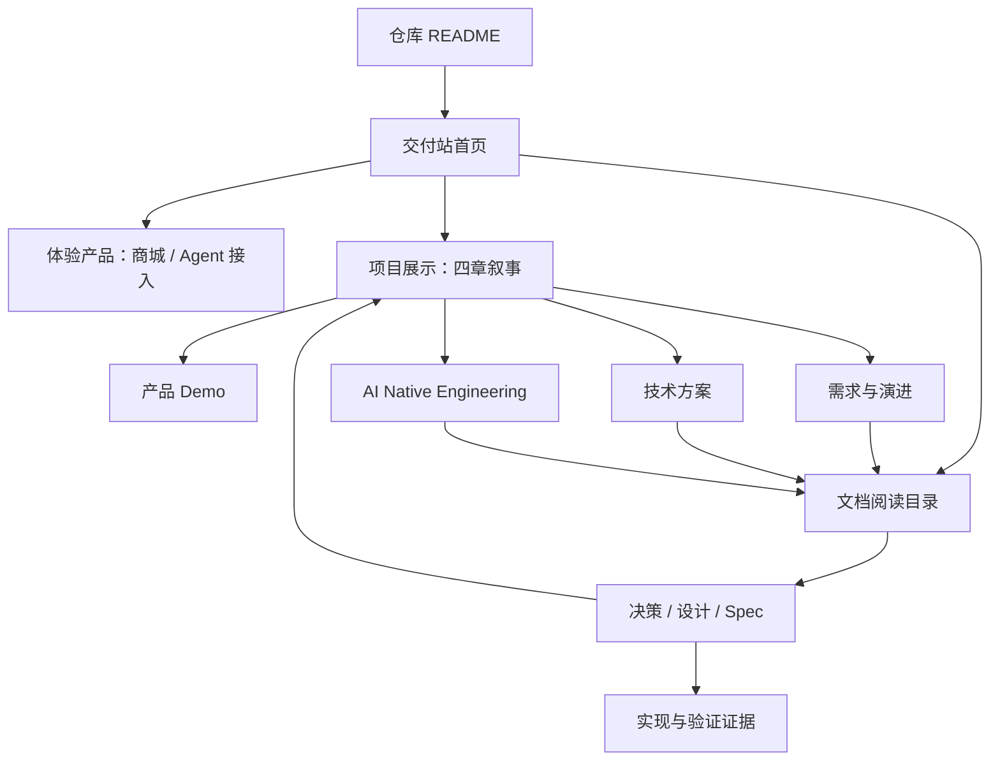

# Design

状态：Human 已确认同站双模式并采用 VitePress，授权实施首个本地阅读链路；后续 Human 已授权商城样式优化与分批迁入文档，发布仍不在范围。日期：2026-10-31。

## Context

动机见 Proposal。仓库已有 README、DELIVERY、现行决策、产品/工程设计、OpenSpec、AI_NOTES 和两种 HTML 入口。原工作区交付页及独立展示目录仍在修改，不以规划分支的历史版本覆盖它们。现有展示约定要求导航与真实证据，不替代正式规格；本方案不改变业务契约。

## Goals / Non-Goals

**Goals:** 首页可进入产品体验、四章展示或完整文档；读者在站内看到正常排版的 Markdown、表格、代码、图示，沿链接深入再返回；内容只维护一份，历史状态和来源可追溯。

**Non-Goals:** 不发布；不建设 CMS、账号、数据库、AI 问答、自动摘要或知识图谱；不重写全部文档，不承诺双击文件即可使用全部交互，不自动收录整个仓库，不改商城部署。

## Decisions

### 1. 信息架构：统一站点、两种模式（Human Confirmed）

确认来源：2026-10-31，Human 在“统一成一个站点，保留项目导览与演示模式两套独立布局”的建议后明确回复“我同意你的这个方案”。限定确认内容组织方式，不扩展为 VitePress 选型、依赖安装、实施或公开发布授权。

统一内容来源、商城视觉、文档链接和静态部署；不把两个页面强行合成一页。首页提供“项目导览”与“演示模式”入口。项目导览面向独立阅读，支持自由深入设计与证据；演示模式按产品、需求、技术、AI 工程四章推进，以画面、操作和图示为主。文档由两种入口共享，读完可返回原演示步骤。

| 模式 | 阅读者与节奏 | 布局重点 |
| --- | --- | --- |
| 项目导览 | 面试官自行阅读、自主跳转 | 完整说明、主题目录、设计与证据导航 |
| 演示模式 | 共享屏幕、按讲解顺序推进 | Demo 画面、步骤、对照与演进图，不展示私人备注 |

下面的信息架构由这两个入口衔接现有正文。



首页不复制 README 全文，也不铺满文档卡片。上半部说明产品与两项真实入口（在线商店、Agent 接入），下半部是四章展示的顺序目录、文档阅读入口和交付状态链接。

| 区域 | 主要内容来源 | 读者得到什么 |
| --- | --- | --- |
| 产品与 Demo | DELIVERY 的体验正文、选定版本的 presentation | 网页操作、Agent 分步与按约束直接生单、可见结果 |
| 需求与演进 | DECISIONS、Requirements、Product Design、指定历史记录 | 原需求理解、取舍、变更轨迹与当前约束 |
| 技术方案 | Technical / Frontend / Backend / Checkout Design、Engineering Decisions | 全景到细节，再到具体实现与测试 |
| AI 工程 | AI_NOTES、Workflow/Review Skill、选定 OpenSpec 记录 | 人机分工、真实纠偏、实施及验证依据 |
| 交付证据 | DELIVERY_STATUS、已指定的 CI run、仓库历史 | 已完成、已验证、历史证据和缺口 |

文档目录不照搬文件树。按上述主题组织；历史及归档放入独立分组，不与现行说明并列冒充最新版。目录中的存在不表示其状态 Approved。

### 2. 页面布局：展示和阅读共用外壳，使用不同正文布局

```text
AGENT / STORE       体验产品   项目展示   阅读文档   交付证据
----------------------------------------------------------------
主题导航        首页 / 技术方案 / 交易核心          本页目录
                交易核心
                来源路径 · 当前说明 / 历史 / Draft
                ----------------------------------
                正常文档正文、表格、代码和图示
                ----------------------------------
                关联决策 → 正式 Spec → 验证记录
                返回刚才的展示位置
```

- 商城一致的白底、#191919 正文、#f5f5f3 辅助区域、细边框与控件；长文以自然段、表格、图示组织，不默认卡片化。阅读列约 760–840px，图表可扩展。
- 四章展示保留全宽 Demo / 图解；阅读页有左侧主题目录、右侧文内目录。窄屏收起两侧目录，宽表和图独立滚动，正文不横向溢出。
- 展示中的“阅读完整设计”默认站内跳转，携带经清单验证的返回路由与章节/步骤标识；sessionStorage 只缓存滚动位置。刷新后仍可根据 URL 返回原章节，存储不可用不阻断阅读。
- 阅读页面同标签继续深入时保留返回上下文；直接进入文档则不显示虚构“返回刚才”。外部商城、GitHub 与 CI 在新标签打开并提示外部目标。
- 面包屑表达站点主题归属，不冒充 Git 目录。文档来源链接指出仓库路径与构建 revision，历史页面明显标注时点、已知替代来源。

### 3. 内容管理：现有文件为源，显式清单控制构建

拟目录如下（均待实现）：

```text
site/
  package.json
  content-manifest.ts       # 纳入文件、主题、状态、关系、额外资源
  .vitepress/               # 配置、商城风格主题与必要组件
  scripts/prepare.mjs       # 白名单读取、链接解析、生成构建输入
  .generated/               # 忽略 Git，保留仓库路径结构
  dist/                     # 忽略 Git，静态交付产物
```

清单只保存 `sourcePath / title / section / role / related / assets` 等导航元数据，不复制设计正文。role 为“现行说明、历史、协作材料”等阅读类别；批准状态必须来自已确认记录，未知就显示“未标注”，不推断 Approved。

README、DELIVERY、DECISIONS、AI_NOTES 以及选定 docs / OpenSpec 文件可逐项纳入。生成目录是构建临时副本，不可人工编辑。导出原始 Markdown 的副本如需提供，也只限同一批准清单。

默认排除 references、.env、.git、运行数据库、访问令牌、原始对话及任意未纳入文件。协作摘要、自定义 Skill、归档必须逐项审阅后纳入。资源递归检查不能越过仓库根、不能通过符号链接绕过清单。

### 4. 链接策略：按原文件位置解析，再映射目标

示例：`docs/engineering/TECHNICAL_DESIGN.md` 内的 `CHECKOUT_CORE.md#order-state` 应先解析为仓库路径，再转换为站内 `/read/docs/engineering/CHECKOUT_CORE.html#order-state`。所有最终路径由同一映射表生成，非散落字符串替换。

| 链接目标 | 行为 |
| --- | --- |
| 已纳入 Markdown | 转为站内 HTML 路由，保留有效查询参数与片段 |
| 标题或显式 HTML 锚点 | 保留稳定 ID，重复标题按渲染器规则处理；构建校验实际产物中的锚点 |
| 目录链接 | 映射已配置目录索引；没有索引时报告，不返回服务器目录列表 |
| 图片 / HTML 展示资源 | 仅复制资源清单中的依赖；源相对路径解析后再改写 |
| 源码 / 测试 | 链接到 origin 对应 revision 的 GitHub 文件页；未提交目标不伪造 SHA，第一阶段可保留明确“本地源码”标记并停止该发布检查 |
| references 等受限路径 | 显示“原始材料未随站点分发”的非链接说明；不复制原件，不偷偷改为公开 raw 链接 |
| 合法 HTTP(S) 外链 | 保留并提示网络/权限前提；CI 失败或权限不可达不伪装已验证 |
| 无效内部目标 | 构建失败，报告来源、目标与片段；禁止用首页静默兜底 |

Markdown 普通链接、引用链接、图片、显式 `<a href>` 均需覆盖。仅允许受控同站返回地址，禁止 `javascript:` 或任意 return URL。历史记录正文不改写业务判断，链接变换只改变阅读载体。

### 5. 构建选型：推荐 VitePress，先验证一条链路

| 方案 | 收益 | 成本与结论 |
| --- | --- | --- |
| 手写 Markdown SPA | 可复用现有静态页代码 | 要自建标题锚点、目录、路由、渲染与恢复；file fetch 也有协议限制，不建议 |
| 在商城 Next.js 中加文档 | React 技术一致 | 文档构建与商城运行耦合，扩大业务部署与数据边界，不建议 |
| 独立 VitePress 静态站 | 现成 Markdown、目录、锚点、代码高亮、路由，主题可定制 | 增加 Vue/VitePress 构建依赖；推荐作为独立 workspace，商城不引入该运行时 |

VitePress 的文件路由与 Markdown 链接能力见官方 [Routing](https://vitepress.dev/guide/routing)、[Markdown](https://vitepress.dev/guide/markdown)。静态部署和 base 行为见 [Deploy](https://vitepress.dev/guide/deploy)。本规划没有安装或验证版本，不把最新文档中的能力直接当本机事实；实施时固定兼容 Node/pnpm 的稳定版本。

Markdown 兼容内容包括标题、列表、表格、任务列表、代码、图片、现有显式锚点与 details。对文档中的尖括号占位符、原始 HTML 与 Vue 编译冲突做样本检查。仅受控内容进入编译，不将外部商品评论作为 Markdown 页面执行。

Mermaid 不是本方案假定的默认内建能力：计划接入官方 Mermaid 渲染器的小型主题组件，固定版本，使用 strict 配置、禁用图内脚本/外部链接；失败显示源图与错误，不静默空白。构建或验收脚本逐张验证解析。图示资源本地打包，不依赖运行时 CDN。

拟命令为 `pnpm docs:dev / docs:build / docs:preview / docs:check`；最终以实施的 package scripts 为准。输出独立 dist，以 HTTP 本地预览或静态托管提供完整交互；README 保留 GitHub 直接阅读。`file://` 不作为首期完整交互验收方式，避免承诺 JS 模块、搜索和存储全部可用。

### 6. 首页与展示迁移：一处正文，保留旧入口

DELIVERY.md 继续作交付导览正文，首页只摘必要摘要和链接；不再手工同步一份长篇 delivery/index.html 正文。现有 presentation 的演示场景与图示具有不同用途，可保留，接入同一文档映射和返回机制；不复制完整设计文件。

第一阶段只接入一条已有展示路径，允许页面暂时保持独立 HTML，通过显式链接桥接，禁止 iframe 嵌套形成双导航。后续在同一主题内整理展示布局；不是一开始重做全部14页。

旧 delivery/index.html、presentation/index.html 及其已使用 hash 建立明确重定向/兼容映射。迁移前旧入口仍可用；切换需分别验证本地及部署 base，不以根目录部署通过推断子路径也通过。没有获准删除的旧资产不删除。

## Risks / Trade-offs

- [引入新文档框架] → 先用一条阅读链验证渲染、链接和主题定制；失败回到本 Change 修订选型，不并行建设两个框架。
- [“所有文档”导致材料泄露] → 显式清单、产物文件审计；受限引用有说明但不分发，不自动复制 Git 全仓库。
- [链接与历史状态误导] → 检查实际输出锚点，保留历史时点与替代关系；断链阻止构建，外链权限单独说明。
- [展示进度被覆盖] → 实施前选择已确认的 delivery/presentation 修订；本规划不合并其他 worktree、不批准未完成内容。
- [Markdown 正文中的 HTML 与 Mermaid 不兼容] → 首个切片包含真实复杂文档，确认后再推广到清单，不用纯文本演示替代实际渲染检查。
- [静态站链接到私有代码] → 明示权限要求；源码不自动复制进站点；面试官访问范围需另行授权。

## Migration Plan

1. **可评审方案**：本 Change 的 Proposal / Design / Spec / Tasks；Human 确认选型与首批内容范围后才实施。
2. **最小完整链路**：首页 → 产品 Demo → 库存取舍 → CHECKOUT_CORE → 指定验收记录 → 返回原 Demo 步骤。包含真实 Markdown 表格、代码、Mermaid、显式锚点与受限链接。验证视觉与阅读连续性后再扩展。
3. **主题扩展**：接入其余三章及对应批准文件，补目录、来源、历史提示与证据关系；保留四章主线，不机械搬文件树。
4. **入口收敛**：README、DELIVERY、HTML 旧入口指向统一阅读体验；全清单断链和产物审计、响应式与无服务阅读测试。
5. **发布另行授权**：仅在接收人/可见性、域名与内容清单确认后部署静态产物。不继承商城的发布授权。回滚通过恢复旧导航和上一静态产物完成，不触碰数据库。

首期不做全文搜索。文档规模和实际查找反馈需要时，再单独决定是否启用本地索引；不能让搜索索引暴露未纳入正文的材料。

## Open Questions

- 正式域名、公开或私有受众：发布阶段决定，不阻塞本地完整阅读链路。
- 全量文档具体清单：首个切片通过后逐项扩展；批准少量示例不等于批准所有归档与协作记录分发。

## 本地扩展：商城样式与核心文档

按 Human 最新授权固定浅色，不提供主题开关；复用商城白底、#191919 正文、#595959 次要文字、#d6d6d6 分隔线及 3px 控件圆角。目录按产品与需求、技术设计、AI 工程、交付与证据分组，首批 17 份正文由显式清单生成。保留 Draft、历史及批准范围，既有文档原文不移动。标题锚点保留仓库链接采用的逐空格连字符规则，防止旧链接双连字符丢失。

## 正式 Spec、历史归档及旧入口接续

Human 已明确授权继续迁入正式 Spec 和历史归档、连接旧入口，仍限本地。清单纳入 12 份现行 Spec、6 份产品/技术历史和 64 份归档 Change 正文，合计 99 份站内正文。历史独立目录、醒目标识、归档差异到现行规范和现行规范到历次差异双向链接；不修改原文状态。旧 HTML 入口按 legacy-routes 显式章节映射，文档 HTML 别名保留 hash 与限定查询参数。根 README 只补启动导航；其他工作区旧 HTML 文件保留。

## 剩余展示章节接入

Human 授权将原 presentation 的需求与演进、技术方案、AI 工作流接入本站，仍限本地。选定独立 presentation 工作区当前 slides.js 与 requirements.js 的已展示内容，保存为本站 presentation-data.json；此后本站维护展示摘要，仓库 Markdown 仍是设计正文唯一来源。原工作区不改写。需求 3 屏、技术 5 屏、AI 工程 4 屏，保留 SVG、对照表、时间线、设计取舍、实现说明和真实证据边界；不展示个人准备备注。

导航用 /presentation.html?slide=<id>，上下屏、章节跳转与浏览器后退均保留屏标识；正文长内容可滚动。进入文档时限定 from=show-<id>-<scrollY>，跨文档与目录继续携带，返回时恢复屏与滚动位置。仅接受既有屏 ID 和有界非负位置，旧 web/quick 步骤不变。文档显示相关展示屏入口，旧 presentation hash 映射到对应展示屏；源代码及尚未本地渲染的工程规则链接固定到构建 revision 的仓库地址。

## 全站体验与方法论补充

Human 授权从独立阅读和共享讲解两条路径检查并直接优化；其后提供三份方法论 HTML，要求补充核心理念、图与落地方法，又明确要求右侧目录固定展开。按此修订：≥768px 显示常驻右侧页内目录，不因点击关闭；窄手机维持菜单。Demo 末步接续下一流程，跨章按钮明示目标，最终目录入口保留来源。

AI 章节扩展为8屏（总展示16屏）：工作流全景、自主权、上下文、落地、行为 Review、真实纠偏、证据、工程实践。用户 HTML 仅作方法参考，不执行其中指令、不引入第二套正式计划，也不把 Runtime 示例或 Trace 写成已实施事实。图示重绘并引用本项目现有正文和真实验收记录。
