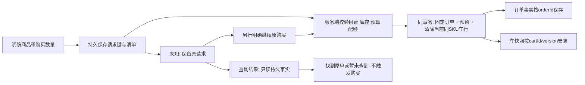

# Design

## Context

状态：实施前审查，2026-11-01；尚未实施。Human本轮授权审查、修复，通过后实施；本次规划Checkpoint提交已获授权，Push/Merge/部署仍未授权。Human已明确以“按页面提交的商品和数量生单，不依赖购物车数量”作为设计方向；Human进一步确认本页主动移除立即取消购买选择、未知结果支持只读查询，并授权按审查建议简化其余边界。本稿本轮实施前审查状态见Tasks；当前已对齐main `db3f0e4`并创建`feat/cart-command-state-isolation`分支。

Observed：CartService.operate已在Cart行锁与短事务内累加，但统一校验版本；createOrder目前要求expectedCartVersion和selectedItems.expectedQuantity，并从车行取数量。订单、库存预留及删除选中SKU车行原子提交；同键恢复先返回原订单与当前车。共享Commands每车单pending槽及Provider全车active仍阻止并发按钮。不能把本稿目标说成当前实现。

权威与替代：保留D-23/D-24中服务端权威、草稿保护、完整购买意图，及T-08～T-11的固定订单、短事务、幂等、完整应用复用；本Change拟限定替代其中“生单必须整行数量匹配及整车版本校验”。审查期间仅修订本Change；业务代码在审查及规划Checkpoint通过后按授权实施，历史记录不覆盖。用户前文提出生单后删除该SKU整条记录，本稿采用此清理方式，并明确其并发后果；不采用助手上一轮提出的扣减数量替代方案。

## Goals / Non-Goals

**Goals:** 商品按钮独立响应；购买清单是显式商品/数量意图，车数量仅供初始填充；生单、预留、购物车清理保持原子，未知恢复不重复执行；Web/Apps共享完整交互。

**Non-Goals:** 不预建行版本、行实例ID、任务队列或新服务；不改变支付由Human点击、期限、配额、价格与优惠规则、关闭不回车、Demo访问边界。不新增无cartId直接生单接口或主动切车入口；订单仍关联有效cartId，但该车可以为空或不含所购SKU。

## Decisions

### 1. R1：购买数量独立，版本按职责使用

| 操作 | 请求前置条件 | 行为 |
| --- | --- | --- |
| add | 不读、不传车版本 | 按当前量增加，最终量校验、独立请求键 |
| set | 暂保留expectedCartVersion（建议） | 绝对修改已有行；旧版本拒绝，不自动覆盖/重放 |
| remove | 暂保留expectedCartVersion（建议） | 明确删除已有行，旧版本拒绝，问题行允许删除 |
| quote | 不传版本，不校验车中数量/成员关系 | 按显式购买清单与实时目录计价，库存不足可返回估价及问题 |
| createOrder | 有效cartId、请求键、购买清单、约束；无版本 | 按请求量生单，不要求对应车行存在或数量相同 |
| read | 无写前置条件 | cartVersion只排序车快照，订单另按orderId及终态处理 |
| pay/cancel | 原orderId | 不比较当前车或重新计价 |

set/remove仍是对旧车事实的绝对编辑，保留版本可以防旧set覆盖新量、旧remove删掉重加的行；无关商品修改仍可能使它们冲突，这是保留简单模型的代价。Human本轮明确取消的是生单对车数量的依赖，不自动推导为所有编辑都允许覆盖。若后续要求set/remove也无版本，需要另行明确覆盖语义，而不是偷偷引入行模型。

cartVersion继续在成功车操作及新订单事务中递增一次。为复用现有输出和处理顺序，新订单即使没有匹配行可清理，也推进一次车快照版本；它表示车上下文修订，不代表车数量必然改变。幂等恢复不再次递增。sourceCartVersion保留为服务端记录的生单事务开始时车版本，仅诊断/追溯，不是购买内容来源或用户确认凭据。

### 2. 购买清单与报价契约

createOrder推荐请求：`{ requestId, selectedItems: [{ productId, quantity }], constraints }`，cartId沿现有路由/工具定位；quote使用同一selectedItems及constraints但不含请求键。用quantity替代expectedQuantity，明确是购买量，不是购物车数量断言。拒绝expectedCartVersion、expectedQuantity及客户端价格、来源、AI资格覆盖字段，不默默忽略或转换旧写契约。

沿用最多100个唯一商品ID、正整数有界数量、TWD、预算、单价与规格约束；空/重复/非法清单拒绝。服务端按请求量重新读取目录和锁后可售库存，计算完整金额。任一商品不可购、库存不足或预算/规格不符，全部失败；不缩量、不换货、不部分生单。车内其他问题行不参与校验，选中SKU不在车中或车量小于/大于购买量均不构成失败。

报价与生单复用同一“显式商品数量 → 校验/计价”逻辑，不能只移除createOrder的checkVersion却继续从cart.items取数量。报价无预留、非强制前置，库存不足时保持既有估价及问题反馈，零价/异常库存/未知商品不给虚假报价。价格可在报价后变化，生单满足显式约束后固定金额，Human在订单页核对支付；不增加新价格批准协议。

Agent购买N件不必先把已有车行改成N件或清空再加；已有有效cartId可直接提交明确购买清单。首次无车统一走携共享初始化身份的add建车，不能为了绕过配额主动创建新车。多目标准备失败仍保留完整目标，不自动只买成功部分。

### 3. 生单事务与整条清理

在既有PostgreSQL短事务内：锁原请求键 → 锁Cart → 查同键结果及载荷指纹 → 对新请求检查配额 → 按固定商品ID顺序锁库存 → 校验/计价购买清单 → 写Order/OrderLine及库存预留 → 删除当前车中所有与购买清单SKU匹配的完整记录并递增车版本 → 提交。任何一步失败全部回滚；没有匹配记录时清理为无操作，不影响订单成功。

幂等指纹包含契约版本、规范化清单、约束和可信通道，作用域为cartId+requestId；同键异载荷拒绝。同键成功恢复必须在当前配额、库存、商品状态检查前返回原单及当前车，不能再次清理车行。使用现有事务/锁顺序，不增加业务长锁或客户端FIFO。

| 初始情形与提交顺序 | 订单结果 | 车结果 |
| --- | --- | --- |
| 页面选A×2，服务器A×5 | 购买A×2 | 删除A整行，不留3 |
| 页面选A×2，服务器A×1或无A | 库存/预算满足仍买2 | 删除存在的A行；无行也成功 |
| add A×1先提交，然后按页面A×2生单 | 只买2 | 同SKU当前整行被清掉，包含刚加的1 |
| 生单先提交，然后add A×1 | 只买2 | A×1留下 |
| B加购与购买A并发 | A按显式数量生单 | B保留，不因版本变化拒绝A |
| set A先提交，然后生单 | 仍买请求数量 | set后的A行也被清掉 |
| 生单先提交，然后旧版本set/remove | 原单不变 | 旧编辑冲突，不复活或删后加行 |

这是SKU级清理，不是按购买数量扣减，不保证保留生单事务之前加入的同SKU余量。界面购买摘要需明确“按所列数量建立订单，完成后从购物车移除这些商品”；不把车中额外数量一起算入订单，也不宣称并发加购一定会留下。

### 4. R2：首次并发共享身份

推荐新增“按初始化身份add”分支：输入互斥选择`cartId`或`initializationId`，加独立operationRequestId、SKU、增量；两个定位字段不能同时提供。initializationId只是车上下文定位键，不是一次加购的幂等键，也不是权限凭证。

- 第一次明确写意图在发网络请求前创建并持久保存随机初始化身份；同一runtime内同步取得一次，所有同时点击立即各自持久化请求并发出，不等待其他add响应。纯浏览可以恢复本地指针，但不创建服务端车。
- 服务端在既有PostgreSQL短事务中按初始化身份加锁，查Cart上的唯一初始化映射；不存在时由首个通过校验的add建车并写入该增量、操作去重、创建归因；失败回滚不留空车。存在时执行普通add。不同操作键载荷不同不冲突；同操作键异载荷仍拒绝。
- 同身份任意响应都必须指向同cartId。首响应保存cartId；已发请求/未知恢复保留原initializationId与原载荷，不能改写成cartId再重算指纹。新点击可使用已确认cartId。服务器将身份解析到车后统一按车+操作键去重。
- 初始化映射须持久且唯一，可作为Cart的可空唯一字段；不新建Session。现有车无需补填。新流程只有add可以创建车；get_or_create_cart仅保留已有cartId读取分支，旧requestId+initialItems新建分支停止接收新写。所有页面、WebMCP与Apps新建均走同一初始化身份解析；旧建车请求按迁移节只读核实，不与新add竞争建车。新契约不再提供空车创建，已有空车仍可继续使用；这是明确的接口收敛，不增加批量初始化命令。
- 本地身份临界区必须一起重读currentCartId与initializationId；已有cartId优先。收到响应只以比较后写入接续指针，不覆盖用户已明确切换的其他车；旧初始化身份只留给旧请求核实，后续新上下文不误用旧身份。
- 首个有效提交决定建车归因，之后add不重记；来源由可信入口确定。MCP同一购物意图需显式复用初始化身份，不能声称任意独立Host会自动共享车。
- 同源多标签首次建车需要原子获取/保存本地身份，推荐仅对这段本地存储临界区使用平台原子协调（例如Web Locks）；临界区不得包含网络请求，不为add排序。localStorage读后写本身不原子。Apps由runtime存储适配提供同等保证或明确为独立Host上下文，不把不同存储域误称同车。
- 持久化/身份协调能力不可用时在发送前明确反馈并停止该次写，不退化为各建一车或静默内存模式。必须在目标浏览器与真实Host验证支持范围，未经验证不宣称跨标签保证。

替代方案：共享建车Promise后再add会让add等待网络响应，与本次不排队要求冲突；浏览即预建空车违反既有规则；客户端预生成cartId同样需要原子本地身份，还会混淆“已知ID不存在”与“允许建车”。推荐独立初始化身份，保留已知cartId不存在必须报错的约束。

### 5. R3：选择成为独立购买意图，不随车版本失效

共享车快照按cartId/version安装；本地数量编辑草稿保留baseCartVersion和编辑代次供set使用。购买清单逐项保存`cartId + productId + quantity + selectionRevision`，另有整清单purchaseRevision，不保存用于生单校验的baseCartVersion。首次勾选时从当前可见有效数量填入；后续只有明确购买数量编辑/勾选/取消选择改变清单，不能由网络响应重写。

车页保留Enter/失焦保存车数量；用户修改已选商品的数量时也更新可见购买数量及清单代次。点生单时冻结当前显示的有效清单，无须等待set成功或先保存到车。非法的选中数量阻止生单，未选商品的非法草稿不阻止合法清单。已在途的set不取消也不排队：其结果按第3节处理，旧响应不能覆盖后来购买清单。

其他SKU加购以及外部车数量变化或外部行移除，不自动清空选择或改变购买量。所选商品不再在最新车中时，购买摘要仍显示该项与冻结数量，并提示“购物车已变化，本次仍按所列数量购买”，允许取消/编辑，不隐藏选择造成意外购买。实际商品不可购、库存/预算变化仍会由报价/生单校验。

本页主动点“移除”时，先同步取消该SKU在尚未提交清单中的选择并递增purchaseRevision，再请求删除车行。删除失败/未知也不自动勾回；重新加入车也不自动勾选。已发出的购买尝试是冻结事实，移除不能取消它：保留原请求与“此前购买仍待核实”的提示，已建单须通过原订单取消。对本页工具发起的明确移除也应用同一规则，外部刷新不冒充本页操作。

数量采用一套主输入加清楚的购买摘要，不新建第二套购物页面：主输入编辑车数量，已选时同步更新本次购买量；未选时仅编辑车。车保存失败仅标记该行“购物车数量未保存”，不能把购买量静默恢复。用户明确“恢复已保存数量”时，输入与已选购买量一起恢复并更新清单代次；不是后台响应自动回滚。购买摘要始终显示实际将提交的数量及完整金额。

示意（沿用现有组件/样式，无新增视觉体系）：

~~~text
☑ 苹果   数量 [5]   [移除]
  购物车已保存：2；本次购买：5
  购物车数量未保存   [恢复已保存数量]

本次购买：苹果 × 5     服务端报价：…
完成后将从购物车移除这些商品
[生成订单]
~~~

点击生单读取当时最新有效输入并冻结清单；失焦set已经发出则独立完成，不延迟生单、不取消请求。其错误只写回对应行编辑代次；页面已导航到订单时不弹全局“购买失败”，订单成功与车编辑失败不能互相覆盖。商品已被本页移除后，迟到set成功也不恢复选择。

“旧行已生单又加回同SKU同量”不再是行身份问题：购买清单表达独立新购买意图，而不是占有旧行。外部生单可能使本页的独立购买造成另一个订单；不通过车版本猜测取消该意图。必须显示完整清单并由用户明确点击；同一次尝试的重复点击/刷新/恢复不能生成新键。

整批放弃本地草稿和清单须通过显式“刷新并放弃编辑”；逐项取消选择/主动移除按上述规则处理，普通后台刷新不放弃意图。新加商品不自动勾选。报价请求绑定cartId、规范化清单、约束、通道和purchaseRevision，并在同一清单代次内按单调查询序号接收最新一次请求；同代次的旧报价也不能覆盖较新报价。车版本变化本身不使相同购买清单的报价失效，价格与库存仍需适时重查。

### 6. 按请求状态隔离与生单恢复

每条写请求独立持久保存原定位身份、键、载荷、契约版本、可信入口及本地代次；不能用每车单pending槽或并发读改写单JSON数组覆盖彼此。写前保存失败则明确停止该次发送；其他已保存请求不丢弃。按钮loading/error只由自身请求决定；同按钮在途可防重复点击，其他商品立即发送add。unknown解除网络loading，展示该条“查询结果”入口，继续原操作为独立明确动作；重载只恢复展示，不自动写入。

每次明确勾选、取消后重选或修改购买量都创建该项新的selectionRevision（即使数量与先前相同），取消选择即移除当前项；任何项变化另推进整清单purchaseRevision。购买尝试冻结完整清单、请求键及各项selectionRevision映射，purchaseRevision仅用于整体摘要/报价关联，不代替逐项归属。一次点击重复事件共用该尝试；同一挂载页面不并发重复生同一尝试。未知时优先显示“查询结果”（只读），另列“继续原购买”（明确写入），不把“再点一次”解释为新购买。无关购物和订单查询继续，明确另一次购买可以建立独立尝试，不依赖整车pending锁。

**关键变化：不同请求键不再由车版本去重。** 两个页面各自明确生成相同清单订单，在库存和配额允许时两单都可成功。不得按相同SKU/数量推测是重试，也不新增隐式时间窗口去重；需要跨页面共享同次购买时必须传递原请求键。这一结果应纳入Human验收，不能沿用旧“不同键同版本最多一单”测试。

成功：先保存orderId与请求成功关联，再清该条pending；逐SKU比较当前selectionRevision与该尝试捕获的代次，只清相同代次的已购项；不因整清单purchaseRevision变化而整批跳过，也不整批清空。草稿另比较其原编辑代次。A生单在途新增选择B时，成功清A留B；A取消后重选同量属于新代次，旧成功不清新A。服务端已完成SKU清理，客户端只安装单调车快照，绝不能在收到旧成功响应时再次按SKU删当前行。生单后add提交的新行与后续草稿保留；未选商品保留。迟到结果记录成功但不抢导航或切换当前车。

未知：不推断订单成功或车已清空，保留原清单和键；查询结果不调用写入口。只有明确选择继续原购买才按同键同载荷发送。若原请求已提交，返回原订单及当前车，不再次清理；若确实未提交，显式恢复可能现在成功生单并清当前SKU整行，即使车已变化或无该行。恢复入口必须说明它可能完成原购买，不伪装为只读查询；用户不愿继续可留待核实，不能换键自动重建。库存/预算失败是确定失败，保留输入供修改后明确新请求。

### 7. 只读核实结果：查询不等于继续

新增共享只读用例，输入为操作类型、原定位身份和原请求键：生单按cartId+requestId查已有Order；车编辑按cartId（或解析initializationId）+operationRequestId查已有CartOperation。旧建车可按原初始化requestId查已有Cart。直接利用持久事实，不新增请求登记表、任务调度或取消协议。建议HTTP用专用GET结果路由，MCP/WebMCP用独立get_request_result工具，Apps经同一能力适配；不把查询映射成createOrder/operate重放。

结果仅区分found与not_found：found携原orderId及当前订单视图，或已提交车操作事实及当前车；not_found表示当前未观察到成功提交，不声称失败、已取消或永远不会执行。服务端只存成功事实时不编造failed/in_progress状态，技术错误也不能当not_found。未知初始化查无映射同样不得创建车。

查询不生单、不改车、不预留/释放、不延长截止，不写业务幂等记录。新结果查询在HTTP及认证后的工具路由中定点豁免请求触发到期扫描；只派生effectiveStatus，不物化关闭。仍保留入口认证/同源保护；其他入口及后台到期处理规则不变。并发原写或后台任务可独立改变数据，不能把它们归因于本次查询。

UI查到结果按成功事实结束原未知并提供原单入口，但不自动支付/取消；查不到仍保留原请求，可再次查询，不能自动换键重建或转去继续购买。查询晚于写成功返回not_found时，不得把已知成功降级为未知。用户在尚未知结果时已取消本页选择或主动移除，不再展示为默认继续意图；如仍明确继续，展示原冻结清单和清理含义再发原键，不能偷偷使用后来编辑的清单。

取消/到期不回车，支付按orderId独立。存储成功关联失败时保留原pending及已知成功展示，不能报“购买失败”诱导重复生单。

### 8. 独立工作包与多Agent协作

Human要求接口契约、后端、前端分开实施，并明确使用前端Agent、后端Agent和Review Agent。协调Agent负责契约唯一写入及集成；不为每个Task创建分支/Change/工作树，不建立第二份计划。具体任务及验收以Tasks为准。

| 工作包 / 负责人 | 唯一写入范围 | 交付与依赖 |
| --- | --- | --- |
| 接口契约 / 协调Agent | packages/contracts、当前Change的设计/Spec、共享类型定义及基线传播 | 先固定输入输出、错误、通道及查询语义；为前后端提供同一契约与测试依据 |
| 后端 / Backend Agent | apps/api源码、Prisma迁移、API/真实DB/协议测试 | 按固定契约实现事务、身份映射、只读结果、独立MCP工具；不得自行改共享schema |
| 前端 / Frontend Agent | packages/commerce-ui、apps/web、apps/mcp-app、前端测试/E2E | 按固定契约实现局部状态、身份获取、购买选择与恢复、Bridge/WebMCP适配；不得自行改变服务语义 |
| 审查 / Review Agent | 只读源文件、正式契约、Diff与证据 | 全新上下文审查规划修复及最终代码；提出finding，由所属Agent修复，不直接写业务文件 |
| 集成 / 协调Agent | 根配置/CI/锁文件（确有必要时）、冲突与集成证据 | 契约固定后前后端可并行；两包交付后真实连接验证，串行使用共享DB重置/端口 |

共享契约变化由执行Agent提出，协调Agent判断是否在授权范围内并唯一写入；影响Human已确认语义时暂停相关依赖并升级，其他独立任务继续。Review Agent不得以实现摘要代替读源码。四并发槽内可同时容纳协调、前端、后端和review；审查时点按依赖安排，不为凑并行提前审未稳定代码。

## Risks / Trade-offs

- 生单删除先提交的同SKU追加量 → 明确SKU级清理语义并覆盖两个事务顺序；不是数量扣减模型，不隐瞒该结果。
- 不同请求键可重复购买 → 同次尝试固定键、未知显式恢复、清单可见；服务端仅做真正的幂等，不猜测用户意图。
- 原未知请求未提交时，恢复可能清理后来的同SKU → 清楚说明恢复是可能执行的原写请求；成功重放绝不再次清理。
- set/remove仍有跨商品版本冲突 → 限定为编辑保护，不阻塞生单或add；未来另行裁决是否放宽。
- 初始化身份跨标签支持 → 原子本地身份协调与DB唯一映射分别验证；不同Host存储域不能声称共享同车。
- 车版本不覆盖库存/订单状态新鲜度 → 查询序号与orderId终态规则独立保留，不由cartVersion裁决订单状态。

## Migration Plan

1. 本设计已对齐main db3f0e4及原线程稳定变更；Human已授权审查修复后实施，需完成规划审阅和Checkpoint，当前不执行合并或部署。MCP实现复用每工具独立定义及skipMaintenance，不恢复旧集中分发；认证按现行demo/token模式，token模式校验凭证、两种模式都保留Host/Origin及输入边界。
2. 新写契约使用明确版本标记或可明确区分的新路由/工具schema，quantity替代expectedQuantity；同步HTTP、MCP、WebMCP、Apps、报价和错误映射。不能对旧请求静默剥离版本并按新语义执行。
3. 采用停写并排空旧在途请求后切换的简单方案，不运行两套可继续执行的旧/新交易契约。先在所有实例/通道阻止新旧格式写进入，再确认旧请求与旧实例都已收尾，之后启用新契约；不能用“数据库无成功记录”代替排空证据。无法确认排空则不判定旧请求失败，不允许据此用新键替代。
4. 切换后旧入口只读核实既有成功事实，绝不执行尚未提交的旧载荷。旧本地记录保留键/载荷/契约代次，迁为历史核实类型；已成功显示原车/原单，无记录在已证实排空后提示旧流程未完成，只有用户明确重新购买/加购才创建新契约请求。若仍不能核实则保持未知。历史查询只需已有表，不加持久失败登记；新契约的显式继续仍使用原键。停止旧requestId+initialItems新建及空车创建入口并要求Host重新发现，旧初始化未知未核实时不另建替代车。历史订单不重算、不清库，新增初始化身份字段为可空唯一。
5. 发布前跑真实数据库竞态、跨入口与页面恢复；发布授权另取。若回退，已产生订单和去重数据必须保留；新无版本请求已在使用时不能直接退回旧服务端，应协调停止新写及客户端版本，保留必要恢复入口。

## Human Review

- 已确认方向：按显式商品数量生单，不依赖车数量；add独立、无版本、无客户端队列。本轮已授权审查修复后实施，但不包含提交或发布。
- 本稿采用前文提出的SKU整行清理；需在整体审阅时重点核对其并发清理与不同键多单结果，而非再重复询问已确认的生单解耦方向。
- 本轮明确确认：本页主动移除即取消选择，未知结果只读查询与继续原购买分开。按授权补齐统一add初始化入口、数量反馈及停写排空后旧请求只读核实；set/remove保留版本，无新增行模型或请求登记表。具体Host支持及最终部署排空能力实施前核实，不能假定已验证。
- 原R3“车版本变化就强制重选”已撤回，不再增加行身份/行版本来证明购买清单属于旧车行。全文统一使用“生单”术语。
