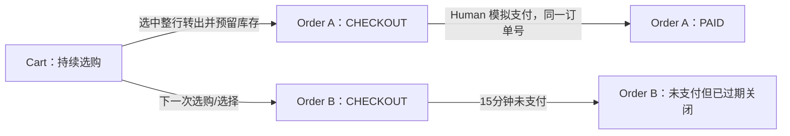

# Design

**Draft v0.11 — 购物车、待支付订单与库存生命周期；下一里程碑设计输入。**

2026-10-30，Asia/Shanghai。依据 [Proposal](proposal.md)；调查基线 `main@0ece77a`。本轮只做静态梳理和设计，未执行业务实验、开发或迁移。Human确认的规则列于§0；本轮已授权采用上一轮建议，具体技术默认值列于§11，仍未授权实施。

架构总览与分层正文见[Technical Design架构总览](../../../docs/engineering/TECHNICAL_DESIGN.md#order-lifecycle-architecture)，选择理由与限定替代关系见[T-08～T-11](../../../docs/engineering/ENGINEERING_DECISIONS.md#order-lifecycle-decisions)。本文件保留变更级接口、事务、恢复和验收细节，不复制全局架构正文。

阅读顺序：§1 当前逻辑 → §2 改动映射 → §3～§9 技术草案 → §10 迁移 → §11 采用结论 → §12 验证边界。

## Context

### 0. Human 已明确的下一里程碑规则

| ID | 本聊天的明确要求 |
| --- | --- |
| H1 | 按商品整行勾选，全部数量进入订单；不能直接从 3 件中只买 1 件。少买须先在车中改成 1 件。 |
| H2 | 生单成功后选中商品从车中移出，不保留该行余量；再买须从商品选购入口重新加入。 |
| H3 | 可有多笔待支付订单，生命周期独立，不因另一单准备/取消/支付而失效。 |
| H4 | 待支付订单占库存。 |
| H5 | 明确购买意图时 Agent 尽量完成必要步骤并直接生单、展示支付界面；咨询不下单。 |
| H6 | AI 优惠按本次由 AI 发起生单触发，仅 AI 咨询/加购不够；Human 支付既有 AI 订单仍有资格。 |
| H7 | 本轮只梳理和设计，新里程碑再开发。 |
| H8 | 只使用 Order 业务实体；CHECKOUT 是待支付状态，PAID 是已支付状态。Agent 创建订单，Human 确认即执行模拟支付。 |
| H9 | 未支付订单从成功创建起固定预留 15 分钟；读取和重试不续期，到期释放。 |
| H10 | 生单即固定商品价格、优惠和应付金额，15 分钟内不变；超时关闭原单并释放库存，重新购买按当时价格/优惠生成新订单。 |
| H11 | 当前持有的cartId唯一定位购物上下文；可恢复原车时不另开新车，不提供主动新建/切换购物车操作。该索引不等同于身份认证。 |
| H12 | 订单号全局唯一，订单必须关联来源购物车，Cart 一对多 Order；单车支持多笔待支付订单，上限由 env 配置，默认10笔。 |
| H13 | 新流程切换时清空旧流程数据，不保留旧流程兼容或历史订单迁移；本轮仍只设计，不执行清理。 |
| H14 | 本轮替代原会话期限方案：购物会话持久化，不设业务到期时间；保留车ID就复用原会话。缓存TTL不结束会话，窗口关闭不触发服务端删除；本地材料丢失不等于数据被删除。 |
| H15 | 订单记录与查看不设24小时截止；库存/支付仍固定15分钟。本人跨入口接续完整会话，分享只限单订单；已有不同会话不自动覆盖或合并。 |
| H16 | Demo本轮不设计权限/凭证/签名/Review流程；以cartId、orderId和页面上下文接续，Human点击模拟支付。采用§9三项交互选择及本轮简化，不授权开发。 |

H3 不意味着可重复占用同一份实物库存；不同订单竞争同一 SKU 时仍受可售量约束。H8 使“订单已创建”和“购买已成功”成为不同事实；后者只对应 PAID，工具和 UI 都须区分。H9 不引入真实支付网关。

Human已授权按审查建议统一整理设计：关闭不回车、订单行固定、会话统一管理关联订单、基础MCP使用网页支付入口等已纳入设计；已采用结论见§11。设计采用不等于实施授权。

### 1. 当前逻辑梳理（Observed）

独立工作区从初始 S5 的 `66b2e0a` 更新为 `main@0ece77a` 并建立 `codex/checkout-lifecycle-design`；主目录独立。下表描述当前代码，而非草案目标。

| 层面 | 当前行为与证据 | 对新需求的限制 |
| --- | --- | --- |
| 模型 | [schema.prisma](../../../apps/api/prisma/schema.prisma)：Order.cartId 唯一，Order 仅在购买成功后存在；PurchaseReview 多对一绑定 Cart | 没有待支付订单，多 Review 不等于多笔独立订单 |
| 准备 | [CartService.preparePurchase/purchaseView](../../../apps/api/src/cart/cart.service.ts)：整车摘要，准备递增 Cart.checkoutEpoch，Review 绑定 cartVersion/epoch/原车期限 | 新准备/车编辑让旧 Review stale |
| Web/Handoff | [CheckoutPage](../../../apps/web/src/features/checkout/checkout-page.tsx)、review/submit：按 cartId 审阅和购买 | 点击确认才建 Order，没有“先订单、后支付” |
| WebMCP | [PageTools](../../../apps/web/src/features/webmcp/page-tools.tsx)：已有 prepare_checkout 并 push 到 `/checkout/{cartId}?reviewId=…`，可查询购买状态 | 准备仍整车；加购自身无导航；router.push 不证明目标已显示 |
| Apps | [controller.ts](../../../apps/mcp-app/src/controller.ts)：准备、UI 材料支付和原 review 恢复已实现 | 当前控制器围绕一辆车/一份 purchase，需精确绑定多笔 orderId |
| 基础 MCP | [adapter](../../../apps/api/src/mcp/mcp.adapter.ts)：basic-mcp prepare 只给预览，原生确认/提交/取消返回 NATIVE_CONFIRMATION_UNAVAILABLE | 真实 Host 原生确认与会话关联仍阻塞 |
| 库存 | Inventory.quantity 在 commitPurchase 最终事务才扣减；[CatalogService](../../../apps/api/src/catalog/catalog.service.ts)直接投影 quantity | 无预留、可售量与释放任务 |
| 优惠 | [pricing.ts](../../../apps/api/src/cart/pricing.ts)按车 origin 决定 AI 折扣 | 持续复用 AGENT 车会错误延续后续人工生单资格 |
| 恢复/权限 | [provider.tsx](../../../apps/web/src/features/cart/provider.tsx)保存当前车导航；每车 Cookie、Review 幂等、UI 专用材料及 order-read 已存在 | 当前车指针不代表身份，单订单读取与车完成判断需拆开 |

当前链路：Cart 整车 → Review → Human 确认 → 同一事务创建 Order 并扣库存 → 原车完成。

现行约束见 [D-01](../../../DECISIONS.md#d-01--agent-购物权限与最终确认)、[T-07](../../../docs/engineering/ENGINEERING_DECISIONS.md#t-07--基础mcp原生确认与协议会话)、[agent-purchase-authorization](../../specs/agent-purchase-authorization/spec.md)、[order-placement](../../specs/order-placement/spec.md) 及 [已归档购买增量](../archive/2026-10-30-agent-confirmed-purchase/design.md)。Apps/WebMCP 已实现 UI 直接购买，基础 MCP/真实 Human 验收有缺口；不能沿用旧讨论中“S6 尚未实施”的结论。

## Goals / Non-Goals

完整流程：咨询 → 选购/车内改量 → 勾选整行 → 创建待支付订单并预留 15 分钟 → Human 支付同单 → PAID。支持继续购物、多单并存、取消、到期、未知恢复和显式接手。服务端统一订单事实、版本、金额、库存和幂等，Agent 协调用户意图与呈现。

本轮仅设计。未来里程碑仍默认模拟支付，不新增真实金流、退款、物流、登录系统、跨设备自动身份合并、库存微服务或通用编排框架。Proposal/Design 完成不代表 Delta Specs/Tasks、设计批准或实施授权已完成。

## Decisions

### 2. 改动映射与契约传播

| 领域 | 必须改变 | 复用/影响位置 |
| --- | --- | --- |
| Cart | 选中行生单后移出，剩余继续购物；有订单不代表车完成 | 原创建幂等/逐项操作/版本；CartService、CartPage、Provider/Header、contracts |
| Order | 创建时即存在、CHECKOUT→PAID、同车多单、订单内容与独立支付确认 | 扩展现有 Order，新增 OrderLine；不建 Checkout 表、不在支付时再创建 Order |
| PurchaseReview | 新demo流程移除，不新增订单级Review | 订单页直接展示固定摘要，Human点击模拟支付 |
| 库存 | 建单预留、支付消费、取消/超时释放、公开数量改为可售量 | PostgreSQL 事务/排序锁；Inventory、CatalogService、释放任务 |
| 计价/来源 | 本单选中集合在生单时计算并固定全部金额；AI 资格由生单入口固定 | 保留精确金额与满减/运费算法；支付不再实时重算，Cart.origin 不再驱动新单折扣 |
| 前端 | 选行、待支付订单列表、orderId 支付页、单独恢复创建/支付状态 | Web/Apps 展示和直接 UI 支付机制、页面/卡片归属隔离 |
| Agent | 生单与支付语义明确，咨询零写入，目标明确时直接到支付界面 | MCP adapter/PageTools、工具说明/接入指引、真实 Host 验证 |
| 权限/迁移 | cartId统一恢复关联订单，分享仅限制页面展示；旧流程数据清空，不映射历史订单 | credentials、订单只读链接、schema/迁移、所有旧写入口 |
| 指标 | 订单创建数不等于支付成功数；未支付/取消/超时单不算成功购买 | 保留 Agent Cart 创建事实；必要时分别统计订单创建和 PAID |

需要限定修订：D-05/D-21 的不预留、成功才生单及每车唯一；D-06 的支付时按实时价格/优惠重验和变化后重报价，改为验证生单时不可变金额快照；D-04 的车/确认/交接统一期限；D-07/S5 的车来源优惠；D-24 的整车受阻判断；T-05的能力与确认绑定需为demo后置；旧Accepted原文保留，未来正式规格注明替代范围。D-09～D-13 金额算法保留，计算集合改为本单商品、计算时点为生单。D-22 创建统计的口径仍保留，旧流程统计数据随切换清理，不要求历史回填。

当前明确的新规则限定未来里程碑；尚未改 Accepted 基线/历史归档。正式生效前将已确认规则及关键取舍记录到相关 Decision/Baseline 和 Delta Specs，保留替代关系。

### 3. 单一 Order 模型

| 方案 | 取舍与结论 |
| --- | --- |
| 每次结算另建车 | 继续混淆选购容器和交易，不满足同车多单 |
| 独立 Checkout，支付后创建 Order | v0.1 候选；Human 本轮明确选择更直接的单一 Order，停止沿用 |
| **生单即 Order(CHECKOUT)，支付更新同单为 PAID** | **Human 已选择的领域方向**；从创建、占库到支付/关闭始终追踪同一个 orderId |

Cart本身就是持久购物上下文，不另建Session实体。浏览器保存currentCartId，MCP上下文携带cartId；有ID先恢复原车，无ID才幂等初始化。关闭窗口不删除服务端车，ID丢失后仍可通过保存的车链接恢复；无ID且无法找回时下次购物才创建车。不因付款、取消、满额或缓存事件自动换车。

字段草案：

| 对象 | 关键内容 |
| --- | --- |
| Cart | id、items、version、当前上下文索引、历史创建归因；orders 一对多 |
| Order | id、cartId（必填外键）/sourceCartVersion、status=CHECKOUT或PAID、createdAt、paidAt、reservationExpiresAt、createdByChannel/aiEligible、幂等范围/键/指纹；closedAt/closeReason（§5.2） |
| OrderLine | orderId + productId 唯一、完整数量和商品摘要；源自车的整行，首版创建后不改商品/数量 |
| 订单快照 | OrderLine唯一保存商品摘要、数量、单价和行小计；Order保存优惠、运费、币种、应付及计价规则版本。创建后不可修改，支付与历史展示直接读取这些权威数据，不另存完整商品JSON或purchaseHash；创建请求的幂等载荷校验独立保留 |
| Inventory | quantity 为未售出实际剩余量，reservedQuantity 为未释放/消费预留；正常可售量=quantity−reservedQuantity |
| 预留账本 | 最小采用 OrderLine + 订单支付/关闭状态表示归属；无需另建 Checkout。若细分 Reservation 明细，不能复制一套与订单不一致的生命周期 |

订单号全局唯一，数据库唯一约束保证；Order.cartId 必填且非唯一，Cart.orders 可反向查询关联订单，demo按ID查询。订单号在创建时就返回，PAID 后还是该订单号。支付幂等通过原订单行锁与状态转移保证，不靠“支付时新插入唯一订单”去重。现有 Order 仅代表成交事实，新增未支付状态后所有消费者都要检查 status，不能把“存在 Order”视为支付成功。

例：A×3、B×2 的车勾选 A，生成订单 X（A×3，CHECKOUT），车剩 B×2。重新加 A×1 可另生 Y，但要另占可售库存。支付 X 只将 X 改为 PAID，取消 X 不改 Y 或新加的车行。

### 4. 用户意图与端到端接续

| 用户意图 | Agent 的执行边界 | 结果 |
| --- | --- | --- |
| 比较、问价、问优惠 | 查询与无副作用估价 | 不生单、不占库 |
| 加购物车，先不买 | 明确加购 | 完成后展示购物车，不自动生单；用户明确要求留当前页则遵循 |
| 买这些、准备付款，商品数量充分明确 | 必要搜索/改量/加购，选准确行，创建待支付订单 | 直接展示该订单支付页，等待 Human；不强制车页中转 |
| 买一个 A，但旧车已有 A×3 | 明确要求改成1件并购买则直接执行，只有增量/目标含糊才澄清 | 不默默加成4或绕过整行规则；用户明确价格上限/规格须纳入生单校验 |
| 剩下的也买 | 最新车快照下新的生单意图 | 新 orderId，原单继续有效，另占库存 |
| 刚才那单如何 | 读准确 orderId，多个候选才澄清 | 不重建、不重新支付 |
| 不要这单 | 请求关闭准确未支付订单，等待服务端结果 | 成功释放库存；已支付则返回原事实，不退款 |

Agent 连续完成已授权准备，不追加逐页确认；Host 必要审批仍遵守。后端不能靠 `intent=buy` 或模型自述证明自然人意图，必须守住集合/版本/幂等及订单状态；由UI点击模拟支付，暂不验证点击者身份。商品/评论指令不构成购物授权。

“直接生单”复用Cart：可复用选购操作后原子转行生单。默认只选择本次请求涉及的行，不能顺带买旧车其他商品。完整购买目标必须全部准备成功才生单，见§6.1；多工具准备中已成功加购而生单失败时，商品仍可留车并如实报告；不能声称整段工具链是一个数据库事务。

四个原始问题对应：加购与明确购买分别停在合理位置；待支付订单不锁车；打开 WebMCP 可接续当前车或准确订单；MCP 恢复先读取服务端事实，已支付旧单不妨碍车内新的选购。创建成功、页面导航成功与支付成功分别报告。

### 5. 库存与订单状态

#### 5.1 预留模型

采用 quantity + reservedQuantity + 订单明细账本。相较“建单直接扣实际库存、取消加回”，保留现有 quantity 在成交时扣减的含义，便于区分预留与销售；相较每次实时聚合全部待支付单，读取与锁协调更直接，代价是计数/明细必须原子一致。

正常商品满足 `0 <= reservedQuantity <= quantity`，reservedQuantity 等于尚未消费/物化释放的预留总量。实际量10，X预留3、Y预留2后可售5；X支付后 quantity=7、reserved=2、可售仍5；Y取消后 quantity=7、reserved=0、可售7。

商品/车查询显示可售量；待支付订单使用其自己的有效预留，不能因公开可售量为0而拒绝已持有效预留的本单支付。负库存等异常商品不准预留；旧流程数据清理与商品/库存初始化边界见§10，不以清理交易数据自动推导所有目录数据重置。

#### 5.2 两个主状态与关闭信息

**已确认主状态：CHECKOUT、PAID。** 为避免“过期却仍显示可支付”，采用 `closedAt` 和 `closeReason=CANCELLED|EXPIRED|SALE_BLOCKED`，作为未支付单的关闭信息，不增加 Checkout 实体。本轮采用该字段方案。

| 主状态与关闭事实 | 展示 | 是否可支付/库存处理 |
| --- | --- | --- |
| CHECKOUT、未关闭、未到期 | 待支付 | 持有本单预留，由Human点击模拟支付 |
| CHECKOUT、到期或 EXPIRED 关闭 | 已超时关闭 | 禁止支付；到期释放本单预留 |
| CHECKOUT、CANCELLED 关闭 | 已取消 | 禁止支付；取消事务释放预留 |
| CHECKOUT、SALE_BLOCKED 关闭 | 禁止销售关闭 | 禁止支付；关闭事务释放整单预留 |
| PAID | 已支付 | 不再新支付，不再释放；合法重试返回原支付结果 |

`canPay` 由服务端结合订单状态、关闭信息、数据库当前时间、有效预留得出，不能只看 status=CHECKOUT。paidAt 非空与 status=PAID 一致；PAID 不允许 closedAt；已物化关闭不能复活。未支付到期的订单保留记录，不能删除后重新占库。

创建失败原子回滚，车中选中行不丢失。支付事务失败则保留同一待支付订单及原预留（仍受原15分钟限制），不是“订单不存在”；网络未知只表示客户端尚不知事实。关闭页面、Agent结束、Abort请求都不等于取消订单。

按 H2 的草案解释：取消或到期不自动回车，想再买须重新选购；订单商品/数量首版固定，改量需取消并重新选购（本轮采用）。不是从待支付单里拆部分数量继续付款。

#### 5.3 已确认的 15 分钟规则

`reservationExpiresAt = 服务端成功创建时刻 + 15分钟`。同键恢复、读取、重试、页面重挂载不改变该时间；打开/分享也不续期。数据库取锁后的当前时间达到截止（等号）即拒绝新支付准入，客户端计时只作提示。建单事务应在完成锁等待及校验后记录创建时刻，不能用客户端时钟或请求到达时间消耗预留窗口。

订单支付期限与会话/缓存生命周期完全独立：预留截止不能取缓存TTL或浏览器期限的最小值；会话和订单可长期读取，但新支付必须在原15分钟内完成服务端准入；已准入短事务按§6完成提交。

到期释放采用现有API服务内的PostgreSQL协调任务：启动补扫，定期领取到期未关闭未支付订单，锁订单再按商品ID排序锁库存，释放并记录关闭，同事务提交。多实例领取/锁冲突不重复释放，不靠浏览器或内存计时保存唯一事实，不预建队列服务。

15分钟是订单可支付/占用的业务截止；后台物化释放可能有调度延迟，释放目标采用§11的正常运行5秒内，需未来验收。未物化的占用按保守计数处理，会暂时少卖而不能超卖；该订单无论调度是否正常都不能继续支付。需要积压量/最老超时、重启补扫和账实对账证据，不得宣称无延迟释放已验证。目录不能自行排除超时占用而沿用未减的计数，造成两个可售口径。

### 6. 事务、幂等与未知恢复

锁仅存在于短事务，不贯穿用户15分钟审阅。创建锁顺序：幂等范围 → Cart → 新 Order → 按商品ID排序 Inventory；支付/关闭为目标 Order → 同样顺序 Inventory。禁止持库存锁再反向获取其他订单/车锁；过期释放使用独立短事务。

| 动作 | 原子工作与幂等 |
| --- | --- |
| Agent/Human 生单 | 核验cartId和生单入口；原 cartId+createOrderRequestId 去重，先恢复原请求；新请求在Cart短事务锁内校验有效待支付笔数未达配置上限，再校验expectedCartVersion和selectedItems的商品ID及expectedQuantity，读取各行完整数量，拒绝空选择、重复/缺失ID及数量不匹配，不允许数量覆盖；锁库存检查可售，按当时价格/优惠计算本单金额；创建 Order(CHECKOUT)/明细并保存不可变快照，增加 reserved，删除选中车行并递增车版本，一起提交 |
| 生单丢响应 | 同键同载荷、匹配原cartId及请求载荷返回同一 orderId、当前状态、原快照及截止；车行已转出不阻止恢复，当前价格/活动变化不重新计价，已支付/已关闭不复活。同键异内容冲突 |
| Human 支付 | 锁原 Order，读取原订单固定快照；PAID 合法重试返回原结果；检查未关闭；锁库存后重验数据库截止、本单有效预留、原服务端快照，不调用实时计价重算金额；quantity与reserved各减本单数量，原 Order 更新PAID/paidAt，同事务提交；**不 INSERT 第二笔 Order，不改订单金额/明细** |
| 支付事务回滚 | 已在先前事务创建的 Order 保持 CHECKOUT，原快照与原预留保留；本次 status/paidAt/扣量全部回滚，用户恢复同单而非重算重建 |
| 取消 | 锁原Order；已支付或已关闭返回已有事实（已支付不能取消）；未关闭则锁库存后读取数据库当前时间，已到期记EXPIRED，未到期记CANCELLED；释放reserved与关闭同事务提交，重复请求不再释放、不改原因 |
| 到期 | 锁原 Order 和库存裁决；到期关闭先完成则支付拒绝；支付锁后准入在截止前则允许短事务完成，到期任务不得释放已消费数量 |
| 读取/重挂载 | 读原orderId；创建成功但CHECKOUT不显示支付成功，一次无paidAt不证明旧支付未执行；不自动再建单/支付 |

关闭原因由服务端统一裁决：先保留已经提交的PAID或closedAt/closeReason事实；未关闭单在取得所需锁后检查数据库截止，达到截止即EXPIRED，未到期才按主动取消记CANCELLED。后台到期任务与取消接口采用相同规则，不由请求发起时间或客户端倒计时决定。禁止销售关闭同样先保留已有终态并检查期限，只有未到期才记录SALE_BLOCKED。库存释放及原因只提交一次，不因后来不同请求改写。支付按§5.3准入，截止前完成准入并持锁的支付可提交成功，关闭路径随后返回该事实。

两个不同键、同车旧版本创建只能一笔成功；冲突不能自动改版本重放。新的购买意图先读剩余车再生单。订单创建以后，支付**不比较当前车版本或 Cart.checkoutEpoch**，车后续加购与其他订单无关。

新流程删除Cart.checkoutEpoch、PurchaseReview与确认签名。订单页直接展示固定快照，一次点击模拟支付；刷新/重新打开不生成确认记录。支付接口仍校验订单状态、数据库截止、有效预留和服务端金额，不能将页面点击去重当作后端幂等。

**H10 已确定锁价。** 15分钟内商品涨价/降价、满减/AI优惠/运费规则调整或活动结束，均不改变原订单快照，不触发原单改价或仅因这些变化重新确认。支付只接受服务端原快照对应的金额，不能接受客户端金额覆盖；读单和支付无需从当前目录重新构造金额摘要。

超时订单关闭并释放库存，历史快照保留且不可付款/续期/复活。同键重试只能返回原已关闭状态；用户明确重新购买时使用新创建意图/请求键，读取当前车及当时价格/优惠，重新校验可售量、创建新orderId并预留新的15分钟，不复制旧单锁定金额。Agent不因到期自动重新生单。

仅适配本轮实际已有的商品状态，不为此新增停售管理后台或通用召回系统。普通停售仅影响新订单，已有有效预留订单仍可支付。明确禁止销售则阻止未支付单付款，按SALE_BLOCKED关闭并原子释放整单预留；金额快照保持不变，不换货、不部分支付。只覆盖现有商品状态所需的禁止销售事实，不扩建通用召回系统；支付与该状态更新必须使用一致的事务协调，避免先检查后变更的竞态。

未知恢复分别定位生单请求键、原 orderId 的支付和取消。服务端确认前不宣称付款失败或库存释放；其他购物可以继续，客户端不得把一笔未知订单变成全会话长期锁。

#### 6.1 最小并发边界与请求恢复

数据库锁只存在于短事务。创建订单协调来源车与所选库存，支付/关闭只协调目标订单与其库存，不锁来源车。没有车级结算状态、确认epoch、Review或全局等待付款锁。首版沿用整车version保护JSON条目更新；不同选中集合仍可能因并发改车产生版本冲突，返回最新车核对，不引入逐行版本框架。

加购、改量、删除也采用操作幂等：请求携带cartId、operationRequestId及明确载荷，操作记录与车变更同事务保存。成功后丢响应，使用原键/原载荷重试返回原结果，不再次增加数量；同键异载荷拒绝。去重先于旧版本校验。用户明确再加一次是新操作，才生成新键；确定失败后的纠正操作使用新键，未知结果不得盲目换键。

多工具购买按本次明确意图记录完整目标集合（商品、目标数量、预算等），属于客户端/Agent请求上下文，不新增业务实体。create_order只携带一份`selectedItems: [{ productId, expectedQuantity }]`，不再并行传商品ID列表或另一份选择断言。数组必须非空、商品ID唯一；expectedQuantity是正整数，只核对实际车行完整数量，不覆盖车数量、不允许部分数量下单。服务端仍从车行取得实际下单数量，任何缺失行、数量不符、准备失败或不可售均整笔拒绝；选择集合与预算等一并纳入幂等载荷校验。已经成功的加购保留并如实说明，不能把A成功、B失败自动变成只买A；只有用户明确修改购买目标才生成新请求。该多工具准备过程不是数据库大事务。

购物操作明确传cartId，订单操作明确传orderId；服务端按Order.cartId提供来源关系。当前页查看B订单但currentCartId仍为A时，不靠页面位置猜测购物目标；需要继续B购物按§9接续流程处理。若操作同时携带两个ID，校验关联一致，避免把B订单结果写入A车。

客户端处理CartView先核对cartId，再比较version：低版本响应不能覆盖高版本状态；不同车响应不能替换当前车。迟到生单响应仍可记录原orderId并提示成功，但不得覆盖期间新增商品或抢占用户已切换的页面；不确定时重新查询目标车。前端防重复点击只改善体验，不能替代服务端幂等。

订单响应也按目标和状态处理：只更新响应中orderId对应的记录，不覆盖别的当前订单；同一页面生命周期的读取使用递增请求序号，较早查询结果不覆盖后发查询结果。服务器已提交的PAID或带closedAt的关闭事实优先于迟到的CHECKOUT未关闭响应；任何已确认终态不能退回待支付或被另一终态直接覆盖。支付/取消动作结果即使晚于查询返回，也必须纳入原订单恢复，不能仅凭客户端请求序号丢弃成功结果。出现相互矛盾的终态时保留已知结果、禁用重复操作并重新查询权威服务端，不在前端指定“支付优先”或“取消优先”。

本地倒计时到点、或查询仅因截止时间派生的effectiveStatus=已超时且closedAt为空，只表示禁止发起新的支付，不是已提交关闭事实；它不能覆盖在截止前准入、随后提交的PAID。无需为此新增订单版本字段；数据库终态不可逆、客户端请求顺序与必要重查足够。各入口使用同一规则。

#### 6.2 单车待支付上限

已确认 env 可配置、默认10笔，变量名 `MAX_PENDING_ORDERS_PER_CART=10`。按 CHECKOUT、未关闭且未到期的订单计数；PAID、取消、已到期订单不占名额。配置必须为正整数；下调上限不自动取消现有订单，仅暂停新增直到低于上限。同键恢复先于配额检查，满额仍能返回原订单。

创建时在同一Cart短事务内完成计数、准入和生单，避免第9笔之后两个并发请求都成功形成11笔；不增加长期车锁。满额返回明确原因和现有订单入口，允许支付/取消/等待到期，不能通过自动换车绕过。过期订单即使后台尚未物化释放也不占笔数名额，但库存可售量仍遵守§5.3的单一口径。该上限是单车业务额度，不承诺跨匿名新会话的自然人级防囤占。

### 7. 金额、AI资格与业务指标

本单选中商品独立计算满减/运费，未选商品不贡献门槛。沿用满1000减100一次、优惠前满990免运、满减后AI95折、HALF_UP两位等规则。车中金额是未占用预估；生单时在同一事务保存固定摘要与商品价格、优惠、运费、应付，支付直接引用该快照。预估与生单之间价格变化时，以实际生单快照向Human展示并等待支付确认；不能拿更早车报价代替订单金额。

例如订单X按当时价格和优惠固定应付855.00，之后活动调整使同商品新单应付950.00：X在原有效15分钟内仍支付855.00；X超时关闭后，明确重新购买生成Y，按Y创建时的规则计价。降价亦不自动改X；锁价不是“随实时价格取低值”。

| 生单来源 | 本单AI资格 |
| --- | --- |
| AI仅咨询/加购，Human普通Web生单 | 无 |
| Agent经MCP/WebMCP生单，Human支付 | 有 |
| 已有AI订单由Human重新审阅/支付 | 保留 |
| HUMAN订单被Agent读取或打开 | 不升级 |
| Apps专用入口由Human直接点击生单 | 按AI购物通道计入 |

服务端入口决定 createdByChannel/aiEligible，不接受客户端 origin/price/aiEligible。MCP服务身份不证明具体用户；既有WebMCP同源但可模拟的信任边界继续披露，不能冒称严格AI来源防伪。不得为优惠擅自取消HUMAN订单再建AI单。

保留 Cart.agentCreated 创建归因字段和口径（旧流程数据不迁移），Cart.origin不再驱动新单优惠。新指标区分订单创建数、未支付数量、关闭数量和PAID数量；AI生单不补计Agent建车。收入/购买成功只能由PAID事实计算，状态读取不能只按订单存在推导成功。

### 8. Demo上下文、接口与Agent入口

#### 8.1 Demo上下文接续

Cart是持久上下文，Order通过cartId关联。数据库保存两者，不另建购物会话表，不设置业务TTL，不设计凭证、接手交换、授权签名或撤销机制。按cartId恢复购物车及订单列表，按orderId打开订单。ID仅用于demo定位，不声称具备身份识别或服务端访问隔离。

本人跨入口携带cartId与orderId。目标没有当前车或已是同车时正常接续；已有车A而打开车B的订单时，先只展示订单，不改currentCartId。点击“继续这次购物”才确认是否接续B；选择接续后更新当前指针，不合并/删除A，不提供主动新建车功能。

普通分享链接只打开单订单分享视图，不展示来源车入口和兄弟订单，不修改当前车；有效待支付订单可点击模拟支付，已支付/关闭只展示结果。分享视图不显示取消按钮。这是UI展示约定，不是权限隔离，也不宣称可以验证访问者是本人。

生单恢复使用cartId + createOrderRequestId。同键同载荷返回原订单事实，同键异载荷冲突；支付/取消按orderId恢复。请求键和未知结果标记须在发请求前保存；不因超时或重挂载换键重建。新车初始化同样使用客户端请求键去重，避免丢响应创建多车。

首版直接访问已有PostgreSQL，不新增Redis或缓存管理流程。未来如有性能证据才增加缓存；缓存TTL只淘汰缓存，不能删除车/订单。历史分页读取；本轮不自动删除不活跃车或历史订单。

#### 8.2 最小用例接口

| 用例 | 输入/结果 | 行为 |
| --- | --- | --- |
| get_or_create_cart | 已知cartId优先恢复；无ID时初始化请求键 | 只在没有上下文时创建，不提供主动换车 |
| quote_selection | cartId、selectedItems | 无占库预估，不必暴露成强制流程步骤 |
| create_order | cartId、requestId、expectedCartVersion、selectedItems、明确预算/币种等约束 | 原子生单、固定金额、预留库存、移出整行，返回OrderView与剩余CartView |
| get_order / list_orders | orderId / cartId及分页参数 | 返回真实状态、摘要、截止和allowedActions |
| pay_order（UI） | orderId | Human点击模拟支付，服务端按原快照及原预留更新PAID |
| cancel_order | orderId | 关闭并释放预留，不回车 |
| add/update/remove_cart_item | cartId、operationRequestId、expectedCartVersion、明确操作载荷 | 操作及幂等记录原子提交，同键重试不重复修改 |

创建和读取订单直接返回普通入口及分享入口，不提供独立get_order_link工具。

不提供review_order、request_confirmation、批准材料签发流程。Agent工具只负责选购、生单、查单/取消及返回订单入口，不暴露模拟支付工具；此为demo产品交互边界，不声称后端能证明请求来自人类点击。

生单事务核验实际选中集合、数量、版本、明确预算/币种和规格；约束纳入幂等载荷摘要。任一选中行无效则整笔失败，指出问题行；不静默删商品、少买或拆单，不占库、不移出车行。未选问题行不阻止合法选择。最终金额只从服务端计价与固定快照取得，不接受客户端覆盖。

结果含orderId、cartId、status、effectiveStatus、summary、reservationExpiresAt、allowedActions、导航目标。effectiveStatus区分待支付/已支付/已取消/已超时/禁止销售关闭；各入口使用同一服务端结果，不自行拼出另一套业务状态。

#### 8.3 三入口及普通Web

| 入口 | 正常购买路径 | 特别要求 |
| --- | --- | --- |
| 普通Web | 勾选生单→订单支付页→Human点击支付 | 普通人工生单不享AI资格，离页不取消 |
| WebMCP | Agent生单→直接导航原orderId支付页→UI支付 | 页面工具可识别当前车/订单，普通读取不占库；迟到响应不改变新页面 |
| Apps | Agent或专用UI入口生单→内嵌订单支付视图→UI支付 | 每实例绑定原orderId，重挂载查同单，不重新生单 |
| 基础MCP | Agent生单→提供同订单网页支付入口→Human在网页支付 | 订单链接必须可用；不依赖Host原生支付批准，不声称Host已经自动打开页面 |

“Agent一直生成order”表示明确意图下将流程推进至待支付订单，不表示后台循环建单、猜测购买或重试另起新单。最终Human确认仍必要，Apps/WebMCP一次点击直接模拟支付，不等待Agent继续回复。本轮已授权采用基础MCP网页支付建议，未来需限定替代D-01/T-07的会话内确认要求；保留Human最终确认，不将旧Accepted记录静默改写。

### 9. 前端与导航恢复

普通车页首次默认全不选，提供全选；页面内保留仍存在商品的显式选择，新加商品不自动勾选，离开页面后不承诺选择持久化。Agent明确购买直接指定本次商品，不受页面默认选择影响。外部修改了已选行数量须展示最新内容并核对，不能静默按旧意图生单。

批量加购按一次用户请求全部完成后展示一次购物车，部分加购失败如实说明；内部加购后立即生单的购买请求直接到订单。待支付订单显示模拟支付/取消/继续购物，已支付或关闭隐藏支付与取消；关闭单提供返回选购，不自动回车。分享视图按§8.1不展示车入口或取消。

返回车页、页面重新获得焦点、完成生单/支付/取消后读取最新状态；首版不引入WebSocket。倒计时到点立即禁用支付并查询事实，不因本地计时覆盖已支付结果。

明确加购后展示车；明确购买直接展示订单，内部加购步骤不插入车页跳转。仅打开WebMCP不导航、不重置上下文。迟到响应只更新对应结果，不抢占用户已主动切换的页面。

车页增加行勾选和选中金额；数量先保存后生单，服务端版本变化须刷新并重新核对，不把旧选择自动套到新增/改量行。成功返回剩余CartView，按§6.1的cartId/version规则安装；直接购买且用户未切走时打开返回orderId。客户端不猜减行/版本，不用旧响应覆盖新修改。

购物入口显示车与待支付订单有界列表；空车可继续加购，待支付订单不占用currentCartId。按目标短暂互斥，不将其他订单状态变成全局busy；多Tab/入口由后端事务裁决。

统一使用 `/orders/{orderId}` 稳定入口，按服务端状态显示支付、成功或关闭；旧 `/checkout/{cartId}`、`/orders/{cartId}` 不做数据兼容映射，旧入口提示重新进入新会话，不将车ID解释为订单ID。

页面显示原订单号、状态、摘要和截止；支付/取消/继续购物对应明确动作。倒计时到点禁用新支付、查事实；以服务端已提交终态为准，不因本地计时改为失败；迟到响应处理见§6.1。导航未知时保存原orderId并允许打开，不重新创建。创建未知与支付未知分别提示和恢复。

浏览器/Host保存cartId、orderId和必要请求键/未知标记。重挂载读取原订单：PAID显示结果，CHECKOUT显示原期限，关闭不允许支付。网络未知显示“查询结果/重试原请求”，不能直接显示购买失败或新建订单。

## Risks / Trade-offs

| 风险 | 处理 |
| --- | --- |
| 把预生单当成购买成功 | 所有API/UI/统计按status检查；固定明细和金额在生单时已有，只有模拟支付事务成功才产生PAID/paidAt |
| 读单/支付复用实时计价导致锁价失效 | 金额统一读取不可变订单明细和金额；覆盖涨跌价、促销结束、运费变更、同键重试和超时重购反例 |
| 本地上下文丢失被误当服务端删除 | 服务端永久保留车/订单，可通过保存的ID/链接恢复；首版不建缓存 |
| 两个主状态无法单独表达超时/取消 | 拟用closedAt/closeReason及服务端canPay；关闭与支付互斥，采用§5.2关闭规则 |
| 多笔单占住库存 | 固定15分钟、单车env上限默认10；创建准入原子校验，不自动换车绕过；该额度不是自然人级防囤占 |
| 计数与订单明细不一致 | 同库原子更新、真实并发/回滚验证、只读对账；异常不静默修复 |
| 释放任务延迟 | 截止后始终禁止支付，保守库存不超卖；补扫、监测和释放SLA验证 |
| Agent误判咨询或用新键重试 | 意图矩阵、只读估价、明确工具副作用、创建恢复与支付恢复分别幂等 |
| Demo展示被误当权限隔离 | 明确本轮ID恢复与分享仅为展示约定，未实现身份/凭证/授权机制 |
| 旧代码“有Order即成功” | 全面查找并迁移读取、确认、UI、链接和统计；旧服务不能读写新生命周期 |

## Migration Plan

### 10. 下一里程碑清理与切换方案

Human 已选择清空旧流程数据，不做旧订单回填、旧车续用、旧Review恢复或双流程兼容。以下仅为未来切换方案，本轮不执行删除或数据库操作。

1. 切换时停止旧购买写入并排空在途请求，防止清理后旧请求再次写回。
2. 清理旧流程关联的Cart、Order、PurchaseReview、幂等/确认/接手记录及相应交易统计；按外键依赖处理，不保留历史交易兼容代码。
3. 应用新结构：Order全局唯一ID、必填非唯一cartId、状态/关闭/期限/快照，订单明细及库存预留字段；配置单车待支付上限默认10。
4. 使旧浏览器/Host的车指针、能力和缓存失效；旧接口/工具不能继续写入，客户端明确重新进入新会话。无需旧支付路由映射到新订单。
5. 以一致初始库存启动新流程并验证订单/预留账实一致。采用定向重置：保留商品目录/评论，库存恢复项目受控初始种子，预留归零；清除旧交易及会话/能力/统计记录。实施前核对全部SKU与种子覆盖，不匹配则停止该清理步骤，不猜测数量或删除范围外数据。

清理发生在新流程启用前。新流程产生的订单仍按本设计保留状态/快照，不把此次清理方案用于日常取消、超时或失败恢复。正式执行需确定目标环境、清理对象与库存初始化口径，本轮未实施。

## Adopted Design / Remaining Work

### 11. 审查建议采用结果与默认参数

Human已授权按上一轮建议统一修改、不逐项确认。本节记录采用结果；具体数值是本轮选择的可调整设计默认值，不冒称Human逐项指定，也不授权开发或清理。

| ID | 采用结果 |
| --- | --- |
| Q1 | 单车有效待支付上限env默认10；到期立即禁止支付。释放任务默认每秒扫描，正常服务/数据库及设计负载下目标5秒内释放；故障恢复后补扫。该目标须未来真实负载验证，不能承诺故障期间上限 |
| Q2 | CHECKOUT/PAID两主状态，closedAt/closeReason表达关闭；订单商品数量固定，关闭不自动回车 |
| Q3 | 普通停售不影响有效预留；禁止销售则关闭未支付单并释放整单库存，不增加通用召回框架 |
| Q4 | Demo以Cart作持久上下文，ID恢复，不另建会话表/凭证/Review；本人接续原车，分享仅单订单视图，冲突不覆盖/合并；见§8.1 |
| Q10 | 冲突先展示订单，继续购物才确认接续；车页首次全不选；分享有效待支付单可模拟支付、不显示车入口 |
| Q5 | Apps专用入口内Human点击生单计AI资格；普通Web不计入 |
| Q6 | 基础MCP提供网页订单支付入口，WebMCP直接导航，Apps内嵌支付；Human完成支付 |
| Q7 | 清空旧交易流程及会话材料，保留目录/评论，库存按受控种子初始化；不做旧流程兼容 |
| Q8 | 明确加购展示车，明确购买直达统一订单页；仅打开WebMCP不跳转，迟到响应不抢页面 |
| Q9 | 明确改量意图直接执行，歧义才澄清；显式价格上限/规格作为生单约束，不靠最终支付兜底 |

完整链路：有效会话唯一车 → 咨询只读/加购改车 → 明确选整行 → 原子生单/锁价/预留/转出 → 同一订单页等待Human → 支付或关闭；随时继续购物。未知响应恢复原请求，不自动生单/换车/续期。不保留Review实体或步骤，订单内容不重复准备。

本轮没有需要继续逐项确认的产品问题。后续实施前还需在同一Change补齐Delta Specs/Tasks、传播D-01/T-07等基线差异、验证Host接手和库存竞态；参数与性能目标须运行证据验证。本轮为聚焦自查，未新增独立审查证据，未进入开发。

### 12. 验证与交付边界

| 层次 | 必须验证 |
| --- | --- |
| 领域/契约 | 无Checkout实体；生单即有orderId且CHECKOUT，支付后同ID为PAID；selectedItems为唯一选择参数，expectedQuantity仅作整行数量断言；空/重复/缺失/数量不符拒绝，不支持数量拆分；未选问题行不影响合法选择 |
| 金额/来源 | 选中集合独立门槛/舍入，AI生单资格矩阵；生单快照立即固定，商品涨跌价/优惠结束/运费调整不改原单；CHECKOUT不计收入/成功 |
| 数据库 | 生单转行/占库/写Order全有或全无；支付失败保留原单及原预留；同键跨重启恢复一次；不同键同车旧版本竞争；同单并发支付只扣一次，不新增订单 |
| 时间/关闭 | 固定创建起15分钟，读取/重试不续；取消/到期/支付竞争；取锁跨截止时未关闭单统一EXPIRED，既有终态/原因不改写；关闭单不能支付，同键重试不复活；明确新购买使用新orderId及当时价格/优惠重新占库；多实例释放不重复，重启补扫及延迟目标 |
| 独立生命周期 | 重新打开只读原订单，未决动作不造成全局busy；车编辑或其他单支付/关闭不改变本单内容和支付状态；同SKU重加另占真实可售量；取消不影响新车行 |
| 上下文/恢复 | cartId恢复同车与关联订单，orderId恢复原单；冲突先只开订单，继续购物才确认接续；分享不展示车入口/其他单且有效待支付可模拟支付；长期可查看、超15分钟不可支付 |
| 持久化 | 服务重启后按ID恢复原车/订单；本地ID丢失不删除服务端数据；历史分页，不自动清理车/订单 |
| 准备/响应乱序 | 加购丢响应重试只增一次；A准备成功B失败不只买A；selectedItems预期数量不匹配整笔失败；旧版本/不同cartId响应不覆盖当前车；看B订单不误改A车；迟到待支付不覆盖已支付/关闭，旧查询不覆盖新查询；矛盾终态重查，本地超时不覆盖在途成功 |
| Web/Apps/Agent | 咨询零生单零预留；明确购买直达支付页；多单导航、旧卡片/刷新恢复；未支付不显示购买成功；各入口Human模拟支付和导航分别实测 |
| 清理切换 | 旧流程关联记录清理完整、旧能力/工具写入失效；新会话只创建一辆车；初始库存与预留一致，清理不波及范围外数据 |
| 配额/关联 | 全局唯一orderId、有效cartId关联；同车第9笔后并发新增不超过10；满额同键恢复成功，支付/取消/到期释放名额；刷新不换车，不自动换车绕过上限 |

下一步整理已采用结论与Decision/Baseline限定差异，再补同一Change的Delta Specs/Tasks。后续实施才展开数据/库存核心、前端/Agent接续、清理切换演练与Human验收。本轮不进入Implementation或阶段批准。

文档验证覆盖术语、状态、事务、接口、迁移和相对链接；OpenSpec应仍仅有Proposal/Design，Specs/Tasks未完成。v0.1曾完成一次独立只读Builder Check，发现共享车能力不能区分原创建者，该问题在本轮demo范围内后置，分享仅约束页面展示；那次复核不等于当前v0.11已独立审查或批准。本轮修订采用聚焦一致性自查，未运行业务测试。
